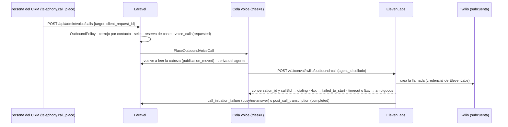

# ULTRON STUDIO · Hito 8 (voz y telefonía): contrato — CONGELADO el 03-11-2026 (paso 0 del lead; decisiones del propietario pendientes de confirmación, abajo)

**Estado: BORRADOR para que el lead lo congele.** Nada de esto rige hasta congelarlo. **Fecha:** 03-11-2026. **Base:** rama `feat/ultron-studio-h8-voice` en los dos repos (backend `cfcd0d1`, CRM `73dbcd3`, los dos = producción). **Auditoría de partida:** `ULTRON_STUDIO_H8_VOICE_AUDIT.md` (las citas `ruta:línea` están allí). **Forma:** la del contrato del H7, más las decisiones de arquitectura que este hito necesita.

**Marcas:**
- **[P-n]**: decisión del propietario (la lista, al final). Las marcadas **antes de implementar** cambian el código; las demás, solo una fase.
- **[C-An]**: condición de la opción A que se comprueba en la fase 2 o 3 con la cuenta real (auditoría §e).
- **[por confirmar]**: no verificado en la documentación oficial del 03-11-2026.

## Objetivo

**Una sola autoridad sobre lo que dice y hace la voz: el Studio.**
- Una **versión aprobada** del Studio y un **perfil de voz aprobado** se compilan, en Laravel, en un **agente de ElevenLabs inmutable**, con su hash y en una cadena firmada propia.
- Laravel es la **única puerta de las salientes**, la **puerta de las entrantes** y la **autoridad de las restricciones críticas**.
- **Cada llamada queda sellada** con la versión, el hash y la identidad del agente.
- **No es un segundo agente comercial:**
  - no hay reglas, textos ni configuraciones de voz que vivan fuera del Studio;
  - el panel de ElevenLabs no es una vía de cambio: un cambio allí es **deriva**;
  - ULTRON de WhatsApp no se toca.

**Dentro del H8:**
- la integración nativa Twilio–ElevenLabs gobernada por Laravel;
- entrantes en canario y salientes autorizadas, a canarios (4a) y a contactos con consentimiento de voz (4b, ver [P-20]);
- transferencias, límites, costes y conciliación;
- el laboratorio hablado (en el navegador, sin teléfono);
- la sección «Voz y telefonía» del CRM;
- el despliegue por fases con todo apagado.

**Fuera del H8:**
- abrir el número al público («todas» en entrantes);
- llamadas por lotes (*batch calls* de ElevenLabs);
- Custom LLM servido por Laravel;
- voz en WhatsApp e integración de WhatsApp de ElevenLabs;
- T2 del motor de WhatsApp;
- cualquier cambio en el motor;
- grabaciones (salvo [P-7]).

## Protecciones intocables (no se retiran en este hito)

1. **Todo apagado por defecto.** `ELEVENLABS_ENABLED=false`, `TWILIO_VOICE_ENABLED=false`, `TWILIO_VOICE_DAILY_CALL_CAP=0` y todas las variables nuevas `VOICE_*` y `ULTRON_STUDIO_VOICE_*` en `false` o `0`. Solo `true`, `1`, `on` o `yes` encienden (el mismo `filter_var` que `config/voice.php:41`).
2. **`VoiceCallPolicy::CALLS_ENABLED_IN_CODE = false`** (`app/Services/Voice/VoiceCallPolicy.php:23`):
   - Literal, una vez, vigilada por `VoiceIsolationTest.php:117-122`.
   - Se gira **solo** en un commit de una línea, `voice(calls-open): …`, con la autorización escrita del propietario citada en el mensaje. Se despliega en la fase 3.
   - **Nunca se gira en el árbol compartido para probar:** el banco aplica el giro en una copia del árbol (como las mutaciones del H4–H7).
3. **Ninguna llamada real en desarrollo ni en el banco:**
   - simuladores de Twilio y de ElevenLabs en `127.0.0.1`;
   - `Http::preventStrayRequests()` en toda prueba con red;
   - hosts oficiales fijos en `production`, y en `production` se ignoran las bases configurables (como `ElevenLabsConfig.php:110-120` y `TwilioReadOnlyClient.php:63-65`).
4. **OTP intacto:**
   - puerta de diff vacía en `app/Services/Sms/**`, `app/Services/Otp/**`, `config/otp.php`, `app/Http/Controllers/Api/TwilioUsageTriggerController.php` y `routes/api.php`;
   - la voz no lee `otp.*` y el OTP no lee `voice.*` (prueba estática en las dos direcciones).
5. **Motor de WhatsApp intacto:**
   - puerta de diff vacía en `app/Services/Marketing/**`, los `app/Jobs/**` existentes, `app/Http/Controllers/Api/Internal/**`, `routes/marketing.php`, `config/marketing.php` y las migraciones de `marketing_*`;
   - `marketing_calls` no se toca ni es origen de un marcador (`VoiceCallContext.php:36-37`);
   - las dos únicas lecturas del motor desde la telefonía son de solo lectura y van por adaptadores enumerados (D8-2): `OutboundContentGuard::inspect()` y las señales `do_not_contact` y `consent_status = denied` del lead.
6. **Meta en solo lectura.** Nunca se importa el número de WhatsApp (coexistencia) y nunca se usa la integración de WhatsApp de ElevenLabs.
7. **Legacy intacto:**
   - la cadena `ultron_studio_publications` y `UltronPublishedConfig` no cambian;
   - la voz no escribe ni lee esa tabla (auditoría §b.1, fila 15);
   - `MARKETING_ULTRON_STUDIO_CONFIG` y `ULTRON_STUDIO_PUBLISHING_ENABLED` no gobiernan la voz.
8. **ElevenLabs sigue en `ELEVENLABS_NOT_CONFIGURED`** hasta que el propietario ponga credenciales en el servidor y `voice:doctor --verify` dé `credentials_ok` (fase 2).
9. **Sin secretos ni teléfonos en claro** en respuestas, libro, eventos, logs, instantáneas ni CRM:
   - el teléfono completo solo se descifra en memoria, en el instante de marcar, y se descarta;
   - las transcripciones no se guardan en Laravel salvo [P-8].
10. **Migraciones aditivas e inertes:**
    - crear las tablas no enciende nada;
    - `down()` se niega con datos y **nunca `migrate:rollback` en producción**;
    - cadena de voz, eventos, consentimientos, exclusiones, consultas al RNE y frenos son de **solo inserción** (`REVOKE UPDATE, DELETE` de `iron_app`, como DB7);
    - la suite de PostgreSQL es obligatoria.
11. **El catálogo `2026-10-19.1` sigue congelado** (`StudioCatalog.php:37`): lo propio de la voz va en el perfil de voz, no en el catálogo.
12. **Sin gasto sin control:**
    - cada vía de gasto, sea una llamada o el laboratorio hablado, tiene **cuatro cerrojos independientes**: la bandera, el driver o alcance, el presupuesto diario mayor que 0 y la credencial presente;
    - se suma una **reserva atómica** contra el techo diario del día de Bogotá.
13. **Producción:** ninguna fase sin orden expresa. La autorización del 25-10-2026 **no cubre** llamadas ni ElevenLabs (`ULTRON_STUDIO_FINAL_REPORT.md:832-844`): cada fase de 2 a 4b pide la suya, por escrito.

## Decisiones de arquitectura

### D8-1 · Integración: opción A (nativa), con salida a B1 para las entrantes

- El número dedicado de la subcuenta de voz se **importa en ElevenLabs** con una API key restringida de esa subcuenta [C-A1].
- **Entrantes:** de Twilio a ElevenLabs, con la puerta del webhook de iniciación de Laravel (D8-11) [C-A2].
- **Salientes:** solo las inicia Laravel, con `POST /v1/convai/twilio/outbound-call` (D8-12).
- **Transferencias:** con la herramienta de sistema `transfer_to_number` en modo conferencia (D8-14).
- **Salida documentada:** si C-A2 no se cumple, las entrantes pasan a «register call» (B1). La interfaz de proveedor (D8-3) no cambia y las salientes siguen en A.
- B2 (Media Streams propios) y C (otro proveedor) quedan descartados (auditoría §e).

### D8-2 · Tres espacios de nombres y sus fronteras

| Espacio | Qué es | Frontera verificable |
|---|---|---|
| `App\Services\Voice` (H6) | Adaptadores de proveedor **neutros y sin estado**: HTTP puro, sin base de datos, log ni caché | `VoiceIsolationTest`, **reescrita por SEC8**:<br>• lista cerrada de ficheros, ampliada solo con los de este contrato;<br>• verbos HTTP solo en los métodos enumerados;<br>• `outbound-call` solo en `ElevenLabsCallStarter`;<br>• hosts fijos en `production`;<br>• secretos solo en los lectores enumerados (D8-5);<br>• sin `UltronStudio`, `App\Services\Marketing` ni `App\Models\` (`VoiceIsolationTest.php:256-265`, que se conserva) |
| `App\Services\Telephony` (nuevo) | Orquestación **con estado**: políticas, puerta de salientes, puerta de entrantes, registro de llamadas y eventos, webhooks, herramientas, coste, conciliación, freno y el lector de la cadena de voz `VoicePublishedConfig` | `TelephonyIsolationTest` (nuevo, SEC8):<br>• no importa `App\Services\UltronStudio` ni `App\Models\UltronStudio`, salvo el modelo de lectura de los canarios de voz (`StudioCanaryNumber`, solo lectura);<br>• del motor, solo los dos adaptadores de la protección 5;<br>• no lee `otp.*` |
| `App\Services\UltronStudio\StudioVoice*` (nuevo) | **Gobierno**: perfil de voz, compilador, cadena de publicaciones de voz, despliegue del agente, evidencia, deriva y laboratorio hablado | De la telefonía solo nombra los adaptadores enumerados (`VoicePublishedConfig::signatureFor()` y las interfaces de D8-3), como `UltronStudioEngineReadOnlyTest` |

### D8-3 · Interfaces de proveedor (no acoplar el motor a ElevenLabs)

El puerto del H6 no cambia (`VoiceAgentProvider.php:20-30`). Se añaden interfaces **segregadas**. Firmas indicativas; B8 las fija al congelar y van al fixture:

```php
namespace App\Services\Voice;

interface VoiceAgentDeployer
{
    /** Crea un agente NUEVO con la carga compilada. Nunca actualiza uno que haya atendido llamadas (D8-7). */
    public function createAgent(VoiceAgentPayload $payload): VoiceDeployResult;      // agentId, observedProjectionHash, outcome
    /** GET: la proyección observada (los campos que controla el compilador), para comparar con la compilada. */
    public function describeAgent(string $agentId): VoiceAgentObservation;
    /** Asigna el número importado al agente que atiende las entrantes. */
    public function assignNumber(string $providerNumberId, ?string $agentId): VoiceDeployResult;  // null = sin agente (voz apagada)
}

interface VoiceCallStarter
{
    /** UNA petición, sin reintentos ni redirecciones. Un tiempo agotado o un 5xx es `ambiguous`, nunca `failed`. */
    public function startOutbound(OutboundCallRequest $request): OutboundCallResult;  // started|rejected|ambiguous|error + conversationId, callSid
}

interface VoiceEventVerifier
{
    /** Firma + sobre → evento neutro. Nunca conserva transcripción ni audio: el llamador recibe solo lo que el contrato enumera. */
    public function verifyPostCall(string $rawBody, ?string $signatureHeader, int $now): VoiceWebhookVerdict;
}

interface VoiceLabSessionIssuer
{
    /** URL firmada de una sesión de navegador (≤ 15 min, auditoría §d.1). La clave nunca sale del servidor. */
    public function signedSessionUrl(string $agentId): VoiceLabSession;
}

interface TelephonyCarrier
{
    /** Corte de emergencia: la llamada a `completed`. Idempotente. */
    public function hangup(string $callSid): CarrierResult;
    /** Conciliación: llamadas de la subcuenta desde $since, una página, solo GET. */
    public function listCalls(\DateTimeInterface $since, ?string $pageToken): CarrierCallsPage;
}
```

- **Implementaciones:**
  - `ElevenLabs\ElevenLabsAgentDeployer`, `ElevenLabsCallStarter`, `ElevenLabsEventVerifier` (envuelve `ElevenLabsWebhookSignature` y `ElevenLabsWebhookEnvelope` sin cambiarlas) y `ElevenLabsLabSessionIssuer`;
  - `App\Services\Twilio\TwilioVoiceCarrier`, que es nueva: no se amplía `TwilioReadOnlyClient`, para no romper su prueba de métodos y pasos;
  - nulos para cada interfaz.
- **DTO neutros**, sin nombres de ElevenLabs: `VoiceAgentSpec`, `VoiceAgentPayload`, `OutboundCallRequest`, `OutboundCallResult` y `VoiceWebhookVerdict`.
- **Rutas de ElevenLabs para crear, leer y asignar agentes y para pedir una URL firmada:** B8 las verifica contra la referencia oficial el día que las implemente y las anota en su informe **[por confirmar: hoy solo están verificadas `outbound-call` y `GET agents/{id}`]**.

### D8-4 · Telefonía separada del OTP

| Aspecto | OTP (no se toca) | Voz (H8) |
|---|---|---|
| Configuración | `config/otp.php` (`otp.twilio.*`) | `config/voice.php` (`voice.twilio.*` y `voice.elevenlabs.*`) |
| Credencial | El Auth Token maestro (`config/otp.php:141-142`) | La **subcuenta** de voz con API keys restringidas (D8-5) |
| Techo | `OtpCostGuard` (`config/otp.php:241-246`) | `Telephony\VoiceCostGuard`, con reserva atómica, día de Bogotá y sus propias variables |
| Interruptor | `TWILIO_SEND_ENABLED` (`config/otp.php:186`) | `VOICE_OUTBOUND_ENABLED` y `VOICE_INBOUND_ENABLED` (D8-11, D8-12) |
| Webhooks | `webhooks/twilio/usage-trigger` (`routes/api.php:632-637`) | Fichero propio **`routes/voice.php`**, montado en `bootstrap/app.php` junto a los de `:36-44` |
| Validador de Twilio | El privado del controlador (T-1) | **`Telephony\TwilioRequestSignature`** (nuevo, puro):<br>• los 6 vectores oficiales, `bodySHA256` y las claves repetidas;<br>• URL = la base canónica configurada + la URI tal como llega, nunca `fullUrl()` |
| Cola | — | Carril propio **`voice`**, con el worker `ironbody-voice`; nunca el del puente de n8n ni `studio-lab` |
| Log | — | Canal `voice`, sin teléfonos ni transcripciones |

### D8-5 · Credenciales de alcance mínimo y número dedicado

- **Las piezas** son las de la auditoría §c.3. En resumen:
  - **Twilio:** la subcuenta «Voz»; una API key restringida **para Laravel** (llamadas: leer, listar y actualizar; números: leer; uso: leer); **otra** para ElevenLabs (lo que exija la importación) [C-A1]; y el **Auth Token de la subcuenta**, solo para validar firmas.
  - **ElevenLabs:** una key acotada con **cupo de créditos**; tres secretos distintos (webhook post-llamada, herramientas e iniciación); y un `agent_id` de verificación, inerte y sin número.
- **Variables nuevas** (`config/voice.php` y el fichero de ejemplo de entorno; nombres indicativos, B8 los fija):
  - `TWILIO_VOICE_ACCOUNT_SID`, `TWILIO_VOICE_API_KEY_SID` y `TWILIO_VOICE_API_KEY_SECRET`;
  - `TWILIO_VOICE_SIGNING_TOKEN` (el Auth Token de la subcuenta, que solo lee `TwilioRequestSignature`);
  - `ELEVENLABS_INITIATION_SECRET`;
  - `VOICE_WEBHOOK_BASE_URL` (la base canónica con la que se calculan las firmas);
  - las banderas y los techos de D8-11, D8-12 y D8-15.
- **Variables que se reutilizan:**
  - `TWILIO_VOICE_FROM` (`config/voice.php:82`): el E.164 del número dedicado;
  - `ELEVENLABS_AGENT_PHONE_NUMBER_ID` (`:60`): el id del número importado. El comentario «integración nativa (descartada)» se corrige.
- **Lectores enumerados de secretos**, cada uno en un fichero y vigilados por la prueba estática:
  - `ElevenLabsVoiceProvider` y los adaptadores de ElevenLabs de D8-3: la key;
  - `ElevenLabsEventVerifier`: el secreto del webhook;
  - `Telephony\VoiceToolAuth`: el de las herramientas;
  - `Telephony\VoiceInitiationAuth`: el de la iniciación;
  - `TwilioVoiceCarrier`: la key de Laravel;
  - `TwilioRequestSignature`: el token de firma.
  - Las huellas de 8 hex de todos salen de un único punto, como `ElevenLabsVoiceProvider.php:126-142`.
- **`ElevenLabsConfig::missing()` no cambia** (`ElevenLabsConfig.php:81-98`). `ELEVENLABS_AGENT_ID` pasa a ser el agente **de verificación**: los agentes de las publicaciones viven en la base de datos (D8-7). Así se conservan los cuatro estados del H6 y su fixture.
- **Un único número en el H8**, en el entorno (sin tabla de números). Si el propietario quiere varios, la tabla llega con su enmienda.
- **Guarda del número de WhatsApp:** si la huella de `TWILIO_VOICE_FROM` coincide con la de `WHATSAPP_DISPLAY_PHONE` o con alguna de `WHATSAPP_PROTECTED_NUMBERS`, la política responde `voice_number_is_whatsapp` y el doctor lo dice por nombre.

### D8-6 · Gobierno: de una versión aprobada a una configuración de ElevenLabs

**Entradas** (las tres obligatorias):
1. Una **versión del Studio aprobada** con cuatro ojos, el flujo del H5 sin cambios. El compilador lee de ella las capas del catálogo congelado (`StudioCatalog.php:254-417`) y sus reglas S-NNN.
2. Un **perfil de voz aprobado** (nuevo: `ultron_studio_voice_profiles`). Es el único sitio donde vive lo propio de la voz, con un conjunto de campos **cerrado**:
   - `voice_id` y el idioma (`es`);
   - el saludo de las entrantes y el de las salientes, y el aviso fijo [P-9];
   - la duración máxima;
   - los destinos de transferencia (alias + E.164 cifrado, como mucho 3);
   - las herramientas activas, un subconjunto del catálogo de D8-10;
   - la privacidad (días de retención y audio apagado);
   - la política de buzón [P-10];
   - los **huecos de texto** de la plantilla, cortos, con `PlainText` estricto, sin cifras monetarias ni datos de contacto.

   El perfil lleva su huella con `StudioContentHasher` y nadie aprueba el que creó (por identidad).
3. La **versión del compilador**: `VoiceAgentCompiler::VERSION = 'ultron-voice-compiler/1'`, una constante del código.

**Salidas:**
- `VoiceAgentSpec`, el JSON canónico **neutro**, con `specHash` (sha256).
- `VoiceAgentPayload`, la carga de ElevenLabs que construye `ElevenLabsAgentMapper` (puro), con `payloadHash`.
- La **proyección**: los campos de la carga que el compilador controla, que es lo que se compara al leer el agente para detectar deriva (ElevenLabs puede añadir valores por defecto).

**Plantilla:**
- Los textos base de la voz viven **en el código**, en una plantilla versionada con el compilador. Los rellenan los huecos del perfil y los parámetros de la versión (persona y estrategia) [P-6].
- Nadie escribe un prompt libre en el CRM.
- Los hechos (planes, horarios, sede y, si [P-3], precios) **no van en el prompt**: salen de las herramientas (R-01).

**El compilador se niega a compilar** (excepción tipada; un 422 con el motivo en la API) si:
- el perfil o la versión no están aprobados, o sus huellas no cuadran;
- un hueco tiene cifras monetarias, vocabulario de descuento (R-02), una URL, un teléfono, un correo o invisibles (la clase `InvisibleCharacters` del H7);
- hay una herramienta fuera del catálogo, una herramienta de sistema distinta de `end_call` y `transfer_to_number`, o falta `end_call`;
- hay un destino de transferencia fuera del perfil (R-07: derivar solo por la herramienta y a destinos aprobados);
- la duración supera `VOICE_PER_CALL_MAX_SECONDS`, la grabación está encendida sin [P-7] o la retención supera [P-8];
- falta el aviso [P-9].

### D8-7 · Un agente inmutable por publicación

- **Publicar una versión de voz:**
  1. compilar;
  2. `createAgent` (un **agente nuevo**);
  3. `describeAgent`: la proyección observada tiene que ser igual a la compilada; si no, se aborta sin publicar y el agente queda marcado `rejected`;
  4. fijar en el agente `call_limits` (diario = el techo de D8-15, concurrencia = `VOICE_MAX_CONCURRENT_CALLS`, ráfaga apagada), la retención y el audio apagado;
  5. si la parte publicada atiende entrantes, `assignNumber`;
  6. insertar la entrada firmada en la cadena de voz (D8-8).
- **Nunca se modifica un agente que haya atendido llamadas.** Los anteriores quedan para la auditoría, con una etiqueta de retirados.
- **Por qué no el versionado de ElevenLabs** [P-2]:
  - activarlo es **irreversible**;
  - no está documentado ni fijar una conversación a un `version_id` ni qué pasa con las llamadas en curso;
  - `call_limits` y `privacy` quedan fuera de él (auditoría §d.1).

  Un agente por publicación da la no retroactividad **por construcción** y deja el versionado nativo como opción futura.
- **El laboratorio hablado** compila **agentes de laboratorio**: misma compilación, sin número y con `purpose = lab`, y nunca se usan para llamadas.

### D8-8 · La cadena de voz y el sello de cada llamada

**Cadena propia** `ultron_studio_voice_publications`, de solo inserción. Copia el patrón del H5 **sin compartir su tabla** (auditoría §b.1, fila 15):
- `seq` es la cabeza + 1, encadenada (como `uspub_chain_next` de DB7), con `CHECK (seq >= 1)` y `REVOKE UPDATE, DELETE`.
- `effective_json` es el JSON canónico de `{contract: "ultron-voice-config/1", seq, entry, issuedAt, canary, rest}`, como mucho 16 384 caracteres.
- Cada parte (`canary` o `rest`), si existe, lleva: `{studioVersionUuid, studioContentHash, voiceProfileUuid, voiceProfileHash, specHash, payloadHash, compilerVersion, provider, providerAgentId, approvedBy, publishedBy}`.
- La firma es HMAC-SHA256 con una subclave de la `APP_KEY` de etiqueta **`ultron-studio-voice-publication`**, distinta de `ultron-studio-publication` (`UltronPublishedConfig.php:110`): una firma no vale en el otro dominio.
- **Implementación única** en `Telephony\VoicePublishedConfig::signatureFor()`. El Studio la recibe como `Closure`, igual que el H5.

**Lector** `Telephony\VoicePublishedConfig`: una sentencia (la cabeza), verificación en bytes y decodificación estricta, y **nunca lanza**. A diferencia del motor, **un fallo deniega**: `publication_unreadable` es un motivo de la política y no hay llamada. La voz, a diferencia de la declaración del H5, sí cambia lo que se dice.

**Sello** (columnas de `voice_calls`, escritas **al empezar**: la saliente al pedirla, la entrante en el webhook de iniciación):
- la publicación: `voice_publication_seq`, `part` (`canary` o `rest`) y `stamp_state` (`applied`, `off` o `fallback`);
- la versión y el perfil: `studio_version_uuid`, `studio_content_hash`, `voice_profile_hash`;
- la compilación: `spec_hash`, `payload_hash`, `compiler_version`;
- el proveedor: `provider` y `provider_agent_id`.

**Después** (webhook post-llamada): `observed_agent_id`, `observed_version_id`, `observed_branch_id` y `seal_verified` (el agente observado coincide con el sellado). Si no coincide, el evento es `seal_mismatch` y se acciona el freno (D8-19).

### D8-9 · No retroactividad

- Una llamada usa el agente con el que empezó. El sello se toma al empezar, y el agente sellado no cambia nunca (D8-7).
- **Revertir** es insertar una entrada que apunta al agente anterior, que sigue existiendo, y reasignar el número. Las llamadas en curso no se enteran.
- **Una saliente pedida y todavía no marcada** vuelve a leer la cabeza en el job: si `seq` cambió, se cancela con `publication_moved`, sin llamar. Es conservador a propósito.

### D8-10 · Restricciones críticas: viven en Laravel, en cuatro capas

1. **Al compilar:** D8-6.
2. **En las herramientas** (`POST /api/voice/tools/{tool}`, catálogo **cerrado** en el H8):
   - `consultar_planes`: nombres y condiciones del catálogo vigente y, solo si [P-3], el precio exacto de la base, nunca calculado ni rebajado;
   - `consultar_horarios`: la sede y el horario;
   - `solicitar_humano`: dice si hay transferencia disponible ahora (personal en horario) y el **alias** del destino;
   - `no_volver_a_llamar`: crea una exclusión inmediata para el número que llama o al que se llamó. Es la revocación oral de la Ley 2300, y no necesita confirmación del LLM para surtir efecto.

   No hay herramientas de cobro, enlace de pago, descuento, activación de membresía ni agenda. Cada petición:
   - autentica (`hash_equals` sobre el Bearer y, si [P-26], la lista de IP de salida de ElevenLabs);
   - valida el esquema;
   - **comprueba la llamada**: el `conversation_id` (o el `call_sid`) existe en `voice_calls`, está `active`, no hay freno, el autorizado es el sellado y el cupo por llamada sigue vivo (como mucho 20 peticiones por llamada).

   El LLM no puede hacer que la herramienta salga de su catálogo ni de su llamada [C-A3].
3. **En la puerta de salientes:** D8-12.
4. **Después de la llamada:**
   - el `post_call_transcription` se recorre **en memoria**;
   - cada turno del agente pasa por `OutboundContentGuard::inspect()` (`app/Services/Marketing/OutboundContentGuard.php:577`) a través de un adaptador de solo lectura (S8 y SEC8 confirman que es pura);
   - se añaden las comprobaciones propias de la voz: el aviso en el primer turno, cifras monetarias si [P-3] = no, y transferencias a destinos no aprobados (imposibles por configuración, pero comprobadas);
   - se guarda **solo el veredicto** (códigos y número de turno), nunca el texto;
   - una violación acciona el freno (D8-19).

### D8-11 · Entrantes

```mermaid
sequenceDiagram
  participant P as Persona que llama
  participant T as Twilio (subcuenta)
  participant E as ElevenLabs (agente de la publicación)
  participant L as Laravel
  P->>T: llama al número dedicado
  T->>E: número importado (integración nativa)
  E->>L: POST /api/webhooks/voice/elevenlabs/initiation (secreto en cabecera)
  L->>L: InboundPolicy · sello · voice_calls(active, idempotente por call_sid)
  L-->>E: dynamic_variables {caller_authorized, call_ref, version_label}
  E->>P: aviso de IA y saludo; si no autorizado: «línea no disponible» + end_call
  E->>L: POST /api/voice/tools/{tool} (Bearer) durante la llamada
  E->>L: POST /api/webhooks/voice/elevenlabs/post-call (HMAC)
  L->>L: guarda posterior · seal_verified · coste · freno si procede
```

- **`InboundPolicy`** (pura), en orden:
  - `inbound_disabled` (`VOICE_INBOUND_ENABLED=false`) y `calls_disabled_in_code`;
  - `voice_braked`, `no_publication` y `publication_unreadable`;
  - el alcance (`VOICE_INBOUND_SCOPE=canary`, el único en el H8): `not_an_active_voice_canary`, que compara la huella del que llama con los canarios de voz `active` (`StudioCanaryNumbers`, solo lectura; es el «T3 de voz», con autorización expresa);
  - `concurrency_exceeded` y `daily_cap_reached` (el de entrantes, [P-5]).
- **La respuesta nunca lleva datos personales.** Solo `caller_authorized` (`si`/`no`), `call_ref` (un uuid opaco) y `version_label`.
- **Sin `conversation_config_override`:** las sobrescrituras quedan desactivadas en la pestaña «Security» del agente. El agente se compila con el valor por defecto **`caller_authorized = no`**: si el webhook falla y ElevenLabs sigue con los valores por defecto, el agente dice «línea no disponible» y cuelga, y además ninguna herramienta responde [C-A2]. **[Por confirmar]** que el agente admite valores por defecto en las variables dinámicas; la página de hoy solo dice que la respuesta tiene que traerlas todas.
- **Presupuesto:** p95 < 300 ms y ninguna petición saliente en esta ruta (PERF8).
- **Fuera del horario del personal** se atiende, pero no se ofrece transferencia (D8-14).

### D8-12 · Salientes: una sola puerta



- **`OutboundPolicy`** compone `VoiceCallPolicy::decide()` (las puertas del proveedor y del código, del H6) con las de la telefonía. Los motivos son un conjunto cerrado, en este orden:
  - el código y el proveedor: `calls_disabled_in_code`, `outbound_disabled`, `twilio_voice_disabled`, `no_voice_number`, `voice_number_is_whatsapp`, los tres estados de ElevenLabs (`VERIFIED` exige una verificación `ok` de menos de 30 días: OPS8 la programa cada semana mientras la voz esté encendida);
  - la publicación: `no_publication`, `publication_unreadable`, `agent_drift` y `voice_braked`;
  - el destino: `source_not_allowed`, `not_an_active_voice_canary` (alcance `canary`), `contact_not_authorized`, `no_voice_consent`, `excluded` y `rne_check_missing` (alcance `contacts`, [P-20]);
  - el calendario: `outside_hours` y `holiday`;
  - los cupos: `frequency_exceeded`, `concurrency_exceeded`, `daily_cap_zero`, `daily_cap_reached` y `budget_exhausted`;
  - `duplicate_request`.
- **El origen `voice_contacts`** se añade a `VoiceCallContext::SOURCES` como permitido. Es un cambio deliberado del conjunto cerrado del H6, con su fixture. `marketing_calls` sigue prohibido.
- **Idempotencia:**
  - `client_request_id` (UNIQUE por persona) → `duplicate_request` con la misma fila;
  - cerrojo consultivo por la huella del destino en la transacción, para que no haya dos solicitudes vivas al mismo número;
  - UNIQUE en `provider_conversation_id` y en `provider_call_sid`.
- **Job:** `tries = 1`, sin `retry()`, con un plazo de 30 s. **Un resultado `ambiguous` no se reintenta:** la conciliación (Twilio por GET y la conversación de ElevenLabs) lo resuelve antes de cualquier reintento manual.
- **Petición a ElevenLabs:**
  - `agent_id` sellado, `agent_phone_number_id` y `to_number` descifrado en memoria;
  - `conversation_initiation_client_data.dynamic_variables = {caller_authorized: "si", call_ref}` y `user_id = call_ref`;
  - `telephony_call_config.ringing_timeout_secs` [P-10], `call_recording_enabled = false`, `twilio_call_recording_enabled = false` y `twilio_machine_detection` según [P-10].
- **Reintentos de negocio** (no contestó o comunicando): solo como **filas nuevas** (`attempt`, `parent_call_id`), pedidas por una persona o programadas por la política, dentro de 1 al día y [P-11]. Nunca los decide el job.

### D8-13 · Estados y eventos (conjuntos cerrados)

**`voice_calls.status`:**

| Estado | Cuándo |
|---|---|
| `requested` | Saliente aceptada por la política y en la cola |
| `canceled` | Antes de marcar: política, publicación movida, freno o corte |
| `failed_to_start` | ElevenLabs la rechazó (4xx); la reserva se libera |
| `ambiguous` | Tiempo agotado, 5xx o sin conexión al iniciarla; se resuelve conciliando |
| `dialing` | ElevenLabs devolvió `conversation_id` y `callSid` |
| `active` | Entrante aceptada en la iniciación |
| `completed` | `post_call_transcription` con duración |
| `busy` | `call_initiation_failure` = `busy` |
| `no_answer` | `call_initiation_failure` = `no-answer` |
| `failed` | `call_initiation_failure` = `unknown` u otro fallo final |
| `hung_up` | Corte de emergencia (D8-20) |

**Transiciones:** solo hacia delante, con un disparador en PostgreSQL (DB8). Un estado final no cambia.

**`voice_call_events`** (solo inserción; UNIQUE `(provider, kind, provider_event_key)` para deduplicar):
- `outbound_requested`, `outbound_started`, `outbound_rejected`, `outbound_ambiguous` e `initiation_received`;
- `post_call_transcription`, `post_call_audio_discarded` y `call_initiation_failure`;
- `tool_call` (solo el nombre y el veredicto), `guard_verdict` y `hangup_requested`;
- `reconciled`, `seal_mismatch`, `cost_recorded` y `unknown_provider_call`.

### D8-14 · Transferencias

- `transfer_to_number` en modo **conferencia**, con los destinos **fijos del perfil aprobado**: como mucho 3, con alias, cifrados en la base y en claro solo dentro de la carga compilada. El mensaje al operador (transferencia asistida) es nativo [P-12].
- `solicitar_humano` (D8-10) dice si hay personal en el horario de transferencia. El agente solo transfiere si la respuesta es sí; eso es blando. Que el destino sea fijo es duro, porque el LLM no puede elegir otro número.
- El tramo transferido se paga (saliente de Twilio al destino) y entra en la reserva de coste.
- La transferencia ciega y SIP REFER no se usan en el H8.

### D8-15 · Límites

| Límite | Dónde se aplica | Defecto |
|---|---|---|
| Duración por llamada | `max_duration_seconds` del agente (60–7 200, auditoría §d.1) = el del perfil, ≤ `VOICE_PER_CALL_MAX_SECONDS` | 300 s, con recorte a 60–600 [C-A5] |
| Concurrencia | Laravel cuenta `dialing` + `active`, y ElevenLabs `agent_concurrency_limit`; ráfaga apagada | `VOICE_MAX_CONCURRENT_CALLS=1` (recorte 1–4) |
| Salientes al día | `TWILIO_VOICE_DAILY_CALL_CAP` (`config/voice.php:85`, 0–20) | 0 |
| Entrantes al día | `VOICE_INBOUND_DAILY_CAP` + `daily_limit` del agente = salientes + entrantes | 0 [P-5] |
| Gasto al día | `VOICE_DAILY_BUDGET_USD`. Reserva = minutos máximos × (ElevenLabs + Twilio según el destino + Media Streams), con los precios oficiales en la configuración y su fecha; el real llega del webhook (`metadata.cost`, unidades **[por confirmar]**) y de la conciliación de Twilio | 0 |
| Frecuencia por contacto | 1 al día (Ley 2300, art. 3) e intentos por semana [P-11] | 1 al día |
| Horario de salientes | De lunes a viernes de 07:00 a 19:00 y sábados de 08:00 a 15:00 (Bogotá); ni domingos ni festivos; más estricto si [P-13] | El legal |
| Festivos | `Telephony\ColombianHolidays`, pura: Ley 51 de 1983 y los móviles de Pascua; el fixture de 2026–2028 lo aprueba el propietario | — |

### D8-16 · Webhooks y autenticación

| Ruta (pública, sin sesión, fuera de `/api/admin`) | Autenticación | Reglas |
|---|---|---|
| `POST /api/webhooks/voice/elevenlabs/post-call` | `ElevenLabs-Signature` con `ElevenLabsWebhookSignature::verify` (sin cambios: 1 800 s hacia atrás y 300 hacia delante) sobre el **cuerpo crudo** | Tope de cuerpo de 1 MB. **El envío de audio se apaga** en el workspace y en el agente; si llega un `post_call_audio`, 200 y se descarta (evento `post_call_audio_discarded`). Duplicado → 200. Tipo desconocido válido → 200 y se ignora. Firma mala → 401. Un fallo propio (de la base) → 5xx para que ElevenLabs reintente. **Nunca un 4xx en bucle**: tras 10 fallos se desactiva solo (auditoría §d.1) |
| `POST /api/webhooks/voice/elevenlabs/initiation` | Secreto en una cabecera fija, con `hash_equals` | Tope de 8 KB y p95 < 300 ms; sin red saliente |
| `POST /api/voice/tools/{tool}` (`{tool}` en una lista cerrada) | Bearer `ELEVENLABS_TOOL_SECRET`, con `hash_equals` | Tope de 8 KB; esquema por herramienta; comprobación de la llamada (D8-10); 20 por llamada |
| `POST /api/webhooks/voice/twilio/usage-trigger` | `X-Twilio-Signature` con `TwilioRequestSignature` y el token de la subcuenta | Idempotencia por `IdempotencyToken`. **Se persiste** como evento (a diferencia del OTP, que solo registra) y puede accionar el freno por coste |

- Las IP de salida estáticas de ElevenLabs, como lista de permitidos en nginx o en Laravel [P-26]: un refuerzo, nunca un sustituto de la firma.
- Twilio no publica rangos de IP (auditoría §d.2): para Twilio, solo la firma.
- Todas las rutas van con `LimitRequestBodySize` y su limitador, y se clasifican en `AuthorizationMap` como públicas con la razón escrita.

### D8-17 · Datos personales (Ley 1581)

- **Teléfonos:**
  - `voice_calls` guarda `remote_hash` (HMAC con su propia subclave de la `APP_KEY`, etiqueta `voice-phone`) y `remote_last4`, **nunca el número**;
  - para marcar, el número cifrado sale del registro de canarios (`phone_encrypted`) o de `voice_contacts`, y se descifra solo en memoria.
- **Grabación:** apagada (`call_recording_enabled = false` y `twilio_call_recording_enabled = false`) [P-7].
- **Transcripciones:** Laravel **no las guarda**; las recorre en memoria para la guarda y las descarta [P-8]. En ElevenLabs, retención de [P-8] días (se recomiendan 30) y el audio guardado apagado.
- **Laboratorio hablado:** la misma retención. Los escenarios son sintéticos, pero la voz de quien prueba es un dato personal.
- **Aviso al empezar cada llamada** (fijo y compilado) [P-9]: que atiende un asistente virtual de Iron Body, la finalidad y cómo pedir no recibir más llamadas (la herramienta `no_volver_a_llamar`).
- **Supresión:**
  - `ops/supresion-1581.sql` gana su sección de voz (OPS8): huellas por un marcador, últimos dígitos a `0000`, cifrados a NULL y textos a «[suprimido]», con el rol dueño y en seco primero;
  - el borrado de las conversaciones en ElevenLabs entra en el procedimiento **[por confirmar el endpoint]**.
- **Encargados del tratamiento** (ElevenLabs y Twilio): contrato de transmisión y región [P-21]; la evaluación es de asesoría legal.

### D8-18 · Consentimiento, exclusiones y horarios (salientes en Colombia)

- **`voice_contacts`** (alcance `contacts`, fase 4b):
  - el teléfono cifrado, su huella y los 4 últimos dígitos;
  - el origen (`lead`, `member` o `manual`) con su id, como referencia sin FK al motor;
  - el estado.
- **`voice_consents`** (solo inserción):
  - `kind` (`granted` o `revoked`), `channel = voice_call` y `purpose = commercial`;
  - `source`, en una lista cerrada: `written_form`, `recorded_inbound_request` (si [P-7] lo permite) o `admin_with_evidence`;
  - `evidence` (≤ 300 caracteres, `PlainText` estricto, sin teléfonos);
  - la identidad del actor y la fecha.

  `admin_with_evidence` exige cuatro ojos [P-18]. El consentimiento de WhatsApp **no vale** para la voz: la Ley 2300, art. 2, pide canales autorizados.
- **`voice_exclusions`** (solo inserción, por huella del teléfono):
  - `source`: `rne`, `spoken_opt_out` (la herramienta), `lead_do_not_contact`, `lead_consent_denied` o `admin`;
  - se consulta **antes de cada saliente**, y solo la quita el procedimiento de supresión.
- **`voice_rne_checks`** (solo inserción): la huella, `checked_at`, el resultado, la referencia de la evidencia y el actor. La vigencia es [P-14]. El mecanismo es manual (el portal de la CRC) hasta que se confirme una API.
- **Señales del lead**, en solo lectura y por un adaptador enumerado: `marketing_leads.do_not_contact` o `consent_status = denied` del lead de origen dan `excluded`. No se escribe nada en el motor.
- **Regla semanal entre canales** (WhatsApp y voz): según [P-15], con asesoría legal. Si aplica, la política lee el último contacto proactivo de WhatsApp por un adaptador enumerado más.

### D8-19 · Canario de voz y freno

- **Canario de voz:** los números de `ultron_studio_canary_numbers` con `channel = voice` y `status = active` (cuatro ojos del H6). Exige la fase 2 del H6 (escrituras encendidas y dos personas) y la autorización expresa del «T3 de voz».
- **Publicar** siempre empieza en la parte `canary`, que atiende las entrantes de los canarios y las salientes 4a. **Promover** a `rest` exige evidencia medida en el servidor [P-16]:
  - al menos 24 h y N llamadas selladas con esa publicación;
  - 0 violaciones de la guarda, 0 `seal_mismatch` y 0 deriva;
  - coste dentro del presupuesto;
  - un veredicto `approved` del laboratorio hablado, de otra identidad.

  Es la misma ventana de publicación del H5 [P-25] y nadie publica ni promueve lo que creó.
- **Freno de voz** (`voice_brakes`, solo inserción) [P-17]. Lo abren solos:
  - una violación de la guarda;
  - un `seal_mismatch`;
  - la deriva del agente;
  - el techo duro de gasto o un aviso de la subcuenta;
  - una `unknown_provider_call` (una llamada en Twilio sin su fila).

  Con el freno abierto, las salientes dan 409 `voice_braked` y las entrantes, `caller_authorized = no`. **Solo lo suelta una persona** con `ultron.voice_publish`, con una nota, y el libro lo registra. Nunca se suelta solo. Abrirlo genera un incidente de IRON GUARD (el mecanismo del monitor del H7).

### D8-20 · Vuelta atrás por niveles

| Nivel | Qué | Efecto | Requiere |
|---|---|---|---|
| 0 | `VOICE_OUTBOUND_ENABLED=false` y/o `VOICE_INBOUND_ENABLED=false` + caché (como `www-data`, `umask 077`, `chmod 600`) | Ninguna llamada nueva; las entrantes oyen «no disponible» | El mando `h8-voice-scope.sh` (OPS8) |
| 0b | **Corte de llamadas activas**: `php artisan voice:hangup --all --confirm` (Twilio, la llamada a `completed`, con la key de Laravel) | Cuelga las `dialing` y `active` | — |
| 1 | **Revertir** la publicación de voz: una entrada que apunta al agente anterior y la reasignación del número | Las llamadas nuevas, con la versión anterior | `ultron.voice_publish`, siempre (sin ventana) |
| 2 | **Voz apagada:** una entrada sin agente y el número sin asignar; `ELEVENLABS_ENABLED=false` | No atiende nadie | Ídem |
| 3 | En los proveedores: revocar la key de ElevenLabs y las de Twilio, suspender la subcuenta (consola) y quitar la importación del número | La voz queda físicamente muerta | El propietario |
| 4 | Código: desplegar el commit anterior. Las tablas quedan; `down()` se niega | — | Orden del propietario |

### D8-21 · Deriva y monitor

Tareas tras la bandera del monitor y la de la voz. OPS8 las programa en `routes/console.php`:
- **Deriva del agente:** `describeAgent` de cada agente vivo; la proyección observada frente a la compilada. Se mira también en el job de cada saliente, con una caché de como mucho 5 min [PERF8].
- **Salud del webhook:** la última entrega buena.
- **Conciliación:** las llamadas de la subcuenta en Twilio frente a `voice_calls`. Una sin su fila es `unknown_provider_call`; resuelve las `ambiguous` y registra el precio real.
- **Atascadas:** `dialing` con más de 10 min.
- **El coste** frente al techo.
- **Verificación semanal** de ElevenLabs (mantiene `VERIFIED`).
- **Expectativas del monitor por fase:** `config/ultron_studio.php:282` y `ULTRON_STUDIO_MONITOR_EXPECT`. Los estados `twilio_voice:connected_voice` y `elevenlabs:ELEVENLABS_VERIFIED` son nuevos en los conjuntos cerrados de `StudioIntegrations.php:43-48`.

### D8-22 · Permisos (RBAC) [P-18]

| Llave | Qué permite | Por defecto |
|---|---|---|
| `ultron.voice_manage` | Editar el perfil de voz y enviarlo a revisión; previsualizar la compilación | Super Admin y Administrador |
| `ultron.approve` (existente) | Aprobar o rechazar un perfil de voz ajeno, y el veredicto del laboratorio hablado ajeno | Como hoy |
| `ultron.voice_publish` | Publicar, promover, revertir y apagar la voz; soltar el freno | **Solo Super Admin** |
| `ultron.voice_lab_run` | Abrir sesiones del laboratorio hablado (gasta) | **Solo Super Admin** |
| `telephony.view` | Registro de llamadas sin datos personales, métricas y costes | Super Admin y Administrador |
| `telephony.call_place` | Pedir una saliente autorizada; colgar una llamada | **Solo Super Admin** |
| `telephony.contacts_manage` | Contactos, consentimientos, exclusiones y consultas al RNE | **Solo Super Admin** |

- El dominio `telephony` se añade a `SHARED_TOKEN_EXCLUDED_DOMAINS` (`CrmPermission.php:237`): una automatización no llama.
- Cada ruta, una por una, en `AuthorizationMap` (denegar por defecto), y además exige una persona.
- Nadie aprueba lo que creó ni suelta un freno que abrió su propia acción **[por decidir]**.

### D8-23 · Laboratorio hablado

- **Nivel 1:** texto (el H4, que ya existe).
- **Nivel 2:** voz en el navegador, **sin teléfono**, contra un **agente de laboratorio** compilado desde una versión y un perfil enviados o aprobados:
  - URL firmada de ElevenLabs (≤ 15 min) emitida por Laravel;
  - en el CRM, el cliente oficial de ElevenLabs con la **versión exacta** fijada (revisión de la cadena de suministro por SEC8);
  - CSP `connect-src` hacia los hosts de ElevenLabs y permiso de micrófono **[por confirmar los hosts, WebRTC incluido]**.
- **Nivel 3:** la llamada física a un canario (fases 3 y 4), con su guía en `ULTRON_STUDIO_PRUEBAS_FISICAS.md`.
- **Cuatro cerrojos:**
  - `ULTRON_STUDIO_VOICE_LAB_ENABLED=false`;
  - `ULTRON_STUDIO_VOICE_LAB_DRIVER=fake`: el simulador, sin ElevenLabs;
  - `ULTRON_STUDIO_VOICE_LAB_DAILY_BUDGET_USD=0`;
  - la key presente y verificada.

  Además: como mucho 5 min por sesión, un cupo de sesiones al día y por persona, y una reserva atómica como el H4.
- **Historial y métricas:** quién, qué versión y perfil, qué agente, la duración, el coste, los códigos de la guarda y el veredicto de **otra** identidad (`approved` o `rejected`).
- **Puerta de publicación:** `required` por defecto; solo el propietario la dispensa (`waived`) y queda escrito en la entrada [P-19].

## Contratos de datos (esquema mínimo; DB8 lo refina y lo congela con el lead)

| Tabla | Tipo | Claves y restricciones mínimas |
|---|---|---|
| `ultron_studio_voice_profiles` | Estados `draft` → `submitted` → `approved` / `rejected`; una fila por revisión, sin editar la aprobada | `content_hash`; `CHECK approved_by <> created_by` por identidad; destinos cifrados |
| `ultron_studio_voice_agents` | Artefacto compilado y desplegado | `provider_agent_id` UNIQUE; `purpose` (`lab` o `publication`); `spec_hash`, `payload_hash`, `compiler_version`, `observed_hash` y `status` |
| `ultron_studio_voice_publications` | **Cadena de solo inserción** | Disparador «cabeza + 1 encadenada», `CHECK (seq >= 1)` y `REVOKE UPDATE, DELETE` |
| `ultron_studio_voice_lab_sessions` | Sesiones y veredictos | Veredicto de una identidad distinta de la autora; inmutable |
| `voice_calls` | Una fila por llamada, con el sello | UNIQUE en `client_request_id` (por persona), `provider_conversation_id` y `provider_call_sid`; `status` cerrado con transiciones hacia delante; huella y 4 dígitos, sin el número |
| `voice_call_events` | Solo inserción | UNIQUE `(provider, kind, provider_event_key)`; sin texto de transcripción |
| `voice_contacts`, `voice_consents`, `voice_exclusions`, `voice_rne_checks` | Registro de la fase 4b; las tres últimas, de solo inserción | Huellas con su subclave; cifrado del teléfono solo en `voice_contacts` |
| `voice_brakes` | Abrir y soltar, cada cosa una vez | Disparador «se suelta una vez»; quien suelta, con su identidad |

**Migración de datos: ninguna.** Todo es nuevo. El registro de canarios del H6 se lee y no se migra.

## API (borrador; el lead fija la lista y la numeración)

**Studio** (añadidas a `routes/ultron-studio.php`, con el tope de 64 KB y `AuthorizationMap`):
- `GET integrations/voice` (la ruta 45, con el DTO ampliado).
- Perfiles: `GET voice/profiles`, `GET voice/profiles/{uuid}`, `POST voice/profiles`, `POST voice/profiles/{uuid}/submit`, `/approve` y `/reject`.
- `POST voice/compile-preview` (sin red, en el cubo de lectura).
- Publicaciones: `GET voice/publications`, `POST voice/publish`, `/promote`, `/rollback` y `/off`, y `GET voice/canary-evidence`.
- Frenos: `GET voice/brakes` y `POST voice/brakes/{uuid}/release`.
- Laboratorio: `GET voice-lab/status`, `GET voice-lab/sessions`, `POST voice-lab/sessions` (gasta; con su limitador), `POST voice-lab/sessions/{uuid}/end` y `/verdict`.

**Telefonía** (`routes/voice.php`):
- CRM, en `/api/admin/voice/*`:
  - `GET status`, `GET calls` (paginada y sin datos personales), `GET calls/{uuid}` y `GET metrics`;
  - `POST calls` (la puerta de salientes) y `POST calls/{uuid}/hangup`;
  - `GET contacts`, `POST contacts`, `POST contacts/{uuid}/consents`, `POST contacts/{uuid}/revoke`, `POST exclusions` y `POST rne-checks`.
- Públicas: las 4 de D8-16.

En total, unas 36 rutas nuevas. Con [P-20] = diferir la fase 4b, salen 5: `POST exclusions` y la tabla `voice_exclusions` se quedan, porque las usa `no_volver_a_llamar`.

## Impacto: contratos que cambian (para que nadie los cambie por la puerta de atrás)

| Contrato | Cambio | Consumidores | Quién lo cambia |
|---|---|---|---|
| `VoiceIsolationTest` y `VoiceBoundaryTest` (H6) | Las fronteras se reescriben con la lista de este contrato: ficheros, verbos, rutas y lectores | Las suites del H6 | **SEC8**, nunca quien implementa |
| `VoiceCallContext::SOURCES` y `VoiceCallPolicy` (H6) | Origen `voice_contacts` permitido; los motivos nuevos van en `OutboundPolicy` e `InboundPolicy`, no en la del H6 | Fixture `voiceCallPolicy` (24 casos), la ruta 45 y el CRM (`voicePolicyReasonText`) | B8 + TEST8 (fixture) |
| `StudioIntegrations::PROVIDER_CLASSIFICATIONS` (`:43-48`) | `twilio_voice` gana `connected_voice`; `elevenlabs` usa `ELEVENLABS_VERIFIED` como esperado | `integrations-doctor --expect`, el monitor, el fixture `integrations-cases.json` y `studio-integrations-parse.ts` | S8 + FE8 + TEST8 |
| `StudioIntegrationConfig::voiceFactsFrom` (`:209`) | Hechos nuevos: la subcuenta, las referencias de las keys, el número y las huellas de los secretos nuevos | La huella autorizada: **hay que reconocerla otra vez** en la fase 2 | S8 |
| DTO de `GET integrations/voice` | Estado real, fase, freno, publicación vigente y niveles | La pestaña «Voz» del CRM | S8 + FE8 |
| Catálogo de permisos | 7 llaves nuevas y el dominio `telephony` | El enum y el catálogo del CRM (se regeneran), Roles | B8 + FE8 |
| `config/voice.php` y el fichero de ejemplo de entorno | Variables nuevas, todas apagadas | Los scripts de despliegue y los mandos | B8 + OPS8 |
| Expectativas del monitor (`config/ultron_studio.php:282`) | Una por fase | `ultron-studio:monitor` | OPS8 |
| Rutas públicas nuevas | `/api/webhooks/voice/*` y `/api/voice/tools/*` | nginx (topes y lista de IP), ElevenLabs y Twilio (configuración en sus consolas) | B8 + OPS8 |

## Paquetes, dueños y ficheros exclusivos

| Paquete | Agente | Qué | Ficheros exclusivos |
|---|---|---|---|
| **DB8** | `database-specialist` | El esquema de las 11 tablas de «Contratos de datos»: CHECK de forma y de cuatro ojos; UNIQUE e índices parciales (una cabeza; a lo sumo una parte `canary` y una `rest` vivas); disparadores de solo inserción con el patrón `ultron_studio_forbid()`; el de la cadena (como `uspub_chain_next`); el de transiciones hacia delante de `voice_calls`; `REVOKE UPDATE, DELETE` de `iron_app` con la comprobación posterior y la guarda de producción de DB7; ida y vuelta, y `down()` que se niega con datos. Recuentos antes y después para OPS8; ensayo de roles en un PG local | `database/migrations/2026_11_1*_create_voice_*.php`, `database/migrations/2026_11_1*_create_ultron_studio_voice_*.php` y sus guardas; `tests/Feature/Telephony/Schema/**`; `tests/Feature/UltronStudio/UltronStudioVoiceSchemaTest.php`; `plans/informes-h8/informe-db.md` |
| **B8** | `backend` | Los adaptadores de D8-3 (ElevenLabs y Twilio) con sus nulos; `ElevenLabsAgentMapper` (puro); `TwilioRequestSignature`. La telefonía: `InboundPolicy`, `OutboundPolicy`, la puerta de salientes, el job, los webhooks, las herramientas, `VoiceCostGuard`, `ColombianHolidays`, la conciliación, el freno, `VoicePublishedConfig` y los adaptadores de solo lectura del motor y de los canarios. Los modelos de `voice_*`, las rutas, los permisos y los comandos `voice:hangup` y `voice:reconcile` (y `voice:doctor` ampliado) | `app/Services/Voice/**` (los nuevos de este contrato; de los del H6, solo `VoiceCallContext.php` y `ElevenLabs/ElevenLabsVoiceProvider.php`, por la huella del secreto de iniciación), `app/Services/Twilio/TwilioVoiceCarrier.php`, `app/Services/Telephony/**`, `app/Models/Voice/**`, `app/Http/Controllers/Api/Voice/**`, `app/Http/Controllers/Crm/Voice/**`, `app/Jobs/Voice/**`, `app/Console/Commands/Voice/**`, `config/voice.php`, `routes/voice.php`, `bootstrap/app.php`, `app/Support/Access/{PermissionCatalog,CrmPermission,AuthorizationMap}.php`, el bloque de voz del fichero de ejemplo de entorno, `tests/Unit/Telephony/**`, `tests/Feature/Telephony/**` (salvo `Schema/**` y las guardas de SEC8), las pruebas nuevas de `tests/Unit/Voice/**` (no `VoiceIsolationTest`), `plans/informes-h8/informe-backend.md` |
| **S8** | `backend` (otra instancia) | El gobierno: el perfil de voz (estados y cuatro ojos), la plantilla, `StudioVoiceCompiler` (de la versión y el perfil a `VoiceAgentSpec`, puro, con las negativas de D8-6), la publicación (compilar → desplegar → comprobar → asignar → firmar), la cadena, la evidencia del canario, la deriva, la clasificación y las huellas de integraciones y el DTO de la ruta 45 | `app/Services/UltronStudio/StudioVoice{Profiles,Template,Compiler,Publications,Publishing,Evidence,Drift}.php`, `app/Models/UltronStudio/StudioVoice{Profile,Agent,Publication}.php`, `app/Http/Controllers/Crm/UltronStudio/UltronStudioVoiceController.php`, `routes/ultron-studio.php`, `config/ultron_studio.php` (**solo** el bloque `voice`, y antes que OPS8), `app/Services/UltronStudio/{StudioIntegrations,StudioIntegrationConfig}.php`, `tests/Feature/UltronStudio/*Voice*` y `tests/Unit/UltronStudio/*Voice*` (salvo `*VoiceLab*` y el de esquema), `plans/informes-h8/informe-studio.md` |
| **LAB8** | `backend` (otra instancia) | El laboratorio hablado en el servidor: sesiones, los cuatro cerrojos, la reserva, la URL firmada (con el emisor de B8), el veredicto y las métricas | `app/Services/UltronStudio/StudioVoiceLab*.php`, `app/Models/UltronStudio/StudioVoiceLab*.php`, `app/Http/Controllers/Crm/UltronStudio/UltronStudioVoiceLabController.php`, `tests/Feature/UltronStudio/*VoiceLab*`, `plans/informes-h8/informe-lab.md`. **Sus rutas las añade S8** |
| **FE8** | `frontend` | En el Studio: el perfil de voz, la previsualización de la compilación, la publicación, la evidencia y el freno; el laboratorio hablado (micrófono, sesión e historial); y la **sección «Voz y telefonía»** (llamadas sin datos personales, métricas y costes, la puerta de salientes con los motivos de la política, el corte y los contactos de la fase 4b). Hojas propias por componente: `ultron-studio.scss` no crece (F-4) | CRM: `src/app/modules/ultron-studio/studio-voice-*` (nuevos y el `studio-voice-panel.ts` que ya existe), `src/app/modules/voice/**`, el bloque de la ruta de voz de `src/app/app.routes.ts`, el menú y el enum o catálogo de permisos regenerados **[ruta por confirmar]**, `package.json` y `package-lock.json` (**solo** el cliente de ElevenLabs con versión exacta), sus specs y fixtures; `plans/informes-h8/informe-front.md` (en el backend) |
| **SEC8** | `security` + `api-security-specialist` | Primero, el modelo de amenazas. Después la revisión por ruta: BOLA/IDOR en llamadas y contactos, BFLA, webhooks, herramientas (C-A3), secretos y sus lectores, CSP y micrófono, la cadena de suministro del cliente y la Ley 1581. **Reescribe las guardas** | `tests/Unit/Voice/VoiceIsolationTest.php`, `tests/Feature/Voice/VoiceBoundaryTest.php`, `tests/Feature/Telephony/{TelephonyIsolationTest,OtpUntouchedByVoiceTest}.php`, la lista blanca de `tests/Feature/UltronStudio/UltronEngineIsolationTest.php` (solo las líneas del H8), `plans/informes-h8/informe-security.md` e `informe-api-security.md` |
| **OPS8** | `devops` | El despliegue de la fase 1 (con la detección de «migraciones ya aplicadas por otro»); el esquema, el smoke y el mando `h8-voice-scope.sh` para las fases 2–4b (con copia previa; admite 600 y 640, por C-14); el banco con los simuladores de ElevenLabs (agentes, saliente, iniciación, herramientas, webhooks firmados) y de Twilio (llamadas, colgar, avisos), que **cuentan como violación toda ruta no listada**; el worker `ironbody-voice`; las tareas de D8-21 tras su bandera; las expectativas del monitor por fase; nginx (topes y lista de IP); respaldos; la supresión 1581 de voz y el runbook | `ops/{deploy-h8-backend-fase1.sh,h8-schema-check.sql,smoke-h8.py,smoke-run-h8.sh,h8-voice-scope.sh,banco-h8/**}`, la sección de voz de `ops/supresion-1581.sql`, `routes/console.php`, `config/ultron_studio.php` (**solo** el bloque `monitor`, después de S8), `docs/ops/supervisor/**` (el programa de voz), `plans/informes-h8/informe-devops-h8.md` |
| **PERF8** | `performance-specialist` | Medir antes de optimizar: p95 de la iniciación (< 300 ms), las herramientas (< 500 ms), la ingesta del webhook (< 200 ms) y la puerta de salientes; el tiempo de compilación; el tamaño del chunk de voz del CRM y del cliente de ElevenLabs. Presupuestos en el smoke | `plans/informes-h8/informe-performance.md`, `ops/perf-h8/**`. Los cambios de código, solo a través de B8, S8 o DB8, con su hallazgo |
| **TEST8** | `tester` | **Primero los fixtures, desde el contrato:** los vectores de firma de ElevenLabs (generados en el banco con el SDK oficial, sin red) y los 6 oficiales de Twilio; las tablas de las políticas; el horario y los festivos de 2026–2028; los casos del compilador; las transiciones de estado; los cuerpos de los webhooks. Después: el E2E con los simuladores, la puerta PG, las mutaciones, la regresión completa (OTP, motor en `off` y `all`, Studio, CRM, E2E de todas las specs) y la **vía permitida en una copia del banco con la constante girada** | `tests/fixtures/voice/**`, `tests/**/*H8*Test.php` nuevos, `e2e/h8-*` en el CRM, `plans/informes-h8/informe-tester.md` |
| **DOC8** | `documentation-specialist` (al final) | `ULTRON_STUDIO_VOICE.md` (qué es la voz, cómo se gobierna y qué no hace), y al día: ELEVENLABS_READY, TWILIO_REPORT, la guía de administración, la lista operativa, las pruebas físicas de voz (nivel 3), DEPLOYMENT_PLAN y ROLLBACK del H8, la fila 8 de la hoja de ruta, FINAL_REPORT, SECURITY, BACKEND, VISUAL y `ops/README.md` | `docs/ultron-studio/*.md`, salvo este contrato y la auditoría; `ops/README.md` |
| **REV8** | `reviewer` (al final) | Revisión final e independiente de los dos repos; con un bloqueante abierto no se despliega | `plans/informes-h8/informe-reviewer.md` |

**Traspasos:**
- `AuthorizationMap`, `PermissionCatalog` y `CrmPermission`: solo B8. S8 y LAB8 le pasan su lista de rutas y permisos.
- `routes/ultron-studio.php`: solo S8 (las rutas de LAB8 incluidas).
- `bootstrap/app.php`: solo B8.
- `routes/console.php`: solo OPS8.
- `config/ultron_studio.php`: primero S8 y después OPS8, nunca a la vez.
- El fichero de ejemplo de entorno: solo B8 (los demás le pasan sus variables).
- `ElevenLabsVoiceProvider::secretFingerprints()` gana la huella del secreto de iniciación: la cambia B8 y la consume S8 en `voiceFactsFrom`, que no la duplica.
- Las guardas estáticas: solo SEC8. Si una guarda falla, quien implementa no la toca: avisa al lead.

**Para cada paquete:**
- pruebas en verde en SQLite y, lo que aplique, en la puerta PG (`UNIT_DB=ultron_studio_h8_<paquete>`);
- Pint en lo tocado y `Http::preventStrayRequests()` en toda prueba con red;
- informe en `plans/informes-h8/`;
- **sin commit**: el lead confirma por paquete.

## Orden de ejecución y puertas (banco local, nunca llamadas reales)

**Paso 0, lead.** Congelar el contrato con las decisiones del propietario marcadas **antes de implementar** (abajo). Abrir `plans/informes-h8/`.

**Paso 1, en paralelo** (sin ficheros compartidos):
- TEST8-a: los fixtures;
- DB8: el esquema;
- B8-a: adaptadores puros, DTO, `TwilioRequestSignature`, `ColombianHolidays`, `ElevenLabsAgentMapper` y los nulos;
- S8-a: la plantilla y el compilador puro;
- OPS8-a: los simuladores y el banco;
- SEC8-a: el modelo de amenazas y las guardas reescritas.

**Puerta 1 (primer verde):**
- las suites puras en verde contra los fixtures;
- las migraciones de ida y vuelta en SQLite y PG;
- las guardas de SEC8 en verde;
- la puerta de diff del OTP y del motor vacía;
- cero red.

**Paso 2** (depende de la puerta 1):
- B8-b: políticas, puerta, job, webhooks, herramientas, coste, conciliación y freno;
- S8-b: perfiles, publicación, cadena, evidencia y deriva (con las interfaces de B8-a);
- LAB8, con el emisor de B8-a y el compilador de S8-a;
- FE8 empieza con los DTO del contrato y los fixtures exportados.

**Puerta 2:**
- las suites Feature en SQLite y la puerta PG;
- `auth:coverage` vacío y cada ruta nueva clasificada;
- el tope de cuerpo en todas;
- cero red con las banderas por defecto (como `UltronStudioIntegrationsNoNetworkTest`).

**Paso 3:**
- FE8 completo;
- PERF8;
- el E2E con la pila real y los simuladores, que incluye la **vía permitida en una copia del banco con `CALLS_ENABLED_IN_CODE = true`**: entrante de canario y de no canario, saliente contestada, comunicando, sin respuesta, buzón, ambigua, duplicada, transferencia, corte, freno por guarda, deriva, publicación movida y fuera de horario o festivo.

**Puerta 3:** E2E en verde; mutaciones de lo nuevo cazadas; suite completa y build del CRM sin rojos nuevos frente a la línea base.

**Paso 4:**
- SEC8-b sobre el código final;
- TEST8-b: la regresión completa por nombre contra `origin/main` del mismo día (`ops/suite-compare.sh`), el motor en `off` y `all`, el OTP y Legacy (acta del canario, vigía, `InternalSecretAuthoritySurfaceTest`);
- DOC8 y REV8.

**Puerta 4:** REV8 sin bloqueantes. Entonces, la fase 1.

## Fases de despliegue

| Fase | Qué queda | Criterio para entrar | Coste | Autoriza |
|---|---|---|---|---|
| **1. Todo apagado** | El código y las migraciones; todas las banderas apagadas; la constante en `false`; `voice:doctor` = `ELEVENLABS_NOT_CONFIGURED`; las expectativas del monitor sin cambios; el smoke con cero red | La puerta 4 | 0 | El propietario (orden de despliegue) |
| **2. Credenciales y número** | El propietario crea la subcuenta, las keys, el número (con su expediente) y el workspace, la key y los secretos de ElevenLabs. Después: `voice:doctor --verify` (un GET); la sonda GET de la subcuenta; la importación del número en ElevenLabs por el propietario, con la key de ElevenLabs (C-A1); el agente de verificación; un **agente de laboratorio** y sesiones del **laboratorio hablado** con presupuesto > 0; la configuración reconocida otra vez; las expectativas del monitor de la fase 2. **Ni una llamada telefónica** | La fase 1 estable 24 h; B-6 hecho [P-4]; [P-5], [P-21], [P-22] y [P-23] decididos | Fijo: 17,50 US$/mes del número + el plan de ElevenLabs; minutos del laboratorio dentro del techo | **Autorización escrita** |
| **3. Entrantes en canario** | El commit `voice(calls-open)` desplegado; canarios de voz activos (exige la fase 2 del H6); una publicación de voz en `canary` (cuatro ojos y veredicto del laboratorio) con su agente y el número asignado; `VOICE_INBOUND_ENABLED=true` con alcance `canary`. Pruebas físicas: llama un canario; llama un teléfono **no** registrado («no disponible», C-A2); la transferencia; el freno; C-A4 y C-A5 | La fase 2 verificada; [P-7] a [P-9], [P-12], [P-16] y [P-24] decididos | Por minuto, dentro del techo | **Autorización escrita** (y la del «T3 de voz») |
| **4a. Salientes a canarios** | `VOICE_OUTBOUND_ENABLED=true`, alcance `canary` y techo pequeño (p. ej. 3 al día). Pruebas: contestada, comunicando, sin respuesta, buzón, duplicada, transferencia y corte | La fase 3 estable 24 h y N llamadas sin incidencias | Ídem | **Autorización escrita** |
| **4b. Salientes a contactos con consentimiento** | Alcance `contacts`; consentimientos de voz con evidencia; consultas al RNE; horario, festivos y frecuencia | La fase 4a estable; **el visto bueno legal**; [P-11], [P-13] a [P-15] y [P-20] | Ídem | **Autorización escrita** |

Abrir las entrantes a «todas» (publicar el número) queda **fuera del H8**.

## Criterio de cierre

**`HITO_8_COMPLETED`** cuando:
- DB8, B8, S8, LAB8, FE8, SEC8, OPS8, PERF8, TEST8 y DOC8 están confirmados y REV8 no tiene bloqueantes;
- la fase 1 está en producción y las fases 2, 3 y 4a se ejecutaron con su evidencia (y la 4b, si [P-20] la incluye y hay visto bueno legal);
- la documentación cubre el hito.

Si una dependencia externa lo impide: **`HITO_8_IMPLEMENTED_WITH_EXTERNAL_DEPENDENCY`**, con esta matriz al día. Nunca se declara un hecho lo que es una dependencia.

| Dependencia externa | Bloquea | Dueño | Procedimiento |
|---|---|---|---|
| La subcuenta, las dos API keys restringidas y el token de firma | Fase 2 | Propietario | Consola de Twilio; las variables en el servidor, nunca por chat |
| El número local con su expediente regulatorio aprobado | Fase 2 | Propietario (+ Twilio) | Consola de Twilio (registro mercantil y dirección en la localidad) |
| El plan de ElevenLabs, la key acotada con cupo, los 3 secretos y la región | Fase 2 | Propietario | Consola de ElevenLabs |
| B-6 (key restringida del OTP y rotación del maestro) | Fase 2 (recomendado) | Propietario + `backend` | `docs/ops/ROTACION-CREDENCIALES.md` (sin script de Twilio; cambiar los dos nombres) |
| La fase 2 del H6 (dos personas, escrituras) y `log_error_verbosity = terse` | Fase 3 | Propietario | `ULTRON_STUDIO_DEPLOYMENT_PLAN.md` («Hito 6», «Fase 2») |
| Las personas canario de voz con consentimiento (≥ 2, por los cuatro ojos) | Fase 3 | Propietario | El registro de canarios (H6) |
| C-A1, C-A2, C-A3 y C-A5 comprobadas con la cuenta real | Fases 2 y 3 | Lead + propietario | Las pruebas físicas de voz (DOC8) |
| El visto bueno legal: Ley 2300 (alcance y regla semanal), RNE, Ley 1581 (grabación, transcripción, transferencia, aviso de IA) y los contratos de transmisión | Fase 4b (y [P-7], [P-8] y [P-9] antes de la 3) | Propietario + asesoría | — |

## Decisiones del propietario

**Antes de implementar** (cambian el código):
- **P-1** · Integración: A nativa (**recomendada**), con B1 como salida para las entrantes.
- **P-2** · Un agente inmutable por publicación (**recomendado**) o el versionado nativo de ElevenLabs (irreversible).
- **P-3** · ¿Puede la voz decir precios? Si sí, solo el de la herramienta del catálogo; si no, la guarda marca cualquier cifra monetaria. Pregunta abierta desde el H6.
- **P-6** · Quién escribe los textos de la voz: la plantilla en el código con huecos aprobados en el perfil (**recomendado**) o más libertad.
- **P-7** · Grabación: apagada (**recomendado**) o encendida con consentimiento y retención.
- **P-8** · Transcripciones: Laravel no las guarda (**recomendado**); la retención en ElevenLabs (se recomiendan 30 días) y el audio guardado apagado.
- **P-9** · El texto del aviso de IA y de privacidad al empezar cada llamada.
- **P-17** · Freno automático (**recomendado**) o solo incidente.
- **P-18** · Nombres y reparto por defecto de las 7 llaves nuevas; cuatro ojos en el consentimiento cargado por una persona.
- **P-19** · Puerta del laboratorio hablado `required` (**recomendado**) y quién puede dispensarla.
- **P-20** · Alcance: construir la fase 4b (contactos, consentimientos y RNE) en el H8, o diferirla al H9 (−5 rutas y −3 tablas: `voice_exclusions` se queda por `no_volver_a_llamar`; el H8 queda en entrantes y salientes a canarios).

**Antes de una fase:**
- **P-4** · B-6 antes de la fase 2 (**recomendado**).
- **P-5** · El presupuesto de la subcuenta: techo diario y mensual en US$, avisos y entrantes al día.
- **P-10** · Buzón en salientes: colgar sin dejar mensaje (**recomendado**) o dejarlo; y los segundos de timbre.
- **P-11** · Intentos por contacto: 1 al día y como mucho 2 a la semana (**recomendado**).
- **P-12** · Destinos de transferencia: quién atiende, los números y el horario del personal.
- **P-13** · Horario propio de salientes, más estricto que la ley (p. ej. de lunes a viernes de 9:00 a 18:00), y aprobar el fixture de festivos.
- **P-14** · RNE: cómo se consulta y cuánto vale una consulta.
- **P-15** · La regla semanal entre canales (WhatsApp y voz), con asesoría.
- **P-16** · El criterio de promoción (24 h, N llamadas, 0 incidencias) y si se promueve dentro del H8.
- **P-21** · Región de ElevenLabs (`default` o `eu`) y el contrato de transmisión.
- **P-22** · El plan de ElevenLabs y el cupo de créditos de la key.
- **P-23** · La localidad del número y el titular del expediente regulatorio.
- **P-24** · Las personas canario de voz y la segunda persona del T1.
- **P-25** · La ventana de publicación de voz (se propone la del H5: de 07:00 a 19:00 de Bogotá).
- **P-26** · La lista de IP de ElevenLabs en nginx o en Laravel (refuerzo).

## Preguntas abiertas que cambian el plan

1. **C-A2.** Si el webhook de iniciación no fuera fallo-cerrado y el agente no respetara el valor por defecto, quedaría como riesgo residual que un desconocido hable con el agente sin herramientas hasta `max_duration_seconds`. ¿Lo acepta el propietario para el canario, con el número sin publicar y el freno por la guarda, o pide B1 para las entrantes? B1 no se construye en el H8 salvo enmienda.
2. **P-20.** ¿La fase 4b entra en el H8?
3. **P-2.** ¿Agente por publicación o versionado nativo?

## Congelación (lead, 03-11-2026 21:00 UTC)

El propietario encargó la integración el 03-11-2026 y pidió empezar por la auditoría y seguir con las fases seguras de desarrollo con agentes especializados y revisiones independientes. El lead congela este contrato con las decisiones de abajo como **supuestos de trabajo**: todas siguen la recomendación del architect salvo P-3 y P-20, y el propietario puede cambiar cualquiera; si cambia una, se registra aquí como enmienda y se adapta el paquete afectado. Nada de lo que sigue abre una llamada, una credencial ni un gasto.

| Decisión | Supuesto del lead | Qué cambiaría si el propietario decide otra cosa |
|---|---|---|
| P-1 | Opción A (nativa Twilio–ElevenLabs), con B1 como salida para las entrantes | La salida B1 se construiría como enmienda |
| P-2 | Un agente inmutable por publicación; no se usa el versionado nativo de ElevenLabs | Nada hasta la fase 3 |
| P-3 | **La voz puede decir precios, pero solo los que devuelva la herramienta del catálogo** (`Plan::sellable()`); la guarda posterior marca cualquier cifra monetaria que no coincida con lo devuelto por esa herramienta en la llamada | Si el propietario prohíbe los precios, la herramienta se retira del catálogo y la guarda marca toda cifra monetaria (una línea en el compilador) |
| P-6 | La plantilla de textos vive en el código, con huecos aprobados en el perfil de voz (cuatro ojos) | Más libertad = otra plantilla y otra revisión de seguridad |
| P-7 | Grabación apagada | Encenderla exige consentimiento, retención y el visto bueno legal (fase 3) |
| P-8 | Laravel no guarda transcripciones; retención en ElevenLabs de 30 días; audio guardado apagado | Ídem |
| P-9 | Texto provisional del aviso al empezar cada llamada: «Hola, te habla el asistente virtual de Iron Body Workout, un sistema de inteligencia artificial. Esta llamada se procesa de forma automática y tus datos se tratan según nuestra política de privacidad. Si prefieres hablar con una persona, dímelo en cualquier momento.» El propietario lo aprueba o lo cambia antes de la fase 3 | Solo texto, en la plantilla |
| P-17 | Freno automático (violación de la guarda, sello que no cuadra, deriva, techo de gasto o llamada que Laravel no inició); lo suelta una persona | Solo incidente = una línea de política |
| P-18 | Las 7 llaves de D8-22 con sus nombres; reparto por defecto: Super Admin todas; Administrador solo lectura y laboratorio hablado; cuatro ojos en el consentimiento cargado por una persona | Reparto en el catálogo de permisos |
| P-19 | Puerta del laboratorio hablado `required`; solo el propietario la dispensa, por escrito (como la del H5) | Una variable |
| P-20 | **La fase 4b entra en el H8** (contactos, consentimientos, exclusiones, horario, festivos y frecuencia), **salvo el conector del RNE**, que se construye detrás de una interfaz con el estado `no configurado` hasta decidir P-14; su despliegue sigue exigiendo el visto bueno legal | Diferirla al H9 quita 5 rutas y 3 tablas |
| C-A2 | Aceptado solo para el canario, con el número sin publicar y el freno por la guarda; se comprueba con la cuenta real en la fase 3 | Pedir B1 para las entrantes |

Las decisiones «antes de una fase» (P-4, P-5, P-10 a P-16, P-21 a P-26) quedan abiertas: ninguna cambia el código del paso 1 y se recogen en la guía de pruebas físicas de voz (DOC8). Los informes de los paquetes van en `plans/informes-h8/`.
