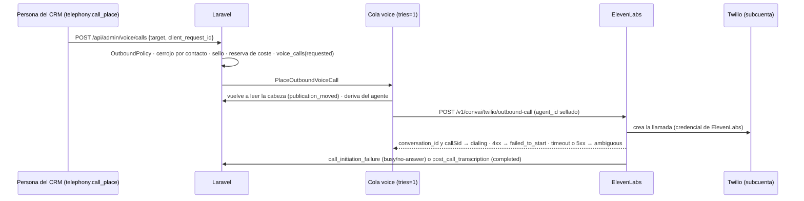

# ULTRON STUDIO · Hito 8 (voz y telefonía): contrato — CONGELADO el 03-11-2026 (paso 0 del lead; decisiones del propietario pendientes de confirmación, abajo)

**Estado: BORRADOR para que el lead lo congele.** Nada de esto rige hasta congelarlo. **Fecha:** 03-11-2026. **Base:** rama `feat/ultron-studio-h8-voice` en los dos repos (backend `cfcd0d1`, CRM `73dbcd3`, los dos = producción). **Auditoría de partida:** `ULTRON_STUDIO_H8_VOICE_AUDIT.md` (las citas `ruta:línea` están allí). **Forma:** la del contrato del H7, más las decisiones de arquitectura que este hito necesita.

**Marcas:**
- **[P-n]**: decisión del propietario (la lista, al final). Las marcadas **antes de implementar** cambian el código; las demás, solo una fase.
- **[C-An]**: condición de la opción A que se comprueba en la fase 2 o 3 con la cuenta real (auditoría §e).
- **[por confirmar]**: no verificado en la documentación oficial del 03-11-2026.

## Objetivo

**Una sola autoridad sobre lo que dice y hace la voz: el Studio.**
- Una **versión aprobada** del Studio y un **perfil de voz aprobado** se compilan, en Laravel, en un **agente de ElevenLabs inmutable**, con su hash y en una cadena firmada propia.
- Laravel es la **única puerta de las salientes**, la **puerta de las entrantes** y la **autoridad de las restricciones críticas**.
- **Cada llamada queda sellada** con la versión, el hash y la identidad del agente.
- **No es un segundo agente comercial:**
  - no hay reglas, textos ni configuraciones de voz que vivan fuera del Studio;
  - el panel de ElevenLabs no es una vía de cambio: un cambio allí es **deriva**;
  - ULTRON de WhatsApp no se toca.

**Dentro del H8:**
- la integración nativa Twilio–ElevenLabs gobernada por Laravel;
- entrantes en canario y salientes autorizadas, a canarios (4a) y a contactos con consentimiento de voz (4b, ver [P-20]);
- transferencias, límites, costes y conciliación;
- el laboratorio hablado (en el navegador, sin teléfono);
- la sección «Voz y telefonía» del CRM;
- el despliegue por fases con todo apagado.

**Fuera del H8:**
- abrir el número al público («todas» en entrantes);
- llamadas por lotes (*batch calls* de ElevenLabs);
- Custom LLM servido por Laravel;
- voz en WhatsApp e integración de WhatsApp de ElevenLabs;
- T2 del motor de WhatsApp;
- cualquier cambio en el motor;
- grabaciones (salvo [P-7]).

## Protecciones intocables (no se retiran en este hito)

1. **Todo apagado por defecto.** `ELEVENLABS_ENABLED=false`, `TWILIO_VOICE_ENABLED=false`, `TWILIO_VOICE_DAILY_CALL_CAP=0` y todas las variables nuevas `VOICE_*` y `ULTRON_STUDIO_VOICE_*` en `false` o `0`. Solo `true`, `1`, `on` o `yes` encienden (el mismo `filter_var` que `config/voice.php:41`).
2. **`VoiceCallPolicy::CALLS_ENABLED_IN_CODE = false`** (`app/Services/Voice/VoiceCallPolicy.php:23`):
   - Literal, una vez, vigilada por `VoiceIsolationTest.php:117-122`.
   - Se gira **solo** en un commit de una línea, `voice(calls-open): …`, con la autorización escrita del propietario citada en el mensaje. Se despliega en la fase 3.
   - **Nunca se gira en el árbol compartido para probar:** el banco aplica el giro en una copia del árbol (como las mutaciones del H4–H7).
3. **Ninguna llamada real en desarrollo ni en el banco:**
   - simuladores de Twilio y de ElevenLabs en `127.0.0.1`;
   - `Http::preventStrayRequests()` en toda prueba con red;
   - hosts oficiales fijos en `production`, y en `production` se ignoran las bases configurables (como `ElevenLabsConfig.php:110-120` y `TwilioReadOnlyClient.php:63-65`).
4. **OTP intacto:**
   - puerta de diff vacía en `app/Services/Sms/**`, `app/Services/Otp/**`, `config/otp.php`, `app/Http/Controllers/Api/TwilioUsageTriggerController.php` y `routes/api.php`;
   - la voz no lee `otp.*` y el OTP no lee `voice.*` (prueba estática en las dos direcciones).
5. **Motor de WhatsApp intacto:**
   - puerta de diff vacía en `app/Services/Marketing/**`, los `app/Jobs/**` existentes, `app/Http/Controllers/Api/Internal/**`, `routes/marketing.php`, `config/marketing.php` y las migraciones de `marketing_*`;
   - `marketing_calls` no se toca ni es origen de un marcador (`VoiceCallContext.php:36-37`);
   - las dos únicas lecturas del motor desde la telefonía son de solo lectura y van por adaptadores enumerados (D8-2): `OutboundContentGuard::inspect()` y las señales `do_not_contact` y `consent_status = denied` del lead.
6. **Meta en solo lectura.** Nunca se importa el número de WhatsApp (coexistencia) y nunca se usa la integración de WhatsApp de ElevenLabs.
7. **Legacy intacto:**
   - la cadena `ultron_studio_publications` y `UltronPublishedConfig` no cambian;
   - la voz no escribe ni lee esa tabla (auditoría §b.1, fila 15);
   - `MARKETING_ULTRON_STUDIO_CONFIG` y `ULTRON_STUDIO_PUBLISHING_ENABLED` no gobiernan la voz.
8. **ElevenLabs sigue en `ELEVENLABS_NOT_CONFIGURED`** hasta que el propietario ponga credenciales en el servidor y `voice:doctor --verify` dé `credentials_ok` (fase 2).
9. **Sin secretos ni teléfonos en claro** en respuestas, libro, eventos, logs, instantáneas ni CRM:
   - el teléfono completo solo se descifra en memoria, en el instante de marcar, y se descarta;
   - las transcripciones no se guardan en Laravel salvo [P-8].
10. **Migraciones aditivas e inertes:**
    - crear las tablas no enciende nada;
    - `down()` se niega con datos y **nunca `migrate:rollback` en producción**;
    - cadena de voz, eventos, consentimientos, exclusiones, consultas al RNE y frenos son de **solo inserción** (`REVOKE UPDATE, DELETE` de `iron_app`, como DB7);
    - la suite de PostgreSQL es obligatoria.
11. **El catálogo `2026-10-19.1` sigue congelado** (`StudioCatalog.php:37`): lo propio de la voz va en el perfil de voz, no en el catálogo.
12. **Sin gasto sin control:**
    - cada vía de gasto, sea una llamada o el laboratorio hablado, tiene **cuatro cerrojos independientes**: la bandera, el driver o alcance, el presupuesto diario mayor que 0 y la credencial presente;
    - se suma una **reserva atómica** contra el techo diario del día de Bogotá.
13. **Producción:** ninguna fase sin orden expresa. La autorización del 25-10-2026 **no cubre** llamadas ni ElevenLabs (`ULTRON_STUDIO_FINAL_REPORT.md:832-844`): cada fase de 2 a 4b pide la suya, por escrito.

## Decisiones de arquitectura

### D8-1 · Integración: opción A (nativa), con salida a B1 para las entrantes

- El número dedicado de la subcuenta de voz se **importa en ElevenLabs** con una API key restringida de esa subcuenta [C-A1].
- **Entrantes:** de Twilio a ElevenLabs, con la puerta del webhook de iniciación de Laravel (D8-11) [C-A2].
- **Salientes:** solo las inicia Laravel, con `POST /v1/convai/twilio/outbound-call` (D8-12).
- **Transferencias:** con la herramienta de sistema `transfer_to_number` en modo conferencia (D8-14).
- **Salida documentada:** si C-A2 no se cumple, las entrantes pasan a «register call» (B1). La interfaz de proveedor (D8-3) no cambia y las salientes siguen en A.
- B2 (Media Streams propios) y C (otro proveedor) quedan descartados (auditoría §e).

### D8-2 · Tres espacios de nombres y sus fronteras

| Espacio | Qué es | Frontera verificable |
|---|---|---|
| `App\Services\Voice` (H6) | Adaptadores de proveedor **neutros y sin estado**: HTTP puro, sin base de datos, log ni caché | `VoiceIsolationTest`, **reescrita por SEC8**:<br>• lista cerrada de ficheros, ampliada solo con los de este contrato;<br>• verbos HTTP solo en los métodos enumerados;<br>• `outbound-call` solo en `ElevenLabsCallStarter`;<br>• hosts fijos en `production`;<br>• secretos solo en los lectores enumerados (D8-5);<br>• sin `UltronStudio`, `App\Services\Marketing` ni `App\Models\` (`VoiceIsolationTest.php:256-265`, que se conserva) |
| `App\Services\Telephony` (nuevo) | Orquestación **con estado**: políticas, puerta de salientes, puerta de entrantes, registro de llamadas y eventos, webhooks, herramientas, coste, conciliación, freno y el lector de la cadena de voz `VoicePublishedConfig` | `TelephonyIsolationTest` (nuevo, SEC8):<br>• no importa `App\Services\UltronStudio` ni `App\Models\UltronStudio`, salvo el modelo de lectura de los canarios de voz (`StudioCanaryNumber`, solo lectura);<br>• del motor, solo los dos adaptadores de la protección 5;<br>• no lee `otp.*` |
| `App\Services\UltronStudio\StudioVoice*` (nuevo) | **Gobierno**: perfil de voz, compilador, cadena de publicaciones de voz, despliegue del agente, evidencia, deriva y laboratorio hablado | De la telefonía solo nombra los adaptadores enumerados (`VoicePublishedConfig::signatureFor()` y las interfaces de D8-3), como `UltronStudioEngineReadOnlyTest` |

### D8-3 · Interfaces de proveedor (no acoplar el motor a ElevenLabs)

El puerto del H6 no cambia (`VoiceAgentProvider.php:20-30`). Se añaden interfaces **segregadas**. Firmas indicativas; B8 las fija al congelar y van al fixture:

```php
namespace App\Services\Voice;

interface VoiceAgentDeployer
{
    /** Crea un agente NUEVO con la carga compilada. Nunca actualiza uno que haya atendido llamadas (D8-7). */
    public function createAgent(VoiceAgentPayload $payload): VoiceDeployResult;      // agentId, observedProjectionHash, outcome
    /** GET: la proyección observada (los campos que controla el compilador), para comparar con la compilada. */
    public function describeAgent(string $agentId): VoiceAgentObservation;
    /** Asigna el número importado al agente que atiende las entrantes. */
    public function assignNumber(string $providerNumberId, ?string $agentId): VoiceDeployResult;  // null = sin agente (voz apagada)
}

interface VoiceCallStarter
{
    /** UNA petición, sin reintentos ni redirecciones. Un tiempo agotado o un 5xx es `ambiguous`, nunca `failed`. */
    public function startOutbound(OutboundCallRequest $request): OutboundCallResult;  // started|rejected|ambiguous|error + conversationId, callSid
}

interface VoiceEventVerifier
{
    /** Firma + sobre → evento neutro. Nunca conserva transcripción ni audio: el llamador recibe solo lo que el contrato enumera. */
    public function verifyPostCall(string $rawBody, ?string $signatureHeader, int $now): VoiceWebhookVerdict;
}

interface VoiceLabSessionIssuer
{
    /** URL firmada de una sesión de navegador (≤ 15 min, auditoría §d.1). La clave nunca sale del servidor. */
    public function signedSessionUrl(string $agentId): VoiceLabSession;
}

interface TelephonyCarrier
{
    /** Corte de emergencia: la llamada a `completed`. Idempotente. */
    public function hangup(string $callSid): CarrierResult;
    /** Conciliación: llamadas de la subcuenta desde $since, una página, solo GET. */
    public function listCalls(\DateTimeInterface $since, ?string $pageToken): CarrierCallsPage;
}
```

- **Implementaciones:**
  - `ElevenLabs\ElevenLabsAgentDeployer`, `ElevenLabsCallStarter`, `ElevenLabsEventVerifier` (envuelve `ElevenLabsWebhookSignature` y `ElevenLabsWebhookEnvelope` sin cambiarlas) y `ElevenLabsLabSessionIssuer`;
  - `App\Services\Twilio\TwilioVoiceCarrier`, que es nueva: no se amplía `TwilioReadOnlyClient`, para no romper su prueba de métodos y pasos;
  - nulos para cada interfaz.
- **DTO neutros**, sin nombres de ElevenLabs: `VoiceAgentSpec`, `VoiceAgentPayload`, `OutboundCallRequest`, `OutboundCallResult` y `VoiceWebhookVerdict`.
- **Rutas de ElevenLabs para crear, leer y asignar agentes y para pedir una URL firmada:** B8 las verifica contra la referencia oficial el día que las implemente y las anota en su informe **[por confirmar: hoy solo están verificadas `outbound-call` y `GET agents/{id}`]**.

### D8-4 · Telefonía separada del OTP

| Aspecto | OTP (no se toca) | Voz (H8) |
|---|---|---|
| Configuración | `config/otp.php` (`otp.twilio.*`) | `config/voice.php` (`voice.twilio.*` y `voice.elevenlabs.*`) |
| Credencial | El Auth Token maestro (`config/otp.php:141-142`) | La **subcuenta** de voz con API keys restringidas (D8-5) |
| Techo | `OtpCostGuard` (`config/otp.php:241-246`) | `Telephony\VoiceCostGuard`, con reserva atómica, día de Bogotá y sus propias variables |
| Interruptor | `TWILIO_SEND_ENABLED` (`config/otp.php:186`) | `VOICE_OUTBOUND_ENABLED` y `VOICE_INBOUND_ENABLED` (D8-11, D8-12) |
| Webhooks | `webhooks/twilio/usage-trigger` (`routes/api.php:632-637`) | Fichero propio **`routes/voice.php`**, montado en `bootstrap/app.php` junto a los de `:36-44` |
| Validador de Twilio | El privado del controlador (T-1) | **`Telephony\TwilioRequestSignature`** (nuevo, puro):<br>• los 6 vectores oficiales, `bodySHA256` y las claves repetidas;<br>• URL = la base canónica configurada + la URI tal como llega, nunca `fullUrl()` |
| Cola | — | Carril propio **`voice`**, con el worker `ironbody-voice`; nunca el del puente de n8n ni `studio-lab` |
| Log | — | Canal `voice`, sin teléfonos ni transcripciones |

### D8-5 · Credenciales de alcance mínimo y número dedicado

- **Las piezas** son las de la auditoría §c.3. En resumen:
  - **Twilio:** la subcuenta «Voz»; una API key restringida **para Laravel** (llamadas: leer, listar y actualizar; números: leer; uso: leer); **otra** para ElevenLabs (lo que exija la importación) [C-A1]; y el **Auth Token de la subcuenta**, solo para validar firmas.
  - **ElevenLabs:** una key acotada con **cupo de créditos**; tres secretos distintos (webhook post-llamada, herramientas e iniciación); y un `agent_id` de verificación, inerte y sin número.
- **Variables nuevas** (`config/voice.php` y el fichero de ejemplo de entorno; nombres indicativos, B8 los fija):
  - `TWILIO_VOICE_ACCOUNT_SID`, `TWILIO_VOICE_API_KEY_SID` y `TWILIO_VOICE_API_KEY_SECRET`;
  - `TWILIO_VOICE_SIGNING_TOKEN` (el Auth Token de la subcuenta, que solo lee `TwilioRequestSignature`);
  - `ELEVENLABS_INITIATION_SECRET`;
  - `VOICE_WEBHOOK_BASE_URL` (la base canónica con la que se calculan las firmas);
  - las banderas y los techos de D8-11, D8-12 y D8-15.
- **Variables que se reutilizan:**
  - `TWILIO_VOICE_FROM` (`config/voice.php:82`): el E.164 del número dedicado;
  - `ELEVENLABS_AGENT_PHONE_NUMBER_ID` (`:60`): el id del número importado. El comentario «integración nativa (descartada)» se corrige.
- **Lectores enumerados de secretos**, cada uno en un fichero y vigilados por la prueba estática:
  - `ElevenLabsVoiceProvider` y los adaptadores de ElevenLabs de D8-3: la key;
  - `ElevenLabsEventVerifier`: el secreto del webhook;
  - `Telephony\VoiceToolAuth`: el de las herramientas;
  - `Telephony\VoiceInitiationAuth`: el de la iniciación;
  - `TwilioVoiceCarrier`: la key de Laravel;
  - `TwilioRequestSignature`: el token de firma.
  - Las huellas de 8 hex de todos salen de un único punto, como `ElevenLabsVoiceProvider.php:126-142`.
- **`ElevenLabsConfig::missing()` no cambia** (`ElevenLabsConfig.php:81-98`). `ELEVENLABS_AGENT_ID` pasa a ser el agente **de verificación**: los agentes de las publicaciones viven en la base de datos (D8-7). Así se conservan los cuatro estados del H6 y su fixture.
- **Un único número en el H8**, en el entorno (sin tabla de números). Si el propietario quiere varios, la tabla llega con su enmienda.
- **Guarda del número de WhatsApp:** si la huella de `TWILIO_VOICE_FROM` coincide con la de `WHATSAPP_DISPLAY_PHONE` o con alguna de `WHATSAPP_PROTECTED_NUMBERS`, la política responde `voice_number_is_whatsapp` y el doctor lo dice por nombre.

### D8-6 · Gobierno: de una versión aprobada a una configuración de ElevenLabs

**Entradas** (las tres obligatorias):
1. Una **versión del Studio aprobada** con cuatro ojos, el flujo del H5 sin cambios. El compilador lee de ella las capas del catálogo congelado (`StudioCatalog.php:254-417`) y sus reglas S-NNN.
2. Un **perfil de voz aprobado** (nuevo: `ultron_studio_voice_profiles`). Es el único sitio donde vive lo propio de la voz, con un conjunto de campos **cerrado**:
   - `voice_id` y el idioma (`es`);
   - el saludo de las entrantes y el de las salientes, y el aviso fijo [P-9];
   - la duración máxima;
   - los destinos de transferencia (alias + E.164 cifrado, como mucho 3);
   - las herramientas activas, un subconjunto del catálogo de D8-10;
   - la privacidad (días de retención y audio apagado);
   - la política de buzón [P-10];
   - los **huecos de texto** de la plantilla, cortos, con `PlainText` estricto, sin cifras monetarias ni datos de contacto.

   El perfil lleva su huella con `StudioContentHasher` y nadie aprueba el que creó (por identidad).
3. La **versión del compilador**: `VoiceAgentCompiler::VERSION = 'ultron-voice-compiler/1'`, una constante del código.

**Salidas:**
- `VoiceAgentSpec`, el JSON canónico **neutro**, con `specHash` (sha256).
- `VoiceAgentPayload`, la carga de ElevenLabs que construye `ElevenLabsAgentMapper` (puro), con `payloadHash`.
- La **proyección**: los campos de la carga que el compilador controla, que es lo que se compara al leer el agente para detectar deriva (ElevenLabs puede añadir valores por defecto).

**Plantilla:**
- Los textos base de la voz viven **en el código**, en una plantilla versionada con el compilador. Los rellenan los huecos del perfil y los parámetros de la versión (persona y estrategia) [P-6].
- Nadie escribe un prompt libre en el CRM.
- Los hechos (planes, horarios, sede y, si [P-3], precios) **no van en el prompt**: salen de las herramientas (R-01).

**El compilador se niega a compilar** (excepción tipada; un 422 con el motivo en la API) si:
- el perfil o la versión no están aprobados, o sus huellas no cuadran;
- un hueco tiene cifras monetarias, vocabulario de descuento (R-02), una URL, un teléfono, un correo o invisibles (la clase `InvisibleCharacters` del H7);
- hay una herramienta fuera del catálogo, una herramienta de sistema distinta de `end_call` y `transfer_to_number`, o falta `end_call`;
- hay un destino de transferencia fuera del perfil (R-07: derivar solo por la herramienta y a destinos aprobados);
- la duración supera `VOICE_PER_CALL_MAX_SECONDS`, la grabación está encendida sin [P-7] o la retención supera [P-8];
- falta el aviso [P-9].

### D8-7 · Un agente inmutable por publicación

- **Publicar una versión de voz:**
  1. compilar;
  2. `createAgent` (un **agente nuevo**);
  3. `describeAgent`: la proyección observada tiene que ser igual a la compilada; si no, se aborta sin publicar y el agente queda marcado `rejected`;
  4. fijar en el agente `call_limits` (diario = el techo de D8-15, concurrencia = `VOICE_MAX_CONCURRENT_CALLS`, ráfaga apagada), la retención y el audio apagado;
  5. si la parte publicada atiende entrantes, `assignNumber`;
  6. insertar la entrada firmada en la cadena de voz (D8-8).
- **Nunca se modifica un agente que haya atendido llamadas.** Los anteriores quedan para la auditoría, con una etiqueta de retirados.
- **Por qué no el versionado de ElevenLabs** [P-2]:
  - activarlo es **irreversible**;
  - no está documentado ni fijar una conversación a un `version_id` ni qué pasa con las llamadas en curso;
  - `call_limits` y `privacy` quedan fuera de él (auditoría §d.1).

  Un agente por publicación da la no retroactividad **por construcción** y deja el versionado nativo como opción futura.
- **El laboratorio hablado** compila **agentes de laboratorio**: misma compilación, sin número y con `purpose = lab`, y nunca se usan para llamadas.

### D8-8 · La cadena de voz y el sello de cada llamada

**Cadena propia** `ultron_studio_voice_publications`, de solo inserción. Copia el patrón del H5 **sin compartir su tabla** (auditoría §b.1, fila 15):
- `seq` es la cabeza + 1, encadenada (como `uspub_chain_next` de DB7), con `CHECK (seq >= 1)` y `REVOKE UPDATE, DELETE`.
- `effective_json` es el JSON canónico de `{contract: "ultron-voice-config/1", seq, entry, issuedAt, canary, rest}`, como mucho 16 384 caracteres.
- Cada parte (`canary` o `rest`), si existe, lleva: `{studioVersionUuid, studioContentHash, voiceProfileUuid, voiceProfileHash, specHash, payloadHash, compilerVersion, provider, providerAgentId, approvedBy, publishedBy}`.
- La firma es HMAC-SHA256 con una subclave de la `APP_KEY` de etiqueta **`ultron-studio-voice-publication`**, distinta de `ultron-studio-publication` (`UltronPublishedConfig.php:110`): una firma no vale en el otro dominio.
- **Implementación única** en `Telephony\VoicePublishedConfig::signatureFor()`. El Studio la recibe como `Closure`, igual que el H5.

**Lector** `Telephony\VoicePublishedConfig`: una sentencia (la cabeza), verificación en bytes y decodificación estricta, y **nunca lanza**. A diferencia del motor, **un fallo deniega**: `publication_unreadable` es un motivo de la política y no hay llamada. La voz, a diferencia de la declaración del H5, sí cambia lo que se dice.

**Sello** (columnas de `voice_calls`, escritas **al empezar**: la saliente al pedirla, la entrante en el webhook de iniciación):
- la publicación: `voice_publication_seq`, `part` (`canary` o `rest`) y `stamp_state` (`applied`, `off` o `fallback`);
- la versión y el perfil: `studio_version_uuid`, `studio_content_hash`, `voice_profile_hash`;
- la compilación: `spec_hash`, `payload_hash`, `compiler_version`;
- el proveedor: `provider` y `provider_agent_id`.

**Después** (webhook post-llamada): `observed_agent_id`, `observed_version_id`, `observed_branch_id` y `seal_verified` (el agente observado coincide con el sellado). Si no coincide, el evento es `seal_mismatch` y se acciona el freno (D8-19).

### D8-9 · No retroactividad

- Una llamada usa el agente con el que empezó. El sello se toma al empezar, y el agente sellado no cambia nunca (D8-7).
- **Revertir** es insertar una entrada que apunta al agente anterior, que sigue existiendo, y reasignar el número. Las llamadas en curso no se enteran.
- **Una saliente pedida y todavía no marcada** vuelve a leer la cabeza en el job: si `seq` cambió, se cancela con `publication_moved`, sin llamar. Es conservador a propósito.

### D8-10 · Restricciones críticas: viven en Laravel, en cuatro capas

1. **Al compilar:** D8-6.
2. **En las herramientas** (`POST /api/voice/tools/{tool}`, catálogo **cerrado** en el H8):
   - `consultar_planes`: nombres y condiciones del catálogo vigente y, solo si [P-3], el precio exacto de la base, nunca calculado ni rebajado;
   - `consultar_horarios`: la sede y el horario;
   - `solicitar_humano`: dice si hay transferencia disponible ahora (personal en horario) y el **alias** del destino;
   - `no_volver_a_llamar`: crea una exclusión inmediata para el número que llama o al que se llamó. Es la revocación oral de la Ley 2300, y no necesita confirmación del LLM para surtir efecto.

   No hay herramientas de cobro, enlace de pago, descuento, activación de membresía ni agenda. Cada petición:
   - autentica (`hash_equals` sobre el Bearer y, si [P-26], la lista de IP de salida de ElevenLabs);
   - valida el esquema;
   - **comprueba la llamada**: el `conversation_id` (o el `call_sid`) existe en `voice_calls`, está `active`, no hay freno, el autorizado es el sellado y el cupo por llamada sigue vivo (como mucho 20 peticiones por llamada).

   El LLM no puede hacer que la herramienta salga de su catálogo ni de su llamada [C-A3].
3. **En la puerta de salientes:** D8-12.
4. **Después de la llamada:**
   - el `post_call_transcription` se recorre **en memoria**;
   - cada turno del agente pasa por `OutboundContentGuard::inspect()` (`app/Services/Marketing/OutboundContentGuard.php:577`) a través de un adaptador de solo lectura (S8 y SEC8 confirman que es pura);
   - se añaden las comprobaciones propias de la voz: el aviso en el primer turno, cifras monetarias si [P-3] = no, y transferencias a destinos no aprobados (imposibles por configuración, pero comprobadas);
   - se guarda **solo el veredicto** (códigos y número de turno), nunca el texto;
   - una violación acciona el freno (D8-19).

### D8-11 · Entrantes

```mermaid
sequenceDiagram
  participant P as Persona que llama
  participant T as Twilio (subcuenta)
  participant E as ElevenLabs (agente de la publicación)
  participant L as Laravel
  P->>T: llama al número dedicado
  T->>E: número importado (integración nativa)
  E->>L: POST /api/webhooks/voice/elevenlabs/initiation (secreto en cabecera)
  L->>L: InboundPolicy · sello · voice_calls(active, idempotente por call_sid)
  L-->>E: dynamic_variables {caller_authorized, call_ref, version_label}
  E->>P: aviso de IA y saludo; si no autorizado: «línea no disponible» + end_call
  E->>L: POST /api/voice/tools/{tool} (Bearer) durante la llamada
  E->>L: POST /api/webhooks/voice/elevenlabs/post-call (HMAC)
  L->>L: guarda posterior · seal_verified · coste · freno si procede
```

- **`InboundPolicy`** (pura), en orden:
  - `inbound_disabled` (`VOICE_INBOUND_ENABLED=false`) y `calls_disabled_in_code`;
  - `voice_braked`, `no_publication` y `publication_unreadable`;
  - el alcance (`VOICE_INBOUND_SCOPE=canary`, el único en el H8): `not_an_active_voice_canary`, que compara la huella del que llama con los canarios de voz `active` (`StudioCanaryNumbers`, solo lectura; es el «T3 de voz», con autorización expresa);
  - `concurrency_exceeded` y `daily_cap_reached` (el de entrantes, [P-5]).
- **La respuesta nunca lleva datos personales.** Solo `caller_authorized` (`si`/`no`), `call_ref` (un uuid opaco) y `version_label`.
- **Sin `conversation_config_override`:** las sobrescrituras quedan desactivadas en la pestaña «Security» del agente. El agente se compila con el valor por defecto **`caller_authorized = no`**: si el webhook falla y ElevenLabs sigue con los valores por defecto, el agente dice «línea no disponible» y cuelga, y además ninguna herramienta responde [C-A2]. **[Por confirmar]** que el agente admite valores por defecto en las variables dinámicas; la página de hoy solo dice que la respuesta tiene que traerlas todas.
- **Presupuesto:** p95 < 300 ms y ninguna petición saliente en esta ruta (PERF8).
- **Fuera del horario del personal** se atiende, pero no se ofrece transferencia (D8-14).

### D8-12 · Salientes: una sola puerta



- **`OutboundPolicy`** compone `VoiceCallPolicy::decide()` (las puertas del proveedor y del código, del H6) con las de la telefonía. Los motivos son un conjunto cerrado, en este orden:
  - el código y el proveedor: `calls_disabled_in_code`, `outbound_disabled`, `twilio_voice_disabled`, `no_voice_number`, `voice_number_is_whatsapp`, los tres estados de ElevenLabs (`VERIFIED` exige una verificación `ok` de menos de 30 días: OPS8 la programa cada semana mientras la voz esté encendida);
  - la publicación: `no_publication`, `publication_unreadable`, `agent_drift` y `voice_braked`;
  - el destino: `source_not_allowed`, `not_an_active_voice_canary` (alcance `canary`), `contact_not_authorized`, `no_voice_consent`, `excluded` y `rne_check_missing` (alcance `contacts`, [P-20]);
  - el calendario: `outside_hours` y `holiday`;
  - los cupos: `frequency_exceeded`, `concurrency_exceeded`, `daily_cap_zero`, `daily_cap_reached` y `budget_exhausted`;
  - `duplicate_request`.
- **El origen `voice_contacts`** se añade a `VoiceCallContext::SOURCES` como permitido. Es un cambio deliberado del conjunto cerrado del H6, con su fixture. `marketing_calls` sigue prohibido.
- **Idempotencia:**
  - `client_request_id` (UNIQUE por persona) → `duplicate_request` con la misma fila;
  - cerrojo consultivo por la huella del destino en la transacción, para que no haya dos solicitudes vivas al mismo número;
  - UNIQUE en `provider_conversation_id` y en `provider_call_sid`.
- **Job:** `tries = 1`, sin `retry()`, con un plazo de 30 s. **Un resultado `ambiguous` no se reintenta:** la conciliación (Twilio por GET y la conversación de ElevenLabs) lo resuelve antes de cualquier reintento manual.
- **Petición a ElevenLabs:**
  - `agent_id` sellado, `agent_phone_number_id` y `to_number` descifrado en memoria;
  - `conversation_initiation_client_data.dynamic_variables = {caller_authorized: "si", call_ref}` y `user_id = call_ref`;
  - `telephony_call_config.ringing_timeout_secs` [P-10], `call_recording_enabled = false`, `twilio_call_recording_enabled = false` y `twilio_machine_detection` según [P-10].
- **Reintentos de negocio** (no contestó o comunicando): solo como **filas nuevas** (`attempt`, `parent_call_id`), pedidas por una persona o programadas por la política, dentro de 1 al día y [P-11]. Nunca los decide el job.

### D8-13 · Estados y eventos (conjuntos cerrados)

**`voice_calls.status`:**

| Estado | Cuándo |
|---|---|
| `requested` | Saliente aceptada por la política y en la cola |
| `canceled` | Antes de marcar: política, publicación movida, freno o corte |
| `failed_to_start` | ElevenLabs la rechazó (4xx); la reserva se libera |
| `ambiguous` | Tiempo agotado, 5xx o sin conexión al iniciarla; se resuelve conciliando |
| `dialing` | ElevenLabs devolvió `conversation_id` y `callSid` |
| `active` | Entrante aceptada en la iniciación |
| `completed` | `post_call_transcription` con duración |
| `busy` | `call_initiation_failure` = `busy` |
| `no_answer` | `call_initiation_failure` = `no-answer` |
| `failed` | `call_initiation_failure` = `unknown` u otro fallo final |
| `hung_up` | Corte de emergencia (D8-20) |

**Transiciones:** solo hacia delante, con un disparador en PostgreSQL (DB8). Un estado final no cambia.

**`voice_call_events`** (solo inserción; UNIQUE `(provider, kind, provider_event_key)` para deduplicar):
- `outbound_requested`, `outbound_started`, `outbound_rejected`, `outbound_ambiguous` e `initiation_received`;
- `post_call_transcription`, `post_call_audio_discarded` y `call_initiation_failure`;
- `tool_call` (solo el nombre y el veredicto), `guard_verdict` y `hangup_requested`;
- `reconciled`, `seal_mismatch`, `cost_recorded` y `unknown_provider_call`.

### D8-14 · Transferencias

- `transfer_to_number` en modo **conferencia**, con los destinos **fijos del perfil aprobado**: como mucho 3, con alias, cifrados en la base y en claro solo dentro de la carga compilada. El mensaje al operador (transferencia asistida) es nativo [P-12].
- `solicitar_humano` (D8-10) dice si hay personal en el horario de transferencia. El agente solo transfiere si la respuesta es sí; eso es blando. Que el destino sea fijo es duro, porque el LLM no puede elegir otro número.
- El tramo transferido se paga (saliente de Twilio al destino) y entra en la reserva de coste.
- La transferencia ciega y SIP REFER no se usan en el H8.

### D8-15 · Límites

| Límite | Dónde se aplica | Defecto |
|---|---|---|
| Duración por llamada | `max_duration_seconds` del agente (60–7 200, auditoría §d.1) = el del perfil, ≤ `VOICE_PER_CALL_MAX_SECONDS` | 300 s, con recorte a 60–600 [C-A5] |
| Concurrencia | Laravel cuenta `dialing` + `active`, y ElevenLabs `agent_concurrency_limit`; ráfaga apagada | `VOICE_MAX_CONCURRENT_CALLS=1` (recorte 1–4) |
| Salientes al día | `TWILIO_VOICE_DAILY_CALL_CAP` (`config/voice.php:85`, 0–20) | 0 |
| Entrantes al día | `VOICE_INBOUND_DAILY_CAP` + `daily_limit` del agente = salientes + entrantes | 0 [P-5] |
| Gasto al día | `VOICE_DAILY_BUDGET_USD`. Reserva = minutos máximos × (ElevenLabs + Twilio según el destino + Media Streams), con los precios oficiales en la configuración y su fecha; el real llega del webhook (`metadata.cost`, unidades **[por confirmar]**) y de la conciliación de Twilio | 0 |
| Frecuencia por contacto | 1 al día (Ley 2300, art. 3) e intentos por semana [P-11] | 1 al día |
| Horario de salientes | De lunes a viernes de 07:00 a 19:00 y sábados de 08:00 a 15:00 (Bogotá); ni domingos ni festivos; más estricto si [P-13] | El legal |
| Festivos | `Telephony\ColombianHolidays`, pura: Ley 51 de 1983 y los móviles de Pascua; el fixture de 2026–2028 lo aprueba el propietario | — |

### D8-16 · Webhooks y autenticación

| Ruta (pública, sin sesión, fuera de `/api/admin`) | Autenticación | Reglas |
|---|---|---|
| `POST /api/webhooks/voice/elevenlabs/post-call` | `ElevenLabs-Signature` con `ElevenLabsWebhookSignature::verify` (sin cambios: 1 800 s hacia atrás y 300 hacia delante) sobre el **cuerpo crudo** | Tope de cuerpo de 1 MB. **El envío de audio se apaga** en el workspace y en el agente; si llega un `post_call_audio`, 200 y se descarta (evento `post_call_audio_discarded`). Duplicado → 200. Tipo desconocido válido → 200 y se ignora. Firma mala → 401. Un fallo propio (de la base) → 5xx para que ElevenLabs reintente. **Nunca un 4xx en bucle**: tras 10 fallos se desactiva solo (auditoría §d.1) |
| `POST /api/webhooks/voice/elevenlabs/initiation` | Secreto en una cabecera fija, con `hash_equals` | Tope de 8 KB y p95 < 300 ms; sin red saliente |
| `POST /api/voice/tools/{tool}` (`{tool}` en una lista cerrada) | Bearer `ELEVENLABS_TOOL_SECRET`, con `hash_equals` | Tope de 8 KB; esquema por herramienta; comprobación de la llamada (D8-10); 20 por llamada |
| `POST /api/webhooks/voice/twilio/usage-trigger` | `X-Twilio-Signature` con `TwilioRequestSignature` y el token de la subcuenta | Idempotencia por `IdempotencyToken`. **Se persiste** como evento (a diferencia del OTP, que solo registra) y puede accionar el freno por coste |

- Las IP de salida estáticas de ElevenLabs, como lista de permitidos en nginx o en Laravel [P-26]: un refuerzo, nunca un sustituto de la firma.
- Twilio no publica rangos de IP (auditoría §d.2): para Twilio, solo la firma.
- Todas las rutas van con `LimitRequestBodySize` y su limitador, y se clasifican en `AuthorizationMap` como públicas con la razón escrita.

### D8-17 · Datos personales (Ley 1581)

- **Teléfonos:**
  - `voice_calls` guarda `remote_hash` (HMAC con su propia subclave de la `APP_KEY`, etiqueta `voice-phone`) y `remote_last4`, **nunca el número**;
  - para marcar, el número cifrado sale del registro de canarios (`phone_encrypted`) o de `voice_contacts`, y se descifra solo en memoria.
- **Grabación:** apagada (`call_recording_enabled = false` y `twilio_call_recording_enabled = false`) [P-7].
- **Transcripciones:** Laravel **no las guarda**; las recorre en memoria para la guarda y las descarta [P-8]. En ElevenLabs, retención de [P-8] días (se recomiendan 30) y el audio guardado apagado.
- **Laboratorio hablado:** la misma retención. Los escenarios son sintéticos, pero la voz de quien prueba es un dato personal.
- **Aviso al empezar cada llamada** (fijo y compilado) [P-9]: que atiende un asistente virtual de Iron Body, la finalidad y cómo pedir no recibir más llamadas (la herramienta `no_volver_a_llamar`).
- **Supresión:**
  - `ops/supresion-1581.sql` gana su sección de voz (OPS8): huellas por un marcador, últimos dígitos a `0000`, cifrados a NULL y textos a «[suprimido]», con el rol dueño y en seco primero;
  - el borrado de las conversaciones en ElevenLabs entra en el procedimiento **[por confirmar el endpoint]**.
- **Encargados del tratamiento** (ElevenLabs y Twilio): contrato de transmisión y región [P-21]; la evaluación es de asesoría legal.

### D8-18 · Consentimiento, exclusiones y horarios (salientes en Colombia)

- **`voice_contacts`** (alcance `contacts`, fase 4b):
  - el teléfono cifrado, su huella y los 4 últimos dígitos;
  - el origen (`lead`, `member` o `manual`) con su id, como referencia sin FK al motor;
  - el estado.
- **`voice_consents`** (solo inserción):
  - `kind` (`granted` o `revoked`), `channel = voice_call` y `purpose = commercial`;
  - `source`, en una lista cerrada: `written_form`, `recorded_inbound_request` (si [P-7] lo permite) o `admin_with_evidence`;
  - `evidence` (≤ 300 caracteres, `PlainText` estricto, sin teléfonos);
  - la identidad del actor y la fecha.

  `admin_with_evidence` exige cuatro ojos [P-18]. El consentimiento de WhatsApp **no vale** para la voz: la Ley 2300, art. 2, pide canales autorizados.
- **`voice_exclusions`** (solo inserción, por huella del teléfono):
  - `source`: `rne`, `spoken_opt_out` (la herramienta), `lead_do_not_contact`, `lead_consent_denied` o `admin`;
  - se consulta **antes de cada saliente**, y solo la quita el procedimiento de supresión.
- **`voice_rne_checks`** (solo inserción): la huella, `checked_at`, el resultado, la referencia de la evidencia y el actor. La vigencia es [P-14]. El mecanismo es manual (el portal de la CRC) hasta que se confirme una API.
- **Señales del lead**, en solo lectura y por un adaptador enumerado: `marketing_leads.do_not_contact` o `consent_status = denied` del lead de origen dan `excluded`. No se escribe nada en el motor.
- **Regla semanal entre canales** (WhatsApp y voz): según [P-15], con asesoría legal. Si aplica, la política lee el último contacto proactivo de WhatsApp por un adaptador enumerado más.

### D8-19 · Canario de voz y freno

- **Canario de voz:** los números de `ultron_studio_canary_numbers` con `channel = voice` y `status = active` (cuatro ojos del H6). Exige la fase 2 del H6 (escrituras encendidas y dos personas) y la autorización expresa del «T3 de voz».
- **Publicar** siempre empieza en la parte `canary`, que atiende las entrantes de los canarios y las salientes 4a. **Promover** a `rest` exige evidencia medida en el servidor [P-16]:
  - al menos 24 h y N llamadas selladas con esa publicación;
  - 0 violaciones de la guarda, 0 `seal_mismatch` y 0 deriva;
  - coste dentro del presupuesto;
  - un veredicto `approved` del laboratorio hablado, de otra identidad.

  Es la misma ventana de publicación del H5 [P-25] y nadie publica ni promueve lo que creó.
- **Freno de voz** (`voice_brakes`, solo inserción) [P-17]. Lo abren solos:
  - una violación de la guarda;
  - un `seal_mismatch`;
  - la deriva del agente;
  - el techo duro de gasto o un aviso de la subcuenta;
  - una `unknown_provider_call` (una llamada en Twilio sin su fila).

  Con el freno abierto, las salientes dan 409 `voice_braked` y las entrantes, `caller_authorized = no`. **Solo lo suelta una persona** con `ultron.voice_publish`, con una nota, y el libro lo registra. Nunca se suelta solo. Abrirlo genera un incidente de IRON GUARD (el mecanismo del monitor del H7).

### D8-20 · Vuelta atrás por niveles

| Nivel | Qué | Efecto | Requiere |
|---|---|---|---|
| 0 | `VOICE_OUTBOUND_ENABLED=false` y/o `VOICE_INBOUND_ENABLED=false` + caché (como `www-data`, `umask 077`, `chmod 600`) | Ninguna llamada nueva; las entrantes oyen «no disponible» | El mando `h8-voice-scope.sh` (OPS8) |
| 0b | **Corte de llamadas activas**: `php artisan voice:hangup --all --confirm` (Twilio, la llamada a `completed`, con la key de Laravel) | Cuelga las `dialing` y `active` | — |
| 1 | **Revertir** la publicación de voz: una entrada que apunta al agente anterior y la reasignación del número | Las llamadas nuevas, con la versión anterior | `ultron.voice_publish`, siempre (sin ventana) |
| 2 | **Voz apagada:** una entrada sin agente y el número sin asignar; `ELEVENLABS_ENABLED=false` | No atiende nadie | Ídem |
| 3 | En los proveedores: revocar la key de ElevenLabs y las de Twilio, suspender la subcuenta (consola) y quitar la importación del número | La voz queda físicamente muerta | El propietario |
| 4 | Código: desplegar el commit anterior. Las tablas quedan; `down()` se niega | — | Orden del propietario |

### D8-21 · Deriva y monitor

Tareas tras la bandera del monitor y la de la voz. OPS8 las programa en `routes/console.php`:
- **Deriva del agente:** `describeAgent` de cada agente vivo; la proyección observada frente a la compilada. Se mira también en el job de cada saliente, con una caché de como mucho 5 min [PERF8].
- **Salud del webhook:** la última entrega buena.
- **Conciliación:** las llamadas de la subcuenta en Twilio frente a `voice_calls`. Una sin su fila es `unknown_provider_call`; resuelve las `ambiguous` y registra el precio real.
- **Atascadas:** `dialing` con más de 10 min.
- **El coste** frente al techo.
- **Verificación semanal** de ElevenLabs (mantiene `VERIFIED`).
- **Expectativas del monitor por fase:** `config/ultron_studio.php:282` y `ULTRON_STUDIO_MONITOR_EXPECT`. Los estados `twilio_voice:connected_voice` y `elevenlabs:ELEVENLABS_VERIFIED` son nuevos en los conjuntos cerrados de `StudioIntegrations.php:43-48`.

### D8-22 · Permisos (RBAC) [P-18]

| Llave | Qué permite | Por defecto |
|---|---|---|
| `ultron.voice_manage` | Editar el perfil de voz y enviarlo a revisión; previsualizar la compilación | Super Admin y Administrador |
| `ultron.approve` (existente) | Aprobar o rechazar un perfil de voz ajeno, y el veredicto del laboratorio hablado ajeno | Como hoy |
| `ultron.voice_publish` | Publicar, promover, revertir y apagar la voz; soltar el freno | **Solo Super Admin** |
| `ultron.voice_lab_run` | Abrir sesiones del laboratorio hablado (gasta) | **Solo Super Admin** |
| `telephony.view` | Registro de llamadas sin datos personales, métricas y costes | Super Admin y Administrador |
| `telephony.call_place` | Pedir una saliente autorizada; colgar una llamada | **Solo Super Admin** |
| `telephony.contacts_manage` | Contactos, consentimientos, exclusiones y consultas al RNE | **Solo Super Admin** |

- El dominio `telephony` se añade a `SHARED_TOKEN_EXCLUDED_DOMAINS` (`CrmPermission.php:237`): una automatización no llama.
- Cada ruta, una por una, en `AuthorizationMap` (denegar por defecto), y además exige una persona.
- Nadie aprueba lo que creó ni suelta un freno que abrió su propia acción **[por decidir]**.

### D8-23 · Laboratorio hablado

- **Nivel 1:** texto (el H4, que ya existe).
- **Nivel 2:** voz en el navegador, **sin teléfono**, contra un **agente de laboratorio** compilado desde una versión y un perfil enviados o aprobados:
  - URL firmada de ElevenLabs (≤ 15 min) emitida por Laravel;
  - en el CRM, el cliente oficial de ElevenLabs con la **versión exacta** fijada (revisión de la cadena de suministro por SEC8);
  - CSP `connect-src` hacia los hosts de ElevenLabs y permiso de micrófono **[por confirmar los hosts, WebRTC incluido]**.
- **Nivel 3:** la llamada física a un canario (fases 3 y 4), con su guía en `ULTRON_STUDIO_PRUEBAS_FISICAS.md`.
- **Cuatro cerrojos:**
  - `ULTRON_STUDIO_VOICE_LAB_ENABLED=false`;
  - `ULTRON_STUDIO_VOICE_LAB_DRIVER=fake`: el simulador, sin ElevenLabs;
  - `ULTRON_STUDIO_VOICE_LAB_DAILY_BUDGET_USD=0`;
  - la key presente y verificada.

  Además: como mucho 5 min por sesión, un cupo de sesiones al día y por persona, y una reserva atómica como el H4.
- **Historial y métricas:** quién, qué versión y perfil, qué agente, la duración, el coste, los códigos de la guarda y el veredicto de **otra** identidad (`approved` o `rejected`).
- **Puerta de publicación:** `required` por defecto; solo el propietario la dispensa (`waived`) y queda escrito en la entrada [P-19].

## Contratos de datos (esquema mínimo; DB8 lo refina y lo congela con el lead)

| Tabla | Tipo | Claves y restricciones mínimas |
|---|---|---|
| `ultron_studio_voice_profiles` | Estados `draft` → `submitted` → `approved` / `rejected`; una fila por revisión, sin editar la aprobada | `content_hash`; `CHECK approved_by <> created_by` por identidad; destinos cifrados |
| `ultron_studio_voice_agents` | Artefacto compilado y desplegado | `provider_agent_id` UNIQUE; `purpose` (`lab` o `publication`); `spec_hash`, `payload_hash`, `compiler_version`, `observed_hash` y `status` |
| `ultron_studio_voice_publications` | **Cadena de solo inserción** | Disparador «cabeza + 1 encadenada», `CHECK (seq >= 1)` y `REVOKE UPDATE, DELETE` |
| `ultron_studio_voice_lab_sessions` | Sesiones y veredictos | Veredicto de una identidad distinta de la autora; inmutable |
| `voice_calls` | Una fila por llamada, con el sello | UNIQUE en `client_request_id` (por persona), `provider_conversation_id` y `provider_call_sid`; `status` cerrado con transiciones hacia delante; huella y 4 dígitos, sin el número |
| `voice_call_events` | Solo inserción | UNIQUE `(provider, kind, provider_event_key)`; sin texto de transcripción |
| `voice_contacts`, `voice_consents`, `voice_exclusions`, `voice_rne_checks` | Registro de la fase 4b; las tres últimas, de solo inserción | Huellas con su subclave; cifrado del teléfono solo en `voice_contacts` |
| `voice_brakes` | Abrir y soltar, cada cosa una vez | Disparador «se suelta una vez»; quien suelta, con su identidad |

**Migración de datos: ninguna.** Todo es nuevo. El registro de canarios del H6 se lee y no se migra.

## API (borrador; el lead fija la lista y la numeración)

**Studio** (añadidas a `routes/ultron-studio.php`, con el tope de 64 KB y `AuthorizationMap`):
- `GET integrations/voice` (la ruta 45, con el DTO ampliado).
- Perfiles: `GET voice/profiles`, `GET voice/profiles/{uuid}`, `POST voice/profiles`, `POST voice/profiles/{uuid}/submit`, `/approve` y `/reject`.
- `POST voice/compile-preview` (sin red, en el cubo de lectura).
- Publicaciones: `GET voice/publications`, `POST voice/publish`, `/promote`, `/rollback` y `/off`, y `GET voice/canary-evidence`.
- Frenos: `GET voice/brakes` y `POST voice/brakes/{uuid}/release`.
- Laboratorio: `GET voice-lab/status`, `GET voice-lab/sessions`, `POST voice-lab/sessions` (gasta; con su limitador), `POST voice-lab/sessions/{uuid}/end` y `/verdict`.

**Telefonía** (`routes/voice.php`):
- CRM, en `/api/admin/voice/*`:
  - `GET status`, `GET calls` (paginada y sin datos personales), `GET calls/{uuid}` y `GET metrics`;
  - `POST calls` (la puerta de salientes) y `POST calls/{uuid}/hangup`;
  - `GET contacts`, `POST contacts`, `POST contacts/{uuid}/consents`, `POST contacts/{uuid}/revoke`, `POST exclusions` y `POST rne-checks`.
- Públicas: las 4 de D8-16.

En total, unas 36 rutas nuevas. Con [P-20] = diferir la fase 4b, salen 5: `POST exclusions` y la tabla `voice_exclusions` se quedan, porque las usa `no_volver_a_llamar`.

## Impacto: contratos que cambian (para que nadie los cambie por la puerta de atrás)

| Contrato | Cambio | Consumidores | Quién lo cambia |
|---|---|---|---|
| `VoiceIsolationTest` y `VoiceBoundaryTest` (H6) | Las fronteras se reescriben con la lista de este contrato: ficheros, verbos, rutas y lectores | Las suites del H6 | **SEC8**, nunca quien implementa |
| `VoiceCallContext::SOURCES` y `VoiceCallPolicy` (H6) | Origen `voice_contacts` permitido; los motivos nuevos van en `OutboundPolicy` e `InboundPolicy`, no en la del H6 | Fixture `voiceCallPolicy` (24 casos), la ruta 45 y el CRM (`voicePolicyReasonText`) | B8 + TEST8 (fixture) |
| `StudioIntegrations::PROVIDER_CLASSIFICATIONS` (`:43-48`) | `twilio_voice` gana `connected_voice`; `elevenlabs` usa `ELEVENLABS_VERIFIED` como esperado | `integrations-doctor --expect`, el monitor, el fixture `integrations-cases.json` y `studio-integrations-parse.ts` | S8 + FE8 + TEST8 |
| `StudioIntegrationConfig::voiceFactsFrom` (`:209`) | Hechos nuevos: la subcuenta, las referencias de las keys, el número y las huellas de los secretos nuevos | La huella autorizada: **hay que reconocerla otra vez** en la fase 2 | S8 |
| DTO de `GET integrations/voice` | Estado real, fase, freno, publicación vigente y niveles | La pestaña «Voz» del CRM | S8 + FE8 |
| Catálogo de permisos | 7 llaves nuevas y el dominio `telephony` | El enum y el catálogo del CRM (se regeneran), Roles | B8 + FE8 |
| `config/voice.php` y el fichero de ejemplo de entorno | Variables nuevas, todas apagadas | Los scripts de despliegue y los mandos | B8 + OPS8 |
| Expectativas del monitor (`config/ultron_studio.php:282`) | Una por fase | `ultron-studio:monitor` | OPS8 |
| Rutas públicas nuevas | `/api/webhooks/voice/*` y `/api/voice/tools/*` | nginx (topes y lista de IP), ElevenLabs y Twilio (configuración en sus consolas) | B8 + OPS8 |

## Paquetes, dueños y ficheros exclusivos

| Paquete | Agente | Qué | Ficheros exclusivos |
|---|---|---|---|
| **DB8** | `database-specialist` | El esquema de las 11 tablas de «Contratos de datos»: CHECK de forma y de cuatro ojos; UNIQUE e índices parciales (una cabeza; a lo sumo una parte `canary` y una `rest` vivas); disparadores de solo inserción con el patrón `ultron_studio_forbid()`; el de la cadena (como `uspub_chain_next`); el de transiciones hacia delante de `voice_calls`; `REVOKE UPDATE, DELETE` de `iron_app` con la comprobación posterior y la guarda de producción de DB7; ida y vuelta, y `down()` que se niega con datos. Recuentos antes y después para OPS8; ensayo de roles en un PG local | `database/migrations/2026_11_1*_create_voice_*.php`, `database/migrations/2026_11_1*_create_ultron_studio_voice_*.php` y sus guardas; `tests/Feature/Telephony/Schema/**`; `tests/Feature/UltronStudio/UltronStudioVoiceSchemaTest.php`; `plans/informes-h8/informe-db.md` |
| **B8** | `backend` | Los adaptadores de D8-3 (ElevenLabs y Twilio) con sus nulos; `ElevenLabsAgentMapper` (puro); `TwilioRequestSignature`. La telefonía: `InboundPolicy`, `OutboundPolicy`, la puerta de salientes, el job, los webhooks, las herramientas, `VoiceCostGuard`, `ColombianHolidays`, la conciliación, el freno, `VoicePublishedConfig` y los adaptadores de solo lectura del motor y de los canarios. Los modelos de `voice_*`, las rutas, los permisos y los comandos `voice:hangup` y `voice:reconcile` (y `voice:doctor` ampliado) | `app/Services/Voice/**` (los nuevos de este contrato; de los del H6, solo `VoiceCallContext.php` y `ElevenLabs/ElevenLabsVoiceProvider.php`, por la huella del secreto de iniciación), `app/Services/Twilio/TwilioVoiceCarrier.php`, `app/Services/Telephony/**`, `app/Models/Voice/**`, `app/Http/Controllers/Api/Voice/**`, `app/Http/Controllers/Crm/Voice/**`, `app/Jobs/Voice/**`, `app/Console/Commands/Voice/**`, `config/voice.php`, `routes/voice.php`, `bootstrap/app.php`, `app/Support/Access/{PermissionCatalog,CrmPermission,AuthorizationMap}.php`, el bloque de voz del fichero de ejemplo de entorno, `tests/Unit/Telephony/**`, `tests/Feature/Telephony/**` (salvo `Schema/**` y las guardas de SEC8), las pruebas nuevas de `tests/Unit/Voice/**` (no `VoiceIsolationTest`), `plans/informes-h8/informe-backend.md` |
| **S8** | `backend` (otra instancia) | El gobierno: el perfil de voz (estados y cuatro ojos), la plantilla, `StudioVoiceCompiler` (de la versión y el perfil a `VoiceAgentSpec`, puro, con las negativas de D8-6), la publicación (compilar → desplegar → comprobar → asignar → firmar), la cadena, la evidencia del canario, la deriva, la clasificación y las huellas de integraciones y el DTO de la ruta 45 | `app/Services/UltronStudio/StudioVoice{Profiles,Template,Compiler,Publications,Publishing,Evidence,Drift}.php`, `app/Models/UltronStudio/StudioVoice{Profile,Agent,Publication}.php`, `app/Http/Controllers/Crm/UltronStudio/UltronStudioVoiceController.php`, `routes/ultron-studio.php`, `config/ultron_studio.php` (**solo** el bloque `voice`, y antes que OPS8), `app/Services/UltronStudio/{StudioIntegrations,StudioIntegrationConfig}.php`, `tests/Feature/UltronStudio/*Voice*` y `tests/Unit/UltronStudio/*Voice*` (salvo `*VoiceLab*` y el de esquema), `plans/informes-h8/informe-studio.md` |
| **LAB8** | `backend` (otra instancia) | El laboratorio hablado en el servidor: sesiones, los cuatro cerrojos, la reserva, la URL firmada (con el emisor de B8), el veredicto y las métricas | `app/Services/UltronStudio/StudioVoiceLab*.php`, `app/Models/UltronStudio/StudioVoiceLab*.php`, `app/Http/Controllers/Crm/UltronStudio/UltronStudioVoiceLabController.php`, `tests/Feature/UltronStudio/*VoiceLab*`, `plans/informes-h8/informe-lab.md`. **Sus rutas las añade S8** |
| **FE8** | `frontend` | En el Studio: el perfil de voz, la previsualización de la compilación, la publicación, la evidencia y el freno; el laboratorio hablado (micrófono, sesión e historial); y la **sección «Voz y telefonía»** (llamadas sin datos personales, métricas y costes, la puerta de salientes con los motivos de la política, el corte y los contactos de la fase 4b). Hojas propias por componente: `ultron-studio.scss` no crece (F-4) | CRM: `src/app/modules/ultron-studio/studio-voice-*` (nuevos y el `studio-voice-panel.ts` que ya existe), `src/app/modules/voice/**`, el bloque de la ruta de voz de `src/app/app.routes.ts`, el menú y el enum o catálogo de permisos regenerados **[ruta por confirmar]**, `package.json` y `package-lock.json` (**solo** el cliente de ElevenLabs con versión exacta), sus specs y fixtures; `plans/informes-h8/informe-front.md` (en el backend) |
| **SEC8** | `security` + `api-security-specialist` | Primero, el modelo de amenazas. Después la revisión por ruta: BOLA/IDOR en llamadas y contactos, BFLA, webhooks, herramientas (C-A3), secretos y sus lectores, CSP y micrófono, la cadena de suministro del cliente y la Ley 1581. **Reescribe las guardas** | `tests/Unit/Voice/VoiceIsolationTest.php`, `tests/Feature/Voice/VoiceBoundaryTest.php`, `tests/Feature/Telephony/{TelephonyIsolationTest,OtpUntouchedByVoiceTest}.php`, la lista blanca de `tests/Feature/UltronStudio/UltronEngineIsolationTest.php` (solo las líneas del H8), `plans/informes-h8/informe-security.md` e `informe-api-security.md` |
| **OPS8** | `devops` | El despliegue de la fase 1 (con la detección de «migraciones ya aplicadas por otro»); el esquema, el smoke y el mando `h8-voice-scope.sh` para las fases 2–4b (con copia previa; admite 600 y 640, por C-14); el banco con los simuladores de ElevenLabs (agentes, saliente, iniciación, herramientas, webhooks firmados) y de Twilio (llamadas, colgar, avisos), que **cuentan como violación toda ruta no listada**; el worker `ironbody-voice`; las tareas de D8-21 tras su bandera; las expectativas del monitor por fase; nginx (topes y lista de IP); respaldos; la supresión 1581 de voz y el runbook | `ops/{deploy-h8-backend-fase1.sh,h8-schema-check.sql,smoke-h8.py,smoke-run-h8.sh,h8-voice-scope.sh,banco-h8/**}`, la sección de voz de `ops/supresion-1581.sql`, `routes/console.php`, `config/ultron_studio.php` (**solo** el bloque `monitor`, después de S8), `docs/ops/supervisor/**` (el programa de voz), `plans/informes-h8/informe-devops-h8.md` |
| **PERF8** | `performance-specialist` | Medir antes de optimizar: p95 de la iniciación (< 300 ms), las herramientas (< 500 ms), la ingesta del webhook (< 200 ms) y la puerta de salientes; el tiempo de compilación; el tamaño del chunk de voz del CRM y del cliente de ElevenLabs. Presupuestos en el smoke | `plans/informes-h8/informe-performance.md`, `ops/perf-h8/**`. Los cambios de código, solo a través de B8, S8 o DB8, con su hallazgo |
| **TEST8** | `tester` | **Primero los fixtures, desde el contrato:** los vectores de firma de ElevenLabs (generados en el banco con el SDK oficial, sin red) y los 6 oficiales de Twilio; las tablas de las políticas; el horario y los festivos de 2026–2028; los casos del compilador; las transiciones de estado; los cuerpos de los webhooks. Después: el E2E con los simuladores, la puerta PG, las mutaciones, la regresión completa (OTP, motor en `off` y `all`, Studio, CRM, E2E de todas las specs) y la **vía permitida en una copia del banco con la constante girada** | `tests/fixtures/voice/**`, `tests/**/*H8*Test.php` nuevos, `e2e/h8-*` en el CRM, `plans/informes-h8/informe-tester.md` |
| **DOC8** | `documentation-specialist` (al final) | `ULTRON_STUDIO_VOICE.md` (qué es la voz, cómo se gobierna y qué no hace), y al día: ELEVENLABS_READY, TWILIO_REPORT, la guía de administración, la lista operativa, las pruebas físicas de voz (nivel 3), DEPLOYMENT_PLAN y ROLLBACK del H8, la fila 8 de la hoja de ruta, FINAL_REPORT, SECURITY, BACKEND, VISUAL y `ops/README.md` | `docs/ultron-studio/*.md`, salvo este contrato y la auditoría; `ops/README.md` |
| **REV8** | `reviewer` (al final) | Revisión final e independiente de los dos repos; con un bloqueante abierto no se despliega | `plans/informes-h8/informe-reviewer.md` |

**Traspasos:**
- `AuthorizationMap`, `PermissionCatalog` y `CrmPermission`: solo B8. S8 y LAB8 le pasan su lista de rutas y permisos.
- `routes/ultron-studio.php`: solo S8 (las rutas de LAB8 incluidas).
- `bootstrap/app.php`: solo B8.
- `routes/console.php`: solo OPS8.
- `config/ultron_studio.php`: primero S8 y después OPS8, nunca a la vez.
- El fichero de ejemplo de entorno: solo B8 (los demás le pasan sus variables).
- `ElevenLabsVoiceProvider::secretFingerprints()` gana la huella del secreto de iniciación: la cambia B8 y la consume S8 en `voiceFactsFrom`, que no la duplica.
- Las guardas estáticas: solo SEC8. Si una guarda falla, quien implementa no la toca: avisa al lead.

**Para cada paquete:**
- pruebas en verde en SQLite y, lo que aplique, en la puerta PG (`UNIT_DB=ultron_studio_h8_<paquete>`);
- Pint en lo tocado y `Http::preventStrayRequests()` en toda prueba con red;
- informe en `plans/informes-h8/`;
- **sin commit**: el lead confirma por paquete.

## Orden de ejecución y puertas (banco local, nunca llamadas reales)

**Paso 0, lead.** Congelar el contrato con las decisiones del propietario marcadas **antes de implementar** (abajo). Abrir `plans/informes-h8/`.

**Paso 1, en paralelo** (sin ficheros compartidos):
- TEST8-a: los fixtures;
- DB8: el esquema;
- B8-a: adaptadores puros, DTO, `TwilioRequestSignature`, `ColombianHolidays`, `ElevenLabsAgentMapper` y los nulos;
- S8-a: la plantilla y el compilador puro;
- OPS8-a: los simuladores y el banco;
- SEC8-a: el modelo de amenazas y las guardas reescritas.

**Puerta 1 (primer verde):**
- las suites puras en verde contra los fixtures;
- las migraciones de ida y vuelta en SQLite y PG;
- las guardas de SEC8 en verde;
- la puerta de diff del OTP y del motor vacía;
- cero red.

**Paso 2** (depende de la puerta 1):
- B8-b: políticas, puerta, job, webhooks, herramientas, coste, conciliación y freno;
- S8-b: perfiles, publicación, cadena, evidencia y deriva (con las interfaces de B8-a);
- LAB8, con el emisor de B8-a y el compilador de S8-a;
- FE8 empieza con los DTO del contrato y los fixtures exportados.

**Puerta 2:**
- las suites Feature en SQLite y la puerta PG;
- `auth:coverage` vacío y cada ruta nueva clasificada;
- el tope de cuerpo en todas;
- cero red con las banderas por defecto (como `UltronStudioIntegrationsNoNetworkTest`).

**Paso 3:**
- FE8 completo;
- PERF8;
- el E2E con la pila real y los simuladores, que incluye la **vía permitida en una copia del banco con `CALLS_ENABLED_IN_CODE = true`**: entrante de canario y de no canario, saliente contestada, comunicando, sin respuesta, buzón, ambigua, duplicada, transferencia, corte, freno por guarda, deriva, publicación movida y fuera de horario o festivo.

**Puerta 3:** E2E en verde; mutaciones de lo nuevo cazadas; suite completa y build del CRM sin rojos nuevos frente a la línea base.

**Paso 4:**
- SEC8-b sobre el código final;
- TEST8-b: la regresión completa por nombre contra `origin/main` del mismo día (`ops/suite-compare.sh`), el motor en `off` y `all`, el OTP y Legacy (acta del canario, vigía, `InternalSecretAuthoritySurfaceTest`);
- DOC8 y REV8.

**Puerta 4:** REV8 sin bloqueantes. Entonces, la fase 1.

## Fases de despliegue

| Fase | Qué queda | Criterio para entrar | Coste | Autoriza |
|---|---|---|---|---|
| **1. Todo apagado** | El código y las migraciones; todas las banderas apagadas; la constante en `false`; `voice:doctor` = `ELEVENLABS_NOT_CONFIGURED`; las expectativas del monitor sin cambios; el smoke con cero red | La puerta 4 | 0 | El propietario (orden de despliegue) |
| **2. Credenciales y número** | El propietario crea la subcuenta, las keys, el número (con su expediente) y el workspace, la key y los secretos de ElevenLabs. Después: `voice:doctor --verify` (un GET); la sonda GET de la subcuenta; la importación del número en ElevenLabs por el propietario, con la key de ElevenLabs (C-A1); el agente de verificación; un **agente de laboratorio** y sesiones del **laboratorio hablado** con presupuesto > 0; la configuración reconocida otra vez; las expectativas del monitor de la fase 2. **Ni una llamada telefónica** | La fase 1 estable 24 h; B-6 hecho [P-4]; [P-5], [P-21], [P-22] y [P-23] decididos | Fijo: 17,50 US$/mes del número + el plan de ElevenLabs; minutos del laboratorio dentro del techo | **Autorización escrita** |
| **3. Entrantes en canario** | El commit `voice(calls-open)` desplegado; canarios de voz activos (exige la fase 2 del H6); una publicación de voz en `canary` (cuatro ojos y veredicto del laboratorio) con su agente y el número asignado; `VOICE_INBOUND_ENABLED=true` con alcance `canary`. Pruebas físicas: llama un canario; llama un teléfono **no** registrado («no disponible», C-A2); la transferencia; el freno; C-A4 y C-A5 | La fase 2 verificada; [P-7] a [P-9], [P-12], [P-16] y [P-24] decididos | Por minuto, dentro del techo | **Autorización escrita** (y la del «T3 de voz») |
| **4a. Salientes a canarios** | `VOICE_OUTBOUND_ENABLED=true`, alcance `canary` y techo pequeño (p. ej. 3 al día). Pruebas: contestada, comunicando, sin respuesta, buzón, duplicada, transferencia y corte | La fase 3 estable 24 h y N llamadas sin incidencias | Ídem | **Autorización escrita** |
| **4b. Salientes a contactos con consentimiento** | Alcance `contacts`; consentimientos de voz con evidencia; consultas al RNE; horario, festivos y frecuencia | La fase 4a estable; **el visto bueno legal**; [P-11], [P-13] a [P-15] y [P-20] | Ídem | **Autorización escrita** |

Abrir las entrantes a «todas» (publicar el número) queda **fuera del H8**.

## Criterio de cierre

**`HITO_8_COMPLETED`** cuando:
- DB8, B8, S8, LAB8, FE8, SEC8, OPS8, PERF8, TEST8 y DOC8 están confirmados y REV8 no tiene bloqueantes;
- la fase 1 está en producción y las fases 2, 3 y 4a se ejecutaron con su evidencia (y la 4b, si [P-20] la incluye y hay visto bueno legal);
- la documentación cubre el hito.

Si una dependencia externa lo impide: **`HITO_8_IMPLEMENTED_WITH_EXTERNAL_DEPENDENCY`**, con esta matriz al día. Nunca se declara un hecho lo que es una dependencia.

| Dependencia externa | Bloquea | Dueño | Procedimiento |
|---|---|---|---|
| La subcuenta, las dos API keys restringidas y el token de firma | Fase 2 | Propietario | Consola de Twilio; las variables en el servidor, nunca por chat |
| El número local con su expediente regulatorio aprobado | Fase 2 | Propietario (+ Twilio) | Consola de Twilio (registro mercantil y dirección en la localidad) |
| El plan de ElevenLabs, la key acotada con cupo, los 3 secretos y la región | Fase 2 | Propietario | Consola de ElevenLabs |
| B-6 (key restringida del OTP y rotación del maestro) | Fase 2 (recomendado) | Propietario + `backend` | `docs/ops/ROTACION-CREDENCIALES.md` (sin script de Twilio; cambiar los dos nombres) |
| La fase 2 del H6 (dos personas, escrituras) y `log_error_verbosity = terse` | Fase 3 | Propietario | `ULTRON_STUDIO_DEPLOYMENT_PLAN.md` («Hito 6», «Fase 2») |
| Las personas canario de voz con consentimiento (≥ 2, por los cuatro ojos) | Fase 3 | Propietario | El registro de canarios (H6) |
| C-A1, C-A2, C-A3 y C-A5 comprobadas con la cuenta real | Fases 2 y 3 | Lead + propietario | Las pruebas físicas de voz (DOC8) |
| El visto bueno legal: Ley 2300 (alcance y regla semanal), RNE, Ley 1581 (grabación, transcripción, transferencia, aviso de IA) y los contratos de transmisión | Fase 4b (y [P-7], [P-8] y [P-9] antes de la 3) | Propietario + asesoría | — |

## Decisiones del propietario

**Antes de implementar** (cambian el código):
- **P-1** · Integración: A nativa (**recomendada**), con B1 como salida para las entrantes.
- **P-2** · Un agente inmutable por publicación (**recomendado**) o el versionado nativo de ElevenLabs (irreversible).
- **P-3** · ¿Puede la voz decir precios? Si sí, solo el de la herramienta del catálogo; si no, la guarda marca cualquier cifra monetaria. Pregunta abierta desde el H6.
- **P-6** · Quién escribe los textos de la voz: la plantilla en el código con huecos aprobados en el perfil (**recomendado**) o más libertad.
- **P-7** · Grabación: apagada (**recomendado**) o encendida con consentimiento y retención.
- **P-8** · Transcripciones: Laravel no las guarda (**recomendado**); la retención en ElevenLabs (se recomiendan 30 días) y el audio guardado apagado.
- **P-9** · El texto del aviso de IA y de privacidad al empezar cada llamada.
- **P-17** · Freno automático (**recomendado**) o solo incidente.
- **P-18** · Nombres y reparto por defecto de las 7 llaves nuevas; cuatro ojos en el consentimiento cargado por una persona.
- **P-19** · Puerta del laboratorio hablado `required` (**recomendado**) y quién puede dispensarla.
- **P-20** · Alcance: construir la fase 4b (contactos, consentimientos y RNE) en el H8, o diferirla al H9 (−5 rutas y −3 tablas: `voice_exclusions` se queda por `no_volver_a_llamar`; el H8 queda en entrantes y salientes a canarios).

**Antes de una fase:**
- **P-4** · B-6 antes de la fase 2 (**recomendado**).
- **P-5** · El presupuesto de la subcuenta: techo diario y mensual en US$, avisos y entrantes al día.
- **P-10** · Buzón en salientes: colgar sin dejar mensaje (**recomendado**) o dejarlo; y los segundos de timbre.
- **P-11** · Intentos por contacto: 1 al día y como mucho 2 a la semana (**recomendado**).
- **P-12** · Destinos de transferencia: quién atiende, los números y el horario del personal.
- **P-13** · Horario propio de salientes, más estricto que la ley (p. ej. de lunes a viernes de 9:00 a 18:00), y aprobar el fixture de festivos.
- **P-14** · RNE: cómo se consulta y cuánto vale una consulta.
- **P-15** · La regla semanal entre canales (WhatsApp y voz), con asesoría.
- **P-16** · El criterio de promoción (24 h, N llamadas, 0 incidencias) y si se promueve dentro del H8.
- **P-21** · Región de ElevenLabs (`default` o `eu`) y el contrato de transmisión.
- **P-22** · El plan de ElevenLabs y el cupo de créditos de la key.
- **P-23** · La localidad del número y el titular del expediente regulatorio.
- **P-24** · Las personas canario de voz y la segunda persona del T1.
- **P-25** · La ventana de publicación de voz (se propone la del H5: de 07:00 a 19:00 de Bogotá).
- **P-26** · La lista de IP de ElevenLabs en nginx o en Laravel (refuerzo).

## Preguntas abiertas que cambian el plan

1. **C-A2.** Si el webhook de iniciación no fuera fallo-cerrado y el agente no respetara el valor por defecto, quedaría como riesgo residual que un desconocido hable con el agente sin herramientas hasta `max_duration_seconds`. ¿Lo acepta el propietario para el canario, con el número sin publicar y el freno por la guarda, o pide B1 para las entrantes? B1 no se construye en el H8 salvo enmienda.
2. **P-20.** ¿La fase 4b entra en el H8?
3. **P-2.** ¿Agente por publicación o versionado nativo?

## Congelación (lead, 03-11-2026 21:00 UTC)

El propietario encargó la integración el 03-11-2026 y pidió empezar por la auditoría y seguir con las fases seguras de desarrollo con agentes especializados y revisiones independientes. El lead congela este contrato con las decisiones de abajo como **supuestos de trabajo**: todas siguen la recomendación del architect salvo P-3 y P-20, y el propietario puede cambiar cualquiera; si cambia una, se registra aquí como enmienda y se adapta el paquete afectado. Nada de lo que sigue abre una llamada, una credencial ni un gasto.

| Decisión | Supuesto del lead | Qué cambiaría si el propietario decide otra cosa |
|---|---|---|
| P-1 | Opción A (nativa Twilio–ElevenLabs), con B1 como salida para las entrantes | La salida B1 se construiría como enmienda |
| P-2 | Un agente inmutable por publicación; no se usa el versionado nativo de ElevenLabs | Nada hasta la fase 3 |
| P-3 | **La voz puede decir precios, pero solo los que devuelva la herramienta del catálogo** (`Plan::sellable()`); la guarda posterior marca cualquier cifra monetaria que no coincida con lo devuelto por esa herramienta en la llamada | Si el propietario prohíbe los precios, la herramienta se retira del catálogo y la guarda marca toda cifra monetaria (una línea en el compilador) |
| P-6 | La plantilla de textos vive en el código, con huecos aprobados en el perfil de voz (cuatro ojos) | Más libertad = otra plantilla y otra revisión de seguridad |
| P-7 | Grabación apagada | Encenderla exige consentimiento, retención y el visto bueno legal (fase 3) |
| P-8 | Laravel no guarda transcripciones; retención en ElevenLabs de 30 días; audio guardado apagado | Ídem |
| P-9 | Texto provisional del aviso al empezar cada llamada: «Hola, te habla el asistente virtual de Iron Body Workout, un sistema de inteligencia artificial. Esta llamada se procesa de forma automática y tus datos se tratan según nuestra política de privacidad. Si prefieres hablar con una persona, dímelo en cualquier momento.» El propietario lo aprueba o lo cambia antes de la fase 3 | Solo texto, en la plantilla |
| P-17 | Freno automático (violación de la guarda, sello que no cuadra, deriva, techo de gasto o llamada que Laravel no inició); lo suelta una persona | Solo incidente = una línea de política |
| P-18 | Las 7 llaves de D8-22 con sus nombres; reparto por defecto: Super Admin todas; Administrador solo lectura y laboratorio hablado; cuatro ojos en el consentimiento cargado por una persona | Reparto en el catálogo de permisos |
| P-19 | Puerta del laboratorio hablado `required`; solo el propietario la dispensa, por escrito (como la del H5) | Una variable |
| P-20 | **La fase 4b entra en el H8** (contactos, consentimientos, exclusiones, horario, festivos y frecuencia), **salvo el conector del RNE**, que se construye detrás de una interfaz con el estado `no configurado` hasta decidir P-14; su despliegue sigue exigiendo el visto bueno legal | Diferirla al H9 quita 5 rutas y 3 tablas |
| C-A2 | Aceptado solo para el canario, con el número sin publicar y el freno por la guarda; se comprueba con la cuenta real en la fase 3 | Pedir B1 para las entrantes |

Las decisiones «antes de una fase» (P-4, P-5, P-10 a P-16, P-21 a P-26) quedan abiertas: ninguna cambia el código del paso 1 y se recogen en la guía de pruebas físicas de voz (DOC8). Los informes de los paquetes van en `plans/informes-h8/`.

## Enmienda 1 (lead, 03-11-2026 23:00 UTC): decisiones del paso 1 y hechos nuevos

Resuelve lo que TEST8-a, S8-a y OPS8-a dejaron abierto y recoge lo que el propietario hizo hoy. Vale como parte del contrato.

| Id | Qué | Decisión |
|---|---|---|
| E1-1 (Q-3 de TEST8-a) | Las herramientas exigían la llamada `active`, pero una saliente contestada sigue en `dialing` | Las herramientas responden con la llamada en `dialing` o `active`; en una saliente, la primera herramienta o el primer evento de conversación la pasa de `dialing` a `active` (transición hacia delante). B8-b lo implementa; DB8 lo admite en el disparador de transiciones |
| E1-2 (Q-6) | La conciliación marcaría como desconocidas las entrantes denegadas y los tramos de transferencia | Toda llamada que el proveedor enseñe y tenga fila en `voice_calls` es conocida: las entrantes denegadas llevan su fila en estado `denied`, y cada tramo de transferencia se enlaza con la llamada madre. Solo abre el freno una llamada sin fila (iniciada fuera de Laravel) |
| E1-3 (Q-1 y S8-5; sustituye el texto de P-9) | El aviso no decía la finalidad ni cómo pedir que no llamen más (D8-17, Ley 2300) | Texto provisional: «Hola, te habla el asistente virtual de Iron Body Workout, un sistema de inteligencia artificial. Te atiendo para informarte sobre nuestros planes y servicios, y tus datos se tratan según nuestra política de privacidad. Si no quieres recibir más llamadas o prefieres hablar con una persona, dímelo en cualquier momento.» El propietario lo aprueba antes de la fase 3 |
| E1-4 (Q-14) | Faltaba el formato del mensaje que firma la cadena de voz | JSON canónico (claves ordenadas, sin espacios, UTF-8) de `{seq, prev_hash, version_uuid, profile_uuid, spec_hash, agent_config_hash, provider_agent_id, scope, actor_id, published_at}`; `prev_hash` = el de la entrada anterior o 64 ceros; HMAC-SHA256 con una subclave derivada de `APP_KEY` con el contexto `ultron-studio-voice-chain` (como la cadena del H5). S8-b lo implementa y TEST8 genera los vectores |
| E1-5 (S8-1) | Variable `call_direction` | Aceptada: `entrante` o `saliente`, enviada por B8-b en la iniciación y en la saliente; ya está en el DTO |
| E1-6 (S8-2) | Primer mensaje | Solo el aviso; el saludo va en el prompt |
| E1-7 (S8-3) | Qué versión compila | APPROVED, CANARY y PUBLISHED (como `StudioCampaignLinks::LINKABLE`); RETIRED y ROLLED_BACK no |
| E1-8 (S8-4) | Reglas propias del compilador | Aceptadas: `no_volver_a_llamar` obligatoria; `transfer_to_number` exige `solicitar_humano`; el buzón solo admite `hang_up`; los textos del perfil no admiten llaves, comillas angulares ni emojis |
| E1-9 (S8-6) | Conflictos entre el compilador y `compiler-cases.json` | Los fixtures se alinean con el compilador: emoji rechazado, `leave_message` no existe, transferir exige `solicitar_humano`, `no_volver_a_llamar` no se quita, el primer motivo es el del primer campo declarado y los uuids entran en `specHash`. TEST8-a lo aplica y reexporta los hashes |
| E1-10 (OPS8-a 1) | `config/queue.php` no tiene dueño y el worker de voz quedaría en FATAL | La conexión `voice` y su carril en `config/queue.php` son de B8-b |
| E1-11 (OPS8-a 3) | Nombre del informe | `plans/informes-h8/informe-devops.md` |
| E1-12 (hecho) | El propietario creó el 03-11-2026 la API key «Ultron Studio» y el agente «ULTRON Voice — Iron Body Neiva» en ElevenLabs y autorizó por escrito su configuración | Configurado y verificado por el lead en producción el 03-11-2026 22:55 UTC con el procedimiento del H6 (`ULTRON_STUDIO_ELEVENLABS_READY.md`, pasos 1–6): `ELEVENLABS_API_KEY`, `ELEVENLABS_AGENT_ID`, dos secretos propios generados en el servidor (webhook y herramientas, aún no registrados en ElevenLabs), `ELEVENLABS_REGION=default`, `ELEVENLABS_ENABLED=true`; `voice:doctor` `ELEVENLABS_DISABLED` → `ELEVENLABS_UNVERIFIED` → `integrations-snapshot --verify-voice`: «credenciales válidas; evidencia guardada» (un GET). `CALLS_ENABLED_IN_CODE` sigue en `false`, `TWILIO_VOICE_ENABLED=false`, el OTP sin tocar. **La clave viajó por el chat: rotar antes de la fase 3.** El workspace está en el plan **free** (10 000 caracteres al mes): la fase 2 exige un plan de pago con telefonía (P-22). Consecuencias: las expectativas del monitor, del smoke del H7 y de las listas pasan de `ELEVENLABS_NOT_CONFIGURED` a `ELEVENLABS_VERIFIED` (OPS8-b y DOC8); el `deploy-h8-backend-fase1.sh` no debe abortar por encontrar las piezas de ElevenLabs (a diferencia del del H6) |

## Enmienda 2 (lead, 03-11-2026 23:30 UTC): cierre del paso 1

| Id | Qué | Decisión |
|---|---|---|
| E2-1 (B8-a / TEST8-a) | Festivos de Colombia: la Ley 2578 del 01-06-2026 añade la Virgen de Chiquinquirá (13-07-2026, 12-07-2027, 10-07-2028); está demandada ante la Corte Constitucional | Son **19 festivos por año** mientras la ley esté vigente: `ColombianHolidays` y el fixture `holidays-co-2026-2028.json` la incluyen, marcada «por confirmar (Ley 2578/2026, demandada)». Tratar un día como festivo solo restringe más las salientes; si la Corte la tumba, se quita en un commit |
| E2-2 (SEC8-a 1) | La clave de ElevenLabs viajó por el chat | **Se rota antes de la fase 2**, no de la 3: en cuanto se importe el número, esa clave podría lanzar llamadas fuera de Laravel y reasignar el número. Procedimiento: clave nueva en la consola → `el-verificar.sh` con el fichero nuevo → revocar la vieja |
| E2-3 (SEC8-a 2) | Nada vigila a qué agente apunta el número importado | D8-21 incorpora la **deriva del número**: la conciliación y el monitor comparan el `agent_id` asignado al número en ElevenLabs con el agente publicado; una diferencia abre incidente y freno. B8-b lo implementa; OPS8-b lo programa |
| E2-4 (SEC8-a 3) | Con E1-12 la fábrica de adaptadores devuelve los reales en producción | Publicar (S8-b) y el laboratorio hablado (LAB8) se cierran por su propia bandera (`VOICE_PUBLISHING_ENABLED`, `VOICE_LAB_ENABLED`, apagadas por defecto), y el paso 2 incluye una prueba de **cero red con la configuración real de producción** (como `UltronStudioIntegrationsNoNetworkTest`) |
| E2-5 (SEC8-a 4) | `TwilioReadOnlyClientTest` lleva una lista cerrada de `app/Services/Twilio` | Esa lista es una guarda estática: dueño SEC8; su ampliación a `TwilioRequestSignature.php` y `TwilioVoiceCarrier.php` queda confirmada |
| E2-6 (SEC8-a 5) | Roturas previstas en el paso 2 | El recuento de rutas del Studio (56) deja de ser literal: la guarda lo lee de una constante que S8-b actualiza con la lista nueva en el mismo commit. Las tareas `voice:*` se programan en su propio bloque bajo `voice.monitor.enabled` (OPS8-b), nunca dentro del bloque del monitor del Studio (m-3 del H7). D8-2 se aclara: el Studio lee la evidencia del canario de voz y suelta el freno **solo** a través de los servicios de B8 (`VoiceEvidence`, `VoiceBrake`) con permiso propio; nunca escribe en `voice_*` directamente |
| E2-7 (TEST8-a Q-17, Q-18) | Formato exacto del mensaje firmado de la cadena de voz | Sin prefijo `CONTRACT + "\n"`: se firma el JSON canónico tal cual (E1-4); `prev_hash` es el **SHA-256 del mensaje canónico anterior**, no su firma. Los vectores de `voice-chain-vectors.json` quedan como referencia; S8-b implementa exactamente eso |
| E2-8 (B8-a) | Decisiones de B8-a | Aceptadas: `VoiceAgentSpec` como lector estricto del JSON de S8 (destinos con alias y huella; los números solo en `VoiceAgentTarget`); `OutboundCallResult` sin `error` (`ambiguous` y `not_attempted`); cada huella de Twilio la calcula su único lector; `VoiceCallPolicy` sin cambios (B8-b compone `OutboundPolicy` sobre ella); sin `VOICE_INBOUND_SCOPE` (solo `canary` en el H8); `leave_message` retirado |
| E2-9 (S8-a) | Versión de la plantilla tras E1-3 | Se queda en `ultron-voice-template/1` (ningún agente compilado fuera de pruebas); la primera publicación real fija la v1. La paridad de S8 se alinea con el fixture de TEST8-a (lista de conflictos vacía, 4 traducciones de motivo e invariantes renombradas) |

## Enmienda 3 (lead, 08-11-2026 00:40 UTC): el esquema de DB8 y la cadena por partes

| Id | Qué | Decisión |
|---|---|---|
| E3-1 (DB8, E1-2) | Enlace del tramo de transferencia con su llamada madre | Columna **`transfer_of_call_id`** (FK `RESTRICT`), porque `parent_call_id` ya la usan los reintentos. B8-b y FE8 la leen con ese nombre |
| E3-2 (DB8, E1-4) | Forma de la cadena de voz | **Una entrada por parte (`canary` o `rest`) y por agente**, que es lo que firma el mensaje de E1-4; encadenada por `prev_hash` (SHA-256 del mensaje canónico anterior, E2-7) y con la huella de los bytes guardados comprobada en la base. Cambia D8-8: el lector `VoicePublishedConfig` (B8-b) lee **la entrada vigente de cada parte**, no solo la cabeza; S8-b publica una entrada por parte afectada |
| E3-3 (DB8) | Banderas del perfil | `record_calls` y `record_voice`, forzadas a `false` (la guarda de SEC8 prohíbe columnas con «recording» o «audio»); la grabación sigue apagada por P-7 |
| E3-4 (DB8, P-18) | Consentimientos | Cuatro ojos en todo consentimiento cargado por una persona: lo carga una cuenta y lo confirma otra; sin confirmar no habilita salientes |
| E3-5 (DB8) | Recuentos del esquema para OPS8 (PG) | Studio: 44 → **68** disparadores, 50 → **84** CHECK, 4 → **6** índices parciales, 14 → **18** tablas; telefonía: **27 / 51 / 3 / 7**; 4 funciones nuevas, ninguna `SECURITY DEFINER`; la función de F no cambia. SQLite: Studio 32 → 55 disparadores, telefonía 21. `iron_app` queda `ra` en las 6 tablas de solo inserción y `rawd` en las 5 con estados; 20 intentos de UPDATE/DELETE/`FOR UPDATE`/TRUNCATE sobre las de solo inserción dan 42501 |
| E3-6 (DB8) | Ensayos del esquema | Ida y vuelta con `pg_dump -s` idéntico (+1 837 líneas, ninguna cambiada); con `APP_ENV=production` y sin el rol de la aplicación la migración se niega sin dejar tablas; con alguien escribiendo en `ultron_studio_versions` cae por `lock_timeout` a los 5,3 s (55P03) sin aplicar nada; 59 mutantes (91 ejecuciones) cazados |
| E3-7 (DB8 → OPS8) | Respaldos | Una restauración **de solo datos** falla con las guardas activas: necesita `--disable-triggers`; la restauración completa funciona. Va a la política de respaldos del H8 |
| E3-8 (lead) | Las 8 pruebas del H5/H6/H7 que cuentan objetos de `ultron_studio_%` | El lead aplicó el Anexo A del informe de DB8 (29 líneas, solo literales y comentarios, en `UltronStudioIntegrationsSchemaTest`, `UltronStudioHardeningH7Test` y `UltronStudioPublicationSchemaTest`), porque los agentes de DB8 y FE8 no respondieron tras el límite semanal y se cerraron; FE8 se relanzó como instancia nueva |

## Enmienda 4 (lead, 08-11-2026 16:20 UTC): costuras del paso 2 (B8-b, S8-b, LAB8, FE8)

| Id | Qué | Decisión |
|---|---|---|
| E4-1 (S8-b §10.1, E2-4) | Dos banderas para publicar | Queda **una**: `ULTRON_STUDIO_VOICE_PUBLISHING_ENABLED` → `ultron_studio.voice.publishing_enabled` (S8). B8-b retira `VOICE_PUBLISHING_ENABLED` de `config/voice.php` y del fichero de ejemplo de entorno; el estado de la telefonía (`GET admin/voice/status`) deja de informar `publishing` (la guarda solo deja a la telefonía leer `voice.*`/`telephony.*`); la ruta 45 (`GET ultron-studio/integrations/voice`) informa `publishingEnabled`. FE8 toma esa bandera del Studio y `lab`/`monitor` de la telefonía |
| E4-2 (S8-b §11.1) | La firma de la evidencia no cuadra | `Telephony\VoiceEvidence::forPublication(int $seq, string $part, DateTimeInterface $since): array{calls, guardViolations, sealMismatches, driftEvents, unknownProviderCalls, budgetBreaches}`, exactamente esas seis claves, enteros ≥ 0; `calls` = llamadas selladas con esa entrada y esa parte desde `$since`, sin tramos ni denegadas. Hoy B8-b la tiene como `(string $part, int $seq)` con otras claves: el Studio atrapa el `TypeError` y promover se niega siempre (`evidence_unavailable`). Los recuentos ricos de B8-b pasan a `VoiceEvidence::summary(string $part, int $seq)` para `GET admin/voice/metrics` |
| E4-3 (B8-b §4.1) | `VoicePublishedConfig` nombra las tablas del Studio | Es **el puente** y puede nombrar `ultron_studio_voice_publications` y `ultron_studio_voice_agents` (JOIN para los tres campos del sello que no van en el mensaje firmado). `TelephonyIsolationTest::…canarios_y_su_cadena` y `UltronEngineIsolationTest::…nadie_nombra…` lo admiten **solo en ese fichero** (SEC8-b) |
| E4-4 (B8-b §4.2, §4.3) | Falsos positivos de las guardas | El literal `voice_number_is_whatsapp` (motivo del contrato) y el dominio `telephony` (D8-22) se admiten en `TelephonyIsolationTest::…dos_adaptadores` y `VoiceIsolationTest::…lectores_enumerados` (SEC8-b) |
| E4-5 (S8-b §11.2, §11.3) | Anexos B y C | Los aplica el lead (están en `plans/informes-h8/anexos/`). Con ellos, E4-3 y E4-4, la puerta 2 debe quedar en verde; ninguna guarda se relaja más allá de lo que el contrato permite |
| E4-6 (B8-b §4.5a) | `ELEVENLABS_VERIFIED` vive en la instantánea del Studio | `OutboundPolicy` sigue **fallando cerrado** (`elevenlabs_unverified`): no bloquea las fases 1 y 2 (las entrantes no lo necesitan). Antes de la fase 3, B8 añade en la capa Voice (`ElevenLabsVoiceProvider`/`VoiceAdapters`) un lector de la última verificación con fecha, y SEC8 lo enumera |
| E4-7 (B8-b §4.5b) | Destinos de transferencia aprobados | `VoicePublishedConfig` expone por parte **solo las huellas** (`voice-phone`) de los destinos aprobados del perfil publicado (JOIN al perfil; descifra con la clave de la aplicación, que la telefonía puede leer) y `VoiceTransferDirectory` compara huellas: un `transfer_to_number` a un destino aprobado no es violación. Antes de la fase 2 (un canario puede pedir un humano) |
| E4-8 (B8-b §4.5c, E2-3) | Deriva del número | La interfaz de observación de B8 gana `describeNumber(string $phoneNumberId): VoiceNumberAssignment` (DTO; el nulo devuelve «desconocido»); `ElevenLabsAgentDeployer` la implementa con un GET; `voice:reconcile --numbers` la usa y OPS8-b la programa; SEC8 la enumera. Antes de la fase 2 |
| E4-9 (S8-b §10.2–13, LAB8 §3.1–9) | Decisiones de S8-b y LAB8 | **Aceptadas.** Matices: S8-b 11 → las dos huellas `voice-phone` se unifican en `PhoneFingerprint` en SEC8-b (paso 4); S8-b 10 → eventos de voz con `subject_type = integration`, sin migración en el H8; S8-b 12 → las 6 rutas del laboratorio con el limitador del H4; LAB8 1 → un agente de laboratorio por sesión (se acumulan en ElevenLabs hasta el cupo diario; D8-7 los conserva) |
| E4-10 (FE8) | Prefijos y catálogo | Studio `/api/admin/ultron-studio/…` (21 rutas de S8-b y LAB8); telefonía `/api/admin/voice/…` (13 rutas CRM de B8-b); públicas `/api/webhooks/voice/*` y `/api/voice/tools/*`. El catálogo de permisos del CRM se regenera desde el `PermissionCatalog` de B8-b con el procedimiento del H6 |
| E4-11 (hecho) | Corte por límite de uso | B8-b y FE8 se cortaron el 08-11 a las 01:40 UTC con el trabajo en disco. El lead lo verificó: sintaxis, Pint, `auth:coverage --unmapped` vacío, 675 pruebas con solo las 4 guardas previstas (SQLite y PG), Studio 3 085 con los 10 fallos previstos (9 del Anexo B + E4-3); CRM `tsc` limpio y 1 169 specs en verde. B8-b confirmado en `61513a1`; FE8 sigue sin commit hasta su informe |

## Enmienda 5 (lead, 08-11-2026 17:00 UTC): cierre del paso 2

| Id | Qué | Decisión |
|---|---|---|
| E5-1 (sustituye a E4-7) | Destinos de transferencia aprobados | Los destinos aprobados son **los compilados en el agente**, no los del perfil (el perfil puede cambiar después; el agente es inmutable). S8 escribe al desplegar `ultron_studio_voice_agents.transfer_destination_hashes` (json, nullable: huellas `voice-phone` de los destinos de la `VoiceAgentSpec`); DB8 añade la columna en la migración `2026_11_10_100001` (nunca ha corrido en ningún entorno, así que se edita en sitio y se anota). La telefonía la lee en `VoicePublishedConfig` desde la fila del agente que **ya** une (E4-3 no cambia: dos tablas) y **no descifra nada**; `VoiceTransferDirectory` compara huellas. El JOIN al perfil y el descifrado que B8-b tenía en curso se retiran |
| E5-2 (E4-8) | Forma de la observación del número | Aceptada la interfaz propia **`VoiceNumberObserver`** (solo lectura, un método `describeNumber`), en vez de ampliar `VoiceAgentDeployer`; `ElevenLabsAgentDeployer` la implementa con **una** petición GET; solo `VoiceReconciler` la llama; SEC8 enumera fichero, método y GET en `VoiceIsolationTest` cuando B8-b la confirme |
| E5-3 (SEC8-b-lite H-1..H-4) | Endurecimientos de las guardas | **Aceptados**: el Studio solo usa `forPublication`, `isOpen`, `list` y `release` del freno (E2-6); el nombre completo de clase no esquiva la comprobación de métodos; el Studio de voz no nombra tablas `voice_*`; los prefijos de bloque cuentan como lectura del bloque |
| E5-4 (SEC8-b-lite M-1, media) | Limitadores de las 4 rutas públicas por IP antes de autenticar, en un contador compartido; ElevenLabs sale por dos IP comunes a todos sus clientes | **B8-b, antes de la fase 2** (las entrantes del canario usan iniciación y post-llamada): sin límite por IP antes de autenticar en esas rutas; límite **después** de autenticar con clave por ruta y por llamada (iniciación por `call_sid`, post-llamada por evento, herramientas por llamada además del tope 20 de la base); los fallos de autenticación en un cubo propio (`ruta|IP|fallo`). Pruebas: una credencial mala no gasta el presupuesto de la buena; la lista de IP (P-26) es refuerzo débil, no control |
| E5-5 (SEC8-b-lite B-1, baja) | El secreto de iniciación es estático y sin atadura al cuerpo (D8-16) | Consecuencia del diseño: se guarda como el resto de D8-5 y se rota ante sospecha; migrar a firma si ElevenLabs la ofrece. Queda en el registro de riesgos de DOC8 |
| E5-6 (FE8 Q-1, Q-2, Q-3) | Huecos de la API para el CRM | **S8-c**: `can` con las 7 llaves de D8-22 y `template` (constantes de `StudioVoiceTemplate` y topes del esquema) en la ruta 45; `expectedSpecHash` obligatorio en `publish` y `promote` con 409 `spec_changed` (lo que se vio es lo que se publica, como el H5). Sin rutas nuevas (`STUDIO_ROUTE_COUNT` sigue en 77) |
| E5-7 (hecho) | FE8 paso 2 | Verificado por el lead (`tsc` 0/0; 82 ficheros de specs en verde; catálogo regenerado con `permissions:export`) y confirmado en el CRM. Las seis pestañas que aún leen la forma propuesta por FE8 dicen «No se pudo leer…» contra el backend real hasta reexportar en el paso 3; `flags.publishing` de la telefonía se ignora aunque llegue (E4-1) |
| E5-8 (hecho) | SEC8-b-lite | Confirmado (`a7771c0`): en copia aislada 675 + 3 085 pruebas en SQLite y 295 en PG, 0 fallos; 26/26 mutaciones. En el árbol compartido caen a propósito las guardas por E5-1 (JOIN al perfil, que se retira) y E5-2 (pendiente de enumerar) |

## Enmienda 6 (lead, 08-11-2026 17:45 UTC): decisiones de B8-b (tanda 2) y S8-c; contratos para FE8 y TEST8-b

| Id | Qué | Decisión |
|---|---|---|
| E6-1 (B8-b) | Motivo del freno por deriva del número | Se guarda como `agent_drift` con `trigger: number_drift` en la evidencia: el CHECK `vbr_reason_chk` y el conjunto cerrado de motivos que ya consumen fixtures y CRM no cambian |
| E6-2 (B8-b, E4-2) | `calls` de la evidencia | Excluye además `requested`, `canceled` y `failed_to_start` (nunca llegaron al agente): más estricto que E4-2, en el sentido seguro |
| E6-3 (B8-b, E5-1) | Forma de los destinos aprobados | `transfer_destination_hashes` = lista de `{alias, hash}` (alias de la `VoiceAgentSpec`, `hash` = huella `voice-phone` de 64 hex), `[]` sin destinos, `null` solo en agentes anteriores a la columna; inmutable (`AGENT_IMMUTABLE_COLUMNS`); el alias acompaña a la huella porque el fixture de `solicitar_humano` lo exige. El lector decodifica el escape de acentos del cast `array` |
| E6-4 (B8-b, E5-4) | Limitadores de las 4 rutas públicas | Sin `throttle` por IP; cada controlador comprueba primero la credencial y después limita por ruta y por llamada: iniciación 10/min por `call_sid`, post-llamada 10/min por evento, herramientas 60/min por llamada (además del tope 20 de la base), aviso de Twilio 10/min por `IdempotencyToken`; fallos de credencial en cubo propio `ruta|IP|fallo` 30/min, 429 sin registrar. `VoiceBoundaryTest` exige en esas 4 rutas el limitador con nombre dentro del controlador (SEC8-b-lite) |
| E6-5 (B8-b) | `voice:reconcile --numbers` | Se suma a la conciliación de llamadas, no la sustituye; un único `GET /v1/convai/phone-numbers/{id}` por número, sin redirecciones ni reintentos, solo desde `VoiceReconciler::numbers()` |
| E6-6 (B8-b) | Revalidación antes de marcar (TOCTOU) | Puerta y job comparten `OutboundPolicy::targetReasons()` y `OutboundGate::targetFacts()`; el job cancela con el primer motivo (`no_voice_consent`, `excluded`, `rne_check_missing`, `outside_hours`, `holiday`, `not_an_active_voice_canary`) sin petición, sin evento y liberando la reserva. El recorrido completo con la constante abierta se ensaya solo en la copia del banco (TEST8-b) |
| E6-7 (S8-c) | `can` de la ruta 45 | El Administrador tiene `voiceManage`, `telephonyView` y también `approve` («como hoy», D8-22); Super Admin todas |
| E6-8 (S8-c) | Topes del perfil expuestos en `template` | Duración 60 s como mínimo, tope del servidor 300 s por defecto, techo del esquema 600 s; retención ≤ 30 días; ≤ 3 destinos; fijados contra los CHECK de la migración |
| E6-9 (S8-c) | `expectedSpecHash` | Obligatorio (64 hex en minúsculas) en `publish` (la `specHash` de `compile-preview`) y en `promote` (la del agente canario, `state.canary.agent.specHash` de `GET voice/publications`); 422 si falta o está mal, 409 `spec_changed {expected, actual}` si no cuadra, sin crear agente ni tocar número ni cadena; se comprueba también al repetir una petición idempotente. `UltronStudioIntegrationController::voice()` pasa la sesión al panel (2 líneas) |
| E6-10 (contratos para FE8-3) | Cambios de forma del servidor | `GET admin/voice/status` ya no trae `flags.publishing`; `transferDirectory` pasa de texto a `{canary, rest}`; `GET admin/voice/metrics` añade `publications`; las rutas públicas pueden responder 429 con `Retry-After` |
| E6-11 (TEST8-b) | E2E con simuladores | Siempre a través de los adaptadores reales apuntados a los simuladores de `ops/banco-h8/` (nunca los nulos, para que el veredicto del laboratorio sea admisible); la evidencia del canario se comprueba por recuentos y la regla de 24 h por pruebas unitarias (`too_soon` es el resultado esperado del E2E); la constante de salientes solo se abre en la copia del banco |

## Enmienda 7 (lead, 08-11-2026 18:10 UTC): puerta 2 en verde y restos para el paso 4

| Id | Qué | Decisión / hecho |
|---|---|---|
| E7-1 (hecho) | **Puerta 2** sobre `d07eec0` (ejecución propia del lead, 17:45–17:49 UTC) | `auth:coverage --unmapped` vacío; voz y telefonía SQLite **718** pruebas, 0 fallos (131 solo PG); Studio completo SQLite **3 091**, 0 fallos; puerta PG (telefonía, voz, esquema, Studio de voz, laboratorio, guarda del motor) **484**, 0 fallos; migraciones ida y vuelta PG **109**, 0 fallos. El tope de cuerpo (`UltronStudioEarlyBodyCapTest`), el cero red con la configuración de producción (`VoiceProductionNoNetworkTest`, `UltronStudioVoiceNoNetworkTest`) y las 61 guardas están dentro |
| E7-2 (SEC8-b-lite, notas residuales) | Limitadores autenticados | Para **B8-c (paso 4)**: techo global por ruta para lo autenticado (nadie sin credencial lo gasta), y una línea de registro limitada («fallos silenciados: N») cuando el cubo de fallos se agota, para que otro cliente de ElevenLabs no apague nuestros avisos `voice.*.unauthorized`. El cubo `sin-llamada` se queda |
| E7-3 (S8-c) | Agentes de laboratorio | Dejan `transfer_destination_hashes` en `null`: nunca entran en la cadena de publicación. Aceptado |
| E7-4 (hecho) | Agentes | Cerrados al entregar: DB8, LAB8, S8-b, B8-b, S8-c, FE8 (paso 2), SEC8-b-lite. En curso (paso 3): FE8-3, TEST8-b (E2E), OPS8-b, PERF8. El SEC8-b completo del paso 4 lo hará un agente nuevo con el informe de SEC8-b-lite como base |
| E7-5 (hecho) | Respaldo remoto | La rama del CRM está en GitHub (`26ef142`); la del backend la bloquea la protección de secretos por el valor de prueba de `TwilioVoiceCarrierTest.php:34` (commit `7a27a44`, paso 1): se sube cuando el propietario lo permita o desactive un momento la protección |

## Enmienda 8 (lead, 08-11-2026 21:45 UTC): hallazgos del paso 3 y decisiones

| Id | Qué | Decisión |
|---|---|---|
| E8-1 (TEST8-b 1, **fallo real**) | El evento `voice.lab.post_call` no tiene oyente registrado: la post-llamada de un agente de laboratorio queda como `unknown_provider_call`, abre el freno y la sesión no se cierra | **B8-c** registra el oyente (`StudioVoiceLabSessions::recordProviderReport`) en el arranque de la aplicación, con prueba Feature del camino real. El E2E repite la fase cerrada después |
| E8-2 (TEST8-b 2) | El simulador de ElevenLabs de OPS8-a está desfasado (rechaza `call_direction` y `version_label`; su emisor no envía post-llamadas de conversación web) | **OPS8-b** lo actualiza en `ops/banco-h8/` |
| E8-3 (TEST8-b 3, E4-6) | Ninguna saliente pasa la puerta en el banco porque `verifiedRecently()` siempre es `false` | Es el fallo cerrado de E4-6: el arnés siembra la fila sellada como la puerta; se levanta en la fase 3 con el lector de verificación de E4-6 |
| E8-4 (PERF8 P8-1, media) | `status`/`metrics`: 41/38 consultas por `VoiceEvidence::summary()` sin índice `(voice_publication_seq, part)` y cadena leída 3 veces | **B8-c**: índice en la migración `2026_11_10_100002` (editada en sitio, nunca ha corrido), una sola agregación, cadena reutilizada; E3-5 no cambia sus índices parciales (este no lo es) |
| E8-5 (PERF8 P8-2, media) | N+1 en `GET admin/voice/contacts` | **B8-c**: dos `whereIn` por página |
| E8-6 (PERF8 P8-3, baja) | Las claves por llamada del limitador dejan filas en `cache` sin purga | **B8-c**: `voice:prune-rate-limits`; **OPS8-b** lo programa en el bloque de voz |
| E8-7 (OPS8-b H-1..H-9) | Despliegue de la fase 1 | `PREVIO` se lee del servidor con una operación de solo lectura; `voice:doctor` dice `UNVERIFIED` (telefonía, E4-6) y el Studio `VERIFIED`: cada estado en su sitio; antes del 03-12-2026 (caducidad de la verificación) se enciende el monitor del Studio o se repite `integrations-snapshot --verify-voice` a mano; el monitor del H7 se enciende con `ULTRON_STUDIO_MONITOR_EXPECT=ELEVENLABS_VERIFIED` fijado en el entorno (el defecto no cambia); sin `composer install` en producción (el script aborta si cambia el lock); el worker de la cola `voice` no se instala en la fase 1; la salud del webhook la vigila B8 antes de la fase 3 |
| E8-8 (hecho) | Reescritura autorizada | Con la autorización expresa del propietario (08-11, «Autorizo reescribir la rama»), la rama del backend, nunca subida, se rehízo commit a commit con plumbing de git: solo cambia `TwilioVoiceCarrierTest.php:34` (el literal `SK…` pasa a concatenación de dos literales, mismo valor). HEAD antiguo `e753649` en `refs/backup/h8-voice-antes-de-rehacer`; nuevo `c01124c`, subido a GitHub |
| E8-9 (hecho) | Límite de uso | TEST8-b, OPS8-b, PERF8 y FE8-3 quedaron a medias el 08-11 ~18:17 UTC con el trabajo en disco; se reanudan con su contexto. Sus informes dicen qué está ejecutado y qué no: nada no ejecutado se da por bueno |

## Enmienda 9 (lead, 08-11-2026 23:00 UTC): cierre de las correcciones del paso 3 (B8-c)

| Id | Qué | Decisión / hecho |
|---|---|---|
| E9-1 (E8-1) | Oyente del laboratorio | Registrado en `AppServiceProvider::boot()` (el sitio que documenta Laravel 12; funciona con la configuración y las rutas en caché). `UltronEngineIsolationTest` admite esa única referencia al Studio en ese fichero (E8-1) |
| E9-2 (E8-6) | Purga de los límites | `voice:prune-rate-limits [--dry-run] [--json]` borra solo las claves `voice-rl:*` caducadas; la parte que localiza la caché vive en `app/Support/Cache/ExpiredCachePruner.php` porque la guarda prohíbe a la voz leer `cache.*` (no se relaja la guarda). Programada a las **04:40 de Bogotá** (una vez al día basta) en el bloque de voz; son cuatro tareas de voz |
| E9-3 (E7-2) | Techo global autenticado | Variables opcionales `VOICE_PUBLIC_INITIATION_PER_MINUTE=120`, `VOICE_PUBLIC_POST_CALL_PER_MINUTE=240`, `VOICE_PUBLIC_TOOLS_PER_MINUTE=600`, `VOICE_PUBLIC_USAGE_TRIGGER_PER_MINUTE=60`; registro `voice.public.failures_silenced {route, silenced}` ≤ 1/min por ruta |
| E9-4 (P8-5, cubo del login) | Cupos del CRM de voz | `throttle:voice-admin-read` / `voice-admin-write` con nombre: con sesión, por persona (120/30 por minuto; una segunda sesión no da más cupo); sin sesión, por ruta y red (60/30), sin tocar nunca el cubo del login. **Sin** techo por red para lo autenticado (volvería a dar un cubo común a toda la recepción). El 429 de `/api/admin/voice/*` lleva el cuerpo uniforme del Studio (`ok`, `code`, `message`, `retry_after`) y `Retry-After`: FE8-3 lo consume |
| E9-5 (P8-7) | Conciliación en régimen | Los dos `INSERT` condenados por llamada se evitan con dos `EXISTS` en el `SELECT … FOR UPDATE`: 166 → 57 ms de mediana en PG, mismo resumen y 0 puntos de guardado deshechos |
| E9-6 (O-1) | Recuento de eventos al segundo | **Diferido** (sentido seguro: solo puede bloquear promover de más). Propuesta aceptada para después de la fase 1: columna nullable `events_watermark_id` en la entrada de la cadena (DB8) escrita al publicar (S8) y usada por `forPublication()` (B8) |
| E9-7 (hecho) | Cifras de B8-c | SQLite 759 + 588 pruebas, PG 1 347, 0 fallos; `auth:coverage` vacío; 46/46 mutaciones; `status`/`metrics` 33/30 → 17 consultas; contactos 202 → 4 |
| E9-8 (hecho) | Agentes | Cerrados por orden del propietario al entregar: TEST8-b, OPS8-b, PERF8, B8-c. El lead asume: la pasada final del E2E con evidencia, el antes/después de PERF8 y el ensayo del paso 0 sobre el HEAD final. Sigue activo FE8-3 (relanzado) |

## Enmienda 10 (lead, 08-11-2026 23:45 UTC): puerta 3, regresión global y hallazgos del paso 4

| Id | Qué | Decisión / hecho |
|---|---|---|
| E10-1 (hecho) | **Puerta 3** sobre `8d3c41f` (lead, 22:44–22:48 UTC) | `auth:coverage --unmapped` vacío; voz y telefonía SQLite **759**, Studio **3 091**, puerta PG **525**: 0 fallos |
| E10-2 (hecho) | **Regresión global** (`suite-compare.sh`, rama `e112586` frente a `origin/main` `7c84cb5`, el mismo día, por nombre) | 13 931 pruebas en la rama (12 695 en la base); rojos 57 = 57 (los conocidos de la base), **nuevos: 0**; 9 nombres de la base que ya no existen (renombrados por los anexos B y E8-6) |
| E10-3 (hecho) | **E2E final** y **ensayo de la fase 1** | E2E 15/15 recorridos, 395 comprobaciones, hash `6ee260ef…`, evidencia en `ops/evidencia-h8/2026-11-08/`; banco rehecho sobre `8d3c41f`: paso 0 sin bandera = 3, con `--acepta-main=7c84cb5` = EN VERDE, despliegue COMPLETADO, smoke 49 OK · 1 omitido esperado |
| E10-4 (SEC8-b M-2, media) | Violaciones sin tope en la post-llamada rompen el guardado en PG (CHECK de 4 KB) y con él el freno; ElevenLabs desactivaría el webhook tras 10 fallos | **B8-d, antes de la fase 2**: tope `MAX_GUARD_CODES` con contador `truncated`, como el laboratorio |
| E10-5 (SEC8-b M-3, media) | Cortar una saliente `requested` mientras el job espera al proveedor no la impide | **B8-d** (antes de la fase 4a, se hace ya): gana el corte y se cuelga en el acto la llamada recién iniciada |
| E10-6 (SEC8-b B-2, baja) | El freno no se rearma por la misma causa tras soltarlo | **B8-d**: se rearma si la evidencia cambió después de la liberación (observación nueva de deriva; gasto mayor que el registrado al soltar) |
| E10-7 (SEC8-b B-3, baja) | El guion de la fase 1 comprueba la constante de llamadas solo después de desplegar | **Lead**: se comprueba también antes del merge, en el paso 0 |
| E10-8 (DOC8-1) | Con `VOICE_DAILY_BUDGET_USD=0`, una llamada denegada de coste 0 echa `cost_cap` | **B8-d, antes de la fase 2**: `cost_cap` solo si el gasto comprometido del día es mayor que el presupuesto **y** mayor que cero; lo denegado no compromete gasto |
| E10-9 (DOC8-2) | `voice:reconcile` no es de solo lectura y el runbook lo usa como diagnóstico | **B8-d**: `--dry-run` que informa (`would_open_brake`, incidentes, eventos) sin escribir |
| E10-10 (DOC8-3, LAB8 §6.4) | Un perfil con destinos de transferencia no se puede probar en el laboratorio y la puerta `required` impide publicarlo | Limitación aceptada hasta la **fase 3** (el perfil del canario no lleva destinos); entonces el laboratorio admite destinos (B8/LAB) |
| E10-11 (SEC8-b, huecos de guardas) | `ExpiredCachePruner` fuera de la guarda de «sin red»; nada impide un segundo oyente de `voice.lab.post_call`; los limitadores con nombre del CRM solo los fija una prueba de B8 | **SEC8-b** los cierra en las guardas con mutaciones en copia aislada |
| E10-12 (FE8-3) | Laboratorio hablado en el navegador | Cliente `@elevenlabs/client` **1.30.0** (npm, 21-10-2026, MIT; 13 transitivos todos anteriores al 25-10), chunk diferido de 643 kB (169 kB gzip). El micrófono se pide **antes** de abrir la sesión (si se niega, no se gasta). CSP en Nginx: solo `connect-src wss://api.elevenlabs.io` y `Permissions-Policy: microphone=(self)`; los worklets de audio se alojan en el propio CRM (nada de `script-src blob: data:`). La huella `ref` de los destinos en `compile-preview` la juzga SEC8 (no es dato personal según D8-5) |
| E10-13 (DOC8, discrepancias) | Guía y checklist del H7 esperan `ELEVENLABS_NOT_CONFIGURED` desde el 03-11; el plan cita cupos antiguos y una nota de 5–500 (el código admite 5–300); `el-verificar.sh` no estaba en el repo; fase 3 sin `ULTRON_STUDIO_VOICE_PUBLISHING_ENABLED`; fase 4b sin la publicación promovida | DOC8 corrige los documentos con fecha y fuente; `el-verificar.sh` (ejecutado en producción el 03-11) está desde hoy en `ops/`, recuperado del scratchpad (que se purga a los 3 días) |
| E10-14 (hecho) | Límite de uso | FE8-3b, SEC8-b y DOC8 quedaron a medias el 08-11 ~22:58 UTC; su trabajo está confirmado como parcial (el CRM en un commit WIP `c6c48b6` con `ng test` sin compilar) y se reanudan con su contexto. Nuevo agente B8-d para E10-4..E10-9 |

## Enmienda 11 (lead, 09-11-2026 03:15 UTC): aclaraciones de DOC8 y cierre documental

| Id | Qué | Decisión |
|---|---|---|
| E11-1 (D8-23) | El contrato nombra las variables del laboratorio como `ULTRON_STUDIO_VOICE_LAB_*`; el código usa `VOICE_LAB_*` en `config/voice.php` | **Manda el código** (E4-1/E2-4: las banderas de la telefonía viven en `config/voice.php` y solo publicar en el Studio); D8-23 se lee con `VOICE_LAB_*` |
| E11-2 (protección 1) | «Todo en false o 0» frente a techos por minuto con defecto no nulo | Se aclara: «apagado» son las banderas y los presupuestos (todos `false`/0); los techos de los limitadores (`VOICE_PUBLIC_*_PER_MINUTE`, cupos del CRM) no habilitan nada y conservan sus defectos |
| E11-3 (P-18 frente a D8-22) | El supuesto P-18 daba el laboratorio al Administrador | **D8-22 manda**: `ultron.voice_lab_run` solo Super Admin; el Administrador tiene `ultron.approve`, `ultron.voice_manage` y `telephony.view` (E6-7) |
| E11-4 (fila DOC8) | Documentos adicionales que pedía la fila | `ROLLBACK` del H8: está en la sección H8 del plan; `TWILIO_REPORT`: pendiente de configuración (no hay subcuenta ni número); `FINAL_REPORT`, `ops/README.md` y la fila 8 de la hoja de ruta: el lead al cierre con REV8; `VISUAL`: capturas del CRM con FE8-3 (paso 3); `SECURITY`/`BACKEND`: los informes de `plans/informes-h8/` hacen de tales |
| E11-5 (hecho) | Correcciones documentales del lead | `ULTRON_STUDIO_ELEVENLABS_READY.md` con nota fechada del estado real (E1-12/E4-6); plan, fase 2: `twilio_voice:disabled` es el único estado posible con la bandera apagada y se añade la CSP de Nginx del laboratorio (E10-12). `informe-devops.md` («cada hora») se deja como registro histórico: la purga corre a diario a las 04:40 (E9-2) |
| E11-6 (DOC8, aviso) | `el-verificar.sh` regenera también los dos secretos propios | Al rotar la clave (E2-2) hay que volver a registrar el secreto del webhook y el de las herramientas en ElevenLabs; en el plan, el checklist y el manual |
| E11-7 (DOC8, aviso) | Un canario que diga «no me vuelvas a llamar» en una prueba queda excluido para siempre de las salientes de la 4a | Es el comportamiento del contrato (D8-10, `no_volver_a_llamar` excluye el número sellado); la guía física lo avisa: en las pruebas se usa la frase solo cuando se quiera probar la exclusión |
| E11-8 (hecho) | DOC8 | Completo y confirmado (`532d738`); agente cerrado. Las marcas «[paso 3]» las retira el lead al confirmar FE8-3 |

## Enmienda 12 (lead, 09-11-2026 04:30 UTC): B8-d confirmado y cierre de la revisión de seguridad

| Id | Qué | Decisión / hecho |
|---|---|---|
| E12-1 (E10-4, M-2) | Tope de violaciones de la post-llamada | Como mucho las primeras **50** violaciones (≤ 3 584 bytes) y un contador `truncated`; el veredicto y el freno no dependen del tamaño |
| E12-2 (E10-6, B-2) | Rearme del freno | `VoiceBrake::openOrRearm()`: un freno soltado vuelve a abrirse (`<clave>:r2`, `:r3`…, con su incidente) solo si la evidencia cambió **después** de soltarlo: deriva con observación posterior (el mismo segundo cuenta como posterior; la caché del job nunca rearma, la conciliación sí); techo de gasto con gasto mayor que el `committedMicros` de la apertura soltada (la fila de liberación no admite evidencia por `vbr_shape_chk`) |
| E12-3 (E10-8) | Presupuesto 0 | `cost_cap` solo si el gasto comprometido del día es mayor que el presupuesto **y** mayor que 0. Las llamadas `denied`, `canceled` y `failed_to_start` no reservan pero cuentan su **coste real** (0 en la prueba O-2): una avalancha de denegadas con minutos reales sí llega al techo |
| E12-4 (E10-9) | `voice:reconcile --dry-run` | Informa lo que haría sin escribir filas, eventos, freno, incidentes ni la caché del job; la clave del resumen es **`wouldOpenBrake`** (camelCase, como el resto; sustituye al `would_open_brake` de E10-9); las lecturas a los proveedores sí salen |
| E12-5 (E10-5, M-3) | Gana el corte | Si la persona corta una `requested` mientras el job espera al proveedor y este inicia la llamada igual: el `callSid` queda en el evento, se cuelga en el acto vía el adaptador y la conciliación la reconoce; si el job marca primero, el corte da `hung_up`. Sin dos conexiones de PG (los dos órdenes son deterministas y están probados). **Pendiente para la fase 4a:** si el colgado inmediato falla, la llamada sigue hasta su máximo (≤ 300 s) y la conciliación la frena; `voice:hangup` no corta hoy una fila `canceled` |
| E12-6 (SEC8-b (3) O-1) | `codes` de los eventos | `VoiceCallsQuery::show()` entrega `codes` como **lista plana** de códigos `^[a-z][a-z0-9_]{0,47}$` (la expresión del lector del CRM), ≤ 50 entradas con `y_N_mas`, solo claves de una lista blanca (sin `callSid`, `conversationId` ni clase de error); lo guardado no cambia |
| E12-7 (SEC8-b (3) B-4) | CSP ausente en producción (anterior al H8) | El CRM no envía hoy `Content-Security-Policy` ni `Permissions-Policy`; la fase 2 no lo necesita (el micrófono vale `self` por defecto). **Después de la fase 1, OPS8**: CSP primero en `Report-Only` con `connect-src wss://api.elevenlabs.io` (o la región `eu`) y `Permissions-Policy: microphone=(self)`; sustituye la nota de E10-12 sobre «añadir a la CSP» |
| E12-8 (SEC8-b (3)) | Huella `ref` en `compile-preview` | Dato personal **seudonimizado** (HMAC con subclave de la `APP_KEY`), permitido por D8-5/D8-17; S8 no está obligado a quitarla; el CRM la descarta al leer. Minimización opcional para después |
| E12-9 (hecho) | Cifras de B8-d | 25 pruebas nuevas; voz 786 SQLite, Studio de voz 588, PG 1 374, 0 fallos; `auth:coverage` vacío; 14/14 mutaciones del punto 7 y 19 de 21 regresiones caen sin el arreglo (las 2 restantes fijan a propósito lo que no cambia) |
| E12-10 (hecho) | Agentes | Cerrados al entregar: SEC8-b (CRM sin hallazgos críticos, altos ni medios; cadena de suministro de los 14 paquetes verificada contra el registro) y B8-d. Activos: TEST8-b (2) (E2E del CRM) y REV8 |

## Enmienda 13 (lead, 09-11-2026 05:00 UTC): veredicto de REV8 y cierre de sus hallazgos

| Id | Qué | Decisión / hecho |
|---|---|---|
| E13-1 (REV8) | **Veredicto: APROBADO CON CONDICIONES para la fase 1.** 0 bloqueantes, 3 mayores, 5 menores (`plans/informes-h8/informe-reviewer.md`, `d9df219`). El revisor reprodujo en copias aisladas: puertas de diff vacías, la constante única, defectos apagados, la reescritura exacta (solo `TwilioVoiceCarrierTest.php:34`, con `7c84cb5` como padre de la fusión), suites 786/588/1 374/3 091, recuentos E3-5, hash del E2E y 93/93 specs de voz del CRM | Condiciones: **C-1** repetir el E2E y el ensayo del banco sobre el commit que se despliegue; **C-2** registrar las dos reescrituras y decidir la rama remota |
| E13-2 (C-2, M-2) | Las dos reescrituras | La primera (08-11 21:50 UTC) recreó también los 8 commits ajenos de `origin/main` (perdió la ascendencia de producción; copia en `refs/backup/h8-voice-rehecho-1` = `bb239b5`); la segunda (22:10 UTC) partió del original (`refs/backup/h8-voice-antes-de-rehacer` = `e753649`), rehízo solo los 24 commits propios y conservó la fusión con `7c84cb5`. **La rama remota** `origin/feat/ultron-studio-h8-voice` sigue en la defectuosa `bb239b5`: el propietario autorizó reemplazarla con `--force-with-lease` (09-11 ~02:20 UTC) pero el guardián de comandos del lead lo bloquea, así que la ejecuta el propietario desde su sesión (línea entregada). Hasta entonces, el único respaldo completo es local |
| E13-3 (M-3, diseño) | La evidencia para promover contaba llamadas selladas cuya post-llamada nunca llegó | **Regla nueva (cambia D8-19 P-16):** `calls` solo cuenta llamadas selladas con su post-llamada procesada (evento `guard_verdict`); séptima clave `missingPostCall`, que debe ser 0 para promover (`missing_post_call` en la lista cerrada de fallos de `StudioVoiceEvidence`). Implementa **B8-e** (punto 2) |
| E13-4 (m-1, hecho) | Documentos desfasados tras B8-d | Riesgos (R8-13, R8-19, R8-20, R8-21, R8-27 → «Corregido (B8-d, `bff58d8`)»), guía §14 (presupuesto 0), manual de la voz (`wouldOpenBrake`, nota del techo, estado) y plan (`--dry-run --json` para diagnosticar; nota del `cost_cap`; «Enmiendas 1–13») actualizados por el lead |
| E13-5 (m-2, hecho) | Comodín en la lista blanca del motor | `UltronEngineIsolationTest`: las dos rutas exactas de las migraciones de DB8 en vez de `2026_11_1*voice*.php` (8/8 en verde) |
| E13-6 (m-3) | `StudioCanaryPhone` en la telefonía | **Ratificado**: además de `StudioCanaryNumber` (D8-2), la telefonía puede nombrar `App\Services\UltronStudio\StudioCanaryPhone` (puro: `parse`, `masked`, `message` y constantes), tal como fijan `TelephonyIsolationTest` y `UltronEngineIsolationTest` |
| E13-7 (m-4, hecho) | La comprobación de E10-7 no estaba anclada | El paso 0 exige exactamente una declaración `public const CALLS_ENABLED_IN_CODE = false;` y **cero** apariciones de `= true` en `VoiceCallPolicy.php` del commit a desplegar |
| E13-8 (m-5, hecho) | `el-verificar.sh` terminaba con éxito aunque fallara la verificación | Si `voice:doctor --verify` falla: destruye igualmente el fichero de la clave, imprime «VERIFICACIÓN FALLIDA» con la vuelta atrás y sale con 1 |
| E13-9 (revisión automática de `bff58d8`) | `VoiceReconciler::canceledStartFor()` daba por conocida la llamada final sin comprobar el colgado; si el colgado inmediato fallaba, sin freno hasta la conciliación | **B8-e** (punto 1): freno inmediato si el colgado no se confirma; la conciliación solo reconoce la llamada con un colgado `hung_up`/`not_found` y reintenta colgar si sigue viva |
| E13-10 (hecho) | Agentes | REV8 cerrado al entregar. Activos: B8-e y TEST8-b (2). La puerta 4 se cierra con C-1 sobre el commit final |

## Enmienda 14 (lead, 09-11-2026 12:10 UTC): condición C-1 cumplida y cierre del hito en la rama

| Id | Qué | Decisión / hecho |
|---|---|---|
| E14-1 (C-1, hecho) | E2E y ensayo sobre el commit a desplegar (`7824cce`) | **E2E 15/15**: fase cerrada 6/6 (112 comprobaciones, hash `a49db7d0…`, evidencia `ops/evidencia-h8/2026-11-09/20261109T115302Z-7824cce7`), fase abierta 9/9 (283, hash `20bc13a1…`, `…T115426Z-7824cce7`); 0 violaciones en los simuladores, 0 red fuera de 127.0.0.1, barrido limpio. **Banco** rehecho sobre el mismo commit: paso 0 sin bandera → código 3 (`FALTA DECIDIR [7c84cb5]`), con `--acepta-main=7c84cb5` → EN VERDE, despliegue COMPLETADO, smoke 49 OK · 0 FALLO · 1 OMITIDO (esperado) |
| E14-2 (hecho) | Dos pasadas previas del mismo día en rojo por causas no funcionales (evidencia conservada) | 05:59 UTC (01:00 de Bogotá): publicar respondió 409 `outside_publication_window` (la ventana 07–19 de P-25) y todo lo posterior cayó en cascada; se repite con `H8_E2E_VENTANA=` (el banco desactiva la ventana solo para la prueba). 11:11 UTC (máquina recién despertada): el job de salientes tardó más de los 15 s que espera el arnés (`esperarEstado`) y el paso g cayó en las dos fases; en caliente pasa. **Pendiente (TEST8, antes de la fase 2):** el arnés espera 30 s |
| E14-3 (hecho) | El paso 0 tomaba por ajeno un commit del lead con tipo compuesto (`docs/test/ops(ultron-studio-h8):`) | Admite `tipo` o `tipo/tipo(ultron-studio-h8):` (`7824cce`); el único commit ajeno entre producción (`32a2560`) y la rama sigue siendo `7c84cb5` del compañero, que decide el propietario con `--acepta-main` |
| E14-4 (B8-e) | Decisiones confirmadas | El precio se queda en la fila cortada aunque la llamada acabe desconocida; un 400 con 21220 cuenta como `failed` (calibrar en la fase 4a); manda el **último** colgado; `failed()` del job también frena. Supera el pendiente de E12-5 |
| E14-5 | Pendientes con dueño y momento | **Antes de la fase 2:** ejecutar el E2E del CRM (arnés `ops/h8-e2e-crm/`, confirmado a medias en `fdd3bf7`); las 4 pruebas que dependen de la hora (04:44–05:00 UTC: `VoiceReconcilerTest` y 3 de `VoiceReconcileDryRunTest`) con reloj congelado en UTC; CSP del CRM en `Report-Only` (E12-7); el arnés con 30 s de espera. **Antes de la fase 3:** E13-3 `missingPostCall` (diseño exacto en `informe-backend.md` §B8-e); el lector de la verificación de ElevenLabs (E4-6); el laboratorio con destinos de transferencia (E10-10). **Fase 4a:** `voice:hangup` sobre filas `canceled`; calibrar 21220 |
| E14-6 (estado) | Hito 8 | **`HITO_8_IMPLEMENTED`** en la rama `feat/ultron-studio-h8-voice` (backend `7824cce`, CRM `45dd73a`): puertas 1–4 cumplidas, REV8 aprobado con condiciones y las condiciones cerradas (C-1 aquí; C-2 en E13-2). **Fase 1 lista para desplegar** con la autorización del propietario en el momento: (1) reemplazar la rama remota del backend (`--force-with-lease`, orden del propietario), (2) llevar la rama a `main` en GitHub (avance rápido: `main` = `7c84cb5` está contenido), (3) `deploy-h8-backend-fase1.sh 7824cce <respaldo> [--acepta-main=7c84cb5]` y `deploy-h8-crm-fase1.sh` en el servidor. Todos los agentes cerrados |

## Enmienda 15 (lead, 09-11-2026 12:15 UTC): fase 1 en producción

| Id | Qué | Hecho |
|---|---|---|
| E15-1 (orden) | Autorización | El propietario ordenó por escrito el 09-11-2026 («Haz tú el commit, push y despliegue»). Con esa orden el lead llevó `main` del backend a `fe29126` y `main` del CRM a `45dd73a` (avance rápido, sin forzar) y desplegó la fase 1 |
| E15-2 (backend) | `deploy-h8-backend-fase1.sh fe29126 <respaldo> --acepta-main=7c84cb5` | Respaldo `/var/backups/ironbody/ultron-studio-h8-fase1-20261109-120245` (227 tablas, huella comprobada, 700/600). Ensayo `--solo-comprobar` EN VERDE a las 12:03 UTC; despliegue **COMPLETADO** a las 12:06 UTC (registro `/root/h8-fase1-20261109-120411.log`): 2 migraciones (154 y 194 ms), esquema `68 84 6 18 27 51 3 7`, 4 funciones INVOKER de `iron`, 11 tablas vacías, 9 variables añadidas apagadas, rutas `77 18 8 10 15 6 13 5 8 4`, `auth:coverage` vacío, programador 39/0/0, 13 workers, 0 ERROR, instantáneas 5 → 5, el motor y los hitos 4–7 iguales. El commit ajeno `7c84cb5` del compañero viajó con el merge por decisión implícita en la orden de desplegar `main` |
| E15-3 (smoke) | `smoke-run-h8.sh` en producción | 49 OK · 0 FALLO · 1 OMITIDO (`voice-lab/sessions`, esperado); presupuestos 10 OK con medidas en `/root/h8-presupuestos-medidos-20261109.json`; la post-llamada de 1 MB la contesta Laravel (nginx deja pasar el tope); cuenta 32 de nuevo inactiva y sin sesiones. El lanzador imprimió «código de salida 143»: el `wait` del vigía devolvía 143 y `set -e` lo tumbaba tras el RESUMEN; corregido en `5612756` (`|| true`) |
| E15-4 (CRM) | `deploy-h8-crm-fase1.sh 45dd73a c9eef6d` | Build verificado (`main-LDFEELH6.js`, chunk de voz `chunk-RZCQMHMD.js` 304 681 B, tablero `chunk-CREZGO7Z.js`), respaldo `/var/backups/ironbody/crm-pre-h8-45dd73a-20261109-120828`, `rsync` sin `--delete`, verificación pública 200 en los chunks nuevo y viejo y en `/marketing/ultron-studio/voz`. **PUBLICADO Y VERIFICADO** a las 12:09 UTC |
| E15-5 (vigilancia) | A los 15 minutos | HEAD `fe29126`, 0 ERROR, 13 workers, cola `voice` vacía, API 200. Queda la lectura a las 24 h (runbook, paso 9) y, antes del 03-12-2026 22:55 UTC, renovar la verificación de ElevenLabs o encender el monitor del Studio (paso 10); antes de encender el monitor del H7, fijar `ULTRON_STUDIO_MONITOR_EXPECT` (paso 11) |
| E15-6 (estado) | Hito 8 | **`HITO_8_FASE_1_DEPLOYED`**: en producción con toda la voz apagada. Las fases 2 → 4b esperan las dependencias externas del propietario (plan de pago de ElevenLabs con telefonía, subcuenta y número de Twilio con bundle, rotación de la clave y registro de los dos secretos, dos cuentas reales) y las puertas del contrato |

## Enmienda 16 (lead, 09-11-2026 20:45 UTC): cierre integral, primera entrega (SEC8-c, S8-d y B8-g parcial)

Encargo del propietario del 09-11 («cierre integral del Hito 8»): completar las fases 2–4b, priorizar las salientes, revisar la reutilización del número empresarial, corregir el español, probar sin servicios de pago ni llamadas reales y preparar los procedimientos que exigen autorización. **Prohibido** en este encargo: afectar a ULTRON Legacy, WhatsApp/n8n, el OTP de Twilio, los módulos comerciales y los datos de producción; comprar, llamar, cambiar credenciales, hacer commit, push o despliegue. Todo lo de esta enmienda está **en el árbol de trabajo, sin commit**. La matriz de seguimiento es `ULTRON_STUDIO_H8_COMPLETITUD.md`.

| Id | Qué | Decisión / hecho |
|---|---|---|
| E16-1 (SEC8-c, hecho) | Qué es el número «Outbound Only» | Según la documentación oficial de ElevenLabs, un número «Outbound Only» es un *Verified Caller ID* de Twilio: un número que no es de Twilio, **no recibe llamadas, no se asigna a agentes y no se traslada entre cuentas** (se vuelve a verificar en la cuenta destino). Consecuencias: la opción «subcuenta con el número trasladado» de la matriz no aplica; **la fase 3 (entrantes) es imposible con este número**; y el código de publicación exigía asignar el número al agente (`StudioVoicePublishing.php:264-278`), lo que E16-3 corrige |
| E16-2 (SEC8-c, decisión recomendada) | Cuenta de Twilio para la voz | Se **desaconseja la misma cuenta del OTP** (M-3: el token de firma tendría que ser el maestro del OTP, la conciliación vigilaría toda la cuenta y suspender la cuenta tumbaría el OTP). Recomendación **(b′)**: subcuenta sin coste, el número empresarial verificado de nuevo como identificador de llamada dentro de ella, importación nueva en ElevenLabs con una clave restringida de la subcuenta y borrado de la importación actual. B8-g comprobó que el código pide lo mismo con cuenta principal o subcuenta y nunca la credencial del OTP (`OtpUntouchedByVoiceTest`). **Decide el propietario** |
| E16-3 (S8-d + B8-g, hecho) | Número solo saliente | Variable nueva y opcional `VOICE_NUMBER_INBOUND_CAPABLE` (`voice.number.inbound_capable`), tri-estado: ausente = `null`; solo un «no» explícito (`false`, `0`, `off`, `no`) significa «solo saliente» (con `true` por defecto habría caído `VoiceBoundaryTest`). Con `false`: publicar, revertir y apagar no piden nada al número ni a la compensación (`not_applicable_outbound_only` en la entrada `publish`, la respuesta y el libro); `describeNumber()` lo da sin agente; la conciliación lo trata como `outbound_only` sin freno (un agente ajeno asignado sigue siendo deriva); publicar ya no se detiene por `CALLS_ENABLED_IN_CODE = false`, porque no hay asignación que la consulte (las salientes siguen cerradas en la puerta: `calls_disabled_in_code`). La señal es solo la configuración: el Studio no puede llamar a `describeNumber` (guarda E5-2); si la configuración dice «admite» y el número no, el proveedor rechaza la asignación (409, falla cerrado). **Pendiente (B8-g, M-2):** la iniciación deniega siempre en ese modo; pruebas en los dos modos; el simulador del banco modela un número solo saliente (OPS8-c) |
| E16-4 (B8-g, hecho; supera E4-6) | Verificación de ElevenLabs legible por la telefonía | `ultron-studio:integrations-snapshot --verify-voice` escribe la marca `voice:elevenlabs:verified_at` (la escribe un método de la telefonía, no un `Cache::put` en el comando, para que clave y regla vivan en un solo sitio) y `VoiceProviderState::verifiedRecently()` la lee con la regla del Studio: manda la última verificación, 30 días estrictos; sin marca, caducada o ilegible sigue cerrado. `voice:doctor --telefonia` enseña la fecha; `GET admin/voice/status` añade `providerVerification`. La marca vive en la caché `database` de producción; no la purga `voice:prune-rate-limits` (solo `voice-rl:*`); sí `cache:clear`/`optimize:clear`. Tras desplegar, la telefonía estará `UNVERIFIED` hasta la primera `--verify-voice`. **Operación:** `el-verificar.sh` usa `voice:doctor --verify`, que no guarda nada: tras rotar la clave hay que correr también `--verify-voice` (runbook) |
| E16-5 (B8-g + S8-d, hecho; supera E13-3) | `missingPostCall` | Séptima y última clave de `VoiceEvidence::forPublication()`, en el orden de `MEASURE_KEYS`: llamadas selladas sin `guard_verdict` ni `call_initiation_failure`, salvo `busy`, `no_answer` y `failed`, que nunca conectan. `calls` solo cuenta llamadas con su post-llamada procesada. Para promover, la medida debe traer **exactamente siete claves** (con seis u ocho no hay evidencia) y `missing_post_call` entra en la lista cerrada de motivos. El E2E `H8E2EAbiertaTest:206` (6 claves, `calls=3`) lo adapta TEST8-c |
| E16-6 (S8-d, hecho) | Español de Colombia | Plantilla `ultron-voice-template/2`: sección fija de idioma y trato (español de Colombia de principio a fin, léxico colombiano, sin «vosotros» ni voseo; a otro idioma responde en español que solo atiende en español); tras el aviso de E1-3 el agente saluda con el saludo del perfil; precios, planes y horarios solo si una herramienta se los dio en esa llamada; «no me vuelvas a llamar» → `no_volver_a_llamar` sin insistir; sección fija de seguridad (ignorar reglas, cambiar de idioma, revelar el prompt, salir del catálogo: responde en español que no puede). Trato por perfil con el campo opcional y cerrado `addressForm` (`tu` por defecto, o `usted`). El modelo `eleven_flash_v2_5` es multilingüe y admite `es` (doc oficial); la llamada del propietario salió en inglés porque un agente creado a mano nace en inglés y los agentes del Studio fijan `language = es`. Cambian todas las `specHash`: `compiler-cases.json` reexportado (882 casos y 98 del compilador real en verde). `StudioVoiceCompiler::VERSION` sigue en `/1` (la huella de la plantilla ya viaja en la especificación; ningún agente real se compiló). **El aviso de «usted» es texto PROVISIONAL** que aprueba el propietario junto con el de E1-3 antes de la fase 3; mientras FE8 no ofrezca el selector, ningún perfil de usted sale del CRM. El acento lo da el `voice_id` del perfil (ElevenLabs no tiene variante «es-CO»): en la fase 2a se elige una voz latinoamericana; la de los fixtures es de pruebas |
| E16-7 (S8-d, hecho; supera E10-10) | Laboratorio con destinos | Los números se descifran en memoria, se comprueban contra los destinos aprobados y viajan como `transfer_to_number` en conferencia. El laboratorio **no transfiere de verdad**: ElevenLabs solo transfiere en llamadas telefónicas (la sesión es web) y `solicitar_humano` responde `call_not_found`; el agente dice que ahora no hay nadie y ofrece WhatsApp. El libro del Studio registra abrir la sesión y dar el veredicto (no el cierre, que puede ser del sistema; la nota del veredicto no se copia porque puede llevar un teléfono); publicar, promover, revertir y apagar ganan la misma traza |
| E16-8 (B8-g, hecho) | Salientes sin la fase 3 | Ningún requisito de la puerta, el job o el iniciador exige las entrantes ni que el número tenga agente. Variables exactas de la primera saliente en `informe-backend.md` §B8-g §5: entre ellas el worker de la cola `voice` (no se instaló en la fase 1) y `VOICE_DAILY_BUDGET_USD` de al menos 0,97 US$ por llamada (≈ 2,90 para 3 al día) |
| E16-9 (B8-g, hecho; supera E14-5) | Pruebas que dependían de la hora y `voice:hangup` sobre `canceled` | Las 4 pruebas (04:44–05:00 UTC) con reloj fijo en UTC: con el reloj forzado a las 04:50 UTC caen las viejas y pasan las nuevas. `voice:hangup` por uuid, con `--all` si se cortó hace menos de una hora, o desde el CRM, repite el colgado si el proveedor la inició y nadie confirmó el corte; si vuelve a fallar, freno |
| E16-10 (B8-g, a vigilar) | Webhook de iniciación en una saliente | La documentación lo describe para entrantes. Si ElevenLabs lo llamara también en una saliente, `InboundGate::responseFor()` respondería `caller_authorized=no` y `call_direction=entrante` para la fila saliente y el agente colgaría al canario; si llega antes de que el job guarde el SID, se crearía una entrante `denied` con ese SID y el job chocaría con el UNIQUE. No se cambia sin evidencia (arreglo de una función). **Firma a vigilar en la primera llamada de la 4a:** un `voice.inbound.*` en el canal `voice` durante una saliente |
| E16-11 (SEC8-c, hallazgos) | Riesgos y correcciones | **A-1 (alta, condicionada):** si el número se importó con el Auth Token de la cuenta principal, ElevenLabs guarda la credencial maestra del OTP (puede mandar SMS, tocar Verify y, si la rota, tumbar el login): reimportar con clave restringida, borrar la importación vieja y rotar el token maestro (procedimiento B-6). **A-2 (alta, condicionada):** si la clave de ElevenLabs que pasó por el chat (E2-2) no se rotó antes de importar el número, hoy permite llamar fuera de Laravel con el número real de recepción: **rotar ya**. **M-1 (media, B8-g, antes de la 4a):** la guarda de la transcripción pasa el texto tal cual (`VoiceTranscriptGuard.php:76-82`) a la guarda del motor, que compara precio y descuento sin quitar tildes (`OutboundContentGuard.php:651, 668`): las 18 frases de ataque de SEC8-c pasan («promoción», «descuentos», «gratuita», «no tiene costo», «ochenta lucas», «un palo», «un millón», inglés, fuga del prompt, datos de otros socios, teléfonos dictados en palabras); normalización y léxico en la telefonía, sin tocar el motor, con el fixture de SEC8-c (18 cazadas, 0 falsos positivos en 20 legítimas). **M-2:** E16-3. **M-3:** E16-2. **B-1 (B8-g):** la guarda del número de WhatsApp compara `TWILIO_VOICE_FROM` y debe comparar también el número que ElevenLabs usa de verdad. **B-2 (S8-d, hecho):** la plantilla fija el idioma y cubre a quien dice ser «del equipo» o «el gerente» |
| E16-12 (lead, verificado) | Estado del árbol con las tres entregas juntas | SQLite, `php -d memory_limit=512M` (la convención del proyecto es 2G; con los 128M del CLI la suite de Telefonía muere por memoria en `routes/api.php`, falso rojo): `tests/Feature/Telephony` **394 pruebas, 181 346 aserciones, 0 fallos** (131 omitidas, solo PG); `tests/Feature/UltronStudio --filter 'Voice|Lab'` **309, 4 602, 0 fallos** (82 omitidas); `tests/Feature/Voice` 48 (25 omitidas); `tests/Unit/Voice` 273 (19 152 aserciones); `tests/Unit/Telephony` 20. **Puerta de PostgreSQL del lead** (`pgunit.sh`, base `ultron_studio_h8_lead`, 20:31 UTC): `tests/Feature/Telephony` **394 pruebas, 182 102 aserciones, 0 omitidas, 0 fallos**; `tests/Feature/UltronStudio --filter 'Voice|Lab'` **309, 5 104, 0 fallos**. Coincide con las puertas de los agentes (`ultron_studio_h8_sd`, `ultron_studio_h8_bg`). 39 ficheros cambiados (+1 736 / −351), sin commit |
| E16-13 (estado) | Hito 8 | **`HITO_8_NOT_YET_COMPLETE`** (fase 1 en producción, Enmienda 15). Faltan de este encargo: B8-g puntos 7–9 (M-1, iniciación en modo solo saliente con pruebas en los dos modos, B-1); TEST8-c (E2E del CRM, esperas a 30 s, 7 claves en el E2E, mutaciones); OPS8-c (mandos `h8-voice-scope.sh`, `h8-secrets-register.sh`, `h8-twilio-check.sh`, runbooks 2a y 4a-primero, simulador con número solo saliente); revisión independiente del cierre; y, del propietario, A-1/A-2, el plan de ElevenLabs, la decisión de Twilio y las autorizaciones de cada fase |
| E16-14 (OPS8-c, hecho; 20:37 UTC) | Mandos, registro y runbooks de las fases 2a y 4a | Entregados y ensayados en el banco local (**80 OK · 0 FALLO**; `ensayar-ops8c.sh`): `h8-voice-scope.sh` (el mando: copia previa, escritura atómica de solo las claves pedidas, comprobación de que el fichero parsea, caché como `www-data`, reinicio de colas, antes/después sin secretos y la orden de vuelta atrás; admite `www-data 600` y `root:www-data 640` (C-14); se niega a abrir entrantes o salientes si la constante no viene de un commit `voice(calls-open)` y a `lab on` sin las tres referencias o la base de los webhooks; órdenes extra `fase 2 secreto <fichero>` y `expectativa`; conciliación en seco antes de `monitor on`), `h8-secrets-register.sh` (los dos secretos y el webhook post-llamada por API, rutas verificadas en la documentación oficial; **el secreto HMAC del webhook lo genera ElevenLabs** y el guion lo escribe en el entorno sin que pase por la pantalla, H-17: sustituye al de E1-12 y cambia la huella de voz del Studio), `h8-twilio-check.sh` (cuenta y número, solo GET, con veredicto y fuentes), `SMOKE_PHASE=1|2a|4a` en el smoke, simuladores ampliados (5 rutas de secretos y webhooks, 11 violaciones, caller ID, bundle), runbooks «Fase 2a» y «Fase 4a-primero» y la pregunta del número en `ULTRON_STUDIO_DEPLOYMENT_PLAN.md` («Hito 8»). Nada ejecutado en el VPS; los comandos exactos que exigen autorización están en `informe-devops.md` §«Acciones pendientes de autorización» |
| E16-15 (OPS8-c, hallazgos) | H-13 a H-17 | **H-13 (alto):** «Outbound Only» = caller ID verificado (coincide con SEC8-c y E16-1); publicar el canario intentaba asignarle el agente y la deriva del número frenaría: lo resuelve E16-3. **H-14 (alto, security):** con qué credencial se importó el número (= A-1 de E16-11). **H-15 (medio):** la conciliación lista **todas** las llamadas de la cuenta configurada (48 h por defecto, 1–168) sin filtrar por número: la llamada de prueba del 09-11, si está en la cuenta de la voz, echaría el freno en la primera conciliación; `monitor on` lo comprueba antes y se niega; con la voz en la cuenta madre, cualquier llamada ajena frenaría (argumento operativo para la subcuenta). **H-16 (medio):** `el-verificar.sh` regeneraba los dos secretos propios en cada ejecución: antes del registro no rompe nada (por eso la rotación va primero), después rompería la post-llamada y las herramientas → **resuelto por el lead:** modo `--solo-clave` (solo la clave; secretos, agente y región se conservan), en el repo; la copia de `/root` se renueva con la siguiente autorización de operación. **H-17 (bajo):** el secreto del webhook lo genera ElevenLabs (E16-14) |
| E16-16 (criterio de entrada; enmienda explícita) | La fase 4a (salientes a canarios) **no exige la fase 3** (entrantes) | Cambia el orden de §14 del cuerpo (2 → 3 → 4a → 4b). Criterio de entrada de la 4a: fase 1 estable; rotación de la clave y registro de los dos secretos y del webhook (fase 2); fase 2a con veredicto del laboratorio a cuatro ojos; cuenta o subcuenta de Twilio decidida y comprobada con `h8-twilio-check.sh`; `VOICE_NUMBER_INBOUND_CAPABLE=false` si el número es un caller ID verificado; código de B8-g y S8-d desplegado y `ensayar-ops8c.sh` repetido sobre él; publicación canaria; commit `voice(calls-open)` desplegado; worker `ironbody-voice`; `TWILIO_VOICE_DAILY_CALL_CAP=1` y presupuesto ≥ 0,97 US$ por llamada; primera saliente al propietario y conciliación del coste real. La fase 3 queda condicionada a un número de Twilio propio de la (sub)cuenta importado con entrantes (o a decidir que no haya entrantes). **Lo ratifica el propietario** al autorizar la 4a |
| E16-17 (pendientes de OPS8-c, con dueño) | — | Repetir `ensayar-ops8c.sh` sobre el código de B8-g/S8-d (OPS8, antes de la 4a); preguntar al propietario con qué credencial importó el número (H-14); decidir cuenta o subcuenta con la salida de `h8-twilio-check.sh` (propietario); confirmar en la consola el permiso que lista los webhooks, lo que exige la clave de ElevenLabs en Twilio para un caller ID y el código de error de una clave restringida sin permiso (lead + propietario, fase 2); la 4a positiva en el banco con una publicación canaria real (TEST8 + OPS8); política de rotación de las copias `/root/env-pre-voice-*` (lead) |
| E16-18 (encargo del propietario, 20:50 UTC) | Tiempo real en los paneles de voz | Los paneles de voz del CRM (llamadas, freno, conciliación, publicaciones, evidencia, laboratorio) ganan actualización en tiempo real por el canal SSE único del Studio definido en el contrato del H9 («Paquete SSE9»): nace apagado (`ULTRON_STUDIO_STREAM_ENABLED=false`), sin datos personales en los eventos, con el tique de stream ya existente; con la bandera apagada el CRM sigue sondeando como hoy. Los textos pendientes de FE8-4 se entregan en el mismo paquete de frontend |
| E16-19 (B8-g puntos 7–10, hecho; 20:56 UTC) | Guarda que ve el español real, modo solo saliente completo, identidad del número, aviso de «usted» | **7 (M-1):** clase pura `Telephony\VoiceTranscriptLexicon` en la telefonía, sin tocar el motor: pliega tildes y mayúsculas, pasa a cifras los números con «mil» o «millón» detrás y añade seis códigos `voice_*` al veredicto (un turno puede llevar más de uno); fixture de SEC8-c: 18 ataques cazados con su código, 0 falsos positivos en 20 legítimas; de paso, un precio del catálogo dicho en palabras («ochenta y nueve mil pesos») ya no echa el freno por error. **8 (M-2):** con `VOICE_NUMBER_INBOUND_CAPABLE=false` la iniciación deniega siempre con `number_outbound_only` como primer motivo; en ese modo cualquier agente asignado al número es deriva, también el publicado; pruebas en los dos modos. **9 (B-1):** la conciliación lee el número importado en ElevenLabs solo en memoria, lo compara con `TWILIO_VOICE_FROM` y con los de WhatsApp y frena si no cuadra (`number_mismatch` / `number_is_messaging`; el literal «whatsapp» está prohibido en la telefonía por la guarda de SEC8); la conclusión queda en caché sin el número y la puerta de salientes la usa (`voice_number_is_whatsapp`); `number.observed` en `GET admin/voice/status` y en el doctor. **10:** `template.aiNotices` en la ruta 45 con el aviso de «usted». Cifras del agente: Telefonía + Voz 842 pruebas y Studio voz 646, 0 fallos en SQLite y PG; `auth:coverage --unmapped` vacío; Pint; mutaciones 25/25 cazadas |
| E16-20 (decisiones de B8-g confirmadas por el lead) | §4 y §5 de `informe-backend.md` (B8-g) | Confirmadas tal cual: paridad exacta con el Studio en la verificación (la última manda, 30 días estrictos, instante = `created_at` de la evidencia, sin atarla a la huella de la clave); `missingPostCall` (`call_initiation_failure` cuenta como procesada; `busy`/`no_answer`/`failed` nunca faltan; `seal_verified` no entra en `calls`); `outbound_only` por lo declarado o lo observado (`supports_inbound` obsoleto); `assigned_agent` ausente = sin asignar; ventana de `--all` 60 min; colgado manual sin credencial frena; la declaración nace `null`; el léxico vive en la telefonía; pasada plegada tras la original sin repetir familia; precios en palabras solo con «mil»/«millón»; el inglés exige dos marcas; iniciación con motivo propio. **Una se cambia:** la puerta de salientes **falla cerrada** sin una observación del número de menos de 2 h (motivo nuevo `number_unverified`), igual que E4-6 cierra sin la marca: en la fase 4a el monitor está encendido por contrato (`voice:reconcile --numbers` cada hora), y ninguna saliente debe salir sin vigilancia. B8-g lo implementa como último punto antes de cerrar |
| E16-21 (B8-g puntos 11–13, hecho; 21:41 UTC; B8-g CERRADO) | Puerta cerrada sin observación del número; webhook de iniciación en salientes; recomprobación antes de marcar | **11:** `OutboundPolicy::REASONS` pasa a **28** motivos (tras `voice_number_is_whatsapp`, `number_unverified` y `number_mismatch`); sin conciliación del número, o con una de ≥ 2 h, ilegible o incomparable → `number_unverified`; con una reciente cuyo número importado no es `TWILIO_VOICE_FROM` → `number_mismatch`; con una reciente que es de la mensajería → `voice_number_is_whatsapp`; solo aplica con `TWILIO_VOICE_FROM` configurado (en producción hoy la puerta sigue diciendo `no_voice_number`); `voice:doctor --telefonia` y `GET admin/voice/status` enseñan `number.check`. Fallo latente corregido: la marca de verificación exigía solo la longitud y una marca basura daba 500; ahora forma exacta y falla cerrado. **12:** `InboundGate::responseFor()` responde como saliente cuando el SID es de una fila saliente (`call_direction=saliente`, autorizada solo si sigue `dialing`/`active`), sin crear filas ni eventos, con la línea de registro `voice.inbound.initiation_for_outbound`; riesgo residual a vigilar en la primera llamada de la 4a: webhook antes de que el job guarde el SID → una entrante `denied` y la saliente `ambiguous` (señales: esa línea de registro, o una entrante denegada cuyo llamante es el número de voz). **13:** `PlaceOutboundVoiceCall` recomprueba el número justo antes de marcar (lectura de caché, antes del freno y la deriva): si la conciliación ya no vale, cancela con el mismo motivo, sin marcar, sin evento y liberando la reserva. Fixture de TEST8 tocado solo en el conjunto cerrado (`outbound-gate-cases.json`, `sec_gate.py` ORDER 26 → 28). **Cifras finales:** Telefonía + Voz **847 pruebas, 0 fallos** en SQLite (156 omitidas: 131 solo PG, 25 E2E) y en PG (25 omitidas, E2E); `auth:coverage --unmapped` vacío; Pint; mutaciones 6/6 (y 7/7, 25/25 de las tandas anteriores). Para TEST8: el arnés E2E ejecuta `voice:reconcile --numbers` antes de las salientes. Para FE8 (SSE9-f): textos de `number_unverified` y `number_mismatch`. Para el runbook 4a: conciliar el número antes de la primera saliente y tras un `cache:clear` |
| E16-22 (lead, verificado; 21:57 UTC) | Puerta de PostgreSQL final sobre el árbol con B8-g cerrado | `pgunit.sh`, base `ultron_studio_h8_lead`: `tests/Feature/Telephony` + `tests/Feature/Voice` + `tests/Unit/Voice` + `tests/Unit/Telephony` → **753 pruebas, 207 640 aserciones, 0 fallos** (25 omitidas: los E2E, que exigen el banco); `tests/Feature/UltronStudio --filter 'Voice\|Lab'` → **309 pruebas, 5 106 aserciones, 0 fallos**. Coincide con las cifras de B8-g (847 incluye además `tests/Unit/Twilio`). Falta la regresión global por nombre de TEST8-c y la revisión independiente REV8-c |
| E16-23 (REV8-c, 22:49 UTC) | Revisión independiente del cierre integral | **APROBADO CON CONDICIONES: 0 bloqueantes, 2 mayores, 4 menores** (`informe-reviewer.md` §REV8-c). **M-1:** `VoiceNumberGuard::policyCheck()` no compara el `phoneNumberId` observado con `ELEVENLABS_AGENT_PHONE_NUMBER_ID`: tras cambiar el id con el mando, la observación vieja en caché (≤ 2 h) daría `verified` a un número no observado; mientras no se corrija, «falla cerrada» de E16-20/E16-21 no es exacto. **M-2:** la guarda nueva marca las negativas que la plantilla `/2` manda decir («no puedo ofrecerte descuentos», «no manejamos promociones», «no puedo compartir mis instrucciones»): cualquier violación abre el freno de toda la voz e impide promover. **m-1:** huecos de normalización (NFD, homoglifos cirílicos, ancho completo, espacios de ancho cero, guiones) y variantes («luquitas», «no te cuesta nada», «gratuitamente», «te la regalamos», «al día con sus pagos»). **m-2:** fallo abierto si PCRE devuelve null en `numbersToDigits()`/`neutralizeIdioms()` (turno de 16 KB → limpio). **m-3:** Pint falla en `H8E2ESalientesPrimeroTest.php`. **m-4:** documentos a corregir cuando M-1 esté cerrado. Lo que ejecutó cuadra: 847/0 telefonía+voz (SQLite y PG), 309/0 Studio voz, fixtures 882 + 98, constante `false`, sin migraciones, Legacy/n8n/OTP/motor intactos. **Condiciones:** C-1 M-1 corregido antes del commit; C-2 M-2 y m-1 antes de la 4a; C-3 antes del commit: TEST8-c entregado, Pint limpio, el commit solo con rutas del H8 (el árbol comparte ficheros del H9 que ponen en rojo `UltronEngineIsolationTest`), documentos corregidos. **Decisión del lead:** paquete **B8-h** corrige M-1, M-2 (lista cerrada de frases permitidas = las fijas de la plantilla, con paridad), m-1 (normalización NFKC/NFD/ancho cero/guiones/homoglifos y variantes, lo más estricto) y m-2 (fallo cerrado) **antes del commit**; TEST8-c cierra m-3 y la regresión sobre un WIP desechable solo con rutas del H8; REV8-c vuelve a mirar B8-h y TEST8-c antes de pedir la orden de commit |
| E16-24 (TEST8-c, 23:01 UTC; informe §TEST8-c) | E2E del backend y del CRM sobre el árbol del cierre | El arnés gana `H8_E2E_ARBOL=1` (copia el árbol de trabajo sin crear commits) y `H8_E2E_FUENTE` (repite sobre la misma copia); los simuladores salen del commit. **Pasadas finales** (evidencia en `ops/evidencia-h8/2026-11-09/`): `ambas` sobre el árbol `9e9afe8f1829`: cerrada 6/6 (113/113), abierta 8/9 (281/283), hash `3c872c8d…`; fase nueva `salientes` sobre `ace6becff7a1`: **10/10 (205/205)**, hash `8f75effb…`; CRM (misma copia): 264 comprobaciones, 262 OK, hash `a376900b…`, sin una pasada limpia por la carga de la máquina (40–105) y por H-1; juntando las pasadas completas, cada comprobación pasó al menos una vez; 0 violaciones en los simuladores, 0 conexiones fuera de 127.0.0.1, barrido limpio en todas. Mutantes: 8/8 sobre HEAD, 11/11 sobre la copia (incluidas tres reglas de B8-g). Lo pedido: `esperarEstado` a 30 s (y un fallo del propio E2E corregido: contaba una sola saliente dentro del horario legal); la abierta espera 7 claves (`calls` 3, `missingPostCall` 0); el caso sin post-llamada da `calls` 2 y `missingPostCall` 1 y promover se niega por `missing_post_call` también pasadas 24 h, y se promueve cuando llega la post-llamada tardía; con E4-6 el proveedor queda verificado al arrancar y una verificación con la clave mala borra la marca; con las entrantes apagadas se llega de punta a punta hasta promover. **Dos fallos reales encontrados:** **H-1 (CRM):** `studio-voice-parse.ts:1035` rechaza `actions.end.allowed: true` en una sesión `ended` (el servidor lo manda así por contrato LAB8): la dueña deja de ver la sesión que cerró la post-llamada del proveedor; no bloquea publicar (el veredicto lo da otra persona) pero en la fase 2a pasará con cada sesión → **SSE9-f** lo corrige. **H-4 (backend):** repetir la misma petición de saliente (mismo `clientRequestId`) devuelve 409 `[frequency_exceeded, duplicate_request]` en vez de 200 con la misma fila (DF-G5), porque `OutboundGate::decide()` cuenta la propia llamada para la frecuencia antes de resolver la idempotencia → **B8-h** lo corrige. **Pendiente de TEST8-c:** m-3 (Pint) y la regresión global por nombre contra `origin/main` sobre una copia del árbol sin las rutas del H9, sin ningún commit |
| E16-25 (B8-h, hecho; 10-11-2026 00:40 UTC; lo cerró el lead) | Corrección de REV8-c (M-1, M-2, m-1, m-2) y de H-4 de TEST8-c | El agente `h8-fix` escribió el código de M-1, M-2, m-1 y m-2 y las pruebas de M-1; el límite de uso de la cuenta lo cortó a las 00:00 UTC y el **lead** terminó el paquete: pruebas de M-2 (paridad: la lista cerrada `VoiceTranscriptAllowlist` conoce `StudioVoiceTemplate::VERSION` y cada negativa citada sigue literal en la plantilla; cada negativa limpia sola, con entrada y cola y en mayúsculas; la oferta en la misma frase, la cláusula no exacta y el homoglifo marcan), de m-1 (11 sondas del revisor: NFD, cirílico, ancho completo, ancho cero, guiones, puntos, «luquitas», «no te cuesta nada», «gratuitamente», «te la regalamos», «al día con sus pagos»; 7 legítimas limpias) y de m-2 (UTF-8 inválido → `voice_guard_unprocessable`, fallo cerrado; la sonda de 16 KB no se puede forzar de forma fiable en el proceso porque el JIT de PCRE no respeta el límite de retroceso: mismo camino de código), y **H-4**: la idempotencia se resuelve **antes** de la política en `OutboundGate::decide()` (misma persona + mismo `client_request_id` + mismo destino → 200 con la misma fila, sin frecuencia, cupo, presupuesto, fila, evento ni job; otro destino → 409 `client_request_reused`; la política recibe `duplicate = false`), con `OutboundIdempotencyTest` (3) y `VoiceCrmRoutesTest` adaptado al contrato nuevo. **Dos arreglos colaterales:** `ElevenLabsConfigTest::evaluar()` no limpiaba ni restauraba `VOICE_NUMBER_INBOUND_CAPABLE` y el último valor del bucle («yes») se filtraba a las pruebas siguientes (el doctor y la deriva lo leían como declarado); y S9 (Hito 9) había cambiado `UltronStudioVoiceController::STUDIO_ROUTE_COUNT` para apuntar a una clase del H9 (en una copia sin el H9: «clase no encontrada»): revertido a 77 (L9-36 del contrato del H9). Informe: `informe-backend.md` §B8-h |
| E16-26 (lead, verificado) | Pruebas tras B8-h | **SQLite** (`tests/Unit/Telephony` + `tests/Unit/Voice` + `tests/Feature/Telephony` + `tests/Feature/Voice`): **776 pruebas, 212 394 aserciones, 1 fallo** = `TelephonyRoutesTest` por las 30 rutas `strategies/**` del Hito 9 sin limitador en el árbol compartido (no es del H8). **Copia del árbol sin ningún fichero del H9** (`routes/ultron-studio.php`, `config/ultron_studio.php` y `StudioAuditEvent.php` en su versión de HEAD; sin `Outreach/**`, `StudioStrateg*`, migraciones `2026_11_12_*` ni fixtures del H9): las seis pruebas que cuentan rutas, aíslan el motor o cuentan el esquema (`TelephonyRoutesTest`, `UltronStudioLabNoEngineEffectsTest`, `UltronStudioVoiceRoutesTest`, `UltronStudioVoiceSchemaTest`, `UltronEngineIsolationTest`, `UltronStudioVoiceIntegrationsTest`) → **125 pruebas, 0 fallos**. **PostgreSQL** (`pgunit.sh`, `ultron_studio_h8_lead`): las mismas cuatro carpetas → **776 pruebas, 213 151 aserciones, 1 fallo** = el mismo `TelephonyRoutesTest` del H9 (26 omitidas: E2E del banco); `OutboundIdempotencyTest` 3/3 (su primera versión usaba identificadores que no eran UUID: `client_request_id` es `uuid` en PG y SQLite no lo exige). Verificador de fixtures de voz (`voice-fixtures-check.py --php`): OK. `auth:coverage --unmapped`: solo las 30 rutas del H9 (fuera del commit del H8). Pint en lo tocado |
| E16-27 (REV8-c · segunda mirada, 01:45 UTC del 10-11) | Veredicto sobre B8-h y TEST8-c | **APROBADO CON CONDICIONES, 0 bloqueantes: el commit del cierre puede hacerse siempre que lleve solo rutas del H8.** Verificado por el revisor en una copia con `HEAD` + solo los ficheros del H8: SQLite telefonía y voz 870/0, Studio voz y laboratorio 309/0, el conjunto «646» 646/0, nueve guardas 152/0 (incluidas `TelephonyRoutesTest` y `UltronEngineIsolationTest`), `auth:coverage --unmapped` vacío, fixtures OK; PG 870/0, guardas 152/0, Studio voz 309 con el único rojo inestable de siempre (también falla en `HEAD` bajo carga). **C-1 cumplida** (`VoiceNumberGuard.php:188`; residuo r-1: si cambia solo `TWILIO_VOICE_FROM`, la puerta sigue `verified` hasta 2 h; el número que llama sí está observado). **C-2:** m-1 y m-2 cumplidas (el turno de 16 KB da `voice_guard_unprocessable` 3 de 3); **M-2 solo parcial y abierta para la 4a**: la lista cerrada cubre frases literales y la plantilla no fija qué frase usar: de 15 negativas naturales fuera de la lista, 13 siguen echando el freno (11 de ellas `HEAD` no las marcaba). **C-3 cumplida** en código y pruebas; al hacer el commit: lista explícita de rutas (el H9 toca ficheros versionados compartidos), decidir la evidencia de TEST8-c (56 MB), corregir los documentos (m-4 y las frases «todas corregidas»), Pint en `ops/h8-e2e/ayudante.php`. **Antes del despliegue 1b: repetir los E2E sobre el commit** (la evidencia de TEST8-c es anterior a B8-h, que cambió la puerta, el número y la guarda). Menores con dueño: H-5 (el estado de voz entregaba el `phoneNumberId`), r-5 (prueba inestable del N+1 bajo carga, `tester`), falso positivo nuevo de m-1 («Si estás al día con tus pagos…») |
| E16-28 (lead, 01:55 UTC) | Retoques tras la segunda mirada | **H-5 cerrado:** `number.observed` del estado y del doctor ya no lleva `phoneNumberId`: dice `matchesConfigured` (si la observación es del número configurado), `at`, `matchesFrom` y `collides`; el identificador solo lo usa la puerta por dentro. **Falso positivo de m-1 cerrado:** la condicional («si/cuando/mientras estés al día con tus pagos») queda exenta; la afirmación («sí, estás al día con tus pagos») sigue marcando. Pint en `ops/h8-e2e/ayudante.php`. **M-2 queda abierta para la fase 4a, con decisión del propietario (P-M2):** (a) la plantilla `/2` fija la frase exacta de cada negativa y la lista permitida se ata a ella en los dos sentidos (recomendado: paquete corto de S8 antes de la 4a), o (b) aceptar por escrito esos frenos como calibración de la 4a. **Evidencia de TEST8-c:** las carpetas del backend (JSON pequeños) entran en el commit; las cuatro carpetas `crm-*` (≈ 42 MB de capturas) **no** se versionan: quedan en `ops/evidencia-h8/2026-11-09/` del árbol y se referencian por nombre y hash en el informe. **r-1** se documenta como residuo aceptado (cambiar `TWILIO_VOICE_FROM` exige volver a conciliar el número: runbook). **r-5** queda para TEST8. **Pasada final del lead tras estos retoques** (SQLite, `tests/Unit/Telephony` + `tests/Unit/Voice` + `tests/Feature/Telephony` + `tests/Feature/Voice`): **777 pruebas, 212 826 aserciones, 1 fallo** = el mismo `TelephonyRoutesTest` del H9 (157 omitidas: PG y E2E); una pasada anterior dio 102 errores transitorios por un `ParseError` en `routes/ultron-studio.php` mientras otro agente escribía su bloque (el fichero quedó correcto segundos después) |
| E16-29 (regresión global, 02:05 UTC del 10-11) | Suite completa del backend sobre una copia del árbol SIN las rutas del H9 (TEST8-c, proceso terminado tras el corte del agente; clasificación del lead) | **14 061 pruebas, 311 928 aserciones, 59 rojos (55 errores + 4 fallos), 362 omitidas.** Clasificación contra `tests/baseline-failures.txt` (línea base conocida, 119 entradas) y la lista de pruebas que rompe el H9: **55 rojos conocidos de la base · 0 causados por el H9 (la copia los excluía) · 0 nuevos del H8**. Los 4 que no estaban en la base, explicados uno a uno: `VoiceCommandsTest::test_voice_doctor_telefonia…` y `VoiceNumberDriftTest::test_un_numero_solo_saliente…` → la contaminación de entorno de `ElevenLabsConfigTest::evaluar()` (la copia es de las 23:04 UTC y el arreglo de E16-25 es de las 00:25); `MemberContractTest::test_register_with_the_email_of_another_member…` → la copia no llevaba el PDF no versionado `storage/app/private/contract_templates/source/basic_registration.pdf`; `SecretExposureTest::test_git_never_tracks_environment_files_with_secrets` → la copia no es un repositorio git (exit 128) y además arrastra un respaldo `.env.bak-canario-…` del árbol de trabajo (fichero local, fuera de git). El lado «línea base» del arnés queda sin terminar por innecesario (la lista de la base ya existe). JUnit: `~/.cache/ironbody-h8-suite/run-20261109T230417Z/logs/junit-rama.xml` (5,9 MB) y `rama-rojos.txt` |
| E16-30 (despliegue 1b, 02:16–02:36 UTC del 10-11) | Commit, push y despliegue del cierre integral con la autorización completa del propietario (respuesta a la pregunta del lead «¿autorizas commit, push y despliegue 1b del backend y del CRM?»); el H9 sigue local y sin commit; `CALLS_ENABLED_IN_CODE` sigue en `false` | **Commits.** Backend `b8d00f7f` (cierre integral: 210 ficheros, solo rutas del H8; los 57 ficheros del H9 quedaron fuera), `8b50e1ed` (`PREVIO=fe29126` en el guion) y `a608450` (el paso 0 admite un despliegue solo de código cuando las dos migraciones ya estaban en PREVIO; cualquier otra migración sigue abortando); rama `feat/ultron-studio-h8-voice` y `main` avanzados sin fuerza a `a608450`. CRM `e0f7983` (21 ficheros; el módulo `commercial-automation/` del H9 quedó fuera); rama y `main` en `e0f7983`. **E2E sobre `b8d00f7f`** (`h8-e2e.sh todas`, evidencia en `ops/evidencia-h8/2026-11-10/20261110T021157Z-b8d00f7f`): cerrada 6 pruebas / 113 comprobaciones, abierta 9 / 301, salientes 11 / 247, todo en verde, cero hosts fuera de 127.0.0.1, barrido sin fugas; hash de resultados `32a8507b…`. Build limpio del CRM en un árbol de `e0f7983` sin ficheros ajenos: salida 0, 101 ficheros js, chunk de voz `chunk-L76BKFXG.js` (310 697 B). **Respaldo** `/var/backups/ironbody/ultron-studio-h8-fase1-20261110-021627` (paso 1 del runbook: 238 tablas con datos, volcado de 43 MB con huella, árbol del CRM, entorno, cachés y supervisor; 700/600 de root; commit previo `fe29126`). **Ensayos** `--solo-comprobar`: 02:17 abortó por `PREVIO=32a2560` (el guion aún apuntaba al previo de la fase 1) → `8b50e1ed`; 02:18 abortó porque la lista de migraciones entre `fe29126` y `origin/main` está vacía y el guion exigía exactamente las dos del H8 → `a608450`; 02:19 EN VERDE (`/root/h8-fase1-comprobar-20261110-02{1718,1833,1932}.log`). **Backend** (02:19:57 UTC, `/root/h8-fase1-20261110-021957.log`): nada que migrar; las 9 claves de la fase 1 ya estaban con su valor; esquema `[68 84 6 18 27 51 3 7]`; rutas `77 18 8 10 15 6 13 5 8 4` y `auth:coverage --unmapped → []`; configuración efectiva toda en `false`; programador `39 0 0`; 13 workers RUNNING con pid nuevo, 0 BACKOFF; sanidad 401/413/403 como en la fase 1; colas fallidas 2 (antes 2); `publication-check` 0; monitor en seco igual; entorno igual al respaldo salvo las 9 claves; `voice:doctor --telefonia` en `ELEVENLABS_UNVERIFIED` (a propósito hasta la fase 3); 0 ERROR en `laravel.log`. Terminó «CON 1 DESVÍOS»: `ultron_studio_voice_profiles=1` frente a la expectativa de la fase 1 «11 tablas vacías». **La fila no es del despliegue:** es el perfil de voz id 1, revisión 1, estado `approved`, creado por un Super Admin (cuenta 27) el 09-11 a las 18:24:51 UTC y aprobado a las 18:47:41 UTC, es decir, uso legítimo del Studio desplegado en la fase 1 (publicar y promover siguen en 409). **Smoke de la fase 1** (dos pasadas, 02:23 y 02:35 UTC): 48 OK · 1 FALLO · 1 OMITIDO; presupuestos 10 OK · 1 OMITIDO (laboratorio apagado, esperado); recuento exacto de las 25 tablas igual antes y después; cola `voice` 0; ningún ERROR; cuenta 32 en reposo con 0 sesiones; medidas en `/root/h8-presupuestos-medidos-20261110-1b.json`. El FALLO es `GET voice/profiles: ningún perfil de voz [total 1]`: la misma expectativa caduca del punto anterior. **CRM** (`deploy-h8-crm-fase1.sh e0f7983 45dd73a <árbol limpio>`): build verificado (`main-CIHXGIYJ.js`, chunk de voz `chunk-L76BKFXG.js` idéntico al del build limpio), respaldo `/var/backups/ironbody/crm-pre-h8-e0f7983-20261110-022336` (`index.html`, `version.json`, `app.tgz` de 93,7 MB), `rsync` sin `--delete` a las 02:24:19 UTC, `version.json` → `e0f7983` · `dirty: false`, los 4 ficheros del build y las dos rutas del Studio en 200. **Vuelta atrás** (no hizo falta): backend, los pasos del runbook sobre `fe29126` con el respaldo anterior; CRM, copiar `index.html` y `version.json` del respaldo y desempaquetar `app.tgz`. **Pendientes que deja (OPS):** (a) convertir la expectativa «sin perfiles de voz» del paso 4 del guion y del smoke en informativa para los redespliegues posteriores a la fase 1; (b) antes del próximo despliegue de código del H8, fijar `PREVIO=a608450` en un commit. Producción queda en backend `a608450` y CRM `e0f7983`; `origin/main` del backend avanzará con este registro (commit de documentación con prefijo del H8, que el paso 0 reconoce). |
| E16-31 (vigilancia, hasta las 02:50 UTC del 10-11) | Quince minutos tras el despliegue 1b, una lectura por minuto en el servidor (workers, ERROR en los registros, 5xx en nginx, colas e incidentes) | **Sin incidencias.** Quince lecturas entre las 02:26:39 y las 02:40:48 UTC: 13 workers RUNNING y 0 BACKOFF/FATAL en todas; 0 respuestas 5xx en las últimas 2 000 líneas de nginx en todas; `jobs` 0 y `failed_jobs` 2 (las dos mismas de antes del despliegue) en todas; 0 incidentes `ultron_studio`; la cifra acumulada de líneas ERROR de los dos `laravel*.log` más recientes se mantuvo en 9 055 de principio a fin, y todas son anteriores (la última, del 09-11 a las 06:00:05 UTC, por la columna `benefit_only` que la migración ajena aplicada en la fase 1 ya resolvió): ninguna línea nueva, como ya había contado el guion del despliegue desde su inicio. Quedan la vigilancia a 24 h de la fase 1 (10-11 ≥ 12:06 UTC) y una lectura a las 24 h del 1b (11-11 ≥ 02:24 UTC). |
| E16-32 (OPS8-d, preparación para el plan de pago; 10-11 03:00–08:40 UTC) | Que la contratación del plan de ElevenLabs sea la ÚLTIMA dependencia comercial de la voz (encargo del propietario del 10-11) | **Ensayo en el banco local** (`ops/banco-h8/ensayar-ops8d.sh`, producción de juguete en `fe29126` → `a608450`, el 1b real: paso 0 «despliegue solo de código» en verde y despliegue completado con 0 desvíos), cinco pasadas, la última **102 OK · 0 FALLO** (tramo 0: 5 · fase 2: 20 · fase 2a: 26 · fase 4a-primero: 47 · cierre: 4); smokes 2a fake 48/0/3, 2a elevenlabs 48/0/3, 4a 49/0/5; evidencia en `ops/evidencia-h8/2026-11-10/ops8d/` (28 ficheros, sin secretos). Demostrado punta a punta sin red real: rotación de clave con la vieja revocada y `el-verificar.sh` (completo y `--solo-clave`), base de webhooks, registro de secretos y webhook con oráculo exacto, reconocer, `lab on` fake (sesión entera; veredicto negado `fake_mode`, H-21) y elevenlabs contra el simulador (sesión real cerrada por su informe, veredicto a cuatro ojos), piezas de Twilio, `h8-twilio-check` APTA, expectativa del monitor por fase, `monitor on`, `publicar on`, constante abierta solo en el clon, worker 13 → 14, `salientes on --cupo=1 --presupuesto=2.00`, publicación canaria a cuatro ojos, saliente punta a punta (202 → worker → dialing → answered + `consultar_planes` → active → post-llamada firmada → completed, coste = precio Twilio, conciliación `unknown` 0, 2.ª petición 409 `daily_cap_reached`), canary-evidence y vuelta atrás completa. **Artefactos nuevos (sin commit):** `ops/modelos-root/` (modelos de `el-clave.txt`, `el-registro.txt`, `tw-voz.txt`, solo nombres), `ops/nginx-h8-voz.conf.propuesta` (CSP Report-Only y Permissions-Policy, hueco P-26; NO aplicada), `ops/supresion-1581-voz.propuesta.sql` (la 1581 no mira ninguna de las 11 tablas de la voz: 7 cambios exactos, SIN PROBAR, para `database-specialist` antes de la 4b), cabecera de la conf de supervisor corregida (entra antes de la 4a con D-8), `montar.sh` con 2 arreglos (rol de la base en el migrate; centinelas sin cifras), `ULTRON_STUDIO_H8_PREPARACION_PLAN_PAGO.md` (lista ordenada 0.1–4a.16 con comando, qué cambia y qué necesita), nota datada en el plan «Fase 4a-primero» con el orden corregido (H-26). **Hallazgos:** H-21 una sesión fake no admite veredicto (sin plan no hay veredicto ni publicación; vía: excepción D-4); **H-22 dependencia no listada: el canario de voz del propietario exige la fase 2 del H6 (escrituras de integraciones)** → D-13; H-23 por confirmar con la cuenta real: secretos y webhooks del workspace en el plan gratuito (`--solo-comprobar`, solo GET, lo dirá); H-24 la 1581 no cubre la voz; **H-25 `salientes on/off` cambian la huella de voz** (`twilioVoice.enabled`, `dailyCallCap`): reconocer después o salta `config_drift:voice` (el mando ya lo avisa, lead); **H-26 el runbook 4a-primero tenía el orden al revés:** publicar exige cupo > 0 (`StudioVoicePublishing::missingPieces`) → `voice(calls-open)` → worker → `salientes on` (la puerta sigue en `no_publication`) → reconocer → publicar en ventana → estado → smoke 4a → primera saliente; H-27/H-28 solo del banco. **Veredicto preliminar:** preparable sin plan: guiones a `/root`, rotación de clave, base, registro + reconocer, `lab on` fake con sesión desde el CRM, `lab on` elevenlabs (encender no gasta), todo Twilio, `monitor on`, `publicar on`, worker, `voice(calls-open)` + `salientes on` + reconocer, fase 2 del H6 + canario de voz (D-13), permisos de la segunda persona, CSP Report-Only, 1581 de voz, y las decisiones D-2, D-3, D-6, D-7, E16-16, P-M2. Solo con plan (o excepción D-4): la primera sesión real y su veredicto → publicación canaria → smoke 4a en verde. Solo con prueba real: la primera saliente (≈ 0,97 US$ + minutos), 3 llamadas con post-llamada, 24 h sin incidentes, promoción a `rest` |

## Enmienda 17 (lead, 11-11-2026 00:20 UTC): la voz por estrategia del Hito 9 (V9) y el endurecimiento del cierre

Encargo del propietario del 10-11 («operación final de cierre de los 9 hitos», fase 3: «W9 y V9 reales sin despachos»). Todo en el árbol de la rama `feat/ultron-studio-h9`, SIN commit ni despliegue (exigen la autorización del propietario).

| Id | Qué | Decisión / hecho |
|---|---|---|
| E17-1 | El principio de D8-22 («una automatización no llama») | Pasa a: **solo una estrategia del Hito 9 publicada a cuatro ojos llama, desde su canal y por la puerta** (`OutboundGate::requestForStrategy()`), conforme a D9-9.4 del contrato H9. El token compartido sigue sin llamar ni leer el registro (`telephony` sigue excluido); ninguna ruta, permiso ni variable nueva en la telefonía. L9-81 del contrato H9 |
| E17-2 | Qué cambia en el código del H8 | `OutboundGate.php`: solo añadido (constantes de la estrategia y `requestForStrategy`, `strategyRequestErrors`, `decideForStrategy`, `strategyTarget`); `request()`, `decide()`, `targetFacts()`, `targetOf()`, `canaryTarget()`, `contactTarget()` y `currentScope()` byte a byte; el comentario de la clase dice ahora las DOS únicas formas de pedir una llamada. Migración `2026_11_13_100001`: `vc_requester_chk` admite `requested_by_type = strategy` (sin cuenta ni rol; `client_request_id` = el trabajo; nombre «Estrategia <clave>»; `attempt = 1`); solo PG; `down()` se niega con filas de estrategia. `OutboundPolicy`, sus 28 motivos, `VoiceCallPolicy::CALLS_ENABLED_IN_CODE`, el job, `InboundGate`, la plantilla y el compilador: sin cambios |
| E17-3 | Las cerraduras que siguen | `CALLS_ENABLED_IN_CODE = false` (solo un commit `voice(calls-open):`) y `SENDS_ENABLED_IN_CODE = false` del H9 (solo `outreach(sends-open):`), los cupos y presupuestos de voz del H9 y del H8 a 0, `COMMERCIAL_AUTOMATION_VOICE_ENABLED` y las salientes del H8 apagadas, la publicación de la voz y el consentimiento de voz por finalidad (solo `commercial`). Ninguna llamada es posible hoy desde el árbol ni desde producción |
| E17-4 | Endurecimiento (B-T4, B-T5, B-T16, B-T17) | Contactos de voz detrás de `VOICE_CONTACTS_ENABLED` (apagada); `security:check-secret-exposure` con las claves de la voz; `voice:webhook-health` (el monitor de voz programa 5 tareas); trabajos reservados de un worker muerto visibles. Dos guardas de SEC8 ampliadas sin aflojarse, pendientes del visto bueno de seguridad. L9-82 del contrato H9 |
| E17-5 | Supresión 1581 de la voz (B-T3, H-24) | `ops/supresion-1581.sql` cubre las 11 tablas de la voz; probado en PG 14 (1 119 aserciones). L9-83 del contrato H9 |
| E17-6 | P-M2 (M-2 de REV8, B-T2) | **Hecho** (L9-87 del contrato H9): plantilla `ultron-voice-template/3` con cuatro negativas exactas en tú y en usted, lista de la guarda con exactamente esas 8 frases y paridad en los dos sentidos, r-2 hecho. El compilador sigue en `/1` (precedente E16-6); `purposeKey` en el agente queda para un paquete propio. Las frases las aprueba el propietario con D-6 |
| E17-7 | R8-12 (SC-3 de la revisión de seguridad del cierre) | **Sí, frenar:** un webhook post-llamada o unos secretos rotos de forma definitiva abren el freno de voz con el motivo nuevo `webhook_unhealthy` (ampliación de `vbr_reason_chk`); lo incierto solo abre incidente. En curso (agente sc3-voz); exigido antes de la fase 4a |
| E17-8 | El freno y la revocación oral (observación de sc3-voz tras SC-3) | Cualquier freno de voz para las salientes, las entrantes y las herramientas de una llamada en curso (DB8), **salvo `no_volver_a_llamar`**: una baja dicha de viva voz (Ley 2300) se acepta siempre, también con el freno echado, y aceptarla no suelta el freno (`VoiceTools::handle`; `VoiceToolsTest::test_con_el_freno_echado_la_baja_dicha_se_acepta_y_las_demas_herramientas_no`). El cupo de herramientas por llamada sigue rigiendo también para ella |

## Enmienda 18 (lead, 11-11-2026 06:10 UTC): las variables de la conversación del laboratorio hablado

Hallazgo de la **primera sesión real** del laboratorio hablado (producción, 11-11-2026 05:51 UTC; cuenta temporal de humo, navegador real con micrófono sintético; el E2E del CRM nunca había conversado con ElevenLabs: su simulador no modela el WebSocket). El CRM abrió la sesión, el servidor compiló y desplegó el agente, el WebSocket conectó (101) y **ElevenLabs lo cerró a los 0,3 s** con `1008 · agent_configuration_error · Missing required dynamic variables in tools: {'call_ref'}` (leído del registro de la conversación en el proveedor). El cierre de la sesión por el informe post-llamada firmado sí funcionó (`provider_report`, 0 s, coste 0).

**Causa raíz.** D8-11 y D8-12 dan por hecho que los valores por defecto de las variables dinámicas del agente (`dynamic_variable_placeholders`) son los que usa el proveedor «si nadie le da otros». No es así: son valores de prueba de su consola (documentación oficial: «the placeholder used during testing»). En una llamada las variables las entrega Laravel (`PlaceOutboundVoiceCall`, `InboundGate`); en el laboratorio (D8-23) no hay llamada y nadie las entregaba. Además, con `caller_authorized = no` el agente solo diría el mensaje de no disponible.

| Id | Qué | Decisión / hecho |
|---|---|---|
| E18-1 | Contrato de `POST voice-lab/sessions` (201) | `data.connection` lleva, **junto a `signedUrl` y solo con ella**, `dynamicVariables`: exactamente las de `VoiceAgentSpec::VARIABLES` → `call_direction = saliente`, `caller_authorized = si`, `call_ref` = **el uuid de la sesión** (desde E18-8; antes, el literal `laboratorio`), `version_label = laboratorio` (`StudioVoiceLabSessions::conversationVariables(string $sessionUuid)`). Ni la repetición (200 `replayed`), ni el detalle, ni el simulador (`fake`) las llevan. No se guardan |
| E18-2 | Qué se ensaya | La llamada **saliente a una persona autorizada**, que es la de la fase 4a; el CRM lo dice antes de abrir. La entrante queda fuera (el número importado es solo de salida) |
| E18-3 | Las herramientas en el laboratorio | **Superada por E18-8.** Corrección de hechos (comprobada el 11-11 al implementar E18-8): con `call_ref = laboratorio` las herramientas no respondían `call_not_found`, sino **422 `invalid_schema`**: el literal no pasa el esquema estricto del cuerpo, que exige un uuid. El efecto era el mismo (el agente no obtenía datos y nada se escribía) |
| E18-4 | CRM | El lector exige las variables en toda conexión firmada (de 1 a 8, nombre en minúsculas, texto de 1 a 120) y el puerto de la conversación las entrega al cliente oficial (`Conversation.startSession({ signedUrl, dynamicVariables })`). Un CRM anterior ignora la clave nueva: el orden de despliegue es backend y después CRM |
| E18-5 | Lo que NO cambia | La compilación, la especificación, las huellas (`specHash`, `payloadHash`, proyección) y los valores por defecto fallo-cerrado del agente; ni una ruta, permiso, migración o bandera |
| E18-6 | Pendiente de decidir (no bloquea) | Una **entrante** cuyo webhook de iniciación falle no cae en `caller_authorized = no` como supone C-A2: el proveedor corta la llamada por falta de variables (también fallo-cerrado, pero sin el mensaje de no disponible). Revisarlo si algún día se compran entrantes |
| E18-7 | «Fases de despliegue»: la fase con el laboratorio encendido | Nueva fase **2a** («Laboratorio hablado»): credenciales de ElevenLabs y el laboratorio hablado encendido contra ElevenLabs, todavía sin la subcuenta de telefonía ni el número. Antes la cabecera decía «Fase 1 · Todo apagado» con el laboratorio en uso. `StudioIntegrations::voicePhase()` la deduce por debajo de la 2; el CRM la admite desde `a539690` (va primero: uno anterior rechazaría el id). No autoriza nada: es una lectura |
| E18-8 | Las herramientas de consulta en el laboratorio (**decidido e implementado el 11-11-2026**) | **Decisión del lead, con revisión de seguridad** (`plans/informes-motores/informe-e18-8.md` e `informe-api-security-e18-8.md`: desplegable, sin hallazgos críticos, altos ni medios). En la primera sesión real el agente no pudo decir planes ni precios («ese dato no te lo puedo confirmar»). Ahora, **solo `consultar_planes` y `consultar_horarios`** (las de SOLO LECTURA) se atienden en el laboratorio, con los mismos datos que en una llamada, cuando el cuerpo es de una conversación web (sin `call_sid`), la telefonía no conoce esa conversación y su `call_ref` es el uuid de una sesión **abierta, sin veredicto, vigente** (`url_expires_at + max_seconds`) y con su agente de laboratorio de ElevenLabs desplegado, con el laboratorio encendido. `solicitar_humano` y `no_volver_a_llamar` siguen negándose: no hay llamada, ni destino, ni número que excluir. **El orden es el de una llamada** (sesión → freno → cupo) y el cupo, el mismo (20), lo lleva la sesión en `guard_codes.toolRequests` bajo el cerrojo de su fila. **Todo lo demás, la negativa de siempre** (`call_not_found`), idéntica byte a byte para una sesión inexistente, cerrada, fallida, caducada, del simulador, con el laboratorio apagado o sin oyente: nadie con el secreto enumera sesiones. Nada se escribe en `voice_*`; sin migraciones, rutas ni claves de configuración. **El puente:** la telefonía no nombra el Studio; pregunta con el evento con nombre `VoiceTools::LAB_TOOL_EVENT` (`voice.lab.tool_call`, entrega con parada en la primera respuesta) y el Studio contesta `counted`, `open` o `quota_exceeded` (`StudioVoiceLabSessions::answerToolCall`). Su oyente es el **segundo** que el arranque registra para el laboratorio: las dos guardas de lista cerrada de SEC8 se **ampliaron a exactamente ese** (`UltronEngineIsolationTest::onlyTheLabListener` admite dos llamadas, cada una una vez; `TelephonyIsolationTest` §9b fija una entrega y un oyente), y las pruebas del oyente comprueban además que no hay comodines (A-1 de la revisión). Cuatro mutaciones del arranque y la del comodín las ponen en rojo. **A-2:** un cuerpo que no pasa el esquema deja la línea `voice.tool.invalid_schema` con los nombres de las claves y el motivo, nunca un valor. **El esquema sigue estricto**: si ElevenLabs manda `call_sid: ""` en una conversación web (su documentación dice `string \| null`), la herramienta dará 422 y esa línea lo dirá en el primer ensayo real; entonces se decide con evidencia. **Para que el agente informe hacen falta además** (no son código): una revisión del perfil de voz con las dos herramientas (la rev. 2 de «Sofia Medellin» solo tiene `no_volver_a_llamar`), que crea y aprueba el propietario con otra persona, y la sede y el horario configurados (E18-10) |
| E18-9 | **Pendiente, anterior a E18-8 y obligatorio antes de la primera llamada real (fase 4a)** | P-1 de la revisión de seguridad de E18-8. `VoiceTools::find()` y `VoicePostCall::find()` asocian un cuerpo a una llamada real **solo por su `call_ref`**, aunque esa llamada ya tenga otra `provider_conversation_id`. En el laboratorio el `call_ref` lo entrega el servidor al **navegador**, que se lo pasa a ElevenLabs: una persona con `ultron.voice_lab_run` que conociera el `call_ref` de una llamada viva podría poner ese valor, y el agente del laboratorio ejecutaría `no_volver_a_llamar` o `solicitar_humano` sobre esa llamada (confirmado en una copia: 1 exclusión creada), y la post-llamada ataría la transcripción del ensayo a ella. **Hoy no es explotable:** no hay llamadas (la constante `CALLS_ENABLED_IN_CODE` está en `false` y las salientes apagadas) y el `call_ref` de una llamada no sale por la API del CRM. Arreglo puntual (backend): el último recurso por `call_ref` solo vale para una fila que aún no tiene ids del proveedor, o cuya conversación es la del cuerpo; lo mismo en la post-llamada; con las pruebas del §3 del informe. Opción estructural (architect): que el cuerpo de las herramientas lleve `system__agent_id` y se exija el agente publicado o el de la sesión |
| E18-10 | La sede y el horario que dice `consultar_horarios` | En producción `VOICE_FACTS_SITE` y `VOICE_FACTS_HOURS` están vacías (leído el 11-11) y ningún mando sabía escribirlas (`h8-voice-scope.sh fase 2 set` tiene una lista cerrada que no las incluye). Se añade un modo al mando de voz, ensayado en el banco (`plans/informes-motores/informe-devops-hechos-voz.md`). Los textos son los de la base de conocimiento del asesor de WhatsApp, que mantiene el propietario: sede «Cl. 24 Sur #33-53, Neiva, Huila»; horario «Lunes a viernes de 5:00 a. m. a 10:00 p. m. Sabados de 8:00 a. m. a 2:00 p. m. Domingos de 8:00 a. m. a 2:00 p. m. Festivos de 8:00 a. m. a 2:00 p. m.» |

