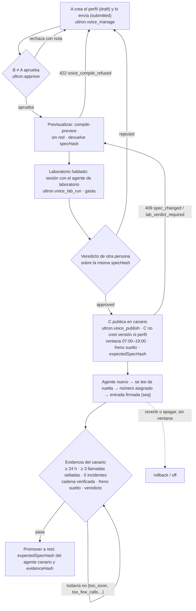

# ULTRON STUDIO · Hito 8: manual de la voz y la telefonía

**Qué es.** Cómo funciona la voz de ULTRON STUDIO: qué es cada pieza, cómo se gobierna desde el Studio, cómo entra y sale una llamada, qué la frena, qué hace el laboratorio hablado, qué se puede comprobar hoy y qué falta, y qué **no** hace el sistema. Incluye la referencia de rutas, comandos, tareas programadas y variables.

**Para quién.** El propietario, quien opera el servidor y las personas que desarrollan o revisan el Hito 8. Hace falta saber qué es una API y una variable de entorno; no hace falta haber leído el código. El uso del CRM en lenguaje llano está en `ULTRON_STUDIO_GUIA_ADMINISTRACION.md` §14; las comprobaciones por fase, en `ULTRON_STUDIO_CHECKLIST_OPERATIVO.md` §5; las pruebas con personas reales (nivel 3), en `ULTRON_STUDIO_PRUEBAS_FISICAS.md` §9; los riesgos, en `ULTRON_STUDIO_H8_RIESGOS.md`; el procedimiento de despliegue, en `ULTRON_STUDIO_DEPLOYMENT_PLAN.md` («Hito 8»).

**Tipo.** Descriptivo (§1–§6) y de referencia (§7–§11). No sustituye al contrato (`ULTRON_STUDIO_H8_CONTRACT.md`, con sus Enmiendas 1–9), que manda sobre este documento.

**Fecha y base:** 08-11-2026, escrito sobre el backend `8d3c41f` (rama `feat/ultron-studio-h8-voice`, commit «Enmienda 9») y el CRM `45dd73a` (paso 3 de FE8, 09-11-2026), leyendo el código.

> **Estado el 08-11-2026: nada del Hito 8 está en producción.** La fase 1 (todo apagado) está preparada y ensayada en el banco, sin ejecutar (`ULTRON_STUDIO_DEPLOYMENT_PLAN.md`, «Hito 8»). En el código, `VoiceCallPolicy::CALLS_ENABLED_IN_CODE = false`: ninguna llamada es posible hasta el commit `voice(calls-open)` de la fase 3.

---

## 1. Lo primero que hay que saber

1. **El Studio es la única autoridad sobre lo que dice la voz.** Una versión aprobada del Studio y un perfil de voz aprobado se compilan en Laravel en un **agente de ElevenLabs nuevo e inmutable**. Nadie escribe un prompt libre en el CRM y el panel de ElevenLabs no es una vía de cambio: un cambio allí es **deriva** y echa el freno.
2. **Laravel es la única puerta.** Las salientes solo las inicia Laravel; las entrantes pasan por su webhook de iniciación; las herramientas que usa el agente durante la llamada son rutas de Laravel con un catálogo cerrado.
3. **Cada llamada queda sellada** al empezar con la publicación, la versión, el perfil, la compilación y el agente. Después de colgar se comprueba que el agente que atendió es el sellado.
4. **Todo nace apagado y cada fase pide autorización escrita** del propietario (fases 2, 3, 4a y 4b). La autorización del 25-10-2026 no cubre llamadas ni ElevenLabs.
5. **Sin datos personales a la vista:** de un teléfono solo se guardan una huella y los 4 últimos dígitos; Laravel no guarda transcripciones ni audio; la grabación está apagada.
6. **Ante la duda, falla cerrado:** una cadena que no verifica, un freno que no se puede leer o una verificación caducada impiden llamar, nunca lo contrario.

*Fuentes: contrato H8, «Objetivo», «Protecciones intocables» 1–13, D8-7, D8-8; `app/Services/Voice/VoiceCallPolicy.php`.*

## 2. Las piezas

| Pieza | Qué es | Dónde vive | Qué NO hace |
|---|---|---|---|
| **Laravel (telefonía)** | La puerta: políticas de entrada y salida, registro de llamadas y eventos, webhooks, herramientas, coste, conciliación, freno y el lector de la cadena de voz | `app/Services/Telephony/**`, `routes/voice.php` | No nombra el Studio salvo el registro de canarios y su cadena; no lee `otp.*` |
| **Studio (gobierno)** | Perfil de voz, compilador, publicación, cadena firmada, evidencia del canario, deriva y laboratorio hablado | `app/Services/UltronStudio/StudioVoice*` | No escribe en `voice_*`: lee la evidencia y suelta el freno solo a través de `VoiceEvidence` y `VoiceBrake` |
| **Adaptadores de proveedor** | HTTP puro, sin estado, sin base de datos: crear y leer agentes, asignar el número, iniciar una saliente, verificar webhooks, la URL firmada del laboratorio, colgar y listar llamadas | `app/Services/Voice/**`, `app/Services/Twilio/{TwilioVoiceCarrier,TwilioRequestSignature}.php` | Ningún adaptador decide nada; cada uno tiene su nulo para cuando falta configuración |
| **ElevenLabs** | El agente conversacional (voz, LLM, herramientas) y la integración nativa con Twilio | Su consola y su API | No es una vía de cambio: un agente publicado no se modifica nunca |
| **Twilio (subcuenta «Voz»)** | El número local dedicado, importado en ElevenLabs; las llamadas reales | Su consola; credenciales propias, **separadas del OTP** | La voz no usa la credencial maestra ni el número de WhatsApp |
| **CRM** | Sección «Voz y telefonía» (`/marketing/ultron-studio/voz`, 7 pestañas) | `src/app/modules/ultron-studio/studio-voice-*` | Solo enseña lo que el servidor permite; nunca guarda un teléfono en la URL, el almacenamiento ni la consola |

**Tres espacios de nombres con fronteras vigiladas por pruebas estáticas** (D8-2): `App\Services\Voice` (neutro y sin estado), `App\Services\Telephony` (con estado) y `App\Services\UltronStudio\StudioVoice*` (gobierno). Las guardas `VoiceIsolationTest`, `VoiceBoundaryTest`, `TelephonyIsolationTest`, `OtpUntouchedByVoiceTest`, `UltronEngineIsolationTest` y la lista cerrada de `TwilioReadOnlyClientTest` caen si alguien cruza una frontera, lee un secreto fuera de su lector o añade red donde no toca.

**Lo que no se toca:** el OTP (diff vacío en `app/Services/{Sms,Otp}/**`, `config/otp.php`, `routes/api.php`), el motor de WhatsApp (diff vacío en `app/Services/Marketing/**` y compañía; las dos únicas lecturas son `OutboundContentGuard::inspect()` y las señales `do_not_contact` y `consent_status = denied` del lead, por adaptadores de solo lectura), Meta (solo lectura) y la cadena del H5.

*Fuentes: contrato D8-2, D8-3, D8-4, protecciones 4–7, E2-6, E4-3; `informe-security.md` §2; `informe-backend.md` §2.*

## 3. Cómo funciona

### 3.1 De una versión aprobada a un agente inmutable

**Entradas** (las tres obligatorias):
1. Una **versión del Studio** en `APPROVED`, `CANARY` o `PUBLISHED` (E1-7), aprobada a cuatro ojos con el flujo del H5.
2. Un **perfil de voz aprobado** (`ultron_studio_voice_profiles`), con un conjunto **cerrado** de campos: voz e idioma (`es`), saludos de entrantes y salientes, duración máxima (60 s como mínimo, tope del servidor 300 s por defecto, techo del esquema 600 s), hasta 3 destinos de transferencia (alias y número cifrado), herramientas activas, retención (≤ 30 días), buzón (solo `hang_up`) y dos huecos de texto (`presentation` y `closing`, ≤ 160 caracteres). El aviso de IA no se escribe: lo pone el servidor. Grabación siempre `false`.
3. La versión del compilador, `ultron-voice-compiler/1`, y la de la plantilla, `ultron-voice-template/2` (constantes del código; la `/2` añade la sección fija de español de Colombia, el trato opcional `addressForm` del perfil y las defensas del prompt, Enmienda 16; el compilador sigue en `/1`).

**El compilador se niega** (422 `voice_compile_refused {reason, field}`, 38 motivos cerrados) si algo no está aprobado o sus huellas no cuadran; si un texto lleva cifras de dinero, vocabulario de descuento, una URL, un teléfono, un correo, invisibles, llaves, comillas angulares o emojis; si falta `end_call` o `no_volver_a_llamar`; si hay `transfer_to_number` sin `solicitar_humano`; si la duración supera `VOICE_PER_CALL_MAX_SECONDS`; o si falta el aviso.

**Publicar** (`POST voice/publish`) compila, **crea un agente nuevo** en ElevenLabs, lo lee de vuelta (la proyección observada tiene que ser igual a la compilada; si no, el agente queda `rejected` y no se publica), fija sus límites, asigna el número (la parte `canary` atiende las entrantes) e inserta una entrada firmada en la cadena. **Nunca se modifica un agente que ya existe**: revertir es volver a un agente anterior, que sigue existiendo. Una llamada en curso sigue con el agente con el que empezó (no retroactividad, D8-9).

**La huella vista es la publicada:** `publish` exige `expectedSpecHash` = la `specHash` que dio `compile-preview`, y `promote` la del agente canario. Si no coinciden, 409 `spec_changed` sin crear agente, tocar el número ni escribir la cadena (E5-6, E6-9).

### 3.2 La cadena de voz, por partes

- Tabla propia de **solo inserción**, `ultron_studio_voice_publications` (no comparte tabla ni firma con la cadena del H5).
- **Una entrada por parte (`canary` o `rest`) y por agente** (E3-2), encadenada por `prev_hash` = SHA-256 del mensaje canónico anterior (64 ceros en la primera; E2-7).
- El mensaje firmado es el JSON canónico de `{seq, prev_hash, version_uuid, profile_uuid, spec_hash, agent_config_hash, provider_agent_id, scope, actor_id, published_at}`, con HMAC-SHA256 y una subclave de la `APP_KEY` propia de la voz (E1-4). Implementación única en `VoicePublishedConfig::signatureFor()`.
- **El lector nunca lanza y un fallo deniega**: con la cadena ilegible, la política da `publication_unreadable` y no hay llamada.
- Acciones: `publish` (canario con agente), `promote` (resto con agente), `rollback` (vuelve al agente anterior de la parte) y `off` (una entrada sin agente por cada parte que tenía; el número queda sin agente).

### 3.3 El sello de cada llamada

Al empezar (la saliente al pedirla, la entrante en la iniciación), la fila de `voice_calls` guarda la entrada y la parte (`voice_publication_seq`, `part`, `stamp_state`), la versión y el perfil (`studio_version_uuid`, `studio_content_hash`, `voice_profile_hash`), la compilación (`spec_hash`, `payload_hash`, `compiler_version`) y el agente (`provider`, `provider_agent_id`). Tras colgar, la post-llamada anota el agente observado y `seal_verified`. **Si el agente observado no es el sellado: evento `seal_mismatch` y freno.**

### 3.4 Las herramientas: catálogo cerrado

`POST /api/voice/tools/{tool}` admite solo cuatro herramientas, sin cobro, enlaces de pago, descuentos, activación de membresías ni agenda:

| Herramienta | Qué devuelve |
|---|---|
| `consultar_planes` | Nombres y condiciones del catálogo vigente y el precio exacto de la base (`Plan::sellable()`), nunca calculado ni rebajado (P-3) |
| `consultar_horarios` | La sede y el horario, de `VOICE_FACTS_SITE` y `VOICE_FACTS_HOURS`; vacías, dice que no los tiene |
| `solicitar_humano` | Si hay personal ahora (horario de `VOICE_TRANSFER_HOURS_*`) y el **alias** del destino aprobado; nunca el número |
| `no_volver_a_llamar` | Crea una exclusión inmediata **del número sellado de la llamada**, nunca de un parámetro (revocación oral, Ley 2300) |

Cada petición autentica (Bearer con `hash_equals`), valida el esquema y comprueba la llamada: existe, está en `dialing` o `active`, no hay freno, la entrante está autorizada y no ha pasado de **20 peticiones por llamada**. La primera herramienta de una saliente contestada la pasa de `dialing` a `active` (E1-1). Las de sistema son solo `end_call` y `transfer_to_number` (conferencia, a los destinos fijos compilados en el agente).

### 3.5 La guarda posterior

La post-llamada (`post_call_transcription`) se recorre **en memoria**: cada turno del agente pasa por `OutboundContentGuard::inspect()` del motor (solo lectura), más las comprobaciones de la voz (el aviso en el primer turno, cifras de dinero que no salieron de `consultar_planes`, transferencias a destinos no aprobados). **Se guarda solo el veredicto** (códigos y número de turno), nunca el texto. Una violación echa el freno.

### 3.6 Conciliación y deriva

Con el monitor de voz encendido (`VOICE_MONITOR_ENABLED=true`, §9):
- **Conciliación:** las llamadas de la subcuenta en Twilio (lecturas; la única escritura es volver a colgar una saliente cortada que siga viva, E13-9) frente a `voice_calls`. Una llamada **sin su fila** es `unknown_provider_call` y echa el freno; resuelve las `ambiguous`, anota el precio real de Twilio y cuenta las atascadas en `dialing` más de 10 minutos.
- **Deriva del agente:** la proyección observada de cada agente vivo frente a la compilada.
- **Deriva del número** (`--numbers`): a qué agente apunta el número en ElevenLabs frente al publicado en canario; una diferencia se guarda como `agent_drift` con `trigger: number_drift` (E2-3, E6-1).
- **Techo de gasto:** si lo comprometido del día de Bogotá supera `VOICE_DAILY_BUDGET_USD`, freno `cost_cap`.

### 3.7 El freno

Tabla de solo inserción `voice_brakes`: abrir y soltar son filas. **Lo abre solo el sistema**, por una de seis causas: `guard_violation`, `seal_mismatch`, `agent_drift` (también la deriva del número), `cost_cap`, `subaccount_alert` (aviso de gasto de Twilio) y `unknown_provider_call`. Cada causa concreta abre **una** apertura (idempotente por su clave) y un incidente en IRON GUARD (fuente `voice`, clase `voice_brake`).

- Con **cualquier** apertura sin soltar: las salientes dan 409 `voice_braked`, las entrantes reciben `caller_authorized = no`, las herramientas se niegan y no se publica.
- **Nunca se suelta solo.** Lo suelta una persona con `ultron.voice_publish` y una nota de 5 a 300 caracteres; cada apertura se suelta **una vez** y por separado.
- **No implementado:** la regla «nadie suelta un freno que abrió su propia acción» (D8-22, «[por decidir]»): como todas las aperturas son del sistema, el servidor no la comprueba.

### 3.8 El laboratorio hablado

Voz en el navegador, **sin teléfono**, contra un **agente de laboratorio** (misma compilación, `purpose = lab`, sin número, nunca entra en la cadena; uno por sesión, con concurrencia 1 y 1 conversación al día). Laravel emite una URL firmada de un solo uso (vigencia de 900 s; no se guarda ni se repite). **Cuatro cerrojos**: `VOICE_LAB_ENABLED`, `VOICE_LAB_DRIVER` (`fake` = simulador sin ElevenLabs), presupuesto (`VOICE_LAB_DAILY_BUDGET_USD` y `VOICE_LAB_SESSION_BUDGET_USD` > 0) y ElevenLabs en `ELEVENLABS_VERIFIED`; con `elevenlabs`, además `VOICE_WEBHOOK_BASE_URL` y las referencias de los secretos. Como mucho 5 minutos por sesión, un cupo por persona y día de Bogotá (`VOICE_LAB_MAX_SESSIONS_PER_DAY`, 5) y una reserva atómica del coste.

En el CRM, el cliente oficial `@elevenlabs/client` **1.30.0**, en un chunk diferido; el micrófono se pide **antes** de abrir la sesión (si se niega, no se gasta) (E10-12).

El veredicto (`approved` o `rejected`, con nota si rechaza) lo emite **otra persona**: ni quien abrió la sesión ni quien creó la versión. Es definitivo. Las sesiones del simulador no admiten veredicto. Con la puerta en `required` (`ULTRON_STUDIO_VOICE_LAB_GATE`), publicar exige que el último veredicto sobre **la misma `specHash`** sea `approved`.

**Limitaciones conocidas:** las herramientas responden que no hay llamada (en el laboratorio no hay fila en `voice_calls`); un perfil con destinos de transferencia **ya se admite en el laboratorio** (E10-10, Enmienda 16): los números se descifran en memoria, se comprueban contra los destinos aprobados y viajan en la carga como `transfer_to_number`, pero **el laboratorio no transfiere de verdad** (ElevenLabs solo transfiere en llamadas telefónicas y `solicitar_humano` responde `call_not_found` en una sesión web): si el interlocutor pide una persona, el agente dice que ahora no hay nadie y ofrece WhatsApp; un perfil de más de 5 minutos no se puede probar (`informe-lab.md` §3, §6; `ULTRON_STUDIO_H8_RIESGOS.md`, R8-14).

*Fuentes §3: contrato D8-6 a D8-10, D8-14, D8-19, D8-21, D8-23, E1-1, E1-4, E1-7, E2-3, E2-7, E3-2, E5-1, E5-6, E6-1, E6-8, E6-9; `informe-studio.md` §7–§16; `informe-lab.md` §2–§3; `informe-backend.md` §B8-b; código: `app/Services/Telephony/{VoiceBrake,VoiceTools,VoiceReconciler,VoicePublishedConfig}.php`, `app/Models/Voice/VoiceBrakeEntry.php:21`, `app/Services/UltronStudio/{StudioVoicePublishing,StudioVoiceEvidence,StudioVoiceLabConfig}.php`, `app/Services/Voice/Dto/VoiceLabSession.php:45`.*

## 4. Una llamada entrante del canario

Iniciación → herramientas → post-llamada → sello → evidencia, con los caminos de error.

```mermaid
sequenceDiagram
    autonumber
    participant P as Persona canario
    participant T as Twilio (subcuenta Voz)
    participant E as ElevenLabs (agente publicado)
    participant L as Laravel (telefonía)
    participant M as Monitor de voz
    P->>T: llama al número dedicado
    T->>E: número importado (integración nativa)
    E->>L: POST /api/webhooks/voice/elevenlabs/initiation (X-Voice-Initiation-Secret)
    alt secreto mal puesto
        L-->>E: 401 y ninguna fila
        E->>P: con su defecto caller_authorized=no, «línea no disponible» y cuelga (C-A2: visto en el simulador, por confirmar con la cuenta real)
    else secreto válido
        L->>L: InboundPolicy y sello de la parte canary · fila voice_calls active (canario) o denied
        L-->>E: caller_authorized (si o no), call_direction, call_ref, version_label
        E->>P: aviso de IA y saludo (o «línea no disponible» y end_call)
    end
    loop durante la llamada (como mucho 20)
        E->>L: POST /api/voice/tools/{tool} (Bearer)
        L-->>E: datos del catálogo, o rechazo neutro si no hay llamada viva, hay freno o se agotó el cupo
    end
    E->>L: POST /api/webhooks/voice/elevenlabs/post-call (ElevenLabs-Signature)
    L->>L: completed · seal_verified · guarda por turno en memoria · coste
    opt agente distinto del sellado o violación de la guarda
        L->>L: seal_mismatch o guard_verdict → freno e incidente de IRON GUARD
    end
    M->>T: voice:reconcile (cada 10 min; lecturas, y cuelga una cortada que siga viva)
    M->>L: precio real · una llamada sin fila es unknown_provider_call → freno
    Note over L: GET voice/canary-evidence cuenta la llamada sellada con esa entrada y esa parte
```

*Fuentes: contrato D8-11, D8-16, D8-21, E1-5, E6-4; `ULTRON_STUDIO_DEPLOYMENT_PLAN.md`, «El secreto de iniciación» (O-2); `informe-tester.md` §TEST8-b (recorridos c y e); código: `app/Services/Voice/ElevenLabs/ElevenLabsAgentMapper.php:75`, `app/Services/Telephony/{InboundGate,VoiceTools,VoicePostCall}.php`.*

## 5. El flujo de publicación

Perfil → aprobar → previsualizar → laboratorio → publicar en canario → evidencia → promover. A, B y C son personas distintas donde lo exige el servidor.



*Fuentes: contrato D8-6, D8-7, D8-19, D8-23, E5-6, E6-9; `informe-studio.md` §8, §10 (decisiones 5–7), §14.2 (orden de las puertas); código: `app/Services/UltronStudio/StudioVoicePublishing.php:225-470, 962-1001`, `StudioVoiceEvidence.php:62-183`.*

## 6. Fases, banderas y cerrojos

### 6.1 Las fases

| Fase | Qué queda | Lo que se enciende | Autoriza |
|---|---|---|---|
| **1. Todo apagado** | Código y migraciones; todo apagado; la constante en `false` | Nada (el script escribe 9 variables en su valor apagado) | Orden de despliegue del propietario |
| **2. Credenciales y número** | Subcuenta, keys y número (con su expediente); clave de ElevenLabs rotada; secretos registrados; laboratorio hablado con presupuesto; **ni una llamada telefónica** | Las piezas de la fase 2, `VOICE_MONITOR_ENABLED`, `VOICE_LAB_*` | Autorización escrita |
| **3. Entrantes en canario** | Commit `voice(calls-open)`; publicación en canario; canarios de voz activos | `ULTRON_STUDIO_VOICE_PUBLISHING_ENABLED` (para publicar el canario), `VOICE_INBOUND_ENABLED`, `VOICE_INBOUND_DAILY_CAP` > 0, `TWILIO_VOICE_ENABLED` | Autorización escrita y la del «T3 de voz» |
| **4a. Salientes a canarios** | Worker `ironbody-voice` | `VOICE_OUTBOUND_ENABLED`, `TWILIO_VOICE_DAILY_CALL_CAP` pequeño, `VOICE_DAILY_BUDGET_USD` > 0 | Autorización escrita |
| **4b. Contactos con consentimiento** | Visto bueno legal; consentimientos, RNE, horario, festivos y frecuencia; una publicación promovida a `rest` | `VOICE_OUTBOUND_SCOPE=contacts`, `VOICE_RNE_VALIDITY_DAYS` > 0 | Autorización escrita |

Abrir las entrantes a todo el público queda **fuera del H8**. El detalle operativo de cada fase está en `ULTRON_STUDIO_CHECKLIST_OPERATIVO.md` §5.

### 6.2 La línea: los cerrojos que cruza una llamada

El CRM los enseña en este orden (pestaña «Estado») y la línea se corta en el primero cerrado: **llamadas en el código** (la constante) → **ElevenLabs** (`ELEVENLABS_VERIFIED`) → **Twilio Voice** (bandera y número) → **publicación de voz** → **freno** → **entrantes** → **salientes**. Es un resumen: los motivos exactos son los de la política.

**Motivos de las entrantes** (`InboundPolicy::REASONS`, en orden): `inbound_disabled`, `calls_disabled_in_code`, `voice_braked`, `no_publication`, `publication_unreadable`, `not_an_active_voice_canary`, `concurrency_exceeded`, `daily_cap_reached`.

**Motivos de las salientes** (`OutboundPolicy::REASONS`, en orden): código y proveedor (`calls_disabled_in_code`, `outbound_disabled`, `twilio_voice_disabled`, `no_voice_number`, `voice_number_is_whatsapp`, `elevenlabs_not_configured`, `elevenlabs_disabled`, `elevenlabs_unverified`); publicación (`no_publication`, `publication_unreadable`, `agent_drift`, `voice_braked`); destino (`source_not_allowed`, `not_an_active_voice_canary`, `contact_not_authorized`, `no_voice_consent`, `excluded`, `rne_check_missing`); calendario (`outside_hours`, `holiday`); cupos (`frequency_exceeded`, `concurrency_exceeded`, `daily_cap_zero`, `daily_cap_reached`, `budget_exhausted`); `duplicate_request`. El job vuelve a comprobar destino y calendario justo antes de marcar y cancela sin petición si algo cambió (E6-6).

**Hoy las salientes fallan cerradas con `elevenlabs_unverified` aunque el Studio diga `ELEVENLABS_VERIFIED`:** la telefonía no lee la verificación guardada hasta que B8 añada su lector, antes de la fase 3 (E4-6, E8-3).

*Fuentes §6: contrato «Fases de despliegue», D8-11, D8-12, E2-8, E4-6, E6-6; `ULTRON_STUDIO_DEPLOYMENT_PLAN.md`, «Hito 8» (tabla de fases); código: `app/Services/Telephony/InboundPolicy.php:35-36`, `OutboundPolicy.php:38-46`, `VoicePublishedConfig.php:252-255`; CRM `26ef142`: `studio-voice-text.ts` (`voiceLineNodes`).*

## 7. Referencia: rutas

Comprobadas en la tabla real de rutas (`php artisan route:list --path=voice --json` sobre `8d3c41f`, 08-11-2026) y en `app/Support/Access/AuthorizationMap.php:773-835, 856-861`. **34 rutas nuevas con permiso** (21 del Studio + 13 de la telefonía), **4 públicas** y la ruta 45 del H6, ampliada. Todas las del CRM exigen además **una persona** (el token compartido no recibe ninguna llave `ultron.*` ni `telephony.*`).

### 7.1 Studio: `/api/admin/ultron-studio/…` (tope de cuerpo 64 KB)

| # | Método y ruta | Permiso | Cupo | Notas |
|---|---|---|---|---|
| 45 | `GET integrations/voice` | `ultron.view` | lectura | H6, ampliada: `telephonyState`, `phase`, `brake`, `publishing`, `publication`, `can` (las 7 llaves para la sesión) y `template` |
| 1 | `GET voice/profiles` | `ultron.view` | lectura | Resúmenes sin contenido, con `actions` |
| 2 | `GET voice/profiles/{uuid}` | `ultron.view` | lectura | Destinos como alias y 4 dígitos |
| 3 | `POST voice/profiles` | `ultron.voice_manage` | escritura | Crea una revisión `draft`; idempotente por `clientRequestId` |
| 4 | `POST voice/profiles/{uuid}/submit` | `ultron.voice_manage` | escritura | Solo quien lo creó (403 `not_profile_owner`) |
| 5 | `POST voice/profiles/{uuid}/approve` | `ultron.approve` | escritura | Otra identidad (403 `four_eyes_required`) |
| 6 | `POST voice/profiles/{uuid}/reject` | `ultron.approve` | escritura | Nota de 5 a 500 |
| 7 | `POST voice/compile-preview` | `ultron.voice_manage` | **lectura** | Sin red ni escritura; devuelve `specHash` |
| 8 | `GET voice/publications` | `ultron.view` | lectura | Estado por parte e historial verificado |
| 9 | `POST voice/publish` | `ultron.voice_publish` | escritura + `ultron-studio-evidence` | `expectedSpecHash` obligatorio |
| 10 | `POST voice/promote` | `ultron.voice_publish` | escritura + `ultron-studio-evidence` | `evidenceHash` y `expectedSpecHash` |
| 11 | `POST voice/rollback` | `ultron.voice_publish` | escritura | `scope` `canary`\|`rest`, motivo de 5 a 500; sin ventana |
| 12 | `POST voice/off` | `ultron.voice_publish` | escritura | Motivo de 5 a 500; sin ventana |
| 13 | `GET voice/canary-evidence` | `ultron.view` | lectura + `ultron-studio-evidence` | Los criterios de §8 de la guía |
| 14 | `GET voice/brakes` | `ultron.view` | lectura | `?limit≤50` |
| 15 | `POST voice/brakes/{uuid}/release` | `ultron.voice_publish` | escritura | `{clientRequestId, note}` (5–300) |
| 16 | `GET voice-lab/status` | `ultron.view` | lectura | 200 también con el laboratorio apagado |
| 17 | `GET voice-lab/sessions` | `ultron.view` | lectura | Historial |
| 18 | `GET voice-lab/sessions/{uuid}` | `ultron.view` | lectura | |
| 19 | `POST voice-lab/sessions` | `ultron.voice_lab_run` | escritura + `ultron-studio-lab-run` | **Gasta**; la URL firmada sale una sola vez |
| 20 | `POST voice-lab/sessions/{uuid}/end` | `ultron.voice_lab_run` | escritura | Solo quien la abrió |
| 21 | `POST voice-lab/sessions/{uuid}/verdict` | `ultron.approve` | escritura | Otra identidad, misma `specHash` |

Cupos con nombre: `ultron-studio-read` y `ultron-studio-write` (los del Studio), `ultron-studio-evidence` (10 por minuto y persona) y `ultron-studio-lab-run` (10 por hora y persona, 30 por hora y red) (`routes/ultron-studio.php`, cabecera).

### 7.2 Telefonía del CRM: `/api/admin/voice/…` (tope de cuerpo 16 KB)

| # | Método y ruta | Permiso | Cupo |
|---|---|---|---|
| 22 | `GET status` | `telephony.view` | `voice-admin-read` |
| 23 | `GET calls` | `telephony.view` | `voice-admin-read` |
| 24 | `GET calls/{uuid}` | `telephony.view` | `voice-admin-read` |
| 25 | `GET metrics` | `telephony.view` | `voice-admin-read` |
| 26 | `GET contacts` | `telephony.contacts_manage` | `voice-admin-read` |
| 27 | `POST calls` (la puerta de salientes) | `telephony.call_place` | `voice-admin-write` |
| 28 | `POST calls/{uuid}/hangup` | `telephony.call_place` | `voice-admin-write` |
| 29 | `POST contacts` | `telephony.contacts_manage` | `voice-admin-write` |
| 30 | `POST contacts/{uuid}/consents` | `telephony.contacts_manage` | `voice-admin-write` |
| 31 | `POST contacts/{uuid}/consents/confirm` | `telephony.contacts_manage` | `voice-admin-write` |
| 32 | `POST contacts/{uuid}/revoke` | `telephony.contacts_manage` | `voice-admin-write` |
| 33 | `POST exclusions` | `telephony.contacts_manage` | `voice-admin-write` |
| 34 | `POST rne-checks` | `telephony.contacts_manage` | `voice-admin-write` |

`voice-admin-read` y `voice-admin-write`: 120 y 30 por minuto **por persona** con sesión; sin sesión, un cubo propio por ruta y red (60 y 30), que nunca toca el cubo del login. El 429 lleva `Retry-After` y el cuerpo `{ok, code: too_many_requests, message, retry_after}` (E9-4; `routes/voice.php:36-40`).

### 7.3 Públicas (sin sesión, fuera de `/api/admin`)

| Ruta | Autenticación | Tope | Límite (después de autenticar) |
|---|---|---|---|
| `POST /api/webhooks/voice/elevenlabs/post-call` | `ElevenLabs-Signature` (HMAC del cuerpo crudo; 1 800 s hacia atrás y 300 hacia delante) | 1 MB | 10/min por evento; techo global 240/min |
| `POST /api/webhooks/voice/elevenlabs/initiation` | Secreto en la cabecera `X-Voice-Initiation-Secret`, con `hash_equals` | 8 KB | 10/min por `call_sid`; techo global 120/min |
| `POST /api/voice/tools/{tool}` | `Authorization: Bearer <ELEVENLABS_TOOL_SECRET>`, con `hash_equals` | 8 KB | 60/min por llamada y 20 por llamada en la base; techo global 600/min |
| `POST /api/webhooks/voice/twilio/usage-trigger` | `X-Twilio-Signature` con el token de la subcuenta | 64 KB | 10/min por `IdempotencyToken`; techo global 60/min |

- **No hay límite por IP antes de autenticar** (E5-4): ElevenLabs sale por IP comunes a todos sus clientes. Una credencial mala cuenta en su propio cubo (`ruta|IP|fallo`, 30/min) y, agotado, recibe 429 sin registrar nada; como mucho una línea `voice.public.failures_silenced` por minuto y ruta (E6-4, E9-3).
- Una firma mala da 401; un fallo propio de la base, 5xx para que ElevenLabs reintente; un duplicado o un tipo desconocido válido, 200.

*Fuentes §7: `routes/voice.php`, `routes/ultron-studio.php:78-211`, `app/Support/Access/AuthorizationMap.php`, `config/voice.php:197-204`; contrato D8-16, E4-10, E5-4, E6-4, E9-3, E9-4; `informe-backend.md` §B8-b, §B8-c (2).*

## 8. Referencia: comandos

Todos como `www-data`, desde `/var/www/api/backend`: `sudo -u www-data php artisan …`. Ninguno imprime números, secretos ni transcripciones.

| Comando | Qué hace | Sale con | Red |
|---|---|---|---|
| `voice:doctor [--json] [--verify] [--telefonia]` | Estado de ElevenLabs y piezas que faltan **por nombre**. `--verify` solo actúa en `ELEVENLABS_UNVERIFIED` (un GET al agente de verificación; no guarda nada). `--telefonia` añade la constante, las banderas, el número, la cadena por partes, el freno, los límites, el horario y los destinos de transferencia | 0; con `--verify`, 0 solo con `credentials_ok` | Solo con `--verify` |
| `voice:hangup {call?} [--all --confirm]` | Corte de emergencia (D8-20, nivel 0b): cuelga en Twilio una llamada o, con `--all --confirm`, todas las `dialing`, `active` y las pedidas sin marcar (estas se cancelan). Sin la credencial de la subcuenta avisa y solo cancela las no marcadas | 0 si todas quedan colgadas, canceladas o ya no vivas; 1 si alguna falla, si falta `--confirm` o si la llamada indicada no existe | Twilio (`Status=completed`) |
| `voice:reconcile [--hours=48] [--numbers] [--dry-run] [--json]` | Conciliación (§3.6). `--numbers` **se suma**: además mira a qué agente apunta el número. **No es de solo lectura:** escribe eventos y precios y puede echar el freno, también ejecutado a mano. El modo en seco `--dry-run` informa `wouldOpenBrake`, incidentes, eventos, transiciones y precios **sin escribir nada** (E12-4, B8-d). Una saliente cortada que Twilio enseñe viva se vuelve a colgar y, si no se confirma, freno (E13-9, B8-e) | 0 sin desconocidas, sin techo superado y sin deriva; si no, 1 | Solo GET a los proveedores |
| `voice:prune-rate-limits [--dry-run] [--json]` | Borra de la caché `database` **solo** las claves `voice-rl:*` caducadas (P8-3); `--dry-run` solo cuenta | 0 | Ninguna |
| `ultron-studio:integrations-snapshot --verify-voice` | La verificación que deja evidencia: un GET al agente de verificación y una instantánea; con ella de menos de 30 días el Studio afirma `ELEVENLABS_VERIFIED` | 1 si la voz no está en `UNVERIFIED` | Un GET |

*Fuentes: `app/Console/Commands/Voice/{VoiceDoctorCommand,VoiceHangupCommand,VoiceReconcileCommand,VoicePruneRateLimitsCommand}.php` (firmas y códigos de salida leídos); `routes/console.php:458-468`; contrato D8-20, E6-5, E9-2.*

## 9. Referencia: tareas programadas

Bloque propio en `routes/console.php:429-469`, **solo si `VOICE_MONITOR_ENABLED=true`** (nunca dentro del bloque del monitor del Studio, E2-6). Apagado, no se programa nada de la voz y los comandos siguen disponibles a mano.

| Tarea | Cuándo | Qué |
|---|---|---|
| `voice:reconcile` | Minutos 10, 20, 30, 40 y 50 de cada hora | La conciliación de llamadas, deriva de agentes y techo de gasto |
| `voice:reconcile --numbers` | Cada hora, en el minuto 0 | Lo mismo y, además, la deriva del número |
| `voice:prune-rate-limits` | A diario a las 04:40 de Bogotá | La purga de los límites caducados |
| `ultron-studio:integrations-snapshot --verify-voice` | Los lunes a las 07:20 de Bogotá | La verificación semanal que mantiene `ELEVENLABS_VERIFIED` |

Todas con `withoutOverlapping(10)` y `onOneServer()`. Son cuatro tareas: con el monitor de voz encendido, el total de `schedule:list` sube en 4.

*Fuentes: `routes/console.php:420-469`; contrato D8-21, E2-6, E9-2.*

## 10. Referencia: variables

Leídas en `config/voice.php` y `config/ultron_studio.php` (bloque `voice`) y contrastadas por nombre con el fichero de ejemplo de entorno (bloques «Voz y ElevenLabs (Hito 6…)» y «Voz y telefonía (Hito 8…)»). **Booleanos:** solo `true`, `1`, `on` o `yes` encienden. **Enteros:** vacío o no entero = el defecto; fuera de rango se recorta. **Ningún valor de secreto aparece aquí**: los pone el propietario en el servidor, nunca por chat ni en el repositorio.

| Variable | Defecto | Rango / forma | Secreto | Cuándo se pone o se enciende |
|---|---|---|---|---|
| `ELEVENLABS_ENABLED` | `false` | booleano | | **Ya `true` en producción desde el 03-11-2026** (E1-12) |
| `ELEVENLABS_API_KEY` | vacía | | sí | Puesta (E1-12). **Rotar antes de la fase 2** (E2-2), con `backend/docs/ultron-studio/ops/el-verificar.sh`, que regenera también los dos secretos propios: antes de registrarlos |
| `ELEVENLABS_AGENT_ID` | vacía | `^[A-Za-z0-9_-]{1,64}$` | | Puesta (E1-12): el agente **de verificación**, inerte y sin número |
| `ELEVENLABS_WEBHOOK_SECRET` | vacía | | sí | Generada en el servidor (E1-12); registrarla en ElevenLabs en la fase 2 |
| `ELEVENLABS_TOOL_SECRET` | vacía | | sí | Generada en el servidor (E1-12); registrarla en la fase 2 |
| `ELEVENLABS_REGION` | `default` | `default` \| `eu` | | `default` (E1-12) |
| `ELEVENLABS_TIMEOUT_SECONDS` | 10 | 3–30 | | — |
| `ELEVENLABS_BASE_URL` | vacía | | | Se ignora en `production` (simulador del banco) |
| `ELEVENLABS_AGENT_PHONE_NUMBER_ID` | vacía | id | | Fase 2: el id del número importado |
| `ELEVENLABS_INITIATION_SECRET` | vacía | | sí | Fase 2 (distinto del de las herramientas) |
| `ELEVENLABS_TOOL_SECRET_REF`, `ELEVENLABS_INITIATION_SECRET_REF`, `ELEVENLABS_POST_CALL_WEBHOOK_REF` | vacías | ids | no (son ids) | Fase 2, al registrar los secretos en ElevenLabs |
| `TWILIO_VOICE_ENABLED` | `false` | booleano | | Fase 3 |
| `TWILIO_VOICE_FROM` | vacía | E.164 | | Fase 2: el número dedicado (nunca el de WhatsApp: la política da `voice_number_is_whatsapp`) |
| `TWILIO_VOICE_DAILY_CALL_CAP` | 0 | 0–20 | | Fase 4a, pequeño (p. ej. 3) |
| `TWILIO_VOICE_ACCOUNT_SID` | vacía | `AC…` | | Fase 2: la subcuenta «Voz» |
| `TWILIO_VOICE_API_KEY_SID`, `TWILIO_VOICE_API_KEY_SECRET` | vacías | `SK…` | el secreto | Fase 2: la key restringida de Laravel |
| `TWILIO_VOICE_SIGNING_TOKEN` | vacía | | sí | Fase 2: el Auth Token de la subcuenta, solo para validar firmas |
| `TWILIO_VOICE_BASE_URL` | vacía | | | Se ignora en `production` |
| `VOICE_WEBHOOK_BASE_URL` | vacía | https, sin ruta | | Fase 2 |
| `VOICE_INBOUND_ENABLED` | `false` | booleano | | Fase 3 |
| `VOICE_INBOUND_DAILY_CAP` | 0 | 0–20 | | Fase 3 (> 0) |
| `VOICE_OUTBOUND_ENABLED` | `false` | booleano | | Fase 4a |
| `VOICE_OUTBOUND_SCOPE` | `canary` | `canary` \| `contacts` | | Fase 4b: `contacts` (otro valor cuenta como `canary`) |
| `VOICE_MAX_CONCURRENT_CALLS` | 1 | 1–4 | | Techo (no enciende nada) |
| `VOICE_PER_CALL_MAX_SECONDS` | 300 | 60–600 | | Techo; el compilador rechaza un perfil que pida más |
| `VOICE_DAILY_BUDGET_USD` | `0` | decimal | | Fase 4a (> 0). Ver la nota de abajo |
| `VOICE_OUTBOUND_RINGING_SECONDS` | 30 | 10–60 | | [P-10] |
| `VOICE_OUTBOUND_HOURS_WEEKDAYS`, `VOICE_OUTBOUND_HOURS_SATURDAY` | vacías | `HH:MM-HH:MM` | | [P-13]; nunca amplían el horario legal |
| `VOICE_FREQUENCY_PER_WEEK` | 2 | 1–2 | | [P-11] |
| `VOICE_FREQUENCY_WEEK` | `rolling` | `rolling` \| `calendar` | | [P-11] |
| `VOICE_TRANSFER_HOURS_WEEKDAYS`, `VOICE_TRANSFER_HOURS_SATURDAY` | vacías | `HH:MM-HH:MM` | | [P-12]; vacías = nunca se ofrece transferir |
| `VOICE_FACTS_SITE`, `VOICE_FACTS_HOURS` | vacías | texto plano: letras, áéíóúüñ, dígitos, espacio y `. , ; : - # / ( )`; 1–300; sin URL ni teléfonos | | Antes de la fase 3 (hechos de `consultar_horarios`; dice los dos o ninguno). Solo con `h8-voice-scope.sh hechos --sede='…' --horario='…'` (vuelta: `hechos borrar`), que los escribe entre comillas dobles y comprueba la configuración efectiva byte a byte (`informe-devops-hechos-voz.md`) |
| `VOICE_RNE_VALIDITY_DAYS` | 0 | 0–365 | | Fase 4b [P-14]; con 0 ninguna consulta vale |
| `VOICE_LAB_ENABLED` | `false` | booleano | | Fase 2 |
| `VOICE_LAB_DRIVER` | `fake` | `fake` \| `elevenlabs` | | Fase 2: `elevenlabs` |
| `VOICE_LAB_DAILY_BUDGET_USD`, `VOICE_LAB_SESSION_BUDGET_USD` | `0` | decimal | | Fase 2 (> 0) |
| `VOICE_LAB_MAX_SESSION_SECONDS` | 300 | 60–300 | | Techo |
| `VOICE_LAB_MAX_SESSIONS_PER_DAY` | 5 | 0–50 | | Cupo por persona y día de Bogotá |
| `VOICE_MONITOR_ENABLED` | `false` | booleano | | Fase 2, en cuanto el número esté importado |
| `VOICE_PUBLIC_INITIATION_PER_MINUTE` | 120 | 10–1 200 | | Techo global (E9-3) |
| `VOICE_PUBLIC_POST_CALL_PER_MINUTE` | 240 | 10–2 400 | | Techo global |
| `VOICE_PUBLIC_TOOLS_PER_MINUTE` | 600 | 60–6 000 | | Techo global |
| `VOICE_PUBLIC_USAGE_TRIGGER_PER_MINUTE` | 60 | 10–600 | | Techo global |
| `QUEUE_VOICE_RETRY_AFTER` | 120 | entero | | Mayor que el `--timeout` del worker |
| `ULTRON_STUDIO_VOICE_PUBLISHING_ENABLED` | `false` | booleano | | Fase 3, para publicar el canario (es la **única** bandera de publicar, E4-1) |
| `ULTRON_STUDIO_VOICE_LAB_GATE` | `required` | `required` \| `waived` | | Solo el propietario la dispensa (P-19) |
| `ULTRON_STUDIO_VOICE_CANARY_MIN_HOURS` | 24 | 1–168 | | [P-16] |
| `ULTRON_STUDIO_VOICE_CANARY_MIN_CALLS` | 3 | 1–100 | | [P-16] |
| `ULTRON_STUDIO_MONITOR_EXPECT` | vacía (= `twilio:connected_otp_only,twilio_voice:not_configured,elevenlabs:ELEVENLABS_NOT_CONFIGURED`) | formato de `--expect` | | Antes de encender el monitor del H7, con la de la fase (`ULTRON_STUDIO_DEPLOYMENT_PLAN.md`, «Hito 8», paso 11) |

**Precios para la reserva** (`config/voice.php:239-246`, sin variable, fecha `2026-11-03`; cambiarlos es un commit revisado): ElevenLabs 80 000 µUS$/min; Twilio saliente a móvil 37 700, a fijo 70 000, entrante local 94 500 y Media Streams 4 400 µUS$/min. La reserva de una llamada es `ceil(segundos máximos / 60) × (ElevenLabs + tramo de Twilio + Media Streams)`, más el tramo de transferencia al precio de fijo (`VoiceCostGuard::reserveMicros`). Con los defectos (300 s): unos **0,96 US$** una saliente a móvil, **1,24 US$** una entrante autorizada y **0,18 US$** una entrante denegada (un minuto). Son techos de reserva, no el coste real.

> **Nota (E12-3, B8-d, 09-11-2026):** `cost_cap` solo salta si el gasto comprometido del día de Bogotá es **mayor** que `VOICE_DAILY_BUDGET_USD` **y mayor que cero**; las llamadas `denied`, `canceled` y `failed_to_start` no reservan pero cuentan su coste real (0 en la prueba O-2).

*Fuentes: `config/voice.php` (leído entero), `config/ultron_studio.php:270-284, 303-316`, el fichero de ejemplo de entorno (líneas 395–513, solo nombres), `config/queue.php:186-204`; código: `app/Services/Telephony/{VoiceCostGuard,OutboundGate,InboundGate,VoiceReconciler}.php`; contrato D8-5, D8-15, E1-12, E2-2, E4-1, E9-3; `ULTRON_STUDIO_DEPLOYMENT_PLAN.md`, «Hito 8».*

## 11. Referencia: estados y eventos

**`voice_calls.status`** (solo hacia delante; un final no cambia): `requested` → `canceled` | `failed_to_start` | `ambiguous` | `dialing` | finales; `ambiguous` → `dialing` | finales (nunca `canceled`); `dialing` → `active` | `completed` | `busy` | `no_answer` | `failed` | `hung_up`; `active` → `completed` | `failed` | `hung_up`. Una entrante nace `active` (autorizada) o **`denied`** (final). Un tramo de transferencia nace en el estado que ve el proveedor y se enlaza con su llamada madre (`transfer_of_call_id`). Un `ambiguous` **no se reintenta nunca solo**: lo resuelve la conciliación.

**`voice_call_events`** (solo inserción, deduplicados por `(provider, kind, provider_event_key)`): `outbound_requested`, `outbound_started`, `outbound_rejected`, `outbound_ambiguous`, `initiation_received`, `post_call_transcription`, `post_call_audio_discarded`, `call_initiation_failure`, `tool_call`, `guard_verdict`, `hangup_requested`, `reconciled`, `seal_mismatch`, `cost_recorded`, `unknown_provider_call`.

**Tablas** (11, dos migraciones aditivas `2026_11_10_100001` y `…100002`): Studio `ultron_studio_voice_{profiles,agents,publications,lab_sessions}`; telefonía `voice_calls`, `voice_call_events`, `voice_contacts`, `voice_consents`, `voice_exclusions`, `voice_rne_checks`, `voice_brakes`. Seis son de solo inserción (cadena, eventos, consentimientos, exclusiones, RNE y frenos): el rol de la aplicación queda en `ra` y 20 intentos de UPDATE/DELETE/TRUNCATE dan 42501. **Nunca `migrate:rollback` en producción.**

*Fuentes: contrato D8-13, E1-1, E1-2, E3-1, E3-5; `informe-db.md` §3–§5.*

## 12. Evidencia: qué está hecho y qué falta

Estado el 08-11-2026. «Hecho» es lo ejecutado en el banco o en las suites, nunca en producción.

### 12.1 Hecho (código y banco)

| Paquete | Evidencia | Fuente |
|---|---|---|
| DB8 (esquema) | 2 migraciones; PG 68/84/6/18 y 27/51/3/7; ida y vuelta idéntica; 59 mutantes cazados | `informe-db.md` §0, §5; E3-5, E3-6 |
| B8 (telefonía) | B8-a/b/c confirmados; SQLite 759 + 588 y PG 1 347 pruebas, 0 fallos; `auth:coverage` vacío; 46/46 mutaciones en B8-c | `informe-backend.md` §B8-c (2); E9-7 |
| S8 (gobierno) | Perfiles, compilador, publicación, cadena, evidencia, deriva, `can`, `template`, `expectedSpecHash` | `informe-studio.md` §15; E5-6, E6-7 a E6-9 |
| LAB8 (laboratorio) | Sesiones, cuatro cerrojos, reserva atómica, veredicto; oyente de la post-llamada registrado (E8-1, E9-1) | `informe-lab.md`; `informe-backend.md` §B8-c |
| FE8 paso 2 (CRM) | 7 pestañas; 1 195 specs en verde; `tsc` 0/0; catálogo de permisos regenerado (111 permisos) | `informe-front.md` §0 |
| TEST8-b (E2E con simuladores) | **Pasada final sobre `8ed0924`:** cerrada 6/6 (112 comprobaciones), abierta 9/9 (283), 0 violaciones en los simuladores, 0 red fuera de 127.0.0.1; hash `6ee260ef…`; evidencia en `ops/evidencia-h8/2026-11-08/20261108T224030Z-8ed09240/` | `informe-tester.md`, «Cierre del lead» (`ccbf4a0`) |
| OPS8 (despliegue de la fase 1) | **Ensayo sobre el HEAD final `8d3c41f`** en el banco rehecho: paso 0 con código 3 sin la bandera y en verde con `--acepta-main=7c84cb5`, despliegue completado, smoke 49 OK y 1 omitido esperado | `informe-devops.md`, «Cierre del lead» (`e112586`) |
| PERF8 | Rutas públicas dentro de objetivo salvo la post-llamada de 1 MB (P8-4, aceptada); «después» de B8-c en consultas: `status` 41 → 25, `metrics` 38 → 25, contactos (100 filas) 212 → 15 | `informe-performance.md` §3, §7 y «Cierre del lead» |
| Puerta 3 y regresión global (E10-1, E10-2) | `auth:coverage` vacío; SQLite 759 (voz y telefonía) y 3 091 (Studio), PG 525, 0 fallos; `suite-compare.sh` frente a `origin/main`: 13 931 pruebas, 57 rojos conocidos, **0 nuevos** | Contrato, Enmienda 10 |
| SEC8-a / SEC8-b-lite / SEC8-b (parcial) | Modelo de amenazas, 61 guardas en verde sobre `8d3c41f`; M-1 corregido (E5-4), B-1 aceptado (E5-5); el SEC8-b parcial deja M-2, M-3, B-2, B-3 y tres huecos de guardas, por lectura de código | `informe-security.md` |

**Estado el 09-11-2026:** SEC8-b completo (el CRM sin hallazgos críticos, altos ni medios); B8-d corregido (`bff58d8`); REV8 emitido: **aprobado con condiciones** para la fase 1 (C-1: repetir el E2E y el ensayo sobre el commit final; C-2: registrar las reescrituras y decidir la rama remota); en curso B8-e (freno inmediato si falla el colgado tras el corte; evidencia para promover solo con la guarda ejecutada, Enmienda 13) y el E2E del CRM (TEST8-b, parte 2).

### 12.2 Pendiente de configuración o de código (antes de una fase)

| Pendiente | Antes de | Dueño | Fuente |
|---|---|---|---|
| El mando `h8-voice-scope.sh` (mueve las banderas de las fases 2–4b con copia previa y `config:cache` como `www-data`). **No existe:** sin él no se enciende ninguna fase | Fase 2 | OPS8 | `ULTRON_STUDIO_DEPLOYMENT_PLAN.md`, «Fases 2 → 3 → 4a → 4b»; `ops/` sin el fichero |
| Adaptar los smokes del H6 y del H7 al H8 (cuentan 14 tablas y `TAREAS`) | Fase 2 | TEST8 / OPS8 | `informe-devops.md` §OPS8-b |
| El lector de la última verificación en la capa de voz (sin él las salientes dan `elevenlabs_unverified`) | Fase 3 | B8 + SEC8 | E4-6, E8-3 |
| La salud del webhook automatizada | Fase 3 | B8 | E8-7 (decisión (f)) |
| nginx: que la post-llamada de 1 MB pase (lo dice el smoke en el servidor) y, si se decide, la lista de IP | Fase 3 | OPS8, con autorización | `informe-devops.md` §OPS8-b |
| La sección de voz de `ops/supresion-1581.sql` (hoy no menciona la voz) | Fase 3 | OPS8 + `database-specialist` | D8-17; `informe-db.md` §11 |
| El commit `voice(calls-open)` (una línea, con la autorización escrita citada) | Fase 3 | Lead, con orden del propietario | Protección 2 |
| El worker `ironbody-voice` (borrador en `docs/ops/supervisor/ironbody-voice.conf`) | Fase 4a | OPS8, con autorización | `informe-devops.md` §OPS8-a |
| `events_watermark_id` (O-1) | Después de la fase 1 | DB8 + S8 + B8 | E9-6 |
| **B8-d, corregido** (`bff58d8`, Enmienda 12): `cost_cap` solo con gasto comprometido mayor que el presupuesto y que cero, y lo denegado sin gasto (E10-8); `voice:reconcile --dry-run` (E10-9); el tope de los códigos de la guarda en la post-llamada (M-2, E10-4); el rearme del freno si cambió la evidencia (B-2, E10-6); que gane el corte de una saliente con el job en vuelo (M-3, E10-5, se hace ya) | Fase 2 (M-3, antes de la 4a) | B8-d | E10-4 a E10-9; R8-13, R8-19 a R8-21, R8-27 |
| La CSP del laboratorio hablado en nginx: `connect-src wss://api.elevenlabs.io` y `Permissions-Policy: microphone=(self)` | Fase 2 | OPS8, con autorización | E10-12 |
| Los tres endurecimientos de las guardas | Fase 2 | SEC8-b | E10-11 |
| Admitir perfiles con destinos en el laboratorio | **Limitación aceptada hasta la fase 3** (el perfil del canario no lleva destinos) | LAB8 (backend) | `informe-lab.md` §6.4; decisión del lead del 08-11-2026 |

### 12.3 Bloqueado por el propietario

| Qué | Bloquea | Fuente |
|---|---|---|
| Orden de despliegue de la fase 1, y la decisión `--acepta-main=7c84cb5` en ese momento | Fase 1 | `ULTRON_STUDIO_DEPLOYMENT_PLAN.md`, «Bloqueantes» 2 |
| Subcuenta «Voz», sus dos API keys restringidas y el token de firma | Fase 2 | Contrato, «Criterio de cierre» |
| El número local con su expediente regulatorio aprobado (registro mercantil y dirección en la localidad del prefijo) | Fase 2 | Ídem; auditoría §c.3, §d.2 |
| El plan de pago de ElevenLabs con telefonía (hoy el workspace está en **free**), la key acotada con cupo de créditos y la región | Fase 2 | E1-12; P-21, P-22 |
| Rotar la clave de ElevenLabs que viajó por el chat | Fase 2 | E2-2 |
| Registrar en ElevenLabs los dos secretos propios sin imprimirlos | Fase 2 | `ULTRON_STUDIO_DEPLOYMENT_PLAN.md`, «Hito 8» |
| B-6 (key restringida del OTP y rotación del maestro), recomendado | Fase 2 | P-4 |
| Decisiones P-5, P-21, P-22 y P-23 | Fase 2 | Contrato, «Fases de despliegue» |
| La fase 2 del H6 (escrituras y dos personas) y `log_error_verbosity = terse` | Fase 3 | Contrato, «Criterio de cierre» |
| Al menos dos personas canario de voz con consentimiento | Fase 3 | Ídem |
| Aprobar el texto del aviso de IA (E1-3) y decidir P-7 a P-9, P-12, P-16 y P-24 | Fase 3 | E1-3; «Fases de despliegue» |
| Aprobar el fixture de festivos 2026–2028 (P-13) | Fase 4a/4b | D8-15 |
| El visto bueno legal (Ley 2300, RNE, Ley 1581, contratos de transmisión) y P-11, P-13 a P-15, P-20 | Fase 4b | Contrato, «Criterio de cierre» |
| La autorización escrita de cada fase de la 2 a la 4b | Cada fase | Protección 13 |

### 12.4 Lo físico que falta (solo con la cuenta real, con autorización)

| Comprobación | Fase | Qué se mira |
|---|---|---|
| **C-A1** | 2 | La importación del número funciona con una API key restringida de la subcuenta (si exige un Auth Token, solo el de la subcuenta, anotado) |
| **C-A2** | 3 | La puerta de entrantes es fallo cerrado: si la iniciación falla, el agente usa `caller_authorized = no` y dice «línea no disponible»; llama un teléfono **no** registrado y oye eso |
| **C-A3** | 3 | Las herramientas reciben `system__conversation_id` y `system__call_sid` sin que los rellene el LLM |
| **C-A4** | 3 | Una publicación nueva no cambia una llamada en curso (por construcción; se comprueba con el `agent_id` de la post-llamada) |
| **C-A5** | 3 | `max_duration_seconds` corta la llamada telefónica y no solo la conversación |
| Pruebas de la fase 3 | 3 | Llama un canario; llama un no registrado; el corte; el freno. La transferencia, **aplazada** (el perfil del canario no lleva destinos) |
| Pruebas de la fase 4a | 4a | Contestada, comunicando, sin respuesta, buzón, duplicada y corte. La transferencia, aplazada |
| Por confirmar en la referencia oficial | 2–3 | Las unidades de `metadata.cost`; que el webhook de iniciación no se dispare en las sesiones web; la vigencia real de la URL firmada; que `call_limits.daily_limit` cuente las conversaciones web; que `null` desasigne el número; la ruta para registrar secretos (`/v1/convai/secrets`) |

El procedimiento de cada una (quién, pasos, lo esperado, la evidencia y la vuelta atrás) está en `ULTRON_STUDIO_PRUEBAS_FISICAS.md` §9. **Ninguna se ha ejecutado.**

*Fuentes §12: contrato «Criterio de cierre», «Fases de despliegue», D8-23, E1-12, E2-2, E8-7, E9-6 a E9-8, E10-1 a E10-12; auditoría `ULTRON_STUDIO_H8_VOICE_AUDIT.md` §e (C-A1 a C-A5); los informes de `plans/informes-h8/` citados en cada fila.*

## 13. Lo que la voz NO hace

- **No es un segundo agente comercial:** no hay reglas, textos ni configuración de voz fuera del Studio, y ULTRON de WhatsApp no se toca.
- **No abre el número al público** («todas» en entrantes queda fuera del H8), no hace llamadas por lotes, no usa un Custom LLM servido por Laravel, ni voz en WhatsApp, ni la integración de WhatsApp de ElevenLabs.
- **No cobra, no da enlaces de pago, no hace descuentos, no activa membresías ni agenda:** las herramientas son solo las cuatro de §3.4.
- **No graba ni guarda transcripciones o audio en Laravel**; el audio que llegue se descarta (`post_call_audio_discarded`).
- **No reintenta solo:** un `ambiguous` nunca se vuelve a marcar sin conciliar; los reintentos de negocio son filas nuevas pedidas por una persona.
- **No modifica un agente publicado** ni usa el versionado nativo de ElevenLabs.
- **No suelta el freno sola** y no se recupera sola de una deriva.
- **No toca el OTP** (otra cuenta, otras credenciales, otro techo y otra ruta) **ni el número de WhatsApp**.
- **No usa el consentimiento de WhatsApp para la voz** (Ley 2300, art. 2) ni llama sin consulta al RNE vigente en la fase 4b.
- **No lee la transcripción para nada que no sea la guarda**, y la descarta.
- **El laboratorio hablado no llama a teléfonos** y sus agentes nunca atienden llamadas.

*Fuentes: contrato «Objetivo» («Fuera del H8»), D8-10, D8-12, D8-16 a D8-19; `informe-security.md` §6.*

## 14. Fuentes

Contrato `ULTRON_STUDIO_H8_CONTRACT.md` (cuerpo y Enmiendas 1–9) y su auditoría `ULTRON_STUDIO_H8_VOICE_AUDIT.md`; `ULTRON_STUDIO_DEPLOYMENT_PLAN.md` («Hito 8»); `ULTRON_STUDIO_ELEVENLABS_READY.md` (H6); los informes `plans/informes-h8/informe-{backend,studio,lab,db,devops,performance,security,front,tester}.md`. En el backend `8d3c41f`: `routes/voice.php`, `routes/ultron-studio.php`, `routes/console.php`, `config/voice.php`, `config/ultron_studio.php`, `config/queue.php`, el fichero de ejemplo de entorno (solo nombres), `app/Support/Access/{AuthorizationMap,CrmPermission,PermissionCatalog}.php`, `app/Console/Commands/Voice/*.php`, `app/Services/Telephony/*.php`, `app/Services/UltronStudio/StudioVoice*.php`; la tabla real de rutas (`php artisan route:list --path=voice --json`) y el reparto por rol (`CrmPermission::byRole()` por `tinker`). En el CRM `26ef142`: `studio-voice-page.ts` y `studio-voice-text.ts`.
