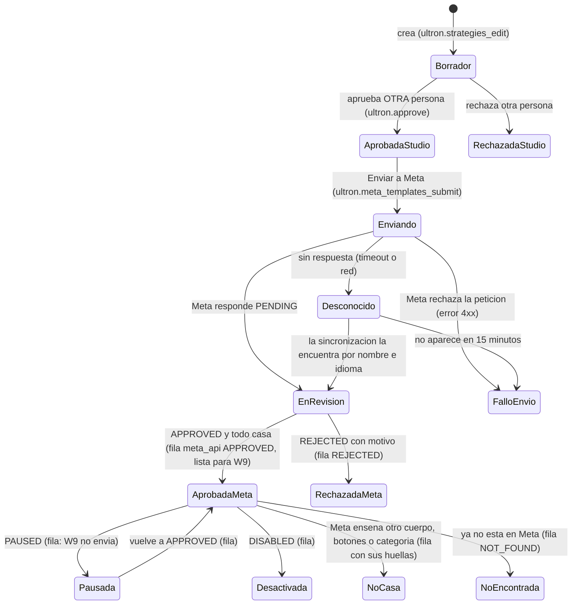
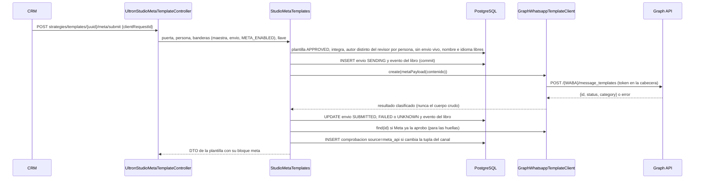

# ULTRON STUDIO · Plantillas de WhatsApp de Meta desde el CRM — plan de arquitectura

> **Autor:** `architect`, 2026-11-10. **Es una propuesta: no implementa nada.**
> **Base verificada:** backend `07e70dac` (rama `feat/ultron-studio-h9`, el commit que sirve producción según L9-94 del contrato H9) y CRM `7a58f16`. El árbol del backend trae cambios del usuario sin confirmar en `docs/ultron-studio/ops/**` y en `ULTRON_STUDIO_H9_CONTRACT.md`: este plan no los toca ni se apoya en ellos.
> **Encargo:** el lead, a petición del propietario («ultra completo», con una interfaz muy cuidada).
> **Ejecutan:** `database-specialist`, `backend`, `frontend` (con la skill `frontend-design`), `tester`, `security` + `api-security-specialist`, `devops` y `reviewer`.
> **Convención:** «`ruta:línea`» es un hecho leído en el código o en un documento del repositorio; lo que no está verificado se marca como **suposición** o **por verificar**.

---

## 0. Resumen en una página

**Lo que pide el propietario:**
- escribir en el CRM una plantilla de WhatsApp: categoría, idioma, encabezado, cuerpo con variables y ejemplos, pie y botones;
- enviarla a Meta para que la revise;
- ver si Meta la aprobó, la rechazó (y por qué) o la pausó;
- que, una vez aprobada, quede **lista para las campañas automáticas de W9 sin pasar por la consola**;
- y verla tal como la verá el socio en su WhatsApp.

**Decisiones:**

| # | Decisión | Dónde se razona |
|---|---|---|
| **D-PM-1** | **Se construye sobre la plantilla versionada del Studio** (`ultron_studio_message_templates`), no en paralelo. Solo se puede enviar a Meta una versión **aprobada a cuatro ojos**, y se envía **exactamente** su contenido inmutable. Una versión del Studio corresponde a **una** plantilla de Meta (nombre + idioma). Desde el CRM **no se edita en Meta**: para corregir se crea la versión siguiente, con otro nombre | §4.3 |
| **D-PM-2** | **Cuatro ojos.** El acto que exige otra persona es **dar por buena la plantilla**: la aprobación del Studio que ya existe, por persona. Esa aprobación es **condición previa para enviar a Meta**. Enviar no exige una tercera persona; aun así, antes de salir el servidor vuelve a comprobar, por persona, que quien aprobó no es quien la escribió | §4.4 |
| **D-PM-3** | **Lo que dice Meta lo registra el sistema, no una persona que lo teclea.** El registro que lee W9 (`ultron_studio_template_meta_checks`) gana filas `source = meta_api` escritas por la sincronización. **Da fe** quien envió la versión, o quien pulsó «Comprobar ahora», con la llave nueva y su persona verificada en ese momento (amplía D-5). Lo negativo (pausa, rechazo, desactivación, recategorización, desaparición, contenido distinto) se registra **siempre y sin esperar a nadie**: falla cerrado | §5.6 |
| **D-PM-4** | **El estado se obtiene por sondeo, no por webhook.** Una orden del Studio cada 5 minutos (de 1 a 3 GET por pasada) y el botón «Comprobar ahora» del CRM. **El webhook y el outbox de hoy no se tocan** (diff vacío). El aviso `message_template_status_update` queda como fase 2 opcional: un «timbre» aislado que no cambia ni el controlador ni el job | §4.2 |
| **D-PM-5** | **El cuarto cerrojo de W9 se amplía, no se sustituye.** Además del nombre, el idioma, la categoría, el estado y la huella del cuerpo, compara una **huella de los componentes** (encabezado, pie y botones) cuando la plantilla los tiene. Sin ella, editar los botones en el administrador de WhatsApp de Meta se saltaría los cuatro ojos | §4.1, §5.3 |
| **D-PM-6** | **La fase 1 incluye solo lo que no pide parámetros al enviar, aparte de los del cuerpo:** encabezado de TEXTO sin variables, cuerpo con los marcadores cerrados de hoy, pie, y botones QUICK_REPLY (entre ellos una baja de lista cerrada). Si el propietario lo aprueba, también un botón de URL estática hacia un dominio de lista y un botón de llamada al número del gimnasio. **El despachador, `OutreachTemplateMessage` y el outbox no cambian.** Los medios, las variables en el encabezado, la URL dinámica, copiar código, los flujos y los carruseles quedan para la fase 2, porque tocan la entrega | §4.5 |
| **D-PM-7** | **Categorías MARKETING y UTILITY**, las de W9 y atadas a la finalidad: comercial ↔ marketing; cobranza y servicio ↔ utility. **AUTHENTICATION queda fuera**: W9 no la admite y su forma es otra (OTP). Idiomas, los de hoy: `es` y `es_CO`; Meta admite `es_CO` | §2.2 |
| **D-PM-8** | **El cliente de Meta es NEUTRO** y vive en `app/Services/Meta/Templates/`: una interfaz, el cliente real de Graph y un doble sin red, como `TwilioReadOnlyClient` en el H6. No nombra el Studio y solo conoce `message_templates`, `me/permissions` y el nodo de una plantilla; **nunca** `/messages`. En producción la URL es fija; **fuera de producción se usa el doble por defecto y nunca `graph.facebook.com`** | §4.6 |
| **D-PM-9** | **Este cliente tiene su propia versión de la Graph API**: por defecto, la última con fecha de caducidad publicada (hoy `v25.0`, que caduca el 29-07-2028), sin depender de `META_GRAPH_VERSION`. Esa variable vale `v21.0` por defecto y **caduca el 21-01-2027**: es un riesgo aparte para el WhatsApp de hoy y queda fuera de este encargo | §2.8, §7 |
| **D-PM-10** | **Una llave nueva:** `ultron.meta_templates_submit` («enviar a Meta plantillas aprobadas y comprobar su estado»), solo para Super Admin por defecto. Las lecturas siguen con `ultron.view`. La sonda de permisos del token usa `ultron.integrations_manage`, que ya existe | §5.10 |
| **D-PM-11** | **Banderas, todas apagadas por defecto:** `ULTRON_STUDIO_META_TEMPLATES_ENABLED` (la maestra), `…_SUBMIT_ENABLED` (lo único que escribe en Meta; además exige `META_ENABLED=true`) y `…_SYNC_ENABLED` (programa la sincronización). Fuera de producción, el driver es `fake` | §5.11 |
| **D-PM-12** | **Esquema mínimo:** 1 tabla nueva (`ultron_studio_meta_template_submissions`) y 1 ampliación aditiva de `ultron_studio_template_meta_checks` (3 columnas, el dominio de estados y el de categorías). El historial se escribe en el libro que ya existe (`ultron_studio_audit_events`, sujeto `message_template`), sin tocar su CHECK | §5.7 |

**Tamaño:** mediano-grande:
- 2 migraciones;
- unos 10 ficheros nuevos de backend;
- 1 enmienda pequeña a W9;
- el rediseño de una pestaña del CRM;
- un componente de vista previa.

No hay una versión más pequeña que cumpla el encargo: o queda abierto el hueco de D-PM-5, o vuelve a hacer falta la consola.

---

## 1. Contexto (hechos verificados)

### 1.1 La plantilla del Studio

- **Una versión inmutable por clave** (`key` + `number`), con `content_json` canónico y su `content_hash`.
  - Los estados solo avanzan: `DRAFT → APPROVED | REJECTED` y `APPROVED → RETIRED`.
  - No se borra.
  - Fuente: `app/Models/UltronStudio/StudioMessageTemplate.php:57-62`, `:65`, `:86-97`.
- **El contenido de WhatsApp es un conjunto CERRADO** de seis claves: `bodyPreview`, `category`, `language`, `metaName`, `optOutLine` y `variables` (`app/Services/UltronStudio/StudioMessageTemplates.php:500`).
  - No hay encabezado, pie, botones ni ejemplos.
  - Idiomas: `es` y `es_CO` (`:60`).
  - La categoría va atada a la finalidad (`:69-73`).
  - Marcadores cerrados (`:81-83`).
  - `metaName` sigue `^[a-z0-9_]{1,64}$` (`:100`).
  - Cuerpo de 1 024 caracteres como máximo (`:92`).
  - Contenido canónico de 8 KB como máximo (`:96`).
  - La cabecera lo dice: «SIN EL ESTADO DE META el 15-11» (`:46`).
- **Los textos pasan tres filtros:** `PlainText` estricto, la guarda de datos de contacto y R-01/R-02/R-03/R-06 (`:604-634`).
- **Cuatro ojos por persona:** aprueba otra persona, con `ultron.approve` y su persona verificada; la misma persona con otra cuenta tampoco puede (`:333-376`; la comprobación está en `:338`).
- **`content()` solo se llama al crear** (`:263`): endurecer la validación afecta únicamente a las versiones nuevas.
- **Vista previa actual:** el texto con `[marcador]` (`:239-248`). El DTO de detalle la devuelve como cadena (`:442-454`).
- **Rutas:** `GET/POST strategies/templates`, `GET …/{uuid}` y `POST …/{uuid}/approve|reject` (`routes/ultron-studio.php:236-237`, `:261-263`). Sus llaves están en `app/Support/Access/AuthorizationMap.php:845-849`.

### 1.2 Lo que exige el canal de W9

- **Antes de llamar a la puerta, el canal vuelve a comprobar todo:**
  - la constante, que sigue cerrada (`OutreachSendGate::SENDS_ENABLED_IN_CODE = false`);
  - el modo, la bandera y el cupo;
  - que la plantilla esté aprobada en el Studio **y por Meta**.
  - Fuente: `app/Services/Outreach/Run/Channels/WhatsappTemplateChannel.php:113-185`; la comprobación de Meta está en `:142-145`.
- **«Aprobada por Meta» significa la ÚLTIMA fila de `ultron_studio_template_meta_checks` de esa plantilla**, con estas condiciones:
  - estado `APPROVED`;
  - la misma huella del Studio;
  - el mismo `meta_name`, `language` y `category`;
  - `meta_body_hash == sha256(bodyPreview)`.
  - Fuente: `app/Services/Outreach/Run/OutreachPublishedStrategies.php:355-376`.
  - A la plantilla del Studio se le exige estar `APPROVED`, íntegra y con la categoría de su finalidad (`:317-341`).
- **Al enviar solo viajan parámetros del cuerpo:**
  - `OutreachTemplateMessage::components()` devuelve únicamente `{type: body, parameters}` (`app/Services/Marketing/OutreachTemplateMessage.php:77-90`);
  - la puerta crea el mensaje y lo entrega por el outbox (`app/Services/Marketing/MarketingMessageDispatcher.php:229-318`);
  - idiomas y categorías también están cerrados ahí (`OutreachTemplateMessage.php:31-33`).
- **Consecuencia:**
  - una plantilla con encabezado de texto fijo, pie y botones estáticos **se envía igual que hoy**, porque Meta no pide parámetros para ellos (§2.9);
  - una con medios, una variable en el encabezado o una URL dinámica **obligaría a cambiar la entrega**.

### 1.3 Cómo se registra hoy lo que aprobó Meta

- **La tabla es de solo inserción:**
  - disparadores contra UPDATE, DELETE y TRUNCATE;
  - `REVOKE UPDATE, DELETE` al rol de la aplicación, con su comprobación;
  - una guarda entre tablas;
  - CHECK de dominio y de forma.
  - Fuente: `database/migrations/2026_11_13_200001_create_ultron_studio_template_meta_checks_table.php`. `status` es `varchar(10)` (`:226`); la forma exige `recorded_by_admin_id > 0` (`:207`); el REVOKE está en `:339`.
- **Estados admitidos:** `APPROVED`, `REJECTED`, `PAUSED` y `DISABLED` (`app/Services/UltronStudio/StudioTemplateMetaChecks.php:52`).
- **En producción tiene 0 filas** (L9-94).
- **Solo se escribe con la orden `ultron-studio:template-meta-check`:**
  - en seco por defecto; `--aplicar` escribe;
  - el texto llega en un fichero y de él solo se guarda la huella;
  - fuente: `app/Console/Commands/UltronStudio/TemplateMetaCheckCommand.php:43-56`, `:112-140`.
- **Quién da fe:** una cuenta activa, con `ultron.approve` y persona verificada; no hay cuatro ojos sobre la fila.
  - Fuente: `StudioTemplateMetaChecks.php:310-327`.
  - Decisiones D-5 y D-6 («la fila es el registro»): `docs/ultron-studio/plans/informes-h9/informe-b9-cierre.md:65-66`.
- **El servicio y el puente comparan lo mismo** por construcción (`StudioTemplateMetaChecks.php:217-226`, `:240-266`), y una prueba lo fija.

### 1.4 Meta en el backend

- **Credenciales:**
  - `MetaAuthService` es «la única puerta»; `enabled()` equivale a `META_ENABLED`, e `isConfigured()` lo exige (`app/Services/Meta/MetaAuthService.php:25-36`).
  - El token y la WABA salen del registro: manda la conexión hecha desde el CRM (Embedded Signup); si no la hay, el `.env` (`app/Services/Meta/WhatsappIntegrationRegistry.php:43-60`, `:74-95`; `config/meta.php:113`, `:120`).
- **Versión:** `META_GRAPH_VERSION`, `v21.0` por defecto (`config/meta.php:109`). La comparte el WhatsApp de hoy (`MetaAuthService::graphUrl`, `:79-86`).
- **El permiso:**
  - Embedded Signup pide `whatsapp_business_management,whatsapp_business_messaging` (`config/meta.php:263`).
  - El token del `.env` es «System User / larga duración» y **no consta qué permisos tiene**. **Suposición:** los de mensajería. Se comprueba con la sonda de §5.9.
- **Precedente de comprobar permisos sin efectos y sin el token en la URL:** `MetaAdsApiClient::tokenInfo()` usa `/me` y `/me/permissions` y evita `debug_token` a propósito (`app/Services/Marketing/Meta/MetaAdsApiClient.php:360-390`). Embedded Signup sí usa `debug_token`, con `input_token` en la query (`app/Services/Meta/WhatsappEmbeddedSignupService.php:700-702`).
- **Precedente de no depender de `META_ENABLED` cuando no se escribe a clientes:** Meta Ads (`config/meta.php`, bloque `ads`).
- **El envío de hoy, que no se toca:** `MetaMessagingService::sendWhatsappTemplate()` (`app/Services/Meta/MetaMessagingService.php:89-104`).

### 1.5 El webhook de hoy, y por qué no hace falta tocarlo

- **`POST /api/webhooks/meta`** valida la firma, **guarda el cuerpo** en `meta_webhook_events` y encola el trabajo (`app/Http/Controllers/Api/WebhookMetaController.php:60-143`; rutas en `routes/api.php:623-624`).
- **El job solo entiende `messages`, `statuses` y `errors`** (`app/Services/Meta/MetaWebhookService.php:88-113`; `app/Jobs/ProcessMetaWebhookEvent.php:145-201`).
  - Un cambio con `field = message_template_status_update` produce **0 eventos** y queda marcado como procesado.
  - Por tanto, si la app ya estuviera suscrita a ese campo, hoy esos avisos se guardarían y se ignorarían sin ningún efecto.
  - Si lo está o no se ve en el panel de la app de Meta; desde el código no se puede comprobar.
- **Los eventos procesados se purgan** por retención (`app/Services/Meta/MetaWebhookIngestService.php:124-134`).
- **No hay webhook «aparte» posible sin tocar el WhatsApp de hoy:** Meta tiene **una** URL de webhook por app y objeto, y la URL alternativa por cuenta o por número solo vale para «ciertos» campos (§2.7).

### 1.6 Las guardas que deciden dónde va cada cosa

- **El código del H9 no puede nombrar la red ni los proveedores:**
  - la lista incluye `StudioMessageTemplates.php`, `StudioTemplateMetaChecks.php` y `TemplateMetaCheckCommand.php`;
  - lo prohibido: `Http::`, `Facades\Http`, `GuzzleHttp`, `MetaMessagingService`, `WhatsappOutboxService`, `MarketingMessageDispatcher`…
  - fuente: `tests/Feature/Outreach/Guards/OutreachStaticGuardsTest.php:42-60`.
  - → **La red tiene que ir en una clase neutra**, fuera de esa lista.
- **Frontera del Studio** (`tests/Feature/UltronStudio/UltronEngineIsolationTest.php`):
  - fuera de la lista blanca nadie nombra el Studio (`:88-109`);
  - las migraciones del Studio entran por su ruta exacta (`:131-136`);
  - las clases neutras no nombran el Studio (`:281`);
  - el puente solo importa dos ayudas puras (`:171-174`).
- **Programador (`routes/console.php`):**
  - la bandera del monitor del Studio solo programa órdenes del Studio sin argumentos (`UltronEngineIsolationTest.php:271-278`; el bloque está en `routes/console.php:399-427`);
  - ese monitor está **apagado** en producción (`docs/ultron-studio/ULTRON_STUDIO_AUDITORIA_9_HITOS.md:150`);
  - la voz y el H9 programan cada uno en su propio bloque, con su bandera.
- **Los principios del H6 siguen vigentes** (`docs/ultron-studio/ULTRON_STUDIO_H6_CONTRACT.md:75-87`, `:1071-1095`):
  - cero red por defecto;
  - el Studio no escribe fuera de `ultron_studio_*`;
  - ningún secreto en DTOs, libro ni logs (prueba centinela);
  - ninguna dependencia nueva.
- **El historial de Meta cabe en el libro del Studio sin migración:**
  - el libro admite actor de sistema (`app/Services/UltronStudio/StudioAudit.php:147-180`);
  - su CHECK de sujetos ya incluye `message_template` (`app/Models/UltronStudio/StudioAuditEvent.php:58-63`).
- **Una prueba fija las columnas de la tabla de comprobaciones** (`tests/Feature/Outreach/W9/TemplateMetaChecksSchemaTest.php:31-40`): ampliarla obliga a enmendarla.
- **La baja:**
  - el normalizador de W9 reconoce una lista cerrada de frases, comparando el mensaje entero (`app/Services/Outreach/Facts/WhatsappSignals.php:72-77`);
  - tocar un botón de respuesta rápida llega como un texto igual a la etiqueta (`MetaWebhookService.php:194-201`; §2.9).

### 1.7 El CRM

- **Dónde está:** módulo `commercial-automation`, pestaña `plantillas` (`Iron-Body_Front/src/app/modules/commercial-automation/commercial-automation-page.ts:28`), componente `ca-templates.ts`.
- **Lo que tiene hoy:**
  - una tabla, un cajón de detalle y un diálogo de creación con nombre en Meta, idioma, categoría fija según la finalidad, texto, marcadores y la casilla de baja (`ca-templates.ts:158-176`);
  - un aviso ligero de restricciones (`:36-44`);
  - acciones según permiso, con el motivo cuando no se pueden usar (`:126-130`).
- **Las llaves** salen del catálogo generado (`commercial-automation-permissions.ts:1-35`; `php artisan permissions:export`).
- **Estilo:** tokens `--us-*` y los kits `ig-*`, `lab-*` y `ca-*` (`commercial-automation-page.scss:1-5`).
- **Referencia visual:** la bandeja (`marketing-inbox-v2/chat-thread.ts`) ya pinta burbujas. Sirve de referencia, no de dependencia.

---

## 2. Lo que dice Meta (documentación oficial, consultada el 2026-11-10)

### 2.1 Llamadas

| Acto | Llamada | Notas |
|---|---|---|
| Crear | `POST /{WABA_ID}/message_templates` con `name`, `language`, `category`, `parameter_format` (posicional por defecto) y `components` | Responde `id`, `status` (`PENDING`, `APPROVED` o `REJECTED`) y `category`. Un nombre duplicado en el mismo idioma da el error `100`, subcódigo `2388024` |
| Leer una | `GET /{TEMPLATE_ID}?fields=…` | `status`, `quality_score`, `components`, `category`… |
| Listar | `GET /{WABA_ID}/message_templates?fields=…&limit=…` | Paginación por cursores (`paging.cursors.after`); el filtro `status` está documentado |
| Editar | `POST /{TEMPLATE_ID}` | Solo en estado `APPROVED`, `REJECTED` o `PAUSED`. Los componentes se sustituyen enteros y una aprobada no cambia de categoría. Una aprobada admite 10 ediciones en 30 días o 1 en 24 h, y vuelve a revisión. **No se usa** (D-PM-1) |
| Borrar | `DELETE /{WABA_ID}/message_templates?name=…` (todas las lenguas) o `?hsm_id=…&name=…` (solo una) | Borrar una aprobada **bloquea el nombre durante 30 días**; las desactivadas no se pueden borrar. **Fase 2** |
| Reanudar | `POST /{TEMPLATE_ID}/unpause` | Solo para las pausadas por *pacing*; las demás se reanudan solas. No se usa |

### 2.2 Componentes y límites

| Componente | Regla |
|---|---|
| HEADER | Opcional, uno. **Texto:** ≤ 60 caracteres, 1 variable como mucho (con `example.header_text`), sin Markdown. **Medios** (IMAGE, VIDEO, GIF, DOCUMENT): con `example.header_handle`, subido por la Resumable Upload API. También LOCATION |
| BODY | Obligatorio, uno, ≤ 1 024. Variables `{{n}}` con `example.body_text: [[…]]`, y **los ejemplos son obligatorios** si hay variables. No puede **empezar ni terminar con una variable**; la numeración va seguida; no admite demasiadas variables para su largo; las variables no llevan `#`, `$` ni `%` |
| FOOTER | Opcional, ≤ 60, solo texto |
| BUTTONS | Hasta 10: QUICK_REPLY ≤ 10 (texto ≤ 25); URL ≤ 2 (texto ≤ 25, URL ≤ 2 000, 1 variable al final); PHONE_NUMBER ≤ 1 (≤ 20); COPY_CODE ≤ 1. Las respuestas rápidas van **agrupadas**, todas antes o todas después de los demás botones. Con más de 3 botones se ven 2 y «Ver todas las opciones»; con 4 o más, o mezclando respuestas rápidas con otros tipos, no se ven en WhatsApp de escritorio |

Además:
- **Nombre:** `^[a-z0-9_]+$`, hasta 512 caracteres. El Studio usa un subconjunto, de 1 a 64.
- **Duplicados:** se rechaza una plantilla con el mismo cuerpo y pie que otra que ya existe.
- **Idiomas:** `es` (español) y `es_CO` (español de Colombia) están en la lista oficial.

### 2.3 Estados, motivos y calidad

- **Valores del aviso de estado:**
  - `event`: `APPROVED`, `ARCHIVED`, `UNARCHIVED`, `DELETED`, `DISABLED`, `FLAGGED`, `IN_APPEAL`, `LIMIT_EXCEEDED`, `LOCKED`, `PAUSED`, `PENDING`, `REINSTATED`, `PENDING_DELETION` y `REJECTED`.
  - `reason`: `ABUSIVE_CONTENT`, `CATEGORY_NOT_AVAILABLE` (obsoleto), `INCORRECT_CATEGORY`, `INVALID_FORMAT`, `NONE`, `PROMOTIONAL`, `SCAM` y `TAG_CONTENT_MISMATCH`.
  - Con `INVALID_FORMAT` llega `rejection_info {reason, recommendation}`.
  - Al desactivar llega `disable_info.disable_date`.
  - Al bloquear o desbloquear llega `other_info {title, description}`, con `FIRST_PAUSE`, `SECOND_PAUSE`, `RATE_LIMITING_PAUSE`, `UNPAUSE` o `DISABLED`.
- **Solo se puede enviar una plantilla `APPROVED`**; con cualquier otro estado no, hasta que vuelva a `APPROVED`. La revisión tarda «hasta 24 horas».
- **Pausa por calidad:**
  - la 1.ª, 3 horas; la 2.ª, 6 horas; a la 3.ª, **desactivada**;
  - los envíos a una plantilla pausada se rechazan, no se cobran y no cuentan.
- **Calidad** (`quality_score.score`), que se pide con `fields=quality_score`:
  - `GREEN`;
  - `YELLOW`;
  - `RED`: en peligro de pausa;
  - `UNKNOWN`: todavía sin datos.

### 2.4 Recategorización (importa para cobranza y servicio)

- **Desde el 09-04-2025 es automática:**
  - una UTILITY que Meta considera marketing **se aprueba como MARKETING** al crearla;
  - si ya estaba aprobada, **pasa a MARKETING y sigue `APPROVED`** (con 1 día de aviso, o en el acto si hubo avisos por mal uso);
  - cualquier otra discrepancia: `REJECTED` con `INCORRECT_CATEGORY`;
  - `correct_category` anuncia el cambio que se aplicará el día 1 del mes siguiente;
  - el aviso correspondiente es `template_category_update`.
- **Para W9 esto es fallar cerrado:** una plantilla de cobranza recategorizada deja de casar (`category_mismatch`) y no sale (P9-7).

### 2.5 Límites de cantidad y de ritmo

- **Cantidad:** 250 plantillas por WABA si el portafolio no está verificado; 6 000 si lo está y hay un número con nombre aprobado.
- **Creación:** 100 por hora y WABA.
- **Peticiones a `…/message_templates`** (GET, POST, DELETE): 200 por hora, por app y WABA; 5 000 por hora si la WABA tiene un número registrado (la nuestra lo tiene).
- **Archivo automático:** tras 12 meses sin uso queda archivada, y se borra a los 28 días si nadie la desarchiva.

### 2.6 El permiso del token

- **`whatsapp_business_management`** cubre «template management» (además de los metadatos de la cuenta, los números, las analíticas y los avisos de cuenta). Sin él, borrar da el error `200`; crear y leer también lo necesitan.
- **`whatsapp_business_messaging`** solo envía y recibe.
- **Cómo comprobarlo sin efectos:**
  - Meta documenta `debug_token` (`scopes`, `granular_scopes`), pero el repositorio lo evita porque lleva el token en la URL (§1.4).
  - Propuesta (§5.9): `GET /me/permissions`, con el token en la cabecera, **y** `GET /{WABA}/message_templates?limit=1&fields=id`, que solo contesta 200 si el token puede leer las plantillas de **esa** WABA.
- **Escribir no se puede probar sin escribir:** lo demuestra el primer envío real. Un error `200` o `10` significa falta de permiso o un activo sin asignar.

### 2.7 Avisos de plantillas por webhook

- **Campos:** `message_template_status_update`, `message_template_quality_update`, `message_template_components_update` y `template_category_update`, del objeto `whatsapp_business_account`. Se suscriben uno a uno en el panel de la app.
- **Entrega:** Meta reintenta durante hasta 7 días, puede haber duplicados, no garantiza el orden y los cuerpos pueden llegar a 3 MB.
- **No sirve para separar plantillas de mensajes sin riesgo:** la URL alternativa solo existe para «ciertos» campos y por cuenta o por número.

### 2.8 Versión de la Graph API

| Versión | Caduca |
|---|---|
| `v21.0` (la de `config/meta.php:109`) | **21-01-2027** |
| `v22.0` | 20-05-2027 |
| `v23.0` | 08-10-2027 |
| `v24.0` | 18-02-2028 |
| `v25.0` | 29-07-2028 |
| `v26.0` | sin fecha |

Los ejemplos actuales de la documentación de plantillas usan de `v23.0` a `v27.0`.

### 2.9 Enviar con botones estáticos

- **El ejemplo oficial** envía una plantilla de marketing con respuesta rápida, URL y teléfono **sin componente `buttons`** en el envío. Solo llevan parámetros el encabezado de medio, el cuerpo y la URL dinámica.
- **Al tocar una respuesta rápida** llega un mensaje `type: button`, con `payload` y `text` iguales a la etiqueta; `context.id` es el mensaje que tenía el botón.

---

## 3. Impacto

### 3.1 Archivos que se tocan

| Dueño | Fichero | Qué |
|---|---|---|
| database-specialist | **NUEVO** `database/migrations/2026_11_2X_100001_create_ultron_studio_meta_template_submissions_table.php` | §5.7.1 |
| database-specialist | **NUEVO** `database/migrations/2026_11_2X_100002_extend_ultron_studio_template_meta_checks.php` | §5.7.2 (aditiva, sobre una tabla blindada) |
| backend | `app/Services/UltronStudio/StudioMessageTemplates.php` | Contenido ampliado, reglas de Meta, `metaPayload()`, `componentsFingerprint()`, `waPreview()`, catálogo y DTOs aditivos |
| backend | `app/Services/UltronStudio/StudioTemplateMetaChecks.php` | Los componentes en `compare()`, `recordFromMeta()` y los estados de la API |
| backend | `app/Services/Outreach/Run/OutreachPublishedStrategies.php` | `metaApproved()`: la huella de componentes (**enmienda de W9**, ±10 líneas) |
| backend | `app/Console/Commands/UltronStudio/TemplateMetaCheckCommand.php` | Se niega con componentes o si hay un envío vivo (§5.6) |
| backend | **NUEVOS** `app/Services/Meta/Templates/{WhatsappTemplateClient, GraphWhatsappTemplateClient, FakeWhatsappTemplateClient, TemplateApiResult, TemplateApiErrors}.php` | El cliente neutro (§5.8.4) |
| backend | **NUEVO** `app/Services/UltronStudio/StudioMetaTemplates.php` | Enviar, comprobar, sincronizar, estado y sonda |
| backend | **NUEVO** `app/Models/UltronStudio/StudioMetaTemplateSubmission.php` | `$guarded = ['*']`, columnas mutables y estados solo hacia delante |
| backend | **NUEVO** `app/Http/Controllers/Crm/UltronStudio/UltronStudioMetaTemplateController.php` | 4 rutas, con su lista `ROUTES` y su `ROUTE_COUNT` |
| backend | **NUEVO** `app/Console/Commands/UltronStudio/MetaTemplatesSyncCommand.php` | `ultron-studio:meta-templates-sync` |
| backend | `routes/ultron-studio.php`, `StudioRouteCount.php` (+4: de 121 a 125), `AuthorizationMap.php` (+4), `PermissionCatalog.php` + `CrmPermission.php` (la llave, fuera del Administrador), `AppServiceProvider.php` (limitador `ultron-studio-meta`), `config/ultron_studio.php` (bloque `meta_templates`), `routes/console.php` (bloque propio), `.env.example` | La red de seguridad habitual de una ruta nueva |
| tester (+ security en las guardas) | `OutreachStaticGuardsTest` (los ficheros nuevos del Studio que no hacen red entran en la lista H9), `UltronEngineIsolationTest` (2 migraciones, zona neutra `app/Services/Meta/Templates` y bloque del programador), `TemplateMetaChecksSchemaTest` (las columnas nuevas) y las pruebas nuevas de §6 | Enmiendas de guardas, nunca relajarlas |
| frontend | `commercial-automation-api.types.ts`, `…-api.service.ts`, `…-session.ts`, `…-text.ts`, `…-permissions.ts`, el catálogo generado y el enum `Permission` | Contratos y textos |
| frontend | `ca-templates.ts` (rediseño) + **NUEVOS** `ca-template-editor.ts`, `ca-wa-preview.ts` (+ `.scss`), `ca-meta-status.ts`; `ca-builder.ts` (aviso «todavía no está lista en Meta» en el selector de plantillas) | §5.13 |
| devops | El guion de despliegue de la ola (lista cerrada de ficheros), la comprobación de esquema, el smoke y el mando de las banderas | §6, paso 6 |
| lead | La enmienda al contrato H9 (§5.15) y las entradas L9 | — |

**Archivos que NO se tocan, con puerta de diff vacío en el despliegue:**
- `app/Http/Controllers/Api/WebhookMetaController.php`
- `app/Jobs/ProcessMetaWebhookEvent.php`
- `app/Services/Meta/MetaWebhookService.php`
- `app/Services/Meta/MetaWebhookIngestService.php`
- `app/Services/Meta/MetaMessagingService.php`
- `app/Services/Marketing/WhatsappOutboxService.php`
- `app/Services/Marketing/MarketingMessageDispatcher.php`
- `app/Services/Marketing/OutreachTemplateMessage.php`
- `app/Services/Outreach/Run/Channels/WhatsappTemplateChannel.php`
- todo `app/Services/Marketing/Ultron/**`
- `routes/api.php`, `routes/marketing.php` y `config/meta.php`

### 3.2 Contratos que cambian (por eso va una enmienda: §5.15)

1. **D9-6 (contenido `whatsapp`):** claves opcionales nuevas. Las plantillas existentes no cambian ni de bytes ni de huella.
2. **Protección 12 / cuarto cerrojo de W9:**
   - se añade la huella de componentes;
   - se amplía el dominio de estados y de categorías;
   - aparecen las filas `meta_api`.
3. **D-5 (quién da fe):** se amplía para las filas de la API.
4. **R-03:** alcance de los botones de URL. Lo decide el propietario (Q1).
5. **API:** 4 rutas nuevas (de 121 a 125) y DTOs aditivos: `meta`, `waPreview` y `templates.meta` en el catálogo. `preview` sigue siendo una cadena.
6. **Permisos:** una llave nueva (D9-13 crece).
7. **Banderas:** 3 nuevas, más el driver, la versión y la base (§9.1 crece).
8. **Programador:** un bloque propio; hay que enmendar `SCHEDULER_REFERENCES`.
9. **Esquema:** la tabla nueva y la ampliación.

### 3.3 Consumidores afectados

- **El canal de W9, a través del puente:** las filas manuales de plantillas sin componentes siguen valiendo igual que hoy (compatibilidad hacia atrás). Las filas manuales de plantillas **con** componentes no valen: falla cerrado.
- **La orden manual:** se niega en los dos casos nuevos de §5.6.
- **El CRM**, único consumidor de la API.
- **El smoke y el despliegue:** cambian los recuentos de rutas (`121 → 125`) y del esquema del Studio (`127 141 9 26` → los nuevos, que fija DB).
- **Meta (externo):** aparecen plantillas nuevas en la WABA de producción.
- **No se ven afectados:** ULTRON Legacy, el webhook, el outbox, el despachador, n8n, la voz y el OTP.

### 3.4 Migración de datos

**No hay datos que migrar.** La tabla de comprobaciones tiene 0 filas en producción (L9-94), y si hubiera alguna quedaría con `source = manual` por defecto. Es una migración de esquema, aditiva.

---

## 4. Opciones y recomendación

### 4.1 Dónde vive «lo que dice Meta» para el canal

- **A · Registro único ampliado.** La sincronización escribe en `ultron_studio_template_meta_checks`, que gana `meta_components_hash`, `source`, `submission_id` y los estados de Meta.
  - El canal sigue la misma regla de siempre: «manda la última fila y tiene que casar».
  - Esfuerzo: una migración `ALTER` y unas 10 líneas en el puente.
  - Riesgo: bajo. La tabla tiene 0 filas en producción y es compatible hacia atrás.
  - Reversible hasta que exista la primera fila de la API; después, `down()` se niega.
- **B · Tablas paralelas, y el canal lee las dos.** Hay dos verdades que el canal tendría que combinar, con más lecturas en cada envío y más superficie de error. Tampoco evita tocar el canal.
- **C · No tocar W9.** El sistema escribe filas con el formato de hoy. Es el menor esfuerzo, pero:
  - no se pueden representar «borrada en Meta» ni «en revisión otra vez»;
  - **un cambio de botones o de encabezado hecho en el administrador de Meta no se detecta**, así que el socio recibiría un contenido que nadie aprobó en el Studio. Abre un hueco a los cuatro ojos.

→ **Recomendación: A.** Es la única que mantiene una sola fuente de verdad y cierra el hueco sin cambiar la entrega.

### 4.2 Cómo se entera el sistema del estado

- **A · Sondeo.** Una orden programada cada 5 minutos y «Comprobar ahora».
  - Coste: 1–3 GET por pasada, unas 864 peticiones al día como mucho, frente a 5 000 por hora disponibles.
  - Latencia: 5 minutos, frente a una revisión que tarda de minutos a 24 horas.
  - Riesgo: nulo para el WhatsApp de hoy.
  - Además Meta pide de todos modos un respaldo: el webhook se puede perder durante 7 días de reintentos.
- **B · Timbre aislado sobre `meta_webhook_events`.** Una orden lee las filas sin mensajes ni estados cuyo `field` es de plantillas, y adelanta la comprobación de esa plantilla.
  - No cambia el controlador ni el job.
  - Pero acopla el Studio a una tabla de Marketing, al formato de su resumen y a su purga, y lee de una tabla con texto de conversaciones (hay que revisar la privacidad).
  - Además, hay que suscribir los campos en el panel de Meta.
- **C · Ampliar el webhook o el job.** Cambia el código del WhatsApp de hoy, que el propietario ha prohibido tocar.

→ **Recomendación: A ahora; B solo en la fase 2, y solo si 5 minutos se quedan cortos.** C, descartada.

### 4.3 Editar en Meta, o una plantilla de Meta por versión

- **A · Una por versión.** El `metaName` forma parte del contenido inmutable, y el CRM propone `<clave>_v<n>`.
  - Cada versión del Studio tiene su propia aprobación de Meta y su historial.
  - La anterior sigue funcionando hasta que se retire.
  - Sin límites de edición y sin ambigüedad sobre «qué texto aprobó Meta».
  - Coste: más plantillas en la cuenta (límite de 250 sin verificar). Para un gimnasio es de sobra.
- **B · Editar la plantilla de Meta.** Rompe la inmutabilidad: la versión anterior del Studio dejaría de casar con Meta a mitad de camino. Además tiene límites (1 edición en 24 horas, 10 en 30 días) y la plantilla vuelve a revisión.

→ **Recomendación: A.** El borrado queda para la fase 2 (§8, Q6), con condiciones: solo `REJECTED` o versiones retiradas sin estrategias que las usen, con cuatro ojos y avisando del bloqueo de 30 días.

### 4.4 Cuatro ojos: qué acto exige otra persona

- **A · El contenido a cuatro ojos como condición del envío, y el sistema da fe.**
  - Se envía exactamente lo que aprobó otra persona: el servidor reconstruye lo que se envía desde el contenido inmutable, porque el CRM no manda el cuerpo.
  - La aprobación de Meta es un hecho leído de Meta, no una declaración.
  - Mantiene D-5: «sin cuatro ojos sobre la propia fila».
- **B · A, y además quien envía tiene que ser distinto del autor.** Añade fricción sin cerrar ningún riesgo: el autor no puede cambiar ni un byte de lo aprobado y solo decide cuándo se envía.
- **C · A, y además un «dar por buena» manual por otra persona después de Meta.** Duplica lo que ya comprueba la máquina. La plantilla «lista» todavía no envía nada: una estrategia solo la usa tras su propia aprobación a cuatro ojos, su publicación, las banderas y la constante.

→ **Recomendación: A.** Si el propietario quiere B, es una línea (`samePerson` en `submit`): Q3.

### 4.5 Alcance de los componentes

- **A · Fase 1 sin parámetros fuera del cuerpo** (D-PM-6). Cero cambios en la entrega.
- **B · Todo:** medios, variable en el encabezado y URL dinámica. Exige cambiar `OutreachTemplateMessage::components()` y `fromStored()`, el outbox (reconstrucción en los reintentos) y la puerta, y además alojar medios y la Resumable Upload API. Es justo lo que el propietario pidió no tocar.

→ **Recomendación: A.** B, como fase 2, con su propio plan.

### 4.6 Dónde va la red

- **A · Un cliente neutro en `app/Services/Meta/Templates/`**, con la credencial que ya resuelve `MetaAuthService`. Es el patrón del H6: el servicio del Studio llama a una clase neutra.
- **B · Dentro del Studio**, como `StudioLabOpenAiClient`. El Studio no tiene las credenciales de Meta y las guardas del H9 prohíben `Http::` en los ficheros de plantillas.

→ **Recomendación: A.**

---

## 5. Diseño recomendado (lo que hay que ejecutar)

### 5.1 Contenido ampliado de la plantilla `whatsapp` (enmienda de D9-6)

**Las claves de hoy no cambian:** `metaName`, `language`, `category`, `bodyPreview`, `variables` y `optOutLine: true`.

**Claves nuevas, todas OPCIONALES.** Si no están, el contenido es el de hoy, con los mismos bytes canónicos y la misma huella:

```json
{
  "metaName": "renovacion_aviso_v2",
  "language": "es_CO",
  "category": "marketing",
  "header":  { "format": "TEXT", "text": "Tu plan está por vencer" },
  "bodyPreview": "Hola {{1}}, tu {{2}} vence el {{3}}. Si quieres seguir entrenando con nosotros, respóndenos y te ayudamos.",
  "variables": ["first_name", "plan_name", "membership_end_date_text"],
  "examples":  { "first_name": "Laura", "plan_name": "Plan Trimestral", "membership_end_date_text": "15 de diciembre" },
  "footer":  { "text": "Escribe BAJA para no recibir más mensajes" },
  "buttons": [
    { "type": "QUICK_REPLY", "text": "Quiero renovar" },
    { "type": "QUICK_REPLY", "text": "Darme de baja", "role": "opt_out" }
  ],
  "optOutLine": true
}
```

**Reglas de validación** (en `content()`, que solo corre al crear; todas a la vez, con pares `{key, code}` como hoy):

| Clave | Regla |
|---|---|
| `header` | `format` solo puede ser `TEXT` en la fase 1. `text`: 1–60, una línea, `PlainText` estricto, sin `{{`, sin `*`, `_`, `~` ni `` ` ``, sin datos de contacto, R-01/02/03/06 |
| `footer` | `text`: 1–60, una línea, sin `{{`, las mismas guardas |
| `bodyPreview` | Lo de hoy, y además para las versiones nuevas: **no empieza ni termina con `{{n}}`** (tras quitar espacios), código `meta_dangling_parameter`. La numeración seguida ya la exige `placeholders_mismatch`. Aviso (no error) `meta_variable_density` si hay más de una variable por cada 4 palabras |
| `examples` | Exactamente los marcadores de `variables`, ni uno más ni uno menos. Cada valor: 1–40 caracteres, una línea, `PlainText` estricto, sin datos de contacto, sin `#`, `$`, `%`, `{`, `}`, sin tabuladores ni 4 espacios seguidos (las reglas de parámetros de `OutreachTemplateMessage::problem()`). **Valores ficticios:** el catálogo trae los de defecto (`META_EXAMPLES`) y el CRM los rellena |
| `buttons` | Lista de 1–3 elementos (así todos se ven, incluso en escritorio). `QUICK_REPLY`: `text` 1–25, `PlainText`, R-*. `role: "opt_out"` solo con una etiqueta de la lista cerrada `OPT_OUT_LABELS` (`Darme de baja`, `No más mensajes`, `Detener promociones`; una prueba fija que cada una se normaliza a una frase de `WhatsappSignals::OPT_OUT_PHRASES`). `URL` (solo si Q1 = sí): `text` 1–25, `url` `https://` ≤ 200, sin `{{`, con el host en `ULTRON_STUDIO_META_TEMPLATES_URL_HOSTS` (vacía = no se admite). `PHONE_NUMBER` (solo si Q2 = sí): `text` 1–25, y el número es **el del gimnasio de la configuración**, nunca el que se teclee. Las respuestas rápidas van agrupadas (regla de Meta), `meta_button_grouping` |
| Tamaño | El peor caso (cuerpo de 1 024 caracteres de 4 bytes, todos los máximos) tiene que caber en los 8 KB de hoy; los límites de 40 (ejemplos) y 200 (URL) se eligieron para eso. El tester lo prueba; si no cabe, se sube el tope por enmienda, nunca en silencio |
| AUTHENTICATION | No existe en el dominio (`CATEGORIES` no cambia) |

**Para enviar a Meta**, además: si hay variables, la versión tiene que tener `examples`. Si no los tiene, 422 `meta_examples_required` (una versión antigua sin ejemplos se corrige con una versión nueva).

**Catálogo** (`GET strategies/catalog`, aditivo): `templates.meta = {headerMax: 60, footerMax: 60, buttonTextMax: 25, buttonsMax: 3, urlButtons: bool, phoneButton: bool, optOutLabels: […], examples: {marcador: valor}}`.

### 5.2 Del contenido a Meta: `metaPayload()` (pura y determinista)

Para el ejemplo anterior:

```json
{
  "name": "renovacion_aviso_v2",
  "language": "es_CO",
  "category": "MARKETING",
  "parameter_format": "POSITIONAL",
  "components": [
    { "type": "HEADER", "format": "TEXT", "text": "Tu plan está por vencer" },
    { "type": "BODY", "text": "Hola {{1}}, tu {{2}} vence el {{3}}. …",
      "example": { "body_text": [["Laura", "Plan Trimestral", "15 de diciembre"]] } },
    { "type": "FOOTER", "text": "Escribe BAJA para no recibir más mensajes" },
    { "type": "BUTTONS", "buttons": [
      { "type": "QUICK_REPLY", "text": "Quiero renovar" },
      { "type": "QUICK_REPLY", "text": "Darme de baja" } ] }
  ]
}
```

- **Sin `allow_category_change`:** desde 2025 ese comportamiento es el de defecto.
- **Sin `message_send_ttl_seconds`:** queda para la fase 2.
- `request_hash = sha256(CanonicalJson(payload))` se guarda en el envío: prueba qué salió exactamente.
- **El CRM nunca envía el cuerpo de la petición a Meta:** solo pide «enviar la versión `{uuid}`».

### 5.3 Las huellas, y lo que compara el canal

**Cuerpo:** la de hoy, sin cambios.
- La sincronización guarda `meta_body_hash = StudioTemplateMetaChecks::bodyHash(texto del BODY que devuelve Meta)`.
- El canal compara contra `sha256(bodyPreview)`.

**Componentes:** nueva, pura, en `StudioMessageTemplates::componentsFingerprint(array $content): string`.

```
sha256(CanonicalJson({
  "h": header ? {"f": "TEXT", "t": header.text} : null,
  "f": footer ? footer.text : null,
  "b": [ {"t": TIPO, "x": texto, "u": url|null, "p": dígitos_del_teléfono|null}, … ]   // en su orden
}))
```

- **Desde la respuesta de Meta se calcula con la MISMA normalización:**
  - los tipos en mayúsculas;
  - del teléfono, solo los dígitos;
  - los textos tal cual;
  - **los ejemplos no entran**, porque no se envían al socio.
- **Por verificar (V-1):** que Meta devuelva los textos y las URL sin retocarlos. Si los retoca, la plantilla no casa y el canal no envía (falla cerrado). Se confirma con el primer envío real y con una lectura del propietario (§6, paso 6).

**Regla nueva del puente** (`OutreachPublishedStrategies::metaApproved()`, `:355-376`). Se añade a las condiciones de hoy:

```
componentes_ok = (f.meta_components_hash === null)
    ? ! tieneComponentes(contenido)                 // filas manuales: solo valen para plantillas de solo cuerpo (como hoy)
    : hash_equals(f.meta_components_hash, componentsFingerprint(contenido))
```

- `StudioTemplateMetaChecks::compare()` repite la misma regla con el motivo `components_mismatch`; la prueba «los dos dicen lo mismo» se amplía.
- El puente ya importa `StudioMessageTemplates`, así que la lista de referencias de la guarda (`UltronEngineIsolationTest.php:171-174`) no cambia. Lo que crece es el texto «dos ayudas puras», en la enmienda.

### 5.4 Ciclo de vida



**Estado del ENVÍO** (columna `state`, solo hacia delante):
- `SENDING → SUBMITTED | FAILED | UNKNOWN`;
- `UNKNOWN → SUBMITTED | FAILED`;
- `FAILED` es terminal y libera la versión para volver a enviarla (por ejemplo, si el fallo fue de permisos y ya se corrigió).

**Estado en META:** en `meta_status`, tal cual lo dice Meta y saneado a `[A-Z_]{1,24}`.

**Lista para campañas:** la decide **solo** el puente (`channelAccepts()`); el CRM la muestra, nunca la calcula.

**Enviar a Meta, paso a paso:**



**Detalles del envío:**
- La red va **fuera de cualquier transacción** de la base, con un cerrojo de la caché compartida por plantilla (`ultron-studio:meta-submit:<id>`) y con `connectTimeout(5)` y `timeout(15)`.
- **Nunca se reintenta el POST** por su cuenta.
- Un fallo de Meta **nunca es un 5xx nuestro**: es `state = FAILED` (con el código, el subcódigo y el mensaje para el usuario saneado) o `UNKNOWN`, en un 200. Es el mismo criterio que la sonda de Twilio del H6.

### 5.5 La sincronización: `ultron-studio:meta-templates-sync [--dry-run] [--json] [--template=<uuid>]`

1. **Si la maestra o la de sincronización están apagadas**, sale con 0 y dice «apagado». Sin red.
2. **Si falta el token o la WABA** (la WABA tiene que ser solo dígitos, `^[0-9]{1,32}$`), sale con 0 y dice «sin configurar». Sin red.
3. **Conjunto vigilado:** las plantillas de WhatsApp del Studio que cumplen una de estas dos condiciones:
   - (a) tienen un envío que no está `FAILED`;
   - (b) su última comprobación es **manual** y trae `meta_template_id` o nombre + idioma. Así se cierra también el hueco de las registradas a mano.

   Si el conjunto está vacío, sale con 0 sin red.
4. **Lectura de Meta:** `GET /{WABA}/message_templates?fields=id,name,language,status,category,correct_category,components,quality_score,rejected_reason&limit=100`, paginada con `after` y con un tope de 10 páginas. Con `--template` o desde «Comprobar ahora», `GET /{id}` con los mismos campos.
   - **Por verificar (V-2):** `rejected_reason` solo aparece en documentación de terceros. Si en la versión fijada pedirlo da error `100` («nonexisting field»), se quita de la lista. El motivo seguirá llegando por el webhook en la fase 2.
5. **Emparejamiento:** por `meta_template_id`; si no lo hay (envío `UNKNOWN` o comprobación manual sin id), por (`name`, `language`).
   - **Si la encuentra**, observa: estado exacto, categoría, `correct_category`, motivo, calidad, las dos huellas y si casa con el Studio.
   - **Si no la encuentra:**
     - envío `UNKNOWN` con 15 minutos o más → `FAILED` (`not_created`);
     - estaba `SUBMITTED` o manual → estado `NOT_FOUND` (borrada fuera del CRM o WABA cambiada).
6. **Qué escribe:**
   - Si la observación cambió, actualiza las columnas mutables del envío y deja un evento en el libro (`meta_template.status_changed`, `quality_changed`, `category_changed`, `mismatch_detected`).
   - Si cambió **la tupla del canal** (`status`, `meta_name`, `language`, `category`, `meta_body_hash`, `meta_components_hash`, `meta_template_id`) frente a la **última** fila de comprobaciones, inserta **UNA** fila nueva `source = meta_api`.
     - La idempotencia la da `client_request_id = UUIDv5(espacio fijo, template_id | tupla | id de la última fila)`, con `ramsey/uuid`, que ya está en vendor.
     - Así dos pasadas a la vez chocan en el UNIQUE y la segunda se repite; y un ir y volver (APPROVED → PAUSED → APPROVED) deja tres filas.
   - La calidad **no** crea filas de comprobación, porque el canal no la usa; sí actualiza el envío y deja un evento.
7. **Si Meta falla** (autorización, permisos, ritmo, servidor, red), la pasada deja el resultado (`outcome`) y **no inventa estados**: lo último registrado sigue mandando. **Código de salida (M-3 de la revisión, L9-105):** 1 si Meta falla en TODA la pasada (`meta_failed`; el programador la registra como tarea fallida, una línea ERROR cada 5 minutos mientras dure) y 0 si falla solo en parte (`partial`: dice cuántas quedaron sin comprobar, `unresolved` en `--json`). Deja el registro `ultron_studio.meta_templates.sync_failed` con el código, sin cuerpos ni token.

**Frecuencia y coste:**
- cada 5 minutos, `withoutOverlapping(10)` y `onOneServer()`;
- 1–3 GET por pasada: unas 864 peticiones al día como mucho, frente a 5 000 por hora;
- «Comprobar ahora» hace un GET de una sola plantilla.

### 5.6 Quién da fe (amplía D-5)

- **Fila manual** (la orden de consola): **D-5 tal cual.** La orden se niega en dos casos nuevos, siempre en seco y con su motivo:
  1. si la versión tiene componentes (`components_require_meta_sync`): solo la sincronización sabe leerlos;
  2. si existe un envío vivo para esa versión (`meta_sync_owns_template`): de ella se ocupa la sincronización.
- **Fila positiva de la API** (`APPROVED` que arma el canal):
  - **da fe la persona que envió la versión a Meta**, o la que pulsó «Comprobar ahora»;
  - esa persona tiene que estar **en ese momento** activa, con `ultron.meta_templates_submit` y con su persona verificada (`StudioPersonBindings::personOf`);
  - su id y su nombre van a `recorded_by_*`;
  - el sistema escribe lo que **leyó** de Meta, nunca lo que alguien tecleó;
  - si quien la envió ya no puede dar fe (baja, sin la llave, sin vínculo), **no se escribe el `APPROVED`**: el envío queda marcado como `attester_unavailable` y el CRM pide que otra persona con la llave pulse «Comprobar ahora».
- **Fila negativa de la API** (cualquier estado que no sea `APPROVED`, o que no case):
  - **se escribe siempre y en el acto**, a nombre de la última persona que dio fe de esa plantilla (la instantánea de la fila anterior o del envío);
  - lleva `source = meta_api` para que nadie la confunda con una declaración manual;
  - no espera a nadie: es la dirección segura.

### 5.7 Esquema (dueño: `database-specialist`; aquí, solo lo imprescindible)

#### 5.7.1 NUEVA: `ultron_studio_meta_template_submissions`

Una fila por cada versión del Studio enviada a Meta. **No lleva datos personales**: solo la instantánea del personal, como F.

| Columna | Tipo | Nota |
|---|---|---|
| `id`, `uuid` | bigint, uuid UNIQUE | |
| `client_request_id` | uuid UNIQUE | Idempotencia del acto «Enviar» |
| `template_id` | bigint, **sin FK** | Como `ustmc`: la guarda entre tablas exige una plantilla de WhatsApp con esa huella (DB9 tiene que poder revertirse sin conocer esta tabla) |
| `template_content_hash` | char(64) | La versión exacta |
| `meta_name`, `language`, `category` | varchar(64), varchar(5), varchar(10) | Lo que se envió (categoría del Studio en minúsculas) |
| `request_hash` | char(64) | sha256 del cuerpo canónico enviado |
| `state` | varchar(10) | `SENDING`, `SUBMITTED`, `FAILED` o `UNKNOWN`; solo hacia delante |
| `meta_template_id` | varchar(32) NULL, solo dígitos | Se fija una vez |
| `meta_status`, `meta_category`, `meta_correct_category`, `meta_rejected_reason`, `meta_quality` | varchar(24/16/16/32/8) NULL, `[A-Z_]` | Lo último que se observó, tal cual |
| `meta_body_hash`, `meta_components_hash` | char(64) NULL | Lo último que se observó |
| `matches_studio` | boolean NULL | Y `mismatch_codes` varchar(200) NULL (códigos separados por comas, de la lista cerrada) |
| `attester_unavailable` | boolean NOT NULL DEFAULT false | §5.6 |
| `error_code`, `error_subcode` | integer NULL | Del POST fallido |
| `error_user_message` | varchar(300) NULL | `error_user_msg` de Meta, saneado (`PlainText`, recortado); **nunca** el cuerpo crudo |
| `submitted_by_admin_id`, `submitted_by_person_id`, `submitted_by_name`, `submitted_by_role` | | Instantánea, sin FK a `admins` |
| `submitted_at`, `last_checked_at`, `last_changed_at`, `created_at`, `updated_at` | timestamp | |

**Guardas, como DB9 y W9:**
- `UNIQUE (template_id) WHERE state <> 'FAILED'` (un envío vivo por versión);
- `UNIQUE (meta_name, language) WHERE state <> 'FAILED'` (un nombre de Meta por versión);
- un disparador contra DELETE y TRUNCATE;
- UPDATE solo de las columnas mutables (`state` hacia delante, `meta_*`, `matches_studio`, `mismatch_codes`, `attester_unavailable`, `error_*`, `last_*`, `updated_at`), y `meta_template_id` una sola vez;
- la guarda entre tablas;
- CHECK de dominio y de forma;
- `REVOKE DELETE` al rol de la aplicación, con su comprobación;
- `lock_timeout`;
- `down()` se niega si hay filas.

#### 5.7.2 AMPLIACIÓN: `ultron_studio_template_meta_checks`

- **Columnas nuevas:**
  - `source varchar(10) NOT NULL DEFAULT 'manual'`, con CHECK `IN ('manual','meta_api')`;
  - `submission_id bigint NULL`, sin FK y comprobado por la guarda;
  - `meta_components_hash char(64) NULL`, con CHECK de forma.
- **`status` pasa a `varchar(20)`.** En PostgreSQL ampliar un `varchar` no reescribe la tabla.
- **`ustmc_status_chk` se amplía.** A los de hoy (`APPROVED`, `REJECTED`, `PAUSED`, `DISABLED`) se suman `PENDING`, `IN_APPEAL`, `PENDING_DELETION`, `DELETED`, `ARCHIVED`, `LIMIT_EXCEEDED` y dos locales:
  - `NOT_FOUND`: Meta ya no la tiene;
  - `UNKNOWN`: Meta devolvió un estado que este código no conoce. Bloquea.
- **`ustmc_category_chk` gana `authentication`**, para registrar fielmente una recategorización. El canal nunca la acepta.
- **CHECK nuevo:** `source = 'meta_api' ⇒ meta_components_hash IS NOT NULL` (las filas de la API siempre traen su huella de componentes).
- **Se vuelve a comprobar el REVOKE** después del ALTER (por tabla y por columna).
- **`down()`** se niega si hay alguna fila `meta_api`, con un estado nuevo o con una categoría nueva; si no, quita lo añadido y devuelve los CHECK.
- **Hay que aplicarla en este orden:** antes del código que la lee. El puente nuevo lee `meta_components_hash` (§6).

#### 5.7.3 Lo que NO hace falta

- **Tabla de observaciones:** el historial va al libro (`ultron_studio_audit_events`, sujeto `message_template`, sin cambiar su CHECK).
- **Espejo de las plantillas ajenas de la WABA.**
- **Columna nueva en `ultron_studio_message_templates`:** el contenido nuevo cabe en `content_json`.

### 5.8 API

#### 5.8.1 Rutas nuevas (de 121 a 125)

Todas siguen la cadena de cerraduras del Studio:
1. la puerta (`AuthorizationMap`);
2. una persona;
3. la maestra de estrategias (409 `strategies_disabled`, como las demás de `strategies/**`);
4. la maestra de este módulo (409 `meta_templates_disabled`, salvo `status`);
5. la llave;
6. la persona verificada.

| # | Ruta | Llave | Limitador | Banderas |
|---|---|---|---|---|
| 1 | `GET strategies/templates/meta/status` | `ultron.view` | lectura | Responde 200 también apagada (como `lab/status`) |
| 2 | `POST strategies/templates/meta/probe` | `ultron.integrations_manage` | escritura + `ultron-studio-probe` (6/h por persona) + enfriamiento de 300 s | maestra |
| 3 | `POST strategies/templates/{uuid}/meta/submit` | **`ultron.meta_templates_submit`** | escritura + **`ultron-studio-meta`** (20/h por persona, 60/h por red) | maestra + `…_SUBMIT_ENABLED` + `META_ENABLED` |
| 4 | `POST strategies/templates/{uuid}/meta/refresh` | **`ultron.meta_templates_submit`** | escritura + `ultron-studio-meta` | maestra |

- `{uuid}` va con `whereUuid`: no choca con el literal `meta`.
- El tope de cuerpo es el de siempre (64 KB).
- El cuerpo de la 3 es `{clientRequestId}`; el de la 4, vacío.
- Las 4 rutas van con su llave en `UltronStudioMetaTemplateController::ROUTES`, y el total en `StudioRouteCount::TOTAL`.

#### 5.8.2 DTOs (aditivos; nada existente cambia de tipo)

**`summaryDto`** (lista) añade, solo para WhatsApp, `meta: {status: string|null, state: string|null, campaignReady: bool} | null`.
- Una sola consulta `whereIn` para toda la página: sin N+1.

**`detailDto`** añade:

```ts
waPreview: { header: string | null; body: string; footer: string | null;
             buttons: { type: 'QUICK_REPLY' | 'URL' | 'PHONE_NUMBER'; text: string; role?: 'opt_out' }[];
             examples: Record<string, string>; metaWarnings: string[] };   // `preview` (cadena) se queda
meta: {
  submission: null | {
    uuid: string; state: 'SENDING' | 'SUBMITTED' | 'FAILED' | 'UNKNOWN';
    metaTemplateRef: string | null; metaStatus: string | null; metaCategory: string | null;
    correctCategory: string | null; rejectedReason: string | null;
    quality: 'GREEN' | 'YELLOW' | 'RED' | 'UNKNOWN' | null;
    matchesStudio: boolean | null; mismatch: string[]; attesterUnavailable: boolean;
    error: null | { code: number | null; subcode: number | null; message: string | null };
    submittedBy: { name: string; role: string | null }; submittedAt: string;
    lastCheckedAt: string | null; lastChangedAt: string | null;
  };
  latestCheck: null | { status: string; source: 'manual' | 'meta_api'; checkedAt: string; recordedBy: string };
  campaignReady: boolean;          // = StudioTemplateMetaChecks::channelAccepts() (el puente)
  campaignReasons: string[];       // los códigos de compare()
  timeline: { at: string; event: string; summary: string; actor: string }[];   // del libro, ≤ 50
  actions: { submit: Allowed; refresh: Allowed };   // {allowed} o {allowed:false, code}
}
```

**Códigos de `actions.*.code`:**
`forbidden`, `person_binding_required`, `meta_templates_disabled`, `meta_submit_disabled`, `meta_messaging_disabled` (`META_ENABLED`), `meta_not_configured`, `template_not_approved`, `four_eyes_required`, `already_submitted`, `meta_name_taken`, `meta_examples_required`, `template_not_whatsapp`.

**`status`:**

```json
{ "enabled": true, "submitEnabled": false, "syncEnabled": false, "driver": "graph", "configured": true,
  "credentialSource": "database", "metaEnabled": true, "graphVersion": "v25.0",
  "lastProbe": { "at": "…", "outcome": "ok", "scopes": { "whatsapp_business_management": true }, "templatesReadable": true },
  "lastSyncAt": "…", "counts": { "PENDING": 1, "APPROVED": 3, "REJECTED": 1, "PAUSED": 0 } }
```

- Ni el token ni la WABA, en ningún caso.

#### 5.8.3 Errores de la API

| Código | Cuándo |
|---|---|
| 409 `meta_templates_disabled` | La maestra del módulo está apagada |
| 409 `meta_submit_disabled` | La bandera de envío está apagada |
| 409 `meta_messaging_disabled` | `META_ENABLED` está apagado (solo al enviar) |
| 409 `meta_not_configured` | Falta el token o la WABA |
| 409 `template_not_approved` | La versión no está aprobada en el Studio |
| 409 `four_eyes_required` | Defensiva: el autor y el revisor resultan ser la misma persona |
| 409 `already_submitted` | Ya hay un envío vivo de esta versión |
| 409 `meta_name_taken` | Otra versión tiene ese nombre e idioma (dice cuál) |
| 409 `client_request_reused` | El `clientRequestId` ya se usó con otros datos |
| 422 `meta_examples_required` | Hay variables y la versión no trae ejemplos |
| 422 `template_not_whatsapp` | La versión no es de WhatsApp |
| 404 `template_not_found` | No existe la versión |

Los fallos de Meta van dentro del DTO (`state`/`error`), nunca como un 5xx.

#### 5.8.4 El cliente neutro (`app/Services/Meta/Templates/`)

```php
interface WhatsappTemplateClient {
    public function create(string $wabaId, array $payload): TemplateApiResult;                        // POST; sin reintentos
    public function find(string $templateId, array $fields): TemplateApiResult;                       // GET nodo
    public function list(string $wabaId, array $fields, ?string $after, int $limit): TemplateApiResult; // GET, una página
    public function permissions(): TemplateApiResult;                                                 // GET me/permissions
}
```

- **`GraphWhatsappTemplateClient`:**
  - `Http::withToken()` con el token leído **en el momento de llamar** de `MetaAuthService::accessToken()`; nunca en una propiedad, un resultado, un log o una URL;
  - `connectTimeout(5)`, `timeout(15)`, sin redirecciones y sin `retry()`;
  - los ids validados como dígitos antes de componer la ruta;
  - en `production`, base fija `https://graph.facebook.com`;
  - versión `config('ultron_studio.meta_templates.graph_version')`.
- **`FakeWhatsappTemplateClient`:**
  - sin red, determinista, con su estado en la caché (`array` en las pruebas, la de la app en el banco);
  - escenarios por prefijo del nombre: `aprobar_*` → APPROVED; `rechazar_*` → REJECTED `INVALID_FORMAT`; `pausar_*` → APPROVED y luego PAUSED; `tardar_*` → PENDING durante N pasadas; `caer_*` → transporte.
  - **No se puede construir en `production`** (prueba).
- **Fuera de producción**, `graph` solo habla con `ULTRON_STUDIO_META_TEMPLATES_GRAPH_BASE` (el simulador del E2E) y **se niega** si esa base es `graph.facebook.com`.
- **`TemplateApiErrors`** (pura) clasifica: `auth` (190), `permission` (10, 200), `rate_limited` (4, 17, 80008, 613, HTTP 429), `duplicate_name` (100/2388024), `validation` (otros 100), `not_found`, `server` (1, 2, 5xx), `transport`, `invalid_response` y `not_configured`. Conserva `code`, `error_subcode`, `error_user_title`, `error_user_msg` (≤ 300, saneado) y `fbtrace_id`. **Nunca** el cuerpo ni las cabeceras.
- **Registros:** `ChannelLog` con el canal `meta.templates.*` y las claves `http_status`, `error_code`, `error_class`, `duration_ms`. Sin texto, sin cuerpo y sin token.

### 5.9 La sonda de permisos (ruta 2; solo lectura)

1. `GET /me/permissions` → ¿`whatsapp_business_management` está `granted`? Si la respuesta no se entiende, `null` (desconocido), no `false`.
2. `GET /{WABA}/message_templates?limit=1&fields=id` → `templatesReadable` (200), o el motivo (`permission`, `auth`, `not_found`, `unreachable`).

- **Resultado:** `ok`, `missing_permission`, `no_waba_access`, `auth_failed`, `unreachable` o `error`.
- Se guarda en el libro (`meta_templates.probed`) y en la caché (24 h), y `status` lo enseña.
- **No prueba la escritura:** lo dice en pantalla («crear plantillas solo se comprueba con el primer envío»).
- **Por verificar (V-3):** `/me/permissions` con un token de usuario del sistema o de integración. Si no contesta, manda el paso 2.

### 5.10 Permisos

| Llave | Estado | Qué permite | Rol por defecto |
|---|---|---|---|
| `ultron.view` | existente | Leer la lista, el detalle, el estado y el historial | Igual que hoy |
| `ultron.strategies_edit` | existente | Crear versiones con el contenido ampliado | Igual que hoy |
| `ultron.approve` | existente | Aprobar o rechazar versiones ajenas (los cuatro ojos) | Igual que hoy |
| **`ultron.meta_templates_submit`** | **NUEVA** | «Enviar a Meta plantillas de WhatsApp aprobadas por otra persona y comprobar su estado. Crea plantillas en la cuenta de WhatsApp del gimnasio; Meta las revisa. Lo que Meta responda queda registrado a tu nombre para las campañas automáticas.» | **Solo Super Admin** (a la lista de exclusiones del Administrador, `CrmPermission.php:289-344`); dominio `ultron`, ya excluido del token compartido (`:267`) |
| `ultron.integrations_manage` | existente | La sonda de permisos | Solo Super Admin, igual que hoy |

Tras añadirla: `php artisan permissions:export` y el catálogo del CRM regenerado.

### 5.11 Banderas y configuración (bloque `meta_templates` de `config/ultron_studio.php`)

| Variable | Defecto | Qué hace |
|---|---|---|
| `ULTRON_STUDIO_META_TEMPLATES_ENABLED` | `false` | La maestra. Apagada: 409 en las rutas 2–4, `status` responde y la orden sale con 0 |
| `ULTRON_STUDIO_META_TEMPLATES_SUBMIT_ENABLED` | `false` | Lo único que escribe en Meta (además exige `META_ENABLED=true`) |
| `ULTRON_STUDIO_META_TEMPLATES_SYNC_ENABLED` | `false` | Programa la sincronización (bloque propio de `routes/console.php`) |
| `ULTRON_STUDIO_META_TEMPLATES_DRIVER` | `fake` | `fake` o `graph`. En `production` solo `graph` (el doble no se construye) |
| `ULTRON_STUDIO_META_TEMPLATES_GRAPH_VERSION` | `v25.0` | La del cliente de plantillas, sin depender de `META_GRAPH_VERSION` |
| `ULTRON_STUDIO_META_TEMPLATES_GRAPH_BASE` | vacía | Solo fuera de producción: el simulador del E2E |
| `ULTRON_STUDIO_META_TEMPLATES_URL_HOSTS` | vacía | Hosts admitidos en botones de URL (vacía = sin botones de URL; Q1) |
| `ULTRON_STUDIO_META_TEMPLATES_PHONE_BUTTON` | `false` | Botón de llamada al número del gimnasio de la configuración (Q2) |

- Solo `true`, `1`, `on` o `yes` encienden, como en el resto del Studio.
- Todas van a `.env.example` con su comentario.

### 5.12 Órdenes y programación

- **`ultron-studio:meta-templates-sync`** (§5.5): en seco con `--dry-run`, `--json`, `--template`. Sale con 0 apagada.
- **En `routes/console.php`, un bloque PROPIO**, nunca dentro del monitor del Studio (como la voz y el H9):

  ```php
  if ((bool) config('ultron_studio.meta_templates.sync_enabled', false)) {
      Schedule::command('ultron-studio:meta-templates-sync')
          ->everyFiveMinutes()
          ->withoutOverlapping(10)
          ->onOneServer();
  }
  ```

- **Enmienda de guarda:** `UltronEngineIsolationTest::SCHEDULER_REFERENCES` admite esa segunda cadena exacta, con su propia aserción: lo único que esa bandera programa es esa orden, sin argumentos. Es una enmienda explícita (tester + security, aprobada por el lead), no un rodeo.
- **La orden manual** `ultron-studio:template-meta-check` se queda, con los dos rechazos nuevos de §5.6.

### 5.13 La pantalla del CRM (pestaña «Plantillas» de Campañas automáticas)

El frontend la diseña con `frontend-design`, dentro del sistema del Studio:
- tokens `--us-*` y kits `ig-*`, `lab-*` y `ca-*`;
- violeta para el gobierno y cian para la ejecución;
- el rojo nunca va solo: siempre con icono y texto.

Lo que no puede faltar:

**1. Franja «Conexión con Meta»** (de `status`):
- Estados: *Apagada en el servidor* · *Modo de prueba (sin red)* · *Conectada (Graph vX, credencial del CRM o del servidor)* · *Sin permiso de plantillas* · *Sin comprobar*.
- Con `ultron.integrations_manage`: «Comprobar permisos» (ruta 2) y el resultado en lenguaje llano.

**2. Lista.** Columnas:
- Clave · versión;
- Finalidad → categoría;
- **Studio** (Borrador, Aprobada, Rechazada, Retirada);
- **Meta**: chip con el estado y un punto de calidad con texto (Alta, Media, Baja, Sin datos);
- **Lista para campañas** (sí / no, con el motivo al pasar por encima);
- Actualizada.

Filtro nuevo por estado en Meta. El selector de plantillas del constructor (`ca-builder.ts`) muestra el mismo «lista / no lista».

**3. Editor**, de ancho completo o un `ib-dialog` grande. Formulario por secciones a la izquierda y **vista previa fija a la derecha**:
- **Identidad:**
  - clave y finalidad (que fija la categoría);
  - idioma (`es_CO` por defecto);
  - nombre en Meta: propone `<clave>_v<n>`, con la regla `[a-z0-9_]` en vivo y el aviso de que no se puede reutilizar.
- **Encabezado:** ninguno o texto (≤ 60).
- **Cuerpo:**
  - área de texto con un contador de 1 024;
  - chips «Insertar marcador» que ponen `{{n}}` en el cursor y lo asignan a un marcador cerrado;
  - avisos en vivo: «no empieces ni termines con un marcador», «demasiados marcadores», R-01/02/03/06 (los mismos que hoy, solo como ayuda).
- **Ejemplos:** uno por marcador, con los ficticios del catálogo, editables, y el aviso «datos inventados: nunca los de un socio».
- **Pie:** ≤ 60. La sugerencia de defecto es la línea de baja.
- **Botones:** hasta 3 respuestas rápidas; una de ellas puede ser «la baja», con su etiqueta de la lista cerrada. URL y llamada solo si `status`/catálogo lo permiten.
- **Línea de baja:** la casilla obligatoria de hoy (Ley 2300).

El servidor decide siempre. El CRM solo avisa, y los errores 422 del servidor se pintan junto a su campo (`aria-describedby`).

**4. Detalle (cajón):**
- **Carril del ciclo de vida:** Borrador → Aprobada en el Studio → Enviada → En revisión → Aprobada por Meta → **Lista para campañas**. Las ramas de fallo van marcadas con su motivo: rechazada, pausada, desactivada, recategorizada, no casa, no encontrada o desconocida.
- **Bloque Meta:** id, categoría (y si `correctCategory` anuncia un cambio, «Meta la pasará a Marketing el 1 de …»), calidad, motivo del rechazo en español con la recomendación de Meta si la hay, error del envío (código + mensaje de Meta) y quién dio fe.
- **Historial** del libro.
- **Acciones** según lo que diga `actions.*` del servidor, con el candado y el motivo cuando no se pueden usar (el patrón de hoy):
  - Aprobar / Rechazar;
  - **Enviar a Meta**, con un diálogo que enseña exactamente qué sale (la vista previa, el nombre, el idioma y la categoría) y la consecuencia: «Crea la plantilla en la cuenta de WhatsApp del gimnasio. Meta la revisa (hasta 24 h). No se podrá editar: para cambiarla, una versión nueva con otro nombre. Si Meta la aprueba, quedará lista para las campañas automáticas a tu nombre.»;
  - **Comprobar ahora**;
  - **Crear versión corregida**: copia esta versión en el editor con el nombre `_v<n+1>`; es el camino natural tras un rechazo.
- **Mensajes de estado**, sin jerga:
  - *Desconocido:* «No sabemos si Meta la recibió; se comprobará sola en unos minutos. No la vuelvas a enviar.»
  - *No casa:* «Meta tiene otro texto o botones (¿se editó en el administrador de WhatsApp?): no se usará en campañas.»
  - *Pausada:* «Meta la pausó por baja calidad (1.ª pausa: 3 h; 2.ª: 6 h; a la 3.ª la desactiva). Las campañas no la usan mientras tanto.»
- **Refresco** mientras el envío está `SENDING` o `UNKNOWN`, o Meta en `PENDING` o `IN_APPEAL`: se relee el detalle cada 60 s, en pausa con la pestaña oculta y como mucho durante 30 min. La opción de tiempo real por SSE (un tema `templates`) queda para la fase 2.

**5. Vista previa (`ca-wa-preview`, componente puro y reutilizable):**
- **Entradas:** encabezado, cuerpo, pie, botones, `variables`, `examples`, `mode: 'examples' | 'markers'`, `perspective: 'member' | 'business'`, `theme: 'light' | 'dark'`, la hora y el nombre del negocio (`legal.brand`).
- **Marco de teléfono** solo con CSS: fondo de chat, cabecera con el nombre del negocio y «cuenta de empresa».
- **La burbuja:**
  - encabezado en negrita;
  - cuerpo con los ejemplos sustituidos y resaltados (o los marcadores como chips, con el conmutador «Ejemplos / Marcadores»);
  - pie en gris y pequeño;
  - **la hora** abajo a la derecha (`10:42 a. m.`);
  - debajo, los botones como filas con su icono: responder para la respuesta rápida, abrir para la URL, teléfono para la llamada.
- **El doble check** depende de la perspectiva:
  - *Vista del gimnasio*, la burbuja a la derecha: con `done_all` (gris = entregado, azul = leído, conmutable).
  - *Vista del socio*, a la izquierda: **sin marcas**, porque en WhatsApp quien recibe no ve doble check en los mensajes recibidos. Se dice en pantalla para que nadie lo tome por un error.
- **Formato de WhatsApp** (`*negrita*`, `_cursiva_`, `~tachado~`, ` ```mono``` `, `` `código` `` y saltos de línea):
  - lo hace una función PURA que convierte el texto en fichas;
  - se pinta con interpolación de Angular: **sin `innerHTML`** ni `bypassSecurityTrust*`.
- **Accesibilidad:**
  - `role="figure"` con `aria-label="Vista previa: así lo verá el socio en WhatsApp"`;
  - los botones de la vista previa no son controles (`aria-hidden`) y llevan una lista accesible equivalente;
  - contraste AA y `prefers-reduced-motion`.
- **Adaptable:** a partir de 1 100 px, al lado y fija; de 700 a 1 099, encima y plegable; por debajo de 700, una hoja inferior que se abre con «Ver cómo llega».

### 5.14 Seguridad (la revisan `security` y `api-security-specialist`)

- **Qué sale hacia Meta:** solo la plantilla, es decir nombre, idioma, categoría, textos, botones y **ejemplos ficticios**.
  - Ningún dato de socios: los textos ya pasan la guarda de contacto, los ejemplos también, y en la fase 1 la marca es lo único concreto.
  - El token va solo en la cabecera `Authorization`.
- **Autorización por ruta** (BFLA): §5.8.1. Por objeto: hay un único inquilino, el uuid se valida con `whereUuid` y no hay sujetos ajenos.
- **Entrada:**
  - el CRM no puede mandar nada que viaje a Meta tal cual: lo que se envía se reconstruye desde el contenido canónico, validado y aprobado;
  - los ids de Meta y de la WABA, solo dígitos antes de ir en la ruta;
  - el host de Graph, fijo en producción;
  - las URL de los botones, solo hacia hosts de la lista.
- **Idempotencia:** `clientRequestId` en el envío; `UNKNOWN` y la reconciliación por nombre + idioma en lugar de reenviar; UNIQUE parciales; UUIDv5 en las filas de la sincronización; cerrojos por plantilla.
- **Auditoría:** cada acto y cada cambio de Meta va al libro: `meta_template.submit_requested`, `submitted`, `submit_failed`, `submit_unknown`, `status_changed`, `quality_changed`, `category_changed`, `mismatch_detected`, `meta_check_recorded` y `meta_templates.probed`.
- **Errores de Meta sin secretos:** solo los códigos, el mensaje para el usuario saneado y `fbtrace_id`. Jamás `$e->getMessage()` de un `RequestException`, que trae el cuerpo. Una prueba **centinela** pone valores reconocibles en `META_ACCESS_TOKEN` y en el token de la integración del CRM y comprueba que no aparecen en las respuestas, el libro, las tablas, los logs ni las URL de las peticiones.
- **El doble en producción, imposible:** si pudiera, escribiría `APPROVED` falsos que el canal aceptaría. Lo cubre una prueba explícita.
- **Asignación masiva:** `$guarded = ['*']` en el modelo nuevo; está en la lista `MODELS` de la guarda.
- **Ritmo:** el limitador nuevo, el de la sonda con su enfriamiento, y los 100/h y 5 000/h de Meta, que quedan muy lejos.

### 5.15 Texto de la enmienda al contrato H9 (para el lead)

1. **D9-6:**
   - el contenido `whatsapp` admite `header` (TEXT), `footer`, `buttons` (QUICK_REPLY y, por Q1/Q2, URL estática y llamada) y `examples`, con las reglas de §5.1;
   - las versiones existentes no cambian;
   - AUTHENTICATION sigue fuera.
2. **Protección 12, cuarto cerrojo:**
   - además de lo de hoy, la huella de componentes de §5.3;
   - estados y categorías ampliados;
   - las filas `meta_api` las escribe la sincronización.
3. **D-5:** las filas de la API las «da» quien envió la versión o quien pidió la comprobación, en las condiciones de §5.6; las negativas, siempre.
4. **R-03:** rige los TEXTOS (encabezado, cuerpo, pie y ejemplos). Un botón de URL estático solo admite hosts de la lista del servidor (si Q1 = sí).
5. **§7:** 4 rutas (de 121 a 125).
6. **D9-13:** `ultron.meta_templates_submit`.
7. **§9.1:** las banderas de §5.11.
8. **§9.3:** diff vacío del webhook, del outbox, de la puerta y de su DTO; el cliente neutro en `app/Services/Meta/Templates/` (zona neutra); el bloque propio del programador.
9. **§6.1:** la tabla nueva y la ampliación.

---

## 6. Plan

Cada paso es pequeño y se verifica por sí solo. Entre corchetes, el agente.

**Paso 0 · [lead + propietario]** Respuestas a §8 (Q1–Q4 cambian el validador; con lo que no se responda rigen los valores por defecto recomendados), la enmienda de §5.15 y la numeración L9-96 en adelante.
- *Verificación:* el texto de la enmienda en el contrato.

**Paso 1 · cuatro carriles EN PARALELO** (ficheros distintos, sin solaparse):
- **1a [database-specialist]** Las dos migraciones de §5.7.
  - *Pruebas:* en SQLite y en PG;
    - solo inserción y columnas mutables;
    - los UNIQUE parciales;
    - la guarda entre tablas;
    - CHECK de dominio y de forma;
    - REVOKE comprobado;
    - `down()` se niega con filas y sin ellas deja el esquema como estaba;
    - una fila manual de hoy sigue entrando igual (por defecto, `manual`);
    - `lock_timeout`.
  - **Señalar a security:** el REVOKE y el rol de la aplicación.
- **1b [backend]** `StudioMessageTemplates`, solo lo puro: contenido ampliado, reglas de Meta, `metaPayload()`, `componentsFingerprint()`, `waPreview()`, catálogo y `OPT_OUT_LABELS`.
  - *Pruebas:*
    - **las huellas de todas las plantillas de las semillas y los fixtures, idénticas** (golden);
    - la matriz de límites (60, 1 024, 60, 25, 200, 40, 3 botones, agrupación, etiquetas de baja, ejemplos que faltan o sobran, marcador al principio o al final, Markdown en el encabezado);
    - el JSON de `metaPayload()` congelado por caso;
    - la huella de componentes, igual desde el Studio y desde una respuesta de Meta de fixture (con otras mayúsculas y orden de claves);
    - el peor caso de tamaño, por debajo de 8 KB.
  - **Primer punto en verde:** nada cableado y el sistema igual.
- **1c [backend]** El cliente neutro y su doble (§5.8.4).
  - *Pruebas con `Http::fake`:*
    - éxito; 100/2388024; 200; 190; 4/80008/429; 5xx; timeout;
    - **una sola petición en POST** (sin reintento);
    - el token, ni en la URL ni en los logs (espía de `Log`);
    - los ids que no son dígitos no llegan a la ruta;
    - la paginación y su tope;
    - en `production`, base fija y el doble no se construye;
    - fuera de producción, se niega a `graph.facebook.com`;
    - estática: en el fichero no aparecen `messages` ni `MetaMessagingService`.
- **1d [frontend]** `ca-wa-preview` y su función de formato, PUROS, contra la forma de §5.1 con datos de prueba.
  - *Pruebas:*
    - el formato de WhatsApp;
    - el texto hostil (``, `{{`, RTL) pintado como texto;
    - perspectiva socio / gimnasio;
    - ejemplos / marcadores;
    - el contraste.

**Paso 2 · [backend] La enmienda de W9** (necesita 1a y 1b):
- en `OutreachPublishedStrategies::metaApproved()`, la regla de §5.3;
- en `StudioTemplateMetaChecks::compare()`, lo mismo con `components_mismatch`;
- la orden manual, con sus dos rechazos.
- *Pruebas:*
  - `tests/Feature/Outreach/W9/**` y `B9Cierre` **sin cambiar ni una aserción** (salvo `TemplateMetaChecksSchemaTest` por las columnas, por enmienda);
  - una fila manual de una plantilla de solo cuerpo, aceptada como hoy;
  - una fila manual de una plantilla con componentes, rechazada;
  - una fila `meta_api` con la huella buena, aceptada; con otra, rechazada;
  - el servicio y el puente dicen lo mismo.
- **Punto en verde con efecto:** todo apagado y comportamiento idéntico para lo que existe.

**Paso 3 · [backend] El servicio, el controlador, las rutas, la llave, el limitador, la orden y el programador** (necesita 1a, 1b, 1c y 2):
- `StudioMetaTemplates`;
- `UltronStudioMetaTemplateController`;
- `MetaTemplatesSyncCommand`;
- los DTOs aditivos;
- `AuthorizationMap`, `PermissionCatalog`/`CrmPermission`, `StudioRouteCount`, el limitador, `config` y `.env.example`;
- el bloque de `routes/console.php`.
- *Pruebas* (con el doble y con `Http::fake`):
  - el camino feliz completo: crear → aprobar otra persona → enviar → PENDING → APPROVED → **el canal acepta** (por el puente) → PAUSED → no acepta → APPROVED → acepta;
  - cada 409 y cada 422 de §5.8.3;
  - el mismo `clientRequestId` se repite y uno distinto da 409;
  - dos envíos a la vez hacen **un** solo POST;
  - un timeout deja `UNKNOWN`; la sincronización la encuentra y queda `SUBMITTED`; si no aparece en 15 minutos, `FAILED`;
  - la edición en el administrador (componentes distintos) → fila → no acepta;
  - la recategorización UTILITY→MARKETING en cobranza → no acepta;
  - la plantilla borrada fuera → `NOT_FOUND` → no acepta;
  - quien la envió ya no puede dar fe → no se escribe el `APPROVED` → «Comprobar ahora» de otra persona → se escribe a su nombre;
  - las pasadas sin cambios no escriben filas;
  - una plantilla registrada a mano también se vigila;
  - la centinela;
  - **cero red con las banderas por defecto y con la configuración de producción** (como `UltronStudioIntegrationsNoNetworkTest`);
  - el diff vacío de los ficheros de §3.1 «NO se tocan».
- **Señalar a security y a api-security-specialist:** la autorización por ruta, la persona, el token y los errores.

**Paso 4 · [frontend, con `frontend-design`] La pestaña** (puede empezar tras el paso 1 con datos de prueba de §5.8.2; cierra cuando el paso 3 congela los DTOs):
- tipos y servicio;
- `ca-template-editor`;
- `ca-meta-status`;
- el rediseño de `ca-templates`;
- textos y motivos en `commercial-automation-text.ts`;
- la llave en `CA_PERMISSIONS`;
- el catálogo regenerado;
- el aviso en `ca-builder`.
- *Pruebas:*
  - las acciones según `actions.*` (nunca calculadas en el cliente);
  - cada estado de Meta con su texto;
  - los 409 y 422 con su mensaje;
  - el refresco que se para con la pestaña oculta;
  - el formulario: errores del servidor junto a su campo;
  - `tsc` sin errores;
  - la suite `commercial-automation` en verde (hoy 464/464 según L9-88);
  - E2E del recorrido completo contra el doble (escenarios `aprobar_`, `rechazar_` y `pausar_`).

**Paso 5 · [tester] + [security] + [api-security-specialist]** en paralelo con el final del paso 4:
- la matriz transversal;
- las enmiendas de guardas (`OutreachStaticGuardsTest`: los ficheros nuevos del Studio en la lista H9 y el modelo en `MODELS`; `UltronEngineIsolationTest`: las 2 migraciones, la zona neutra `app/Services/Meta/Templates` y `SCHEDULER_REFERENCES`);
- la revisión OWASP API (BFLA, idempotencia, exposición, SSRF, secretos).

**La línea base de la suite no puede empeorar.**

**Paso 6 · [devops]**
- El guion de despliegue de la ola: lista cerrada de ficheros, las 2 migraciones con su efecto comprobado y su respaldo previo, la comprobación de esquema y de rutas (125), y el smoke: `status` responde 200 apagado, 409 en el resto, 0 red y la orden sale con 0.
- El mando de las banderas, con copia previa, como `h9-outreach-scope.sh`.
- El runbook de activación por etapas, que **ejecuta el propietario** (nada de producción en el desarrollo):
  1. Desplegar todo apagado y vigilar 15 minutos.
  2. En Configuración del negocio de Meta, confirmar que el usuario del sistema o la integración tienen la WABA con permiso para administrar plantillas (Q5).
  3. Encender la maestra (también hace falta `ULTRON_STUDIO_STRATEGIES_ENABLED` para crear y aprobar versiones) → «Comprobar permisos» → `ok`.
  4. Una plantilla de prueba de **servicio** (utility) → la aprueba otra persona → encender el envío → enviar → «Comprobar ahora» hasta que Meta conteste. La primera respuesta real confirma V-1 y V-2.
  5. Encender la sincronización. **Corrección de la segunda revisión (N-1 de `informe-reviewer-ola-2.md`):** la sincronización se enciende ANTES o A LA VEZ que el envío, nunca después: con el envío encendido y la sincronización apagada, un envío que se quede en `SENDING` no se recupera desde el CRM. El mando de las banderas (`ops/plantillas/meta-templates-scope.sh`) solo tiene los estados `off`, `read` (maestra y sincronización) y `full` (además, el envío).
  6. W9 sigue cerrado por la constante: una plantilla «lista» no envía nada.
- **La vuelta atrás:**
  - nivel 0: las banderas en `false` y la caché como `www-data`;
  - nivel 3: el commit anterior; las tablas se quedan y `down()` se niega;
  - lo que ya se creó en Meta se queda en Meta (§7).

**Paso 7 · [reviewer]** Revisión final independiente. No se cierra con bloqueantes abiertos.

**El orden en una línea:** `0 → (1a ∥ 1b ∥ 1c ∥ 1d) → 2 → 3 → 4 (empezado desde el paso 1) → 5 → 6 → 7`. El primer punto en verde está tras 1b; el primero con efecto, tras 2.

---

## 7. Riesgos y puntos de no retorno

| # | Riesgo | Qué pasa | Mitigación |
|---|---|---|---|
| R1 | **No retorno (externo):** enviar crea plantillas reales en la WABA de producción | Una aprobada solo se puede borrar, y entonces bloquea su nombre 30 días; todas cuentan para el límite de 250 | Banderas, llave solo para Super Admin, diálogo con la consecuencia y fase 2 para borrar con condiciones |
| R2 | Meta retoca el texto, el teléfono o la URL | La plantilla no casa y no se usa (falla cerrado) | Normalización documentada; V-1 con el primer envío; el CRM explica «no casa» |
| R3 | El token no tiene `whatsapp_business_management` o la WABA sin asignar | El envío da `FAILED` 200/10 | La sonda antes de activar; Q5 |
| R4 | `v21.0` caduca el 21-01-2027 (WhatsApp de hoy) | El WhatsApp de hoy queda expuesto a la subida automática de versión | Fuera de alcance; **avisar al propietario** (Q4). Este módulo no lo hereda (D-PM-9) |
| R5 | Recategorización o pausas de Meta | Las campañas se paran (lo buscado) | El CRM lo explica y propone una versión nueva |
| R6 | **No retorno (esquema):** la ampliación de `ultron_studio_template_meta_checks` toca una tabla blindada | A partir de la primera fila `meta_api`, `down()` se niega | 0 filas hoy; `lock_timeout`; ensayo en el banco por el camino de producción |
| R7 | El doble en producción | Escribiría `APPROVED` falsos | Imposible por construcción, con su prueba |
| R8 | Las respuestas rápidas generan entrantes que el Inbox y Legacy tratan como texto | Es lo que ya pasa hoy con cualquier respuesta a una plantilla | La baja solo con etiquetas que el normalizador reconoce; lo dice la vista previa |
| R9 | Doble envío por una carrera o un timeout | Dos plantillas en Meta | `UNKNOWN` + reconciliación, cerrojo y UNIQUE; nunca reintentar el POST |
| R10 | Plantillas creadas en el administrador de Meta y registradas a mano | Contenido que nadie aprobó en el Studio | Se vigilan también (§5.5 3b); la orden manual se niega con componentes |
| R11 | El contenido canónico pasa de 8 KB con todos los máximos | No se puede crear la versión | Límites de 40 y 200 y la prueba del peor caso |
| R12 | `rejected_reason` o `/me/permissions` no responden en la versión fijada | Falta el motivo o el dato de la sonda | V-2 y V-3: se quitan del pedido sin romper nada |

---

## 8. Preguntas abiertas (solo el propietario)

- **Q1 · Botones de URL.** ¿Se admiten, solo estáticos y solo hacia los dominios de una lista? Si es que sí, ¿cuáles?
  - Cambia el alcance de R-03 y el validador.
  - *Recomendación:* sí, solo el dominio propio. La lista vacía = no se admiten.
- **Q2 · Botón «Llamar».** ¿Se admite, solo con el número del gimnasio de la configuración?
  - *Recomendación:* sí, con el número fijo; nunca uno tecleado.
- **Q3 · Cuatro ojos más estrictos.** ¿Quiere que quien envía a Meta sea, además, distinto de quien escribió la plantilla?
  - *Recomendación:* no hace falta (§4.4), pero es una línea si lo quiere.
- **Q4 · Versión de la Graph API.** ¿Acepta fijar `v25.0` para este módulo, aparte de `META_GRAPH_VERSION`? ¿Y quiere que se planifique ya, **como otro encargo**, la subida de la versión del WhatsApp de hoy antes del 21-01-2027?
- **Q5 · Credencial de producción.** ¿Qué credencial rige hoy (la conexión hecha desde el CRM o el `.env`)? ¿Tiene su usuario del sistema la WABA asignada con permiso para administrar plantillas?
  - Es la condición para activar, no una pregunta de diseño. La sonda solo puede confirmar la lectura.
- **Q6 · Plantillas que ya están aprobadas en Meta** fuera del CRM. ¿Hay que traerlas al Studio en esta tanda («vincular» sin reenviar)? ¿Y quiere en esta tanda poder **borrar** en Meta las rechazadas o retiradas?
  - *Recomendación:* las dos cosas en la fase 2. Mientras tanto, la orden manual sirve para las de solo cuerpo.

---

## 9. Fuentes oficiales (Meta, consultadas el 2026-11-10)

- Plantillas, visión general (nombre, límites 250/6 000, 100/h, revisión de 24 h): <https://developers.facebook.com/documentation/business-messaging/whatsapp/templates/overview/>
- Gestión de plantillas (crear, listar, editar, borrar; errores 100/2388024 y 200): <https://developers.facebook.com/documentation/business-messaging/whatsapp/templates/template-management/>
- Componentes y límites: <https://developers.facebook.com/documentation/business-messaging/whatsapp/templates/components/>
- Revisión (variables, ejemplos, duplicados, apelaciones): <https://developers.facebook.com/documentation/business-messaging/whatsapp/templates/template-review/>
- Categorización y recategorización automática: <https://developers.facebook.com/documentation/business-messaging/whatsapp/templates/template-categorization/>
- Calidad (`quality_score`): <https://developers.facebook.com/documentation/business-messaging/whatsapp/templates/template-quality>
- Pausas (3 h, 6 h, desactivada): <https://developers.facebook.com/documentation/business-messaging/whatsapp/templates/template-pausing.md>
- Idiomas admitidos (`es`, `es_CO`): <https://developers.facebook.com/documentation/business-messaging/whatsapp/templates/supported-languages/>
- Plantillas de marketing propias (envío sin parámetros de botones): <https://developers.facebook.com/documentation/business-messaging/whatsapp/templates/marketing-templates/custom-marketing-templates.md>
- Aviso `message_template_status_update` (eventos, motivos y campos): <https://developers.facebook.com/documentation/business-messaging/whatsapp/webhooks/reference/message_template_status_update/>
- Avisos, visión general (suscripción por campo, reintentos de 7 días, 3 MB): <https://developers.facebook.com/documentation/business-messaging/whatsapp/webhooks/overview.md>
- Mensaje `button` entrante: <https://developers.facebook.com/documentation/business-messaging/whatsapp/webhooks/reference/messages/button>
- Permisos (`whatsapp_business_management`, `debug_token`): <https://developers.facebook.com/documentation/business-messaging/whatsapp/permissions.md>
- Límites de peticiones (200/h y 5 000/h): <https://developers.facebook.com/documentation/business-messaging/whatsapp/about-the-platform>
- Versiones de la Graph API y sus fechas de caducidad: <https://developers.facebook.com/docs/graph-api/changelog/versions/>
- Índice de la documentación: <https://developers.facebook.com/documentation/business-messaging/whatsapp/llms.txt>

**Lo que solo encontré en documentación de terceros** (y por eso va como «por verificar»): el campo `rejected_reason` en la lectura y la lista completa de estados de la lectura (frente a los `event` del aviso).

---

## 10. Resumen para el lead

1. **Encaja en lo que hay:** la plantilla versionada del Studio ya tiene los cuatro ojos; se amplía su contenido (encabezado, pie, botones y ejemplos) y se le añade «Enviar a Meta». **Lo único que se envía es una versión que aprobó otra persona.** Ese es el acto de cuatro ojos; enviar y dar fe no piden una tercera persona.
2. **«Lista para W9 sin consola»:** una sincronización por sondeo (cada 5 minutos, más «Comprobar ahora») escribe sola en el registro que ya lee el canal, a nombre de quien envió. Lo negativo se registra siempre. **El webhook y el outbox de hoy no se tocan.**
3. **El único cambio en W9** son unas 10 líneas en el puente: una huella de los componentes. Sin ella, editar los botones en el administrador de Meta se saltaría los cuatro ojos.
4. **Fase 1 sin tocar la entrega:** encabezado de texto, cuerpo con los marcadores de hoy, pie y hasta 3 respuestas rápidas (URL y llamada, si el propietario dice que sí). Los medios y las variables fuera del cuerpo, a la fase 2.
5. **Esquema:** 1 tabla nueva y 1 ampliación aditiva. **Una llave nueva** (solo Super Admin), **3 banderas** apagadas y **4 rutas** (de 121 a 125).
6. **Orden:** las migraciones, el contenido puro, el cliente neutro y la vista previa van en paralelo → enmienda de W9 → servicio y rutas → pestaña → pruebas y seguridad → despliegue apagado → activación por etapas, que hace el propietario.
7. **Avisos para el propietario:**
   - `META_GRAPH_VERSION=v21.0` caduca el **21-01-2027** y afecta al WhatsApp de hoy (otro encargo);
   - enviar a Meta crea plantillas reales: es irreversible;
   - hay 6 preguntas en §8. Las que cambian el validador son Q1–Q3.
